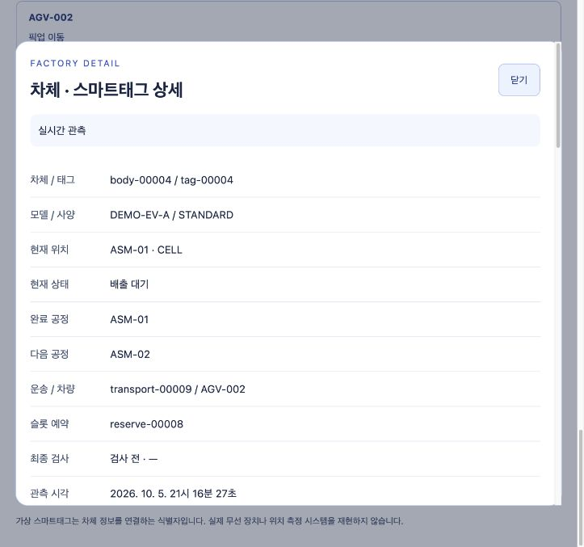

# S08 장애·복구 통합 검증

> 검증일: 2026-10-05 · Asia/Seoul · P0 기능 정확성 검증  
> S08-01~04 완료. 최종 성공 실행과 별도 실제 브라우저 실행을 구분한다. S09 성능 측정은 별도다.

[작업33/S08-01](<../work-notes/작업 33. S08-01 만석·예약 반환과 셀 정지·정상화.md>) · [작업34/S08-02](<../work-notes/작업 34. S08-02 TCP와 브라우저 SSE 단절·복구.md>) · [작업35/S08-03](<../work-notes/작업 35. S08-03 서비스·DB 재시작과 지연·중복 사건.md>) · [작업36/S08-04](<../work-notes/작업 36. S08-04 100대 정상 순환과 차체·실행 격리.md>)

## 범위와 도구

[verify-recovery.py](../../scripts/verify-recovery.py)가 실제 Python 모델과 송신기를 실행하고, [verification_runtime.py](../../scripts/verification_runtime.py)가 **검증 전용 PostgreSQL 17.11·두 Java 서버**를 띄운다. 임의 loopback 포트와 새로운 runId를 사용한다. 개발용 Compose·기존 데이터·기존 볼륨을 재시작하거나 초기화하지 않는다.

Java 21 / Spring Boot 4.1.1 / JDBC / Flyway / PostgreSQL / Python 3.12 / Vue / Vite / ECharts / TCP NDJSON / REST·SSE를 그대로 사용한다. 새 라이브러리·운영 장애 API·DDL은 추가하지 않았다. 브라우저 단절 실험용 프록시는 Python 표준 라이브러리로 검증 프로세스 안에서만 동작한다.

## 재실행

캐시된 개발 도구가 준비된 프로젝트 루트에서 실행한다.

```sh
.build-cache/simulator-venv/bin/python scripts/verify-recovery.py
```

위 명령은 브라우저를 제외한 기능·장애 경계를 검증한다. 실제 브라우저 확인은 다음 명령으로 진행한다.

```sh
.build-cache/simulator-venv/bin/python scripts/verify-recovery.py --browser
```

`--browser`는 출력한 임시 URL을 실제 브라우저로 열어 정상→단절→복구를 확인하는 모드다. 자동으로 브라우저 통과를 주장하지 않는다. 출력한 증거 폴더의 `phase.json`을 읽고 해당 단계의 화면을 확인한 뒤 `UI.SSE_CONNECTED.continue`, `UI.SSE_INTERRUPTED.continue`, `UI.SSE_RECOVERED.continue` 파일을 순서대로 만든다. 단절 단계는 화면 연결 경고가 나타날 때까지 기다린다. 최종 gate 전에 `browser-proof.json`과 증거 파일을 저장해야 한다. 각 단계는 최대 600초이며, 대기 중에도 실제 source TCP 보고는 계속된다.

브라우저 증거 JSON에는 같은 `runId`, `connected`, `lastValuesRetained`, `screenDisconnected`, `sourceStillLive`, `recovered`, `selectionRetained`의 참값과 `screenshots` 파일명 목록을 기록한다. 각 값은 실제 DOM·화면과 서버 기록에 근거해야 한다. JSON을 작성한 후 값을 확인하고 마지막 gate를 만든다. gate를 먼저 만들면 미완성 증거를 읽어 실패할 수 있다.

## 실패를 구별하는 기대/실제 기준

| 지점 | 기대 결과 | 확인하는 실제 근거 |
|---|---|---|
| 출발 전 취소·반복 | 예약 한 번 반환, 출발지 차체 유지 | `cancel-return.json`, 원본 개수 비교 |
| 수집 commit 후 TCP ACK 유실 | 같은 원본 재전송, 중복 저장 없음 | `lost-tcp-ack.json`, 양쪽 DB 전체 원본 비교 |
| 수집 서비스 중단·재시작 | 연결 실패 동안 head 유지, 복구 후 ACK | `tcp-restart.json`, 수집 서버 1/2 세대 로그 |
| 수집 DB 접속 불가 | readyz 503, 성공 ACK 없음, head 유지 | `ingestion-db-outage.json`, 송신 오류 로그 |
| 관제 서비스 중단 | TCP 저장 성공과 업무 반영을 구별, outbox 대기 | `operations-stopped.json`, 서버 재시작 뒤 대기 소진 |
| 관제 재시작 후 새 보고 없음 | 새 epoch, 저장 위치 유지, RESTORING | `restoring.json`과 새 전체 보고 뒤 관측 |
| 관제 DB 접속 불가 | DB_UNAVAILABLE, outbox head/순번 유지 | `operations-db-outage.json`, 복구 뒤 DELIVERED |
| PostgreSQL 프로세스 중단·재시작 | 같은 데이터 보존, 재전송/전달 복구 | `postgres-restart.json`, 동일 data 디렉터리 |
| 12초 소스 보고 단절 | STALE→DISCONNECTED, 예약/위치 유지 | `source-stale.json`, `source-disconnected.json` |
| 브라우저 SSE만 단절 | 서버 보고 LIVE, 화면 마지막 값과 선택 유지 | 실제 Chrome DOM·JPEG·`sse-cut-result.json` |
| 목적 셀 DOWN 중 예약 AGV 도착 | W2/R1/A0→W3/R0/A0, 새 배출 금지 | `FULL_IN_TRANSIT.json`, `FULL_ARRIVED.json` |
| 알람 확인·반복과 실제 복구 | 확인은 물리를 바꾸지 않음, 최초 확인 정보 유지 | CELL_DOWN·SLOT_RELEASED의 상태/알람 비교 |
| 100대 정상 공정 | 작업300/검사100/운송400, PASS80/FAIL20 | run별 최종 JSON, 실제 DB와 모델 비교 |
| 검사·운송 원본 각각 10회 반복 | 사실/실적 증가 0 | DUPLICATE_RECEIVED와 재조회 건수 |
| 같은 tagId를 갖는 다른 run | 각 run의 5대와 100대가 섞이지 않음 | run별 태그·현재 상태·누적 검사 조회 |

두 DB의 개별 장애는 `ALLOW_CONNECTIONS false`와 해당 DB의 기존 연결 종료로 재현한다. **이 전용 클러스터에만** 적용한다. PostgreSQL 전체 프로세스 재시작도 별도로 확인한다. 서버 프로세스는 자기 PID 그룹만 종료한다. 데이터는 성공·실패 모두 남기고 프로세스와 임시 소켓만 정리한다. 자격 정보 파일은 0600이며 공유하지 않는다.

## P0 사례 대응표

새 검증을 모든 테스트의 반복 실행으로 늘리지 않는다. 변경 없는 기능은 이전 단계의 완료 기록을 재사용한다. 다음 표의 ‘기존’은 이번에 다시 실행했다는 뜻이 아니다.

| 기획서 ID | 기대/실제 확인 | 근거/범위 |
|---|---|---|
| T-01 | 정상 순환·투입 상한 뒤 잔여 공정 완료 | S08 실제 100대, 기존 S02 maxBodies 경계. 실시간 5분 부하/성능 조건은 S09에 남김 |
| T-02 | 목적 ASM-02 DOWN, 만석일 때 상류 배출 차단 | S08 목적 셀 정지/도착/상류 BUFFER_FULL |
| T-03 | 검사 원본 10회 반복, 집계 1회 | S08 실제 TCP 중복 원본 |
| T-04 | 다른 eventId의 같은 검사 ID, fact 유지 | S08 선택 실행한 Java 지연/중복 통합 메서드 |
| T-05 | 같은 eventId의 다른 payload 충돌 | 기존 S03 EventStoreTests의 commitDuplicatesConflictsAndNewOnlyCaps |
| T-06 | 오래된 고유 snapshot은 이력 저장, 현재 유지 | S08 선택 Java 메서드 |
| T-07 | 늦은 고유 검사와 구간 집계 정정 | S08 선택 Java 메서드, commit fence도 유지 |
| T-08·09 | 12초 보고 단절 후 같은 위치·예약 유지, 새 보고 후 LIVE | S08 freshness/TCP 재시도 |
| T-10 | 끊긴 브라우저의 최신 묶음 재접속·정리 | S08 실제 Chrome, 기존 S06 StreamIntegrationTests의 emitter 정리 |
| T-11·12·17 | 확인해도 활성, 미확인 정상화, 반복 확인 최초 정보 유지 | S08 ASM-01 확인/반복/복구, ASM-02 미확인 복구 |
| T-13 | 0건의 비율 null/—, 검사 표본 표시 | 기존 S04 집계 및 S07 실제 품질 화면 |
| T-14 | UTF-8 부분·결합·초과 프레임과 deadline | 기존 S03 ReceiverUnitTests/실제 TCP 검증 |
| T-15·16 | DB 저장 실패·서버 재시작 책임 구분 | S08 양 서비스·개별 DB·PG 프로세스와 RESTORING |
| T-18 | run 이벤트/화면 격리 | S08 실제 두 run, 기존 S06/S07 feed 순서 검증 |
| T-19·20·21 | W+R 만석, 예약 도착, 실제 셀 진입 반환 | S08 각 단계 모델/관제 비교, 기존 S07 GUI 동일 규칙 |
| T-22 | 마지막 한 슬롯 경쟁 시 승인 한 건 | 기존 S02 DispatchTests의 last_slot_w_plus_r_capacity_and_idempotent_allocation |
| T-23 | 출발 전 취소 반복에도 반환 한 번 | S08 정상 등록 차체의 실제 취소 |
| T-24 | 지연/12초 단절에도 예약 자동 만료 없음 | S08 예약 상태에서 장애 전후 비교, 기존 S02 이동 지연 |
| T-25 | 도착 반복에도 차체·슬롯·실적 불변 | S08 완료 운송 원본 10회, 기존 S02 중복 인계 명령 |
| T-26 | 동일 태그의 셀→AGV→Bay·검사 조회 | 기존 S07 실제 지도/상세와 S08 선택 보존 |
| T-27 | 미등록 태그/중복 태그 거부와 run 격리 | 기존 S04 404/태그 모순, S08 두 run 조회 |
| T-28 | 부품 AMR·빈 귀환이 차체 W/R에 포함되지 않음 | S08 실제 AMR 포함 P0, 기존 S02 독립 부품 경계 |
| T-29 | 소유자/slot 모순을 현재 상태로 적용하지 않음 | 기존 S04 ModelRules/rollback 검증 |
| T-30 | 결과 구역 도착 이후 검사 실적 유지 | S08 실제 100대의 GOOD/HOLD·100 fact |
| T-31 | 늦은 REST가 최신 SSE/선택을 되돌리지 않음 | 기존 S06/S07 Node 경계, S08 실제 재접속 선택 유지 |
| T-32 | 프레임 상한에서 상태를 자르지 않고 실패 | 기존 S03 프레임 거부/송신 예산 경계. S08 100대 원본 최대 크기도 기록 |

기존 상세 설명: [S02 시나리오](<../work-notes/작업 14. 취소와 장애 복구 및 공장 모델 검증.md>), [S03 저장](<../work-notes/작업 17. S03-03 원본과 전달 대기 저장 및 ACK.md>), [S04 상태/이력](<../work-notes/작업 20. S04-02 차체·태그와 업무 이력 및 최신 상태.md>), [S05 복구](<../work-notes/작업 25. S05-03 재시작 복구와 전달 진단·재개.md>), [S06 SSE](<../work-notes/작업 27. S06-02 REST와 SSE 전체 상태 연결.md>), [S07 조회 순서/접근](<../work-notes/작업 32. S07-04 선택·조회 순서와 모바일·키보드 접근.md>).

## 최소 검증과 한계

최종 성공한 통합 실행과 기존 Java의 관련 메서드 두 개를 사용한다. 전체 Java/Python/Node 테스트를 반복하거나 같은 구현을 따라 하는 테스트를 추가하지 않는다. 검증 도구의 실패도 기록하고 수정 후 최종 성공 증거와 구별한다.

100대는 차체 수이고 차량은 AGV2/AMR1이다. 빠르게 진행한 논리 공정의 정확성을 확인한다. 실제 시간의 5분 입력, events/s·p95·화면 FPS·장시간 느린 네트워크 수치는 S09에 남는다. Python 프로세스 비정상 종료 후 메모리 대기 목록 복원은 보장하지 않는다. 수집 ACK 이후의 outbox는 DB 영속 기록으로 복구한다.

## 최종 실행 기록

최종 성공 결과는 [result.json](../../.build-cache/recovery-verification/05f6bac4de3e4011be194b0719399d10/result.json), 로그는 [s08-recovery-complete.log](../../.build-cache/s08-recovery-complete.log)다. `ownedProcessesStopped=true`, `retainedDatabase=true`, `runIsolation=true`, `browserVerified=true`, `performanceBenchmark=false`다.

| 실행 | 실제 값 |
|---|---|
| 예약/장애 P0 | `run-20261005-13167991377946e691a395f45fe65c46`, 원본216건, 최대 frame5,630바이트, 작업15/검사5/운송22, PASS4/FAIL1 |
| 100대 정상 공정 | `run-20261005-88b0c450e944469684a17e9fb0fe76e6`, 원본3,533건, 최대 frame45,147바이트, 2,764 tick, 중간 snapshot28개+최종, 작업300/검사100/운송400, PASS80/FAIL20 |
| 실제 Chrome SSE component | `run-20261005-7c9ec070fab84bf4a5a6573ca5695242`, 별도 `879a42e635de47bbb131e7612c2a831f` 폴더, SSE만1회 단절·31회 접속 요청, sourceSeq 증가/LIVE와 화면 경고·선택/예약/위치 보존·복구 확인 |
| 지연/중복 Java | `late-facts-tests.log`, 선택2개 / failures0 / errors0 / skipped0 |

5대 운송22건은 정상 차체20건, 취소1건, 부품1건이다. 100대 검증은 실제 TCP/HTTP/두 DB/REST와 Python 모델을 비교했으며, 100대를 브라우저에서 직접 조작한 결과로 기록하지 않는다. 브라우저 SSE와 선택 보존은 위 소수 차체의 **별도 component** 증거다. 변경 없는 같은 Vue/연결 코드이며 최종 JSON의 `browserReference`로 실행 번호와 경로를 명시했다.

최종 실행 명령은 다음과 같다. 이미 확인한 브라우저 component의 재실행을 줄이기 위해 증거 JSON·실제 DOM·캡처와 단절 결과를 확인한 뒤 재사용한다. 기본 `--browser`는 새 브라우저 확인을 요구한다.

```sh
.build-cache/simulator-venv/bin/python scripts/verify-recovery.py --browser-evidence .build-cache/recovery-verification/879a42e635de47bbb131e7612c2a831f
```



중간 실패3회도 별도 DB/로그/원본을 보존한다. `b54f77aa…`는 검증 도구의 해시 필드 참조 오류, `317f9458…`는 실제 선택이 유지됐지만 증거 문자열 판정/저장 순서가 잘못된 경우, `879a42e6…`는 SSE component와5개 물리 단계는 통과했으나 취소 후 새 운송의 시작 명령을 시나리오에서 누락해 전체 run이 끝나지 않은 경우다. 마지막 실행의 전체 실패를 성공으로 집계하지 않고 **이미 통과한 SSE component만** 재사용했다. 새 운송에 `start_transport`를 명시한 `05f6bac4…`에서 실제5대 종료와100대가 모두 통과했다. 수정은 검증 시나리오/도구에 한정하며 운영 모델·서버·Vue 코드는 바꾸지 않았다.

현재 개발용 Compose의 원본/볼륨은 그대로다. 검증 데이터 디렉터리는 성공·실패 모두 retained이며 개인정보/암호 파일은 공유하지 않는다. 다음은 S09-01이며 성능 목표의 실제 달성 여부는 아직 판정하지 않는다.
