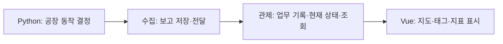

# 작업 1. 서비스 책임과 데이터 소유권

> 작업 ID: S00-01 · 작업일: 2026-10-04  
> 상태: 완료 — 서비스 책임과 데이터 소유권 설계  
> 이 문서는 웹개발을 처음 접하는 사람을 위한 작업별 설명과 결과 기록이다.

## 1. 이번 작업은 무엇인가

이번에는 **어느 프로그램이 무슨 일을 하고, 어떤 데이터를 관리하는지** 정했다. 실제 서버 코드를 만들기 전에 업무 담당을 정한 것이다. 결정은 [ADR-001](<../decisions/ADR-001-서비스 책임과 데이터 소유권.md>)에 기록했다. ADR은 중요한 설계 선택과 그 이유를 남기는 문서라는 뜻이다.

예를 들어 ASM-01에서 조립한 차체를 ASM-02로 보내려면 누군가 목적지의 여유 슬롯을 확인하고, 차량을 확보하고, 예약해야 한다. Python·Java·화면이 각각 이 결정을 하면 같은 빈 칸을 서로 다른 차체에 약속할 수 있다. 그래서 **공장 동작의 결정은 Python만 담당**하고, Java는 그 결과를 수집·검증·보관·조회하도록 정했다.

이 작업의 결과는 책임표와 설계 문서다. 아직 실제 서버나 DB가 실행되는 단계는 아니다. 계획 전체 중 첫 세부 작업을 완료했으며, S00의 나머지 계약 작업은 후속 작업으로 남아 있다.

## 2. 먼저 알아두면 좋은 용어

| 용어 | 쉬운 설명 | 우리 프로젝트의 예 |
|---|---|---|
| 프론트엔드 | 사용자가 브라우저에서 보고 누르는 화면 쪽 프로그램 | Vue의 공장 지도·태그 상세·알람 버튼 |
| 백엔드 | 화면 뒤에서 요청을 받고 기록을 저장·조회하는 프로그램 | Spring 수집 서비스와 관제 서비스 |
| 서버 | 여기서는 요청을 기다리고 처리하는 실행 중인 프로그램 | 한 PC에서도 Spring 서버 2개를 따로 실행 가능 |
| 서비스 | 정해진 책임을 맡고 별도로 실행할 프로그램 단위 | 사건을 접수하는 수집 서비스 |
| DB | 프로그램이 기록을 저장하고 나중에 찾는 저장소 | 검사 결과와 마지막 공장 상태를 보관하는 PostgreSQL DB |
| 표/테이블 | DB 안에서 같은 종류의 기록을 모아 둔 곳 | `inspection_result`는 검사 결과 표 |
| API | 다른 프로그램에 무엇을 어떻게 요청할지 정한 약속 | 화면이 차체 상세를 요청하면 관제가 응답 |
| 이벤트/사건 | 어떤 일이 발생했다는 보고 | 차체 등록·작업 완료·차량 도착 |
| 스냅샷 | 특정 시점의 상태를 한 묶음으로 찍은 보고 | 차체·셀·Bay·AGV의 같은 시점 상태 |
| MSA | 여러 작은 서비스를 따로 실행하고 통신으로 연결하는 구조 | 수집 서버와 관제 서버를 분리 |

‘서버’라는 말이 꼭 컴퓨터 한 대를 뜻하는 것은 아니다. 이번 개발에서는 같은 PC에서 Python, Spring 앱 2개, Vue 화면을 구동해도 각각 역할과 실행을 구분한다.

## 3. 네 프로그램의 역할

### 3.1 Python — 가상 공장 자체

Python이 차체를 만들고 태그를 붙이며, 셀 작업과 차량 이동을 진행한다. 어느 Bay가 비었는지 확인하고, 예약·픽업·도착·슬롯 반환을 결정한다. 검사 결과도 가상 공장 규칙에 따라 발생시킨다.

즉 ‘지금 차체가 실제로 어디에 있는가’의 기준은 이 가상 모델이다. Java나 브라우저 화면이 슬롯을 임의로 비워 공장의 동작을 바꾸지 않는다.

### 3.2 수집 서비스 — 공장의 보고서를 접수하는 곳

Python이 보낸 사건을 받아 메시지 형식과 중복을 확인한다. 받은 원문과 ‘관제 서비스에 전달해야 한다’는 기록을 자기 DB에 함께 저장한다.

공장의 보고를 **받아서 보존하고 전달하는 책임**이다. 이 단계의 저장 확인 답장을 받았다고 브라우저 화면까지 갱신됐다는 뜻은 아니다.

### 3.3 관제 서비스 — 운영자가 볼 수 있는 기록으로 정리하는 곳

수집 서비스가 전달한 사건의 차체·슬롯 관계를 검증하고, 검사·작업·운송 이력과 최신 상태를 저장한다. 검사 결과로 생산량과 불량률을 계산한다. 화면이 태그를 검색하면 차체 정보를 찾아 응답하고, 새 관측 상태를 화면으로 보낸다.

운영자가 ‘알람 확인’을 눌렀다는 기록도 여기에 저장한다. 확인 버튼은 고장 셀을 고치거나 예약을 해제하는 버튼이 아니다.

### 3.4 Vue 화면 — 정리된 정보를 보여 주는 곳

지도·버퍼 카드·태그 창·그래프로 관제 서비스의 정보를 보여 준다. 검색어, 선택한 셀, 펼친 창 같은 화면 상태는 직접 관리한다.

차량이 부드럽게 움직이도록 위치를 이어 그릴 수 있지만, 이 애니메이션이 실제 슬롯이나 차체 위치를 결정하지는 않는다. 연결이 끊기면 마지막 관측 상태를 보여 주고, 공장이 계속 정상이라고 임의로 가정하지 않는다.

## 4. 차체 한 대로 전체 흐름 이해하기

다음은 정한 책임에 따른 예시이며 아직 실행된 본 시스템의 기록은 아니다.

1. Python에서 `body-00001`의 ASM-01 조립이 끝난다. ASM-02 Bay가 대기 2대+예약 1대로 3칸을 채웠으므로 새로 배출하지 않는다. 차체는 ASM-01에 남는다.
2. Python은 작업 완료 사건과 차체·셀·슬롯의 상태 보고를 만든다.
3. 수집 서비스는 보고 원문과 전달 대기를 DB에 보관한다. 저장을 마치면 Python에 확인 응답을 보낸다.
4. 수집 서비스가 관제 서비스에 사건을 전달한다. 관제 서비스는 내용을 검증하고 마지막 관측 상태와 이력을 자기 DB에 반영한다.
5. Vue가 받은 상태를 지도와 태그 창에 표시한다. 사용자에게 ‘ASM-01 배출 대기 / 목적지 여유 0칸’이 보인다.
6. 이후 Python에서 예약 차량이 Bay에 도착하면 대기 3+예약 0이 된다. 여유는 계속 0이다. Bay 차체 1대가 셀에 들어가야 슬롯이 반환되고, Python이 다음 배차를 승인할 수 있다.

이 과정에서 **판단은 Python, 접수/전달은 수집, 검증/조회는 관제, 표시는 Vue**가 맡는다.



이 프로그램들은 다음 방식으로 연결한다. 자세한 메시지 내용은 이후 계약 작업에서 정한다.

| 연결 방식 | 쉬운 설명 | 사용하는 구간 |
|---|---|---|
| TCP / NDJSON | 연결을 유지하며 JSON 보고서를 한 줄씩 보내는 방식 | Python이 수집 서비스에 사건을 보고 |
| REST | 정해진 주소로 요청하고 결과를 응답받는 방식 | 수집→관제 전달, 화면→관제 조회·알람 확인 |
| SSE | 화면이 연결해 두면 서버가 새 정보를 보내 주는 방식 | 관제가 화면에 최신 관측 상태를 전달 |

## 5. 왜 DB를 두 개로 나누는가

수집 서비스에는 접수한 원문과 전달 목록이 필요하고, 관제 서비스에는 검사·공정·현재 상태와 조회용 기록이 필요하다. 두 서비스가 같은 표를 직접 수정하면 어느 쪽이 책임지는지 불분명해진다. 한쪽이 표 구조를 바꾸면 다른 쪽의 코드에도 영향을 줄 수 있다.

그래서 PostgreSQL 안에 두 DB와 서비스별 계정을 만들기로 정했다. 같은 DB 서버 프로그램 안에서도 저장 공간과 접근 권한을 구분할 수 있다. 실제 생성과 권한 확인은 S01에서 한다.

| 저장소 | 담당 서비스 | 대표 기록 |
|---|---|---|
| `ingestion_db` | 수집 | `raw_event`: 받은 원문 / `event_outbox`: 전달 대기 |
| `operations_db` | 관제 | `factory_snapshot`: 마지막 관측 상태 / `inspection_result`: 검사 결과 / `alarm`: 고장·확인·복구 |

다른 서비스의 정보가 필요하면 정해진 통신 약속으로 받는다. 관제 서비스가 수집 DB에 직접 들어가 원문을 조회하지 않는다. 화면도 DB에 바로 들어가지 않고 관제 API를 사용한다.

공장에 있던 차체와 DB 안에 있던 차체 기록도 구분해야 한다. Python이 물리 모델을 만들고, 관제 DB의 `body`는 그 차체를 조회할 수 있도록 등록한 기록이다. DB 기록의 관리자가 관제라고 해서 관제가 차체를 움직이는 것은 아니다.

## 6. 전달 대기 기록은 왜 필요한가

수집 서비스가 원문을 저장한 직후 관제 서비스가 멈췄다고 생각해 보자. ‘원문을 저장했음’만 남아 있고 무엇을 아직 전달하지 않았는지 모르면 복구 후 처리를 이어가기 어렵다.

**outbox는 아직 전달할 책임이 남아 있다는 DB 기록**이다. 수집은 원문과 이 기록을 함께 저장하고, 이후 관제로 전달한다. 관제가 다시 실행되면 남은 기록을 재전달할 수 있도록 설계한다.

여기서 트랜잭션은 여러 저장 작업을 함께 성공시키거나 함께 취소하는 묶음이다. 원문만 저장하고 전달 책임이 빠지는 상황을 막기 위해 둘을 한 묶음으로 처리한다. 구체적인 저장과 재시도 코드는 후속 작업에서 구현한다.

관제가 저장을 마쳤는데 응답만 끊기면 같은 사건을 다시 받을 수 있다. 관제는 처리한 사건 기록을 확인해 검사나 생산량을 다시 올리지 않아야 한다. 이를 멱등 처리라고 부른다. **반복 전달될 수 있지만 업무 결과를 반복해서 만들지 않는 것**이다.

이번에 확정한 것은 이 책임의 위치다. ACK 응답 이름·JSON 필드·전달 순서와 오류 정책은 다음 계약 작업에서 정한다.

## 7. 이번에 확정한 결정

| 결정 | 의미 |
|---|---|
| Spring 서비스는 수집·관제 두 개 | 각각 실행·검증하되 셀·태그·슬롯마다 서버를 늘리지 않음 |
| 예약과 공장 상태는 Python이 변경 | 여러 프로그램이 같은 마지막 슬롯을 독립적으로 승인하지 않음 |
| 원문/전달 대기는 수집 DB | 수집 저장 후에도 전달 책임을 추적 |
| 현재 관측 상태/검사/알람은 관제 DB | 화면에 필요한 상태와 이력을 한 서비스에서 제공 |
| 조회·알람 확인은 관제 API | 화면이나 다른 서비스가 관제 DB를 직접 변경하지 않음 |
| 기존 기술 스택 유지 | 이미 정한 Java·Spring·PostgreSQL·Vue·Python과 통신 방식을 사용 |

이 결정의 상세 책임표·각 DB 표의 소유자·통신 경계는 [ADR-001](<../decisions/ADR-001-서비스 책임과 데이터 소유권.md>)에서 확인할 수 있다.

## 8. 작업 결과와 최소 검증

### 수행한 작업

- ADR-001에 서비스 책임, 모든 계획상 영속 표의 소유자와 통신 경계를 기록했다.
- 단계별 계획에서 S00-01을 완료로 바꾸고, S00 전체는 진행 중으로 표시했다.
- 이 설명 파일을 작성하고 README와 계획에서 찾아갈 수 있도록 연결했다.

### 확인한 것

이번에는 설계 문서만 바뀌므로 서비스/DB 실행이나 GUI 자동 테스트는 수행하지 않았다. 사용자 당부에 따라 필요한 문서 검토만 수행했다.

- 계획·기획서와 비교해 물리 상태 변경 권한과 DB 사본의 관리 책임이 일치하는지 검토했다.
- 기획서의 영속 표 15개가 설계 결정의 소유권 표에 빠짐없이 있으며 각각 한 관리 DB를 갖는지 확인했다.
- 변경 문서 4개의 로컬 링크 20개와 코드 블록의 닫힘, S00-01만 완료이고 S00은 진행 중인지를 한 번 확인했다.

문서 확인용 임시 스크립트의 실행 명령은 `python3 /private/tmp/factory-s00-01-doc-check.py`다. 별도 서비스 테스트를 추가하지 않고 로컬 링크·표 소유권·진행 상태만 확인했으며, 결과는 다음과 같다.

```text
PASS: 4 documents, 20 local links, 15 table owners; only S00-01 complete, S00 in progress.
```

### 작업 기록

| 항목 | 결과 |
|---|---|
| 작업 상태 | 설계 결정과 필요한 문서 확인 완료 |
| 변경 파일 | ADR-001, 이 작업 설명, 단계별 개발 계획, 루트 README |
| 핵심 근거 | 물리 변경은 Python, 영속 표는 서비스별 한 DB/관리자, GUI는 API로 조회 |
| 검증 범위 | 책임/소유권 문서 검토와 로컬 링크·진행 상태 확인만 |
| 검증 결과 | 통과 — 로컬 링크 20개 정상, 영속 표 15개 소유권 일치, S00-01만 완료 표시 |
| 실행하지 않은 것 | 서비스 기동·DB 권한·네트워크·중복/복구 실행 검증. 후속 작업 범위 |
| 소스 코드 변경 | 없음 — 이번 작업은 책임과 데이터 소유를 정하는 설계 작업 |
| 다음 작업 | S00-02: 식별자·시각·순번·이벤트 규격과 예제 정의 |

## 9. 다음 작업과 무엇이 다른가

이번에는 ‘누가 어떤 데이터를 맡는가’를 정했다. 다음 S00-02에서는 프로그램끼리 같은 사건을 이해할 수 있도록 **어떤 ID를 쓰고, JSON 보고서에 어떤 항목을 넣고, 발생 시각과 순번을 어떻게 표현할지** 정한다.

그 후 S00-03~04에서 저장 확인·전달 오류·조회/스트림 약속을 완성하고, S01에서 실제 서비스와 DB의 실행 기반을 만든다. 다음 작업도 `작업 2. … .md`처럼 번호를 이어가며 수행한 내용과 의미를 설명한다.
