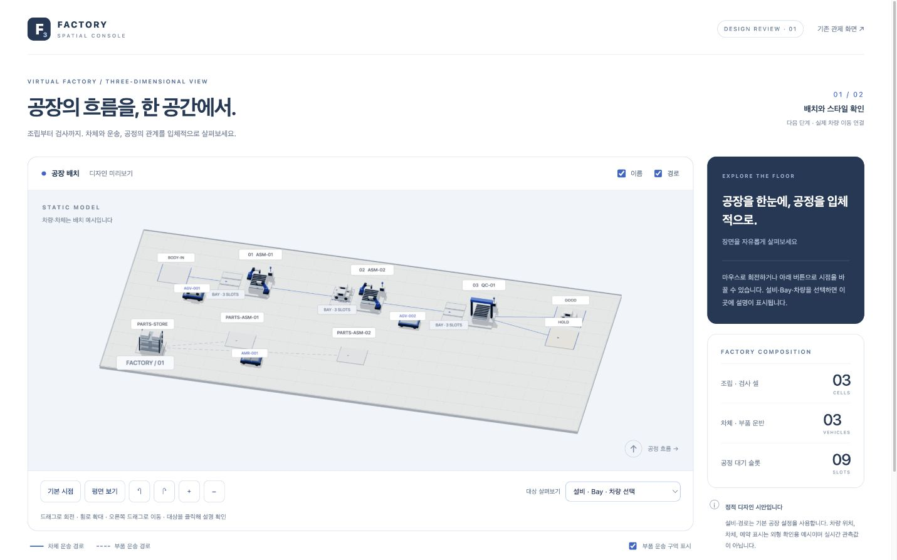

# 작업 43. 3D 정적 공장 시안과 1차 확인

> 2026-10-10 · 1차 사용자 확인 대기 · 실제 상태·차량 이동 연동은 다음 단계

## 이번 결과

기존 Vue 앱에 Three.js 0.186.1을 추가하고, 별도의 정적 디자인 미리보기와 기존 화면의 2D/3D 전환을 구현했다. 사용자가 요청한 첫 확인 지점인 배치·시점·색감·모델 스타일을 직접 살펴볼 수 있다.

```sh
scripts/console.sh dev --port 5174
# http://127.0.0.1:5174/?preview=3d
```

기존 5173 관제 서버를 유지한 채 5174 개발 서버를 열었다. 실행 중인 서버의 보관된 공장 설정과 관측값을 읽어 2D 회귀를 확인했으며 새 생산 실행을 만들거나 DB를 변경하지 않았다.



## 화면과 코드

- `src/SceneReview.vue`: 1차 확인 전용 화면. 정적 예시임을 표시하고 서버 연결을 만들지 않는다.
- `src/components/FactoryScene3D.vue`: 장면 생성·해제, 이름·경로 표시, 카메라·대상 선택, 오류 안내.
- `src/scene3d/factory-scene.js`: 공장 배치, 경로, 카메라, Raycasting 선택, 조명·그림자, 정적 모델 조합.
- `src/scene3d/models.js`: 도형으로 만든 조립 로봇·검사 게이트·AGV·AMR·차체·부품 선반과 GPU 자원 정리.
- `src/scene3d/coordinates.js`: 원본 `(x,y)`를 바닥 `(X,Z)`로 바꾸는 균일 축척. 원본 좌표에 물리 단위가 없어 실측 미터라고 표시하지 않는다.
- `src/scene3d/review-layout.json`: Python 기본 설정의 `config`를 2026-10-10에 복사한 디자인 기준. 독립 콘솔 Docker 빌드 범위 안에 두었다. 기본 공장 설정을 변경하면 이 디자인 기준도 갱신해야 한다.
- `src/App.vue`: 기본 2D를 유지하면서 정적 3D 배치와 디자인 시안 진입 경로 추가.
- `src/main.js`: 미리보기 진입은 실제 App과 분리해 로드한다. Three.js 장면은 비동기 컴포넌트로 로드한다.

위 `src/`는 `services/factory-console/` 기준이다. 외부 유료·다운로드 모델 없이 코드로 형태를 만들었다. Blender·GLB 자산은 아직 추가하지 않았다.

## 표시 의미

미리보기의 설비·위치·경로·슬롯 개수는 기본 설정을 따른다. AGV/AMR 위치, 차량 위 차체, ASM-02 Bay의 차체 2대와 예약 표현은 외형 확인용 예시다. 실제 원본 사건·SSE 관측값이 아니며 서버나 DB에 저장하지 않는다.

기존 관제 화면의 3D 보기는 선택한 실행의 layout에서 정적 설비와 경로를 만든다. 이 경로에는 예시 차량·차체를 추가하지 않는다. 설비 동작과 슬롯 점유는 아직 연결 전이라는 안내를 표시한다.

## 확인한 내용

- `scripts/console.sh build`: 성공. Three.js 포함 3D 청크 약582kB, gzip 약147kB로 분리됨. 기존 ECharts와 3D 청크의 500kB 안내는 남아 있다.
- `scripts/console.sh test`: 기존 7개 테스트 통과. 첫 시도는 sandbox의 loopback listen 제한으로 실행기 테스트만 실패했으며 허용된 로컬 환경에서 다시 실행해 완료했다.
- 실제 Chrome에서 정적 3D 렌더링, 평면·기본 시점, 확대, 설비 직접 클릭, 차량 드롭다운 선택, 부품 구역 숨김·복원, 이름 숨김·복원을 확인했다.
- 데스크톱 실제 CSS 크기 1440×900에서 전체 공장 배치와 오른쪽 정보 패널을 확인했다. 화면 배율을 반영해 viewport를 조정한 뒤 실제 `innerWidth/innerHeight`를 확인했다.
- 좁은 화면 실제 CSS 크기 390×844에서 document scrollWidth=clientWidth=381로 가로 넘침이 없음을 확인했다. 전체 공장은 작게 표시되므로 확대·대상 목록을 이용한다.
- 기존 서버의 보관 실행에서 2D 화면의 GOOD 4대/HOLD 1대, 현재 슬롯, 태그 목록이 계속 표시됨을 확인했다.
- 같은 실행에서 정적 3D 전환 시 장면 캔버스 1개, 2D 복귀 시 0개를 확인했다. 깊은 GPU 메모리 누수나 FPS 측정까지 수행한 결과는 아니다.
- 초기 PCFSoftShadowMap 경고는 현재 Three.js의 PCFShadowMap으로 수정했다. 이후 페이지의 오류 로그는 없었다.
- `git diff --check`: 통과.

## 현재 한계와 다음 단계

실시간 차량 이동·상태·알람, 적재 전환, 보간, 단절·복구 애니메이션은 미구현이다. 정적 시안의 로봇팔 자세는 실제 설비의 운동학을 재현하지 않는다. WebGL 실패 안내와 context-loss 처리 코드는 있으나 실제 그래픽 장애 주입 시험은 수행하지 않았다.

사용자가 **배치·시점·모델·색감**을 확인하면 의견을 반영한 뒤 실제 상태와 차량 이동을 연결한다. 두 번째 실행 화면에서 **이동·가독성·조작**을 다시 확인받는다.

## 사용자 확인 결과

사용자가 색감과 스타일을 승인하고 다음 단계 진행을 요청했다. AGV별 1인칭 카메라는 추후 추가하기로 했다. 이후 추가 요청한 설비 관통 금지·차량 중첩 금지·회피 주행을 2차 확인 범위에 포함했다.
