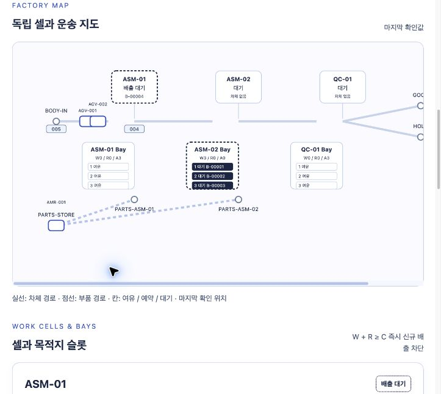
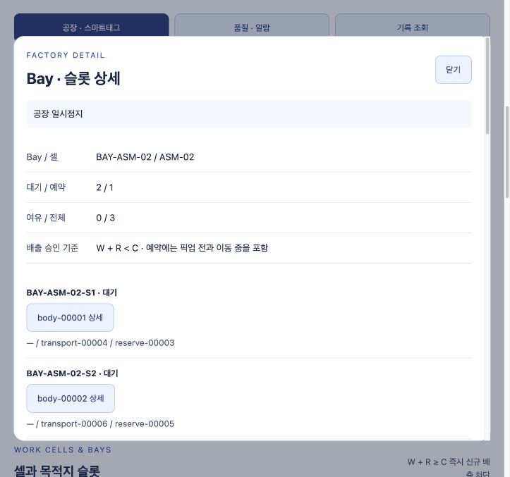
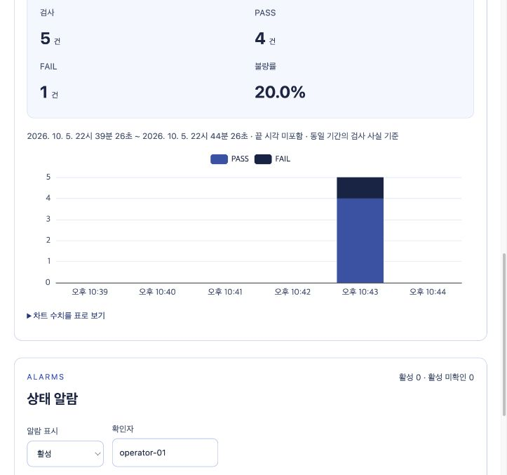
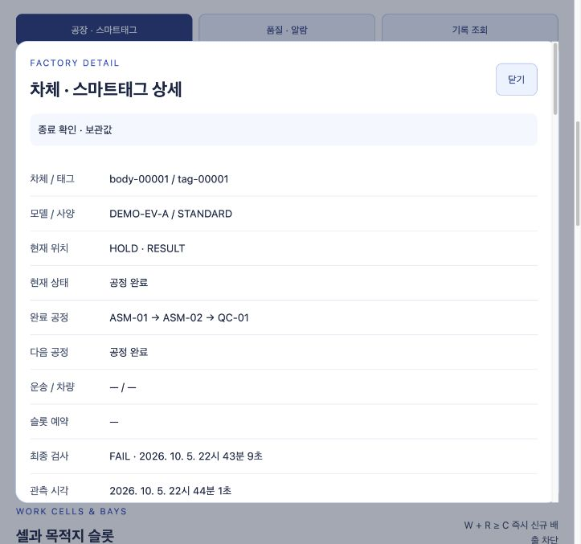

# 가상 제조공장 실시간 통합 관제 시스템 — 기능 설명 및 시연 시나리오

> 문서 버전: v1.0 · S09 완료 상태 기준  
> 대상: 프로젝트를 처음 보는 관람자와 직접 설명·시연할 발표자  
> 실제 관제 화면: `services/factory-console` · 기본 주소: http://127.0.0.1:5173

이 문서는 먼저 기능을 이해하고, 실제 화면에서 무엇을 눌러 무엇을 보여 줄지 정하기 위한 설명서입니다. 1~3장은 관람자에게 설명할 내용, 4~6장은 발표 준비와 시연 순서, 7~10장은 보충 시연·문제 대처·예상 질문·점검표입니다. 발표할 때는 6장의 순서를 따라가면 됩니다.

이미 준비된 [21초 단계 영상](docs/development/s09-demo/s09-stage-playback.mp4)과 실제 캡처만으로도 설명할 수 있습니다. 직접 실행하려면 4~5장을 먼저 읽습니다. 서비스 설치와 장애 검증의 자세한 명령은 [기존 실행 안내](<docs/development/초기 실행·재실행·복구·시연.md>)에 있습니다.

## 1. 이 프로젝트를 30초 안에 소개하기

### 발표자가 처음 할 말

> “이 프로젝트는 독립된 작업 셀 사이에서 운반 차량이 차체와 부품을 옮기는 가상 제조공장을 관측하는 시스템입니다. 차체에 붙인 가상 스마트태그로 현재 위치와 공정·검사 결과를 찾고, 다음 셀의 대기 공간이 가득 차면 앞 셀에서 차체를 내보내지 않도록 합니다. 지금부터 차체가 이동하는 과정, 예약을 포함한 만석 판단, 고장과 복구, 최종 검사 결과를 보여 드리겠습니다.”

관람자가 가장 먼저 이해하면 좋은 질문은 다음 세 가지입니다.

- **이 차체는 지금 어디에 있고, 어떤 공정을 마쳤는가?** → 지도와 스마트태그 상세.
- **조립은 끝났는데 왜 다음 공정으로 못 가는가?** → 목적지 슬롯과 배출 대기 이유.
- **검사가 몇 건 끝났고, 이상은 무엇이었는가?** → 품질·알람과 사건 기록.

### 공장 구성과 차체의 여정

현재 기본 시연은 **작업 셀 3개·차체 운반 AGV 2대·부품 운반 AMR 1대**입니다. 주요 시연에서는 차체 5대를 등록합니다.

| 대상 | 이름 | 역할 |
|---|---|---|
| 투입 구역 | BODY-IN | 아직 첫 공정에 들어가지 않은 차체가 기다립니다 |
| 첫 조립 셀 | ASM-01 | 첫 번째 조립 작업을 합니다 |
| 두 번째 조립 셀 | ASM-02 | 다음 조립 작업을 합니다 |
| 검사 셀 | QC-01 | 최종 검사와 PASS/FAIL 결과를 기록합니다 |
| 결과 구역 | GOOD / HOLD | PASS 차체와 FAIL 차체가 각각 도착합니다 |
| 셀 앞 대기 공간 | BAY-ASM-01 / BAY-ASM-02 / BAY-QC-01 | 셀에 들어가기 전 대기하거나 도착할 자리를 예약합니다 |
| 차체 차량 | AGV-001 / AGV-002 | 차체를 적재하고 공정 사이를 운반합니다 |
| 부품 차량 | AMR-001 | 부품 kit를 부품 보관 구역에서 셀의 부품 인계 지점으로 운반합니다 |

차체는 **투입 → 첫 조립 → 두 번째 조립 → 최종 검사 → GOOD 또는 HOLD** 순서로 진행합니다. 공정 사이에는 AGV 운송과 Bay 대기가 있습니다. Bay에 도착하는 일과 실제 작업 셀에 들어가는 일은 서로 다른 동작입니다.

AMR의 부품 운송은 차체 운송과 구분합니다. 부품 kit를 운반했다고 차체 한 대가 생산되거나 차체 Bay 슬롯이 점유된 것으로 계산하지 않습니다.



*위 지도는 S07 당시의 실제 연결 화면입니다. 뒤에 사용하는 만석·품질·태그 캡처는 S09의 같은 새 실행에서 촬영한 별도 자료입니다.*

## 2. 먼저 알아둘 다섯 가지 개념

### 2.1 스마트태그는 차체의 정보를 여는 이름표

`tag-00001`은 `body-00001` 차체와 연결되는 가상 식별자입니다. 태그를 검색하거나 지도에서 차체를 선택하면 같은 차체 상세를 봅니다.

상세에는 현재 위치, 현재 상태, 완료 공정, 다음 공정, 운송·차량·예약 정보, 최종 검사와 관련 사건 이력이 있습니다. 예약이 생겼다고 차체가 이미 목적지에 도착한 것으로 표시하지 않습니다. 픽업 전에는 원래 셀에 있고, 적재가 끝나면 AGV에 있으며, 인계가 끝나야 목적지 Bay로 바뀝니다.

### 2.2 실행 ID는 이번 시연을 구분하는 번호

`runId`는 공장을 새로 실행할 때마다 생성되는 번호입니다. 여러 번 시연해도 각 실행의 차체·태그·품질 기록이 섞이지 않도록 합니다. 서로 다른 실행의 `tag-00001`을 같은 차체라고 설명하지 않습니다.

발표 중에는 **같은 실행 ID를 유지**합니다. 다른 실행을 선택하면 상세 선택이 초기화될 수 있으므로, 관람자가 보고 있는 차체도 다시 설명해야 합니다.

### 2.3 대기 공간은 ‘현재 대기 + 이미 약속한 자리’로 계산

| 화면 기호 | 의미 | 기본 ASM-02 Bay의 예 |
|---|---|---:|
| W — 대기 | 실제 Bay에 도착해 기다리는 차체 수 | 2 |
| R — 예약 | 픽업 전 또는 이동 중인 차체를 위해 확보한 자리 수 | 1 |
| C — 전체 | 해당 Bay가 수용할 수 있는 전체 슬롯 수 | 3 |
| A — 여유 | 새 차체를 추가로 받아 줄 수 있는 자리 수 | 0 |

**`A = C − W − R`**, **`W + R ≥ C`이면 신규 배차·배출을 차단**합니다.

> “눈에 보이는 빈칸이 하나 있어도, 그 자리가 이미 다른 차체에 예약돼 있으면 새 차체를 받을 수 없습니다.”

예를 들어 W2/R1/C3이면 A0입니다. 앞 셀에서 조립을 마쳤어도 새로운 차체를 AGV로 배출하지 못하고 셀 안에서 기다립니다. 이미 자기 자리를 예약한 AGV는 도착할 수 있습니다. 그 도착은 **W2/R1 → W3/R0** 전환이므로 여전히 만석입니다. Bay의 차체가 셀 안으로 들어가야 해당 슬롯이 반환됩니다.



### 2.4 ‘배출 대기’에는 서로 다른 이유가 있음

| 화면 문구 | 의미 | 시연에서 확인할 대상 |
|---|---|---|
| 목적지 슬롯 만석 | 다음 셀의 W+R이 C에 도달했습니다 | 목적지 Bay의 W/R/A/C |
| 빈 AGV 대기 | 자리는 있어도 현재 배차할 수 있는 AGV가 없습니다 | 차량의 적재·귀환·대기 단계 |
| 픽업 차량 대기 | 배차와 예약은 승인됐고 차량이 픽업을 진행합니다 | 예약과 배정된 운송, 실제 차체 위치 |

슬롯이 반환됐다고 즉시 차체가 이동해야 하는 것은 아닙니다. 차량이 귀환 중이면 빈 AGV를 기다릴 수 있습니다. 이 구분이 있어야 “왜 멈췄는가”를 설명할 수 있습니다.

### 2.5 화면은 관측값과 그 시점을 함께 보여 줌

화면 상단의 **브라우저 수신**, **공장 보고 시각**, **보고 나이**, **전달 대기**를 함께 봅니다. 서버가 실행 중이라는 사실만으로 공장 보고가 최신이라고 판단하지 않습니다.

여기서 **전달 대기 N건**은 서비스 사이에서 아직 반영되지 않은 *데이터 보고*의 수입니다. Bay의 대기 차체 W와 서로 다른 숫자입니다.

## 3. 화면에서 사용할 기능

| 영역 | 실제 조작 | 관람자에게 설명할 내용 |
|---|---|---|
| 실행 선택 | `목록 새로고침`, 실행 목록 선택 또는 `실행 ID` 입력 후 `관측 연결` | 이번 시연의 실행을 선택합니다 |
| 관측 상태 | 보고 시각·나이·연결·전달 대기 확인 | 최신 보고인지, 마지막 확인값인지 구분합니다 |
| 공장 · 스마트태그 | 지도에서 셀·Bay·차체·차량 선택 | 서로 연결된 대상의 현재 상태를 봅니다 |
| 셀과 목적지 슬롯 | 셀 이름, `Bay 슬롯 상세` 또는 `만석 · 신규 예약 차단` 선택 | 앞 셀의 대기 이유와 목적지 수용량을 연결합니다 |
| 차체와 가상 스마트태그 | `태그 · 차체 검색`에 번호 입력, 차체 카드 선택 | 특정 차체의 공정·위치·검사를 추적합니다 |
| 차체 상세의 관련 사건 이력 | 기간·사건 종류 선택, `기록 새로고침`, `사건 내용` 펼치기 | 현재 상태가 어떤 전환을 거쳐 만들어졌는지 설명합니다 |
| 품질 · 알람 | 조회 기간 선택, `품질 새로고침`, `차트 수치를 표로 보기` | 같은 기간의 검사·PASS·FAIL·불량률을 비교합니다 |
| 상태 알람 | `활성`/`복구됨`/`전체 최근 알람`, 확인자 입력, `알람 확인` | 발생·사람의 확인·실제 복구를 구분합니다 |
| 기록 조회 | `사건`/`알람`, 기간·종류·상태 선택, `기록 더 보기` | 과거 기록을 조건별로 찾습니다 |

지도·슬롯·차체 상세의 현재 값은 같은 관측 묶음을 사용합니다. 상세 이력과 기간별 품질은 별도 조회 기준 시각을 표시합니다. 과거 이력을 최신 상태와 똑같은 시각의 값이라고 설명하지 않습니다.

지도 배치 수정 이후 차량은 이름·상태·적재 정보가 있는 카드로 표시합니다. **카드의 연결선 끝 점이 실제 보고 위치**이고, 카드는 겹침을 피하도록 따로 배치합니다. BODY-IN/GOOD/HOLD는 차체 총수와 최대 4대의 개별 번호를 표시합니다. 5대 이상이면 나머지 대수를 안내하며, 아래 스마트태그 목록에서 전체 차체를 조회합니다. 이 문서의 S07/S09 캡처는 수정 전 화면을 촬영한 기존 자료입니다.

화면에서 공장의 배차·작업 시작·고장 복구를 직접 명령하는 버튼은 제공하지 않습니다. **공장 진행과 고장·복구는 Python 시뮬레이터가 결정**하고, 관제 화면에서는 상태와 기록을 확인합니다. 알람 확인은 화면에서 수행할 수 있습니다.

## 4. 시연 방식과 사전 준비

### 4.1 첫 발표에는 ‘자료 설명 + 단계별 실제 시연’을 권장

| 방식 | 준비 | 사용하기 좋은 상황 |
|---|---|---|
| 자료 설명 | 이 문서·실제 캡처·MP4 | 짧은 소개, 서버가 없는 장소, 실행 문제가 생겼을 때 |
| 단계별 실제 시연 | 개발 서비스·Python 환경·터미널 2개·관제 화면 | 만석/이동/고장 장면을 멈춰 자세히 설명할 때 |
| 차체 1대 정상 시연 | 같은 실행 환경 | 공정 이동·태그·PASS/GOOD만 짧게 소개할 때 |

21초 MP4는 **실제 화면 캡처7장을 각3초씩 재생하는 자료**입니다. 연속 실시간 녹화가 아닙니다. 설명할 때는 재생을 멈추거나 원본 이미지를 열어도 됩니다. [촬영 순서와 시각](docs/development/s09-demo/manifest.json)을 함께 제공합니다.

S09 캡처의 실행은 별도 검증 DB에서 수행했고 해당 검증 서버는 종료했습니다. **캡처에 적힌 실행 ID가 현재 개발 DB 목록에 있다고 가정하지 않습니다.** 직접 시연할 때는 새로 생성된 실행 ID를 사용합니다.

### 4.2 실제 시연 전 준비

모든 명령은 **프로젝트 루트**에서 실행합니다. 기본 포트는 관제 화면5173·수집 TCP9090입니다. `.env`에서 포트를 바꾼 환경은 그 값에 맞춥니다.

이미 준비한 개발 환경은 다음 두 명령으로 켭니다.

```sh
scripts/dev-stack.sh up
scripts/dev-stack.sh status
```

처음 준비하는 환경은 아래 순서를 사용합니다. 이미 `.env`와 DB가 있는 환경에서는 위의 기존 환경 절차를 사용합니다.

```sh
scripts/dev-stack.sh env
scripts/dev-stack.sh check
scripts/dev-stack.sh up
scripts/dev-stack.sh status
```

이 컴퓨터의 프로젝트 전용 Lima Engine을 사용하는 경우에는 먼저 `scripts/local-docker.sh start`가 필요합니다. Docker Engine과 Python3.12 준비가 안 된 다른 컴퓨터는 [전체 실행 안내](infrastructure/README.md)를 먼저 따릅니다. 로컬 Python 환경이 아직 없을 때만 다음을 실행합니다.

```sh
scripts/simulator.sh setup
```

발표자는 관제 화면을 미리 열고 `공장 · 스마트태그`, `품질 · 알람`, `기록 조회`의 위치를 확인합니다. 작은 화면에서는 지도 안의 좌우 스크롤과 아래쪽 영역 스크롤이 필요할 수 있습니다. 서비스 준비 상태가 정상이더라도 시나리오를 시작하기 전에는 제조 보고가 없을 수 있습니다. 일반 컨테이너 기동은 생산을 자동으로 시작하지 않습니다.

발표 준비를 위해 전체 테스트나33분 부하 측정을 다시 수행할 필요는 없습니다. 필요한 서비스의 실행 준비와 한 번의 시연 연결만 확인합니다.

## 5. 발표자가 단계별로 진행시키는 방법

### 5.1 터미널 1: 새 시연과 전용 진행 폴더 만들기

기본 설정의 차체 5대 시연을 시작합니다. 새 폴더를 사용하므로 이전 발표의 진행 파일 때문에 장면이 건너뛰어지지 않습니다.

```sh
mkdir -p .build-cache
DEMO_MARKERS="$(mktemp -d "$PWD/.build-cache/presentation-p0.XXXXXX")"
printf '단계 진행 폴더: %s\n' "$DEMO_MARKERS"
INGESTION_TCP_HOST=127.0.0.1 INGESTION_TCP_PORT=9090 P0_DEMO_MARKERS="$DEMO_MARKERS" scripts/simulator.sh run --connected-p0-demo
```

첫 출력의 `runId`를 복사해 관제 화면의 **실행 ID**에 넣고 **관측 연결**을 누릅니다. 목록에서 선택하려면 **목록 새로고침**으로 이번 실행을 찾습니다.

터미널에는 `FULL_RESERVED` 등의 단계명이 나옵니다. 그 단계에서는 물리 공정을 일시정지하고 실제 보고를 계속 전송합니다. 화면의 **공장 일시정지**는 발표자가 장면을 설명하도록 기다리는 상태입니다. 보고와 전달 진단 시점 차이로 잠깐 **업무 반영 대기**가 보일 수 있으므로, 원하는 셀·Bay·차체 값이 반영됐는지 확인합니다.

### 5.2 터미널 2: 설명을 마친 단계만 진행

터미널 1의 `단계 진행 폴더:` 뒤에 출력한 **실제 절대 경로**를 아래 값에 넣습니다. 두 터미널은 변수를 자동 공유하지 않으므로 터미널 2에서도 설정합니다.

```sh
# 아래 예시 경로를 터미널 1이 출력한 실제 경로로 바꿉니다.
DEMO_MARKERS='/실제/단계/진행/폴더'
```

각 장면을 설명한 뒤 해당 명령 **하나만** 실행합니다. 전체 명령을 한꺼번에 실행하면 기다릴 장면이 미리 해제됩니다.

| 터미널 1에 나온 단계 | 설명 뒤 터미널 2에서 실행할 명령 | 다음 장면 |
|---|---|---|
| FULL_RESERVED | `touch "$DEMO_MARKERS/FULL_RESERVED.continue"` | 픽업·적재 후 운반 |
| FULL_IN_TRANSIT | `touch "$DEMO_MARKERS/FULL_IN_TRANSIT.continue"` | 예약한 Bay에 도착 |
| FULL_ARRIVED | `touch "$DEMO_MARKERS/FULL_ARRIVED.continue"` | 앞 셀 ASM-01 고장 |
| CELL_DOWN | `touch "$DEMO_MARKERS/CELL_DOWN.continue"` | 실제 고장 복구·Bay 차체의 셀 진입 |
| SLOT_RELEASED | `touch "$DEMO_MARKERS/SLOT_RELEASED.continue"` | 나머지 공정·검사·결과 구역까지 진행 |

이 진행 파일은 개발 시연의 대기 지점을 해제합니다. 관제 화면에서 생산 제어 명령을 보내는 기능이 아닙니다. 각 장면의 대기는 최대 660초이며 기본 공정 진행 예산과 별도로 계산합니다.

**이 명령의 마지막 종료에는 `FINISHED.continue`가 필요하지 않습니다.** 위 5개 장면 이후 자동으로 공정을 마칩니다. 종료 화면과 품질·태그는 관제에서 확인합니다. S09 측정 도구의 `UI.<단계>.continue` 파일과도 구분합니다. 이 설명서의 일반 P0 시연은 위처럼 `FULL_RESERVED.continue` 형식을 사용합니다.

## 6. 권장 시연 시나리오 — 약 10분 설명 순서

시간은 발표 분량의 예입니다. 실제 이동·처리가 끝나는 시간을 보장하는 수치가 아닙니다. 초 단위로 다음 장면을 밀어붙이기보다 **터미널 단계와 실제 관측값**을 기준으로 진행합니다. 기본 공정은 작업4/6/3초·경로4초이고, S09 캡처의 짧은 시연은 작업200ms·경로1,000ms를 사용했습니다.

### 장면1. 공장 지도와 차체 찾기 — 약 1분

**조작:** 같은 새 run에 연결한 뒤 `공장 · 스마트태그`를 엽니다. ASM-01/ASM-02/QC-01, 각 Bay, AGV 2대와 AMR 1대를 가리킵니다. 아래 `태그 · 차체 검색`에 `tag-00001`을 넣고 차체 카드를 엽니다.

**확인:** `body-00001 / tag-00001`, 현재 위치·현재 상태·완료 공정·검사 상태를 봅니다. 상세를 닫고 `검색 초기화`로 전체 차체를 다시 표시합니다. 시작 직후와 첫 대기 단계의 위치는 다르므로 실제 표시값을 읽습니다.

**발표 멘트:**

> “공장 전체를 보는 지도에서 특정 차체의 상세로 들어갈 수 있습니다. 태그는 차체 정보를 여는 이름표입니다. 차체의 위치뿐 아니라 어떤 작업을 마쳤는지, 검사는 끝났는지도 연결해서 봅니다.”

### 장면2. 빈칸처럼 보이는 예약 자리도 만석 — 약 1분30초

**대기 단계:** `FULL_RESERVED`.

**조작:** ASM-02의 `만석 · 신규 예약 차단` 또는 지도 Bay를 엽니다. 슬롯 상세에서 W2/R1/A0/C3을 보여 줍니다. 차체·운송·예약 번호가 서로 연결된 것도 확인합니다.

**확인:** 이미2대가 대기하고 마지막1면은 다음 차체에 예약돼 있습니다. 이 단계의 예약 차체는 아직 픽업 전이라 원래 셀에 있을 수 있습니다. 예약된 차체의 `픽업 차량 대기`를 신규 배출 거절과 혼동하지 않습니다. 앞 셀의 실제 `목적지 슬롯 만석` 차단은 장면4에서 함께 보여 줍니다.

**발표 멘트:**

> “3면 중2면에는 차체가 있고1면은 예약돼 있습니다. 눈에는 빈칸이어도 받을 수 있는 여유는0입니다. 예약 없는 새 차체를 내보내면 목적지에 도착했을 때 설 자리가 없기 때문에 여기서부터 신규 배출을 막습니다.”

**다음:** 상세를 닫고 `FULL_RESERVED.continue`를 만듭니다.

### 장면3. 이동 중인 AGV와 스마트태그 위치 — 약 1분

**대기 단계:** `FULL_IN_TRANSIT`.

**조작:** 실제 적재 중인 AGV를 열어 `차량 단계`, `실제 적재 차체`, `출발 / 목적지`를 봅니다. 해당 차체 상세도 열어 위치가 AGV로 바뀐 것을 확인합니다.

**확인:** 목적지 ASM-02의 W2/R1/A0이 유지됩니다. AGV가 가는 동안에도 예약을 가용량에서 빼지 않습니다. AGV 번호는 현재 표시값을 읽습니다. [S09의 실제 적재 상세](docs/development/s09-demo/UI-FULL_IN_TRANSIT.jpg)는 AGV-001/body-00003입니다.

**발표 멘트:**

> “차체가 차량에 실제로 적재된 시점에 위치가 AGV로 바뀝니다. 목적지에는 이미 자리를 잡아 두었으므로 이동 중이어도 예약은 유지됩니다.”

**다음:** `FULL_IN_TRANSIT.continue`를 만듭니다.

### 장면4. 도착해도 만석은 그대로, 앞 셀에서 배출 차단 — 약 1분

**대기 단계:** `FULL_ARRIVED`.

**조작:** ASM-02 Bay와 ASM-01 셀을 차례로 엽니다.

**확인:** Bay는 W3/R0/A0/C3입니다. ASM-01은 조립 완료 차체를 보유하며 `목적지 슬롯 만석`으로 배출 대기합니다. 예약을 점유로 바꿨을 뿐 새 여유 슬롯이 생기지 않았습니다.

**발표 멘트:**

> “도착한 차체는 예약 자리로 들어왔습니다. 예약1이 대기1로 바뀌었으므로 합계는 여전히3입니다. 그래서 앞 셀의 차체는 조립이 끝나도 셀 안에서 배출을 기다립니다. 도착과 슬롯 반환은 다른 일입니다.”

**다음:** `FULL_ARRIVED.continue`를 만듭니다.

### 장면5. 고장 알람을 확인해도 설비는 복구되지 않음 — 약 1분30초

**대기 단계:** `CELL_DOWN`.

**조작:** ASM-01의 `설비 정지`와 차체 보존을 확인합니다. `품질 · 알람`으로 이동해 활성 알람에서 ASM-01의 `설비 정지`를 찾습니다. `확인자`에 `demo_presenter`를 입력하고 해당 알람의 `알람 확인`을 누릅니다.

**확인:** 확인자·확인 시각이 저장돼도 그 고장 조건은 활성입니다. `공장 · 스마트태그`로 돌아오면 ASM-01은 여전히 설비 정지입니다. 다른 활성 알람이 있을 수 있으므로 전체 알람 수가 반드시1이라고 설명하지 않습니다.

**발표 멘트:**

> “알람 확인은 사람이 이 문제를 읽었다는 기록입니다. 확인 버튼을 눌러서 설비가 정상화되거나 차체가 없어지지는 않습니다. 실제 복구가 보고돼야 고장 상태가 바뀝니다.”

**다음:** `CELL_DOWN.continue`를 만듭니다. 시뮬레이터가 ASM-01을 실제 복구하고 ASM-02 Bay의 차체 한 대를 셀 안으로 진입시킵니다.

### 장면6. 셀 진입이 슬롯을 반환하고, 대기 이유가 바뀜 — 약 1분

**대기 단계:** `SLOT_RELEASED`.

**조작:** ASM-02 셀의 작업 차체와 Bay의 W/R/A/C를 비교합니다. ASM-01의 새 배출 대기 이유, 차량의 귀환·대기 상태도 봅니다. 필요하면 `품질 · 알람`의 알람 표시를 `복구됨`으로 바꿔 고장 복구 시각을 확인합니다.

**확인:** Bay의 대기 차체 한 대가 작업 셀에 들어가 W가3→2로 줄었습니다. [S09 실제 캡처](docs/development/s09-demo/UI-SLOT_RELEASED.jpg)는 W2/R0/A1입니다. 새 예약이 즉시 잡힌 실행에서는 R1/A0일 수도 있으므로 여유1을 고정된 최종 값으로 요구하지 않습니다. 슬롯이 있어도 AGV가 귀환 중이면 `빈 AGV 대기`가 남을 수 있습니다.

**발표 멘트:**

> “Bay의 차체가 작업 셀 안으로 들어가야 대기 자리가 반환됩니다. 이제 목적지 만석 문제는 풀렸지만, 사용 가능한 AGV가 없으면 차량을 기다립니다. 공간 부족과 차량 부족을 서로 다른 사유로 보여 줍니다.”

**다음:** `SLOT_RELEASED.continue`를 만듭니다. 이후 추가 진행 파일 없이 나머지 차체를 처리합니다. 이 동안 기록 조회 기능을 설명해도 됩니다.

### 장면7. 현재 상태를 사건 기록으로 설명 — 약 1분

**조작:** `기록 조회`에서 기록 종류 `사건`, 기간 `최근 1시간`을 선택합니다. `사건 종류`를 `슬롯 예약`, `적재 운반 시작`, `인계 완료`, `슬롯 반환`으로 하나씩 바꾸어 봅니다. 항목의 `사건 내용`에서 차체·슬롯·운송 정보를 확인합니다.

**확인:** 조회된 기록과 조회 기준 시각을 함께 봅니다. 같은 차체의 흐름을 보고 싶으면 스마트태그 상세의 `관련 사건 이력`을 사용합니다. Bay 상세의 이력은 그 Bay가 연결된 셀의 사건이며 모든 행이 특정 슬롯 한 면의 기록은 아닙니다. 필요하면 `기록 새로고침`을 눌러 새 조회를 시작합니다.

**발표 멘트:**

> “현재 화면은 지금 어디에 있는지를 보여 주고, 기록은 왜 그 상태가 됐는지를 설명합니다. 예약·운반·인계·슬롯 반환을 따로 기록하기 때문에 도착과 자리 반환도 구분할 수 있습니다.”

### 장면8. 최종 검사·HOLD 태그·종료 상태 — 약 1분30초

**조작:** 시뮬레이터의 정상 완료 후 화면의 `종료 확인 · 보관값`을 확인합니다. `품질 · 알람`에서 조회 기간 `최근 1시간`과 `품질 새로고침`을 선택하고 지표·차트를 보여 줍니다. `차트 수치를 표로 보기`도 펼칠 수 있습니다. 이어 `공장 · 스마트태그`에서 `tag-00001`을 검색해 상세를 엽니다.

**확인:** 기본 5대 시나리오의 전체 검사 기간이 포함되면 **검사5건·PASS4건·FAIL1건·불량률20.0%**입니다. tag-00001은 HOLD 구역·FAIL 결과이고, 나머지4대는 GOOD/PASS입니다. 완료한 차량은 비어 있으며 귀환까지 끝난 뒤 대기 상태입니다. 기간을 좁혀 일부 검사만 포함하면 숫자가 달라집니다.

**발표 멘트:**

> “검사를 완료한 사실5건을 기준으로 PASS4·FAIL1을 집계합니다. 같은 검사 보고가 반복돼도 새 생산 실적으로 더하지 않도록 했습니다. 실패 차체는 HOLD로 이동하고 태그 상세에서도 같은 결과를 봅니다. 이 실행은 끝났으므로 현재 실시간 생산이 아니라 종료한 관측값이라고 표시합니다.”





## 7. 짧은 시연과 통신 장애 설명

### 차체 1대만 정상 진행시키기

시간이 짧으면 단계 대기 없이 다음 명령을 실행하고 새 runId에 연결합니다.

```sh
INGESTION_TCP_HOST=127.0.0.1 INGESTION_TCP_PORT=9090 scripts/simulator.sh run --connected-demo
```

tag-00001의 셀→AGV→Bay 위치, 세 공정 완료, 최종 PASS와 GOOD 도착을 보여 줍니다. **이 명령은 만석·고장 장면을 재현하는5대 시나리오와 다릅니다.** 첫 설명에서는 원본 한 건이 화면까지 전달되는 흐름을 함께 소개하면 좋습니다.

### 통신 단절·복구는 기존 확인 자료로 보충

관람자가 신뢰성을 물으면 [S08 실제 장애·복구 기록](<docs/development/S08 장애·복구 통합 검증.md>)과 [실제 복구 화면](docs/development/s08-sse-recovered.jpg)을 보여 줍니다.

> “새 보고를 받지 못하면 차체를 추정해서 계속 움직이거나 슬롯을0으로 바꾸지 않습니다. 마지막 확인 위치와 시각을 보존하고, 연결 또는 보고 지연을 표시합니다. 복구 뒤 최신 전체 보고를 받아 상태를 다시 맞춥니다.”

S08에서는 Python→수집 연결과 관제→브라우저 연결을 구분해 확인했습니다. 짧은 기능 발표를 위해 서버·DB를 중단하거나 전체 장애 검증을 다시 돌릴 필요는 없습니다. 네트워크 장애를 직접 추가 시연하려면 준비된 별도 환경과 기존 검증 절차를 사용합니다. 브라우저 전체를 오프라인으로 전환하는 조작을 “SSE만 끊은 시험”이라고 부르지 않습니다.

## 8. 시연 중 자주 만나는 상황

| 상황 | 먼저 확인할 것 | 발표 중 대처 |
|---|---|---|
| 화면은 열리는데 공장이 없음 | 새 시나리오를 시작했는지, 이번 runId에 연결했는지 | 일반 서비스 기동은 자동 생산이 아님을 설명하고 새 실행에 연결 |
| 원하는 만석 장면이 지나감 | 단계 대기 옵션과 전용 폴더를 사용했는지 | 일반 5대 실행은 기본 약 4초 뒤 단계 재개. 다음 시연은 새 폴더로 단계 대기를 사용하거나 캡처로 설명 |
| 공장 일시정지에서 진행하지 않음 | 터미널 1 단계명, 터미널 2의 실제 폴더 경로 | 지금 단계의 `.continue` 파일 하나만 생성 |
| 업무 반영 대기가 보임 | 전달 대기와 원하는 Bay·셀의 관측값 | 잠깐 기다려 반영 여부 확인. 준비 상태만으로 화면 최신을 주장하지 않음 |
| 여유 슬롯이 생겼는데 차체가 멈춤 | `빈 AGV 대기`, 차량 귀환 단계 | 공간 조건과 차량 조건이 별도임을 설명 |
| 알람 확인 뒤에도 설비 정지 | 확인자·확인 시각과 실제 고장 상태 | 정상 동작. 실제 복구 단계까지 진행해 비교 |
| 품질 숫자가5/P4/F1과 다름 | 같은 run인지, 조회 기간에 모든 검사가 포함되는지 | 최근 1시간과 품질 새로고침 사용. 검사 전에는0건/불량률‘—’가 정상 |
| 오래된 실행의 품질·이력이0건 | 검사 시각이 화면에서 선택 가능한 최근 기간 밖인지 | 현재 UI는 최근5/15/60분 조회. 새 시연 또는 당시 캡처/결과 자료 사용 |
| 기록에 새 사건이 안 보임 | 고정된 조회 시각·기간·필터 | `기록 새로고침`으로 새 기준을 잡고 필요하면 대상 상세 이력 확인 |
| 서버 실행에 문제가 생김 | `scripts/dev-stack.sh status`, 관련 서비스 로그 | 준비된 MP4·원본 캡처로 설명 전환. DB 초기화·볼륨 삭제를 해결 절차로 사용하지 않음 |

중간에 시뮬레이터를 Ctrl+C로 종료한 실행은 정상적으로 끝난 실행과 구분합니다. 다시 시연하려면 새 실행을 만들고 새 runId를 선택합니다. Python의 메모리 물리 상태를 중간부터 자동 복원하는 기능은 없습니다.

발표가 끝나도 환경을 계속 사용할 예정이면 서버는 그대로 두어도 됩니다. 전체 환경을 종료할 필요가 있을 때는 아래 명령을 사용하며 DB 볼륨은 보존합니다.

```sh
scripts/dev-stack.sh down
```

## 9. 예상 질문과 답변

| 질문 | 답변 |
|---|---|
| 컨베이어 공장과 어떤 점이 다른가요? | 작업 셀을 독립된 공간으로 두고 차체 AGV와 부품 AMR이 연결합니다. 다음 셀의 자리·예약·차량 가용성이 이동 가능 여부를 결정합니다 |
| 실제 스마트태그 장비를 사용하나요? | 소프트웨어 식별자와 차체 정보 조회를 구현했습니다. 실제 무선 태그·센서·현장 위치 측정 장비는 연동하지 않았습니다 |
| 왜 이동 중인 차량도 슬롯을 차지하나요? | 이미 보낸 차체가 도착할 자리를 확보하기 위해서입니다. 현재 대기만 세면 이동 중인 여러 차체가 같은 빈자리를 기대할 수 있습니다 |
| 만석이어도 이미 출발한 차량은 도착하나요? | 자신의 유효 예약을 가진 차량은 도착합니다. 도착 시 예약이 대기로 바뀌며 새로운 슬롯을 더 소비하지 않습니다 |
| 이 규칙으로 모든 교착 상태를 해결했나요? | 예약 없는 배출과 목적지 초과 진입을 막는 규칙입니다. 복잡한 경로 충돌·모든 자원 순환의 교착 상태 부재 전체를 증명한 것은 아닙니다 |
| 알람 확인과 복구는 무엇이 다른가요? | 확인은 사람이 읽었다는 기록이고 복구는 공장 상태가 실제로 정상화됐다는 새 보고입니다 |
| 검사0건이면 불량률0%인가요? | 분모가 없으므로 ‘—’입니다. 검사하지 않은 상태를 양품이라고 해석하지 않습니다 |
| 중복 보고가 들어오면 검사 수가 늘어나나요? | 고유 검사 사실을 기준으로 집계합니다. 기존 반복 전송 검증에서는 검사/운송 실적이 추가로 늘지 않았습니다 |
| 왜 프로그램을 나눴나요? | Python은 물리 진행, 수집 서버는 원본 저장/전달, 관제 서버는 업무 반영/조회, Vue는 관측 화면을 담당합니다. 수집/관제는 별도 서비스와 소유 DB를 사용합니다 |
| 수집이 저장됐으면 화면도 완료된 건가요? | 저장 ACK는 수집 DB commit 확인입니다. 관제 업무 반영·브라우저 수신·화면 반영은 뒤의 별도 단계입니다 |
| 실제로 얼마나 빠른가요? | S09 정상 입력 약25.6~25.7건/s에서 작은 전경 화면의 수신→렌더 프레임 p95 약98ms를 관측했습니다. p95는 표본95%가 그 값 이하라는 뜻입니다. 기준1440×900의 지도 성능을 보장하는 값은 아닙니다 |
| 수백 대 AGV도 검증했나요? | 현재 차량은 AGV2/AMR1입니다. S08의100대는 차체 수입니다. 수백 대 차량 성능은 후속 범위이며 높은 입력 실험에서도 목표량 미생성과 관제 전달 지연을 기록했습니다 |
| 서버를 나눴으니 모든 장애가 독립적인가요? | 서비스·DB 소유는 나눴지만 현재 두 DB는 같은 PostgreSQL 인스턴스입니다. 인스턴스 장애까지 물리적으로 분리한 구조나 고가용성 인증은 아닙니다 |

### 웹개발을 처음 접한 사람에게 설명하는 데이터 흐름

**Python의 공장 전환 → TCP 보고 → 수집 서버의 원본 저장 → HTTP로 관제 서버에 전달 → 상태·이력·품질 반영 → REST/SSE로 Vue 화면에 표시**합니다.

TCP는 시뮬레이터가 사건을 보내는 연결, REST는 필요한 자료를 요청하는 방식, SSE는 서버가 관측 화면에 최신 묶음을 계속 보내는 연결입니다. DB는 보고와 업무 기록을 보관합니다. Docker Compose는 이 프로그램들을 함께 실행할 때 사용하는 도구입니다. 화면이 물리 공정을 결정하는 구조는 아닙니다.

## 10. 발표 직전 한 장 점검표

- [ ] 처음 보는 사람에게 “어디에 있는가·왜 기다리는가·검사 결과는 무엇인가”를 설명할 준비가 됐습니다.
- [ ] MP4와 원본 캡처를 열 수 있고, 현재 LIVE 화면과 과거 캡처를 구분할 수 있습니다.
- [ ] 실제 시연은 새 runId에 연결했고 이전 실행·다른 태그의 결과와 섞지 않습니다.
- [ ] 단계 대기 폴더는 새로 만들었고, 두 터미널에서 같은 실제 경로를 사용합니다.
- [ ] W/R/A/C와 픽업 전 예약·이동 중 예약·도착·셀 진입의 차이를 설명할 수 있습니다.
- [ ] 알람 확인 뒤에도 고장이 남는 장면과 실제 복구 장면을 구분합니다.
- [ ] 품질 조회 기간과 기준 시각을 확인하고 검사0건을 양품으로 설명하지 않습니다.
- [ ] 실제 차량 규모·가상 태그·성능 측정 조건·후속 범위를 과장하지 않습니다.

### 발표를 마칠 때 할 말

> “이 시스템은 차체의 현재 위치와 공정·검사 기록을 연결하고, 목적지에 이미 약속한 자리까지 포함해 배출 가능 여부를 판단합니다. 상태가 멈추면 그 이유를 보여 주고, 보고가 끊기면 모르는 현재 상태를 만들어내지 않고 마지막 확인값을 보존합니다. 현재 구현한 규모에서 이 흐름과 장애 복구를 확인했으며, 수백 대 차량·실장비 연동·고부하 개선은 다음 범위로 남겼습니다.”

### 더 자세히 볼 자료

[프로젝트 안내](README.md) · [기획서](<가상 제조공장 실시간 통합 관제 시스템 - 기획서.md>) · [입문 해설집](<가상 제조공장 실시간 통합 관제 시스템 - 해설집.md>) · [초기 실행/재실행/복구/시연](<docs/development/초기 실행·재실행·복구·시연.md>) · [S09 실제 결과와 P0 완료표](<docs/development/S09 측정·완료 기록.md>) · [S08 장애·복구 근거](<docs/development/S08 장애·복구 통합 검증.md>).

이 문서는 기존 코드·화면 문구·검증 자료를 확인해 작성했습니다. 작성 과정에서 서버를 재기동하거나 시연·성능 측정·전체 테스트를 다시 실행하지 않았습니다. 새 발표 순서의 전체 리허설은 아직 수행하지 않았으며, 실제 조작명·기존 단계 대기 동작과 과거 기능 검증 근거에 맞춰 절차를 구성했습니다.
