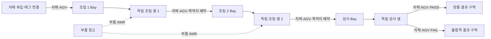
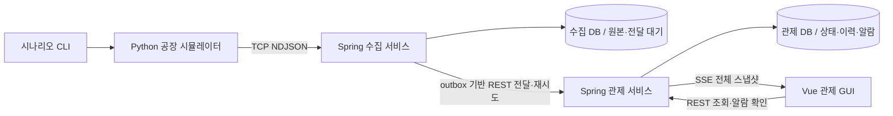

# 가상 제조공장 실시간 통합 관제 시스템 — 프로젝트 기획서

> 문서 버전: v0.3.19 · 셀 기반 공장·소규모 MSA·단계별 개발/검증·사건/전달/화면 계약 v1 반영  
> 작성일: 2026-10-03 · 개정일: 2026-10-05 · 기준 시간대: Asia/Seoul  
> 우선 활용 목적: 현대오토에버 스마트팩토리 / Service Engineer / OT시스템 개발 및 운영 지원  
> 개발 진행: S00~S09 단계별 완료 기준으로 진행 · 날짜별 할당과 고정 총시간을 두지 않음  
> 문서 상태: S00~S09의 P0 구현·검증·문서·재현 산출물을 완료했다. 정상300초×3·스트레스120초×3×3을 측정하고 원본151,073건을 두 DB와 대조했다. 정상 실제 입력은25.63~25.72건/s, 작은 전경 화면의 반영 p95는98.20~98.50ms였다. 높은 입력 목표는 미생성이고 실제96.64~128.19건/s에서 관제 전달 대기와 최대 약54초 SSE 지연을 관측했다. 10만 로그 조회·기존 데이터 재시작·새5대 시연·캡처7장/21초 단계 영상, 작업37~40·ADR-002를 정리했다. 스택·흰색/네이비/파랑 UI·개발 DB/볼륨을 유지했다. 성능 목표의 달성/미검증과 수백 대 차량 등 후속 범위를 구분한다. factory-gui는 참고 샘플이고 실제 화면은 services/factory-console이다.

S01-01 실행 기반은 `services/ingestion-service`와 `services/operations-service`에 분리했다. Spring Boot 4.1.1·Maven 3.10.0·Wrapper 3.3.4·Java release 21을 사용한다. bootstrap은 DB 없는 명시적 골격 확인 모드이며 일반 실행은 자기 DB 설정을 요구한다. [서비스 실행 안내](services/README.md) · [실행 버전](<docs/development/실행 버전과 빌드 기준.md>) · [작업 5 해설](<docs/work-notes/작업 5. 두 Spring 앱의 실행 기반.md>)을 참고한다. S01-01 당시 결과는 앱 실행 기반이며 관제 업무 기능 구현으로 기록하지 않는다.

S01-02에서 ingestion_db/operations_db와 앱·마이그레이션 계정을 분리했다. 실제 PostgreSQL 17.11에서 독립 Flyway V1 적용, 자기 DB 쓰기·상대 DB 접속/앱 DDL 거절·재실행 데이터 유지를 확인했다. 초기 준비는 기존 DB가 있으면 거절하며 지우지 않는다. [DB 구조/실행 기준](infrastructure/postgresql/README.md) · [작업 6 설명](<docs/work-notes/작업 6. 두 DB와 서비스별 저장 구조.md>)을 따른다. SQL 표 초안의 실제 컬럼은 서비스별 V1 마이그레이션이 기준이며 상세 업무 검증은 S02~S05에서 진행한다.


S01-03~04에서는 전체 Compose 기동·보존 종료, DB를 포함한 readiness, 설정/로그, Python 기본 루프와 실제 Vue 앱을 준비했다. 새 검증 볼륨의 최초 기동, 수집 중단 격리, DB 중단 시 readyz 503/livez 200, 재기동 기록/Flyway 이력 보존을 확인했다. Vue 기본 화면은 관제 서버 준비 상태와 공장 데이터 연결 전을 구별한다. [전체 실행 안내](infrastructure/README.md) · [작업 7](<docs/work-notes/작업 7. Compose와 실행 준비 상태.md>) · [작업 8](<docs/work-notes/작업 8. Python과 Vue 기본 앱.md>)을 따른다. 이후 S02 전체의 공장 모델/시나리오/보고 정합성과 S03 수집/저장/재전송을 완료했다. 현재 S09까지 완료했고 실제 측정 수치와 한계를 별도 기록했다. 기존 기술 스택을 유지한다. 선택적인 로컬 검증 VM은 임시 경로에 있어 장기 데이터 보존은 실행 안내의 기준을 따른다.

S02-01에서는 Python의 공장 실행 설정을 v1 구성에 맞춰 검증·고정하고, 실행별 runId·차체/태그 1:1 등록과 단일 위치 소유를 구현했다. 서버 없이 차체 3대를 BODY-IN에 등록해 확인할 수 있다. 위치 변경의 내부 기초 함수는 실제 공정·예약·운송 승인을 대신하지 않는다. [Python 실행 안내](services/factory-simulator/README.md) · [작업 10 설명](<docs/work-notes/작업 10. 공장 설정과 차체·태그 등록.md>)을 따른다. S02-01 당시에는 S02 전체가 진행 중이었다.

S02-02에서는 셀 작업을 시작하고 설정된 작업 시간이 지나면 완료하는 Python 규칙을 추가했다. 조립 완료 차체는 셀 안에서 배출을 기다리며, QC 완료 시에만 검사 번호와 PASS/FAIL을 한 번 기록한다. 검사 전은 NOT_INSPECTED이고 최종 검사 후 COMPLETED는 반출 구역 도착을 뜻하지 않는다. 일시정지 중에는 작업 시간이 줄지 않는다. S02-02 당시 배차·슬롯 예약·실제 운송은 후속 범위였다. `--demo-work`는 공정 간 시험 배치로 작업 규칙을 보여 주는 서버 없는 로컬 확인이며 TCP 사건/완전한 스냅샷/GUI 연결은 아니다. [작업 11 설명](<docs/work-notes/작업 11. 셀 작업과 최종 검사.md>) · [Python 실행 안내](services/factory-simulator/README.md). S02-02 당시의 완료 기록이다.

S02-03에서는 Python의 단일 상태 변경 흐름에서 목적지 슬롯과 차체 AGV를 함께 확보하도록 구현했다. W=실제 Bay 대기, R=픽업 전부터 포함한 활성 예약, A=C-W-R이며 A=0 즉시 신규 배차를 거절한다. BUFFER_FULL/NO_VEHICLE을 구분하고, 승인된 차체는 출발지에 남고 해당 셀의 차단 이유는 WAITING_PICKUP이다. 중복 요청은 기존 운송을 반환하고 시간만으로 예약을 풀지 않는다. QC의 GOOD/HOLD 운송은 Bay 예약을 소비하지 않는다. `--demo-dispatch`로 만석 차단과 마지막 슬롯 경쟁을 확인할 수 있다. S02-03 당시 실제 픽업·이동·인계·반환은 후속 범위였다. S02-03 당시 GUI/네트워크 연결과 완전한 스냅샷은 후속 범위였다. [작업 12 설명](<docs/work-notes/작업 12. 슬롯 예약과 AGV 배차.md>) · [Python 실행 안내](services/factory-simulator/README.md).

S02-04에서는 승인된 운송의 빈 AGV 픽업 이동·적재·운반·Bay/결과 구역 인계·빈 차 귀환을 tick으로 연결했다. 자신의 예약이 있으면 A=0이어도 픽업/도착을 진행한다. Bay 인계 시 R→W 전환만 수행하고, 셀 진입 시 차체 위치/작업 시작과 슬롯 반환을 함께 처리한다. 반환 직후 재배차하므로 새 예약이 같은 슬롯을 즉시 사용할 수 있다. 귀환 중 차량은 신규 배차 대상이 아니다. `--demo-transport`로 일반 등록 차체의 GOOD 도착과 W=2/R=1→W=3/R=0→슬롯 반환/새 배차를 확인한다. 셀 진입은 명시적 모델 명령이며, S02-04 당시 일반 서비스 기동의 실시간 생산 루프나 GUI/통신 연결은 없었다. 이후 S06의 명시적 연결 시나리오에서 구현했다. [작업 13 설명](<docs/work-notes/작업 13. AGV 운송과 버퍼 슬롯 반환.md>) · [Python 실행 안내](services/factory-simulator/README.md).

S02-05에서는 출발 전 취소가 예약과 차량을 함께 반환하고, 반복 취소/도착이 기록이나 슬롯을 다시 바꾸지 않도록 구현했다. 부품 AMR은 별도 kit 식별자와 STORE→PARTS_DOCK 운송을 사용하며 차체/태그와 Bay 예약을 소비하지 않는다. DOWN은 기존 작업/차체/남은 시간을 보존하고 복구 후 이어서 진행한다. 지연·품질 배열도 명시적으로 주입한다. 모델 전환에서 v1 사건을 생성하며 snapshot()/publish_snapshot()으로 전체 상태를 만든다. C=2/3/4 각각 100대 흐름과 사건/최종 상태의 일치를 검증해 S02를 완료했다. 이는 단축 모델 설정의 정합성 시험이며 실제 성능 실적이 아니다. `--demo-scenarios`로 취소·고장/복구·부품 운송과 최종 HOLD 결과를 확인한다. S02-05 당시 사건은 메모리/로컬 출력이었고, 이후 S03에서 TCP/수집 DB 저장을 연결했다. S02-05 당시 관제 REST/SSE 연결은 후속 범위였으며, 현재 REST 조회는 S04, SSE/최소 Vue 연결은 S06에서 완료했다. [작업 14 설명](<docs/work-notes/작업 14. 취소와 장애 복구 및 공장 모델 검증.md>) · [Python 실행 안내](services/factory-simulator/README.md). 현재는 S07까지 완료했고 다음은 S08-01이다.

S03-01~04에서는 TCP NDJSON 조립·입력 제한·v1 형태/식별자 검증·중복/충돌 판정·원본/outbox/실행 정보의 동시 저장·커밋 후 ACK·Python 미확인 원본/제한된 재전송을 구현했다. Java 7개(단위 3·실제 PostgreSQL/TCP 3·bootstrap 1), Python 총 20개가 통과했다. 실제 Python→Spring TCP→PostgreSQL 연결에서 차체 1대의 HOLD 흐름 원본/ACK 39건, DB 바이트/해시 일치, 재접속 중복 확인을 검증했다. 이는 모델 시간을 직접 진행한 연결 검증이며 실시간 성능 측정이 아니다. 검증 run만 정리했고 기존 DB/볼륨은 보존했다. S03 당시 outbox는 PENDING, 전달 커서는 1이었다. ACK는 수집 저장 확인이다. S03 당시 관제 업무 반영·HTTP 전달 worker·REST/SSE·GUI LIVE는 후속 범위였고, 현재 관제 업무와 REST 조회는 S04에서 완료했다. 일반 Python 기동은 자동 생산을 시작하지 않는다. Python 미확인 목록은 메모리이며 프로세스 종료 후 물리 상태 복원을 보장하지 않는다. 현재 S09까지 완료했고 실제 측정 수치와 한계를 별도 기록했다. [S03-01 설명](<docs/work-notes/작업 15. S03-01 TCP 입력 조립과 수신 제한.md>) · [S03-02 설명](<docs/work-notes/작업 16. S03-02 사건 검증과 중복 구분.md>) · [S03-03 설명](<docs/work-notes/작업 17. S03-03 원본과 전달 대기 저장 및 ACK.md>) · [S03-04 설명](<docs/work-notes/작업 18. S03-04 Python ACK 처리와 제한된 재전송.md>).

S04-01~04에서 관제 내부 사건 API·업무 검증/영속 중복 처리, 차체/태그 등록·작업/운송/검사 fact·최신 전체 스냅샷, REST 현재/이력/품질 조회와 신선도·알람 확인/복구를 완료했다. 기존 Java/Spring JDBC/PostgreSQL 기술 스택과 Flyway V1을 유지했다. 실제 PostgreSQL/HTTP 4개·판정 2개·bootstrap 회귀 1개가 통과했다. 최근 5분 검사 100/FAIL 20/비율 .2, 0건 null, 반열린 경계·늦은 고유 검사·cursor fence·중복/rollback·태그/슬롯 모순·run 분리를 확인했다. 기존 Compose의 관제 컨테이너만 반영하고 명시적 시험 호출로 모델 사건 60건의 DB 원본/해시·태그 HOLD·작업 3/운송 6/검사 1·알람 확인/복구를 검증했다. 검증 전용 UUID의 기존 행 0건을 확인한 뒤 자기 run만 정리했고 기존 DB/볼륨은 보존했다. S04 당시 자동 outbox 전달과 수집 진단 제공은 후속 S05 범위였고 진단 미확인은 UNAVAILABLE/UNKNOWN으로 표현했다. S05에서 전달/진단, S06에서 SSE와 최소 실제 Vue 연결을 완료했다. 전체 관제 GUI는 이후 S07에서 완료했다. 물리 runState=FINISHED만으로 관제 종료를 확정하지 않는다. 테스트는 S04의 핵심 경계만 공유 검증하고 Python/수집/GUI 전체 시험을 반복하지 않았다. S04 완료 직후의 다음 작업은 S05-01이었다. [S04-01 설명](<docs/work-notes/작업 19. S04-01 내부 사건 수신과 업무 처리 기록.md>) · [S04-02 설명](<docs/work-notes/작업 20. S04-02 차체·태그와 업무 이력 및 최신 상태.md>) · [S04-03 설명](<docs/work-notes/작업 21. S04-03 관제 조회 API와 검사 집계.md>) · [S04-04 설명](<docs/work-notes/작업 22. S04-04 데이터 신선도와 알람 확인·복구.md>)

S05-01~03에서 영속 outbox의 자동 HTTP 전달·결과 분류·실행별 순서/격리·재시작 복구·전달 진단/명시적 재개를 완료했다. 기존 기술 스택과 적용된 Flyway V1을 유지하고 수집 V2만 추가했다. 필요한 Java 검증 8개가 통과했다. 관제 커밋 후 응답 유실, 수집 전달 완료 저장의 실제 제약 rollback, 관제 DB 접속 중단/복구, 순번/의존성 보류, 영구 거절, 20회 상한과 재개를 확인했다. 기존 Compose에서도 Python TCP ACK 60건→자동 HTTP→관제 저장 60건, 원본/해시 일치, 관제 중단 중 수집 재시작 복구, pending=0/nextSourceSeq=61, REST LIVE→FINISHED/ARCHIVED와 태그 HOLD/FAIL을 확인했다. 새 UUID의 기존 행0건을 먼저 확인하고 성공한 자기 실행만 정리했으며 기존 DB/볼륨을 보존했다. sourceConnected는 현재 TCP 연결 표본이며 진단 실패는 계속 UNKNOWN이다. S05 완료 당시 다음은 S06-01이었고 SSE/실제 Vue 연결은 후속이었다. 현재 최소 연결은 S06에서 완료했으며 상시 생산·성능 측정은 후속이다. [S05-01 설명](<docs/work-notes/작업 23. S05-01 영속 outbox와 자동 HTTP 전달.md>) · [S05-02 설명](<docs/work-notes/작업 24. S05-02 전달 결과와 순서·격리.md>) · [S05-03 설명](<docs/work-notes/작업 25. S05-03 재시작 복구와 전달 진단·재개.md>)

S06-01~03에서 명시적 Python 최소 시나리오, REST와 같은 전체 묶음의 SSE, Vue 셀/버퍼 카드와 차체·태그 상세를 연결했다. 실제 새 실행의 원본 225건이 TCP→수집 DB→자동 HTTP→관제 DB에 동일 바이트/해시로 저장됐다. 프록시 SSE 313개 묶음과 Chrome에서 같은 run/body/tag, ASM-01 작업, 소스 중단 시 마지막 확인값 보존, 재개 후 GOOD/PASS와 FINISHED/ARCHIVED를 확인했다. 필요한 검증은 Java 3개와 Node 2개로 제한했다. 기존 스택/계약 v1/DB/볼륨과 수집 Flyway V1·V2/관제 V1을 유지하며 새 의존성·DDL은 추가하지 않았다. 일반 기동은 자동 생산하지 않는다. S06 완료 당시 다음은 S07-01이었다. 이후 S07에서 지도·검색/이력·품질/알람 화면을 연결했고 현재 S09까지 완료했다. [S06-01 설명](<docs/work-notes/작업 26. S06-01 Python 최소 시나리오와 실제 전달.md>) · [S06-02 설명](<docs/work-notes/작업 27. S06-02 REST와 SSE 전체 상태 연결.md>) · [S06-03 설명](<docs/work-notes/작업 28. S06-03 Vue 셀 관측과 차체·태그 상세.md>)

### S07 실제 관제 화면 완료

S07-01~04에서 실제 3셀·AGV 2대·AMR 1대·Bay SVG 지도, 태그 검색과 대상별 상세/이력, 동일 기간 품질 지표·ECharts, 알람 확인/복구 관측과 사건/알람 기록을 연결했다. 선택/필터 유지·지연 응답 배제·모바일/키보드도 확인했다. 실제 정상 등록 P0 실행의 원본 556건이 두 DB에 같은 바이트/해시로 저장됐고 프록시 SSE 1,070개 묶음을 확인했다. W2/R1/A0→W3/R0/A0→셀 진입 W2/R0/A1, 소스 중단 시 위치/예약 보존, 확인 후에도 설비 고장 유지와 실제 복구를 확인했다. 검사5/PASS4/FAIL1·비율20.0%와 태그 HOLD/FAIL이 실제 API/화면에서 일치했다. 필요한 검증은 Node5개·Python 신규2개와 기존 송신 회귀1개, Vue 빌드와 실제 연결 하나로 제한했다. Java/계약 v1/Flyway/DB/볼륨과 기존 스택을 유지하고 기획에 정한 ECharts6.1.0만 잠금 파일에 추가했다. 일반 기동은 자동 생산하지 않는다. S07 완료 당시 다음은 S08-01이었다. [S07-01 설명](<docs/work-notes/작업 29. S07-01 실제 공장 SVG 지도와 차량·슬롯.md>) · [S07-02 설명](<docs/work-notes/작업 30. S07-02 스마트태그 검색과 대상별 상세·이력.md>) · [S07-03 설명](<docs/work-notes/작업 31. S07-03 품질 차트와 알람 확인·기록 조회.md>) · [S07-04 설명](<docs/work-notes/작업 32. S07-04 선택·조회 순서와 모바일·키보드 접근.md>)

지도와 상세는 같은 전체 보고를 읽고, 과거 이력은 별도 조회 시점을 표시한다. 품질 지표와 차트는 같은 기간의 검사 사실을 함께 읽는다. 알람 확인은 읽었다는 기록이며 실제 복구나 슬롯 반환은 공장의 새 보고로만 바뀐다. [실제 Vue 실행 안내](services/factory-console/README.md)에서 재현 명령과 캡처를 볼 수 있다.

### S08 장애·복구와 100대 통합 완료

S08-01~04에서 별도 PostgreSQL과 두 서버로 예약 취소/반환·목적 셀 정지 중 도착·확인/복구, TCP ACK 유실/재전송·12초 보고 단절, 양 서비스와 개별 DB·PostgreSQL 재시작을 확인했다. 최종 5대 실행 원본216건과 100대 실행 원본3,533건은 두 DB에서 순번·바이트·해시가 일치했다. 100대의 2,764 tick에서 단일 위치/용량을 확인하고 중간 전체 스냅샷28개와 최종 상태를 관제 API와 비교했다. 작업300/검사100/운송400·PASS80/FAIL20, 검사/운송 원본 각각10회 재전송의 실적 증가0·run 격리가 통과했다. 실제 Chrome의 SSE 단절/복구·태그 선택/마지막 값 보존은 별도 실행 증거를 명시해 재사용했다. 기존 Java 관련2개만 선택 실행했고 전체 테스트·새 의존성·DDL·운영 코드 변경은 없다. 기존 스택과 흰색/네이비/파란색 UI·개발 DB/볼륨을 유지했다. 논리 공정의 정확성 검증이며 S08은 기능 정확성 기록이며 이후 S09에서 실제 측정 수치와 한계를 기록했다.

[S08-01 설명](<docs/work-notes/작업 33. S08-01 만석·예약 반환과 셀 정지·정상화.md>) · [S08-02 설명](<docs/work-notes/작업 34. S08-02 TCP와 브라우저 SSE 단절·복구.md>) · [S08-03 설명](<docs/work-notes/작업 35. S08-03 서비스·DB 재시작과 지연·중복 사건.md>) · [S08-04 설명](<docs/work-notes/작업 36. S08-04 100대 정상 순환과 차체·실행 격리.md>) · [S08 통합 결과/재실행](<docs/development/S08 장애·복구 통합 검증.md>)

## 문서 사용 원칙

- 대화에서 합의한 목적은 **설비 상태·생산 및 품질 지표·물류 이동을 하나의 GUI에서 실시간으로 파악하는 통합 관제**다.
- 공장 배경은 독립 작업 셀 사이에서 AMR/AGV가 차체와 부품을 운반하는 자동차 조립 환경으로 정한다. 스마트태그는 차체 식별과 상세 조회를 위한 소프트웨어 모형으로 포함한다.
- **기존 기술 스택은 유지한다.** Java 21·Spring Boot·Spring JDBC/JdbcClient·PostgreSQL 17·Flyway·Maven Wrapper·Vue 3/JavaScript/Vite·SVG/CSS/requestAnimationFrame·ECharts·Python 3·TCP/NDJSON·REST/SSE·Docker Compose를 사용한다. 새 제조 개념을 이유로 언어·프레임워크·통신 방식을 교체하지 않는다.
- 배치·처리 시간·실험 규모는 구현 과정에서 조정할 수 있으나, 차체 조회와 이동 중 예약을 포함한 버퍼 규칙은 핵심 범위로 유지한다. 변경 이유와 영향을 기록한다.
- 구현 도중 선택을 바꾸면 변경 이유와 영향을 기록한다. 완료되지 않은 기능을 완성된 경험으로 소개하지 않는다.
- 화면·영상·실측 성능·장애 근거는 S07~S09 실제 기록에 연결했다. 목표 미달/미검증과 구현 규모를 함께 밝히며 확인되지 않은 경험을 채우지 않는다.
- 제조 환경은 학습용 가정이다. 실제 공장의 생산 조건·불량 분포·설비 안전 기준을 재현했다고 표현하지 않는다.
- 기준 범위는 하나의 공장과 고정 배치도다. Python 시뮬레이터, Spring 수집 서비스와 관제 서비스, Vue 화면을 독립 실행한다. 기존 기술 스택을 유지하며 서비스별 DB 소유권을 분리한다.
- 개발 순서·작업 ID·테스트·완료 기준은 [단계별 개발 계획](<가상 제조공장 실시간 통합 관제 시스템 - 단계별 개발 계획.md>)을 따른다. 세부 인터페이스는 S00에서 확정했고 P0는 S01~S09에서 실제 구현·검증했다. P1/P2 계획을 구현 완료로 간주하지 않는다.

## 목차

1. 프로젝트 개요 및 기획 의도
2. 대상 사용자와 운영 시나리오
3. 가상 공장 구성과 시뮬레이션 모델
4. 개발 범위 및 완료 기준
5. 기능 요구사항
6. GUI 구성 및 사용자 흐름
7. 시스템 아키텍처 및 기술 선정
8. 데이터 모델 및 인터페이스 설계
9. 실시간 처리 및 신뢰성 설계
10. 검증 및 성능 측정 계획
11. 단계별 개발과 우선순위
12. 최종 산출물 및 직무 연결
- 부록 A. 핵심 설계 결정 기록
- 부록 B. 용어 및 지표 정의
- 부록 C. 참고 자료
- 부록 D. 구현 후 기록할 결과

---

## 1. 프로젝트 개요 및 기획 의도

### 1.1 한 문장 소개

**독립된 조립·검사 셀 사이를 AMR/AGV가 차체와 부품을 운반하는 가상 공장에서, 셀 상태·스마트태그로 식별한 차체의 진행 상태·물리적 버퍼의 대기와 예약·품질·물류를 하나의 GUI로 실시간 관제한다.**

### 1.2 기획 배경

공장의 배경을 고정 컨베이어 중심의 연속 라인에서 독립 작업 셀 중심의 조립 환경으로 구체화한다. 각 셀은 작업 공간과 진입 대기 공간을 갖고, 차체 운반 AGV와 부품 공급 AMR이 셀 사이 또는 창고와 셀 사이를 이동한다. 이때 셀의 가동 여부만으로 전체 흐름을 설명하기 어렵다. 차체가 어떤 셀에 있는지, 다음 목적지에 자리가 있는지, 어떤 차량이 운반 중인지 함께 볼 수 있어야 한다.

운영자는 같은 작업 완료 상태에서도 차체가 배출되지 않는 이유를 알아야 한다. 목적지 Parking Bay가 현재 비어 보이더라도 이미 그곳으로 이동 중인 차체가 자리를 예약했다면 추가 배출은 금지된다. GUI는 물리적으로 기다리는 대수와 도착 예정 예약을 나누어 표시한다.

스마트태그는 차체별 정보를 연결하는 출발점이다. 실제 무선 장치 대신 가상 태그 ID를 차체 ID에 연결해, 차체를 선택했을 때 현재 위치·운반 차량·완료 공정·검사 결과를 조회하는 작은 상세 창을 제공한다. 태그 자체가 모든 상태를 측정하는 것으로 모델링하지 않는다.

수백 대의 이동 로봇이 운행하는 제조 환경을 배경으로 삼되, 첫 완성은 소수 셀과 차량의 정확한 공정 흐름으로 한다. 대규모 차량 표현과 입력 부하는 별도 확장 실험으로 구분한다.

### 1.3 해결하려는 문제

| 문제 | 프로젝트에서 설정하는 상황 | 제공할 변화 |
|---|---|---|
| 전체 상황 파악의 어려움 | 셀·차체·부품·운송 정보가 흩어져 있음 | 위치와 작업·품질·운송을 같은 화면에서 확인 |
| 차체 진행 상태 추적의 어려움 | 차체가 셀과 차량을 바꾸며 이동 | 태그 ID로 차체 상세와 관련 이력을 연결 |
| 목적지 수용량 오판 | 현장 대기만 세고 이동 중 차체를 제외 | 대기 + 예약으로 슬롯 만석 판단, 배출 차단 이유 표시 |
| 오래된 데이터에 대한 오판 | 마지막 정상 상태가 현재 상태처럼 보임 | 마지막 수신 시각과 데이터 신선도 명시 |
| 대량 이벤트와 차량 표현 부담 | 모든 이력·태그 정보를 매번 지도에 추가 | 현재 상태 요약, 선택 대상 상세, 페이지 이력 조회 |
| 중복 이벤트에 의한 지표 왜곡 | 검사 결과 재전송 | 이벤트·검사 식별자로 중복 반영 방지 |

### 1.4 개발 동기와 기존 경험의 연결

융합 캡스톤에서는 Raspberry Pi 기반 센서·AI·액추에이터를 연결하고 제어부와 UI 사이의 통신 불안정 및 자원 제약을 해결한 경험이 있다. 졸업 프로젝트에서는 Django 서비스, 데이터 구조화, JSON 인터페이스 명세와 이기종 서비스 연계를 경험했다.

이번에는 그 경험을 Java 기반 운영 서비스로 확장한다. 별도 시뮬레이터의 데이터를 수집하고 DB에 저장하며, 차체·셀·물류의 현재 상태와 이력을 GUI로 전달한다. 목적지 슬롯 예약과 차체 식별을 사례로 삼아 데이터의 의미와 정합성을 직접 설명할 수 있는 결과물을 만든다.

### 1.5 현대자동차그룹·현대오토에버에서 참고하는 방향

현대자동차그룹은 HMGICS의 셀 생산 방식을 소개하며, 컨베이어 대신 셀 단위 작업과 이동 로봇이 연결된 제조 환경을 설명한다. 로보틱스 소개에는 차체 운반 AGV와 부품 공급 AMR의 역할이 구분되어 있다. 이 프로젝트는 그 구성에서 공장 배경과 관제 대상의 관계를 참고한다. [HMGICS 셀 생산 방식](https://www.hyundaimotorgroup.com/ko/story/CONT0000000000122356), [HMGICS 로보틱스](https://www.hyundaimotorgroup.com/en/story/CONT0000000000126181)

현대오토에버의 NNNEO Factory 소개는 생산·품질·물류·관제의 통합 방향을 참고하는 자료다. 스마트태그 소개에는 차량 위치와 조립·품질 정보를 운영시스템에서 통합 관리하는 기능이 제시되어 있다. 여기서는 이를 소프트웨어상의 태그 식별과 차체 상세 조회로 축소한다. [NNNEO Factory 소개](https://www.hyundai-autoever.com/kor/insight/archive/view.do?archiveSeq=4), [SDF·스마트태그 소개](https://www.hyundai-autoever.com/kor/business-area/digital-transformation/sdf/contents.do?cntnSeq=455)

NNNEO Factory는 현대오토에버의 솔루션 소개 명칭이고, HMGICS는 현대차그룹의 제조 혁신센터다. 둘을 동일한 현장명으로 사용하지 않는다. 수백 대 배경, 셀 수, 슬롯 2~4면, 예약·배출 차단 식은 **이 프로젝트의 학습용 설정**이다. 실제 공장의 내부 배차·버퍼 제어 공식을 확인하거나 재현했다는 의미가 아니다.

### 1.6 이번 개발의 목표

1. Java·Spring 서버에서 Python 시뮬레이터의 데이터를 TCP로 수신한다.
2. PostgreSQL에 이벤트와 작업·검사·운송 이력을 저장하고 SQL로 조회·집계한다.
3. Vue·SVG 배치도에서 독립 셀, Parking Bay, 차체와 AMR/AGV 이동을 표현한다.
4. 가상 스마트태그로 차체를 식별하고 별도 상세 창에서 상태와 이력을 조회한다.
5. 대기와 이동 중 예약을 합산해 만석 즉시 추가 배출을 막고, 슬롯 반환 후 재개하는 흐름을 시연한다.
6. 정상·셀 정지·품질 저하·통신 단절·복구와 중복 처리를 검증하고 측정 근거를 남긴다.

### 1.7 결과물의 성격과 현재 파일 상태

- 실제 장비 대신 독립 시뮬레이터를 사용하는 가상 공장 시뮬레이션 기반 통합 관제 프로젝트다.
- 실제 스마트태그 하드웨어, UWB/BLE 위치 측정, 펌웨어는 구현하지 않는다. 좌표·상태는 시뮬레이터가 만든다.
- 합성 PASS/FAIL의 집계이며 불량 탐지 AI 개발이 아니다. 실제 차량 조립 공법도 모사하지 않는다.
- 실시간은 정한 지연 목표 안의 상태 갱신을 뜻한다. 설비 안전 제어나 하드 실시간을 뜻하지 않는다.
- `factory-gui/`는 **v0.2 셀 기반 브라우저 GUI 샘플**이다. 독립 셀 지도, 가상 태그 차체 상세, 차체 AGV/부품 AMR 분리, 예약을 포함한 버퍼 배출 차단과 도착·셀 진입의 차이를 로컬 모델로 구현했다. 서버의 동시 요청·DB 트랜잭션·TCP/SSE·수백 대 운영을 검증한 증거는 아니다. HTML/CSS/JavaScript 샘플 형식을 유지하며 본 구현에서 Vue 컴포넌트와 서버 상태 공급부로 연결한다.

---

## 2. 대상 사용자와 운영 시나리오

### 2.1 대상 사용자

주 사용자는 공장 운영 담당자다. 전체 셀과 물류 흐름에서 이상 위치를 찾고, 차체·셀·차량을 선택해 상태와 관련 기록을 확인한다. MVP는 한 명의 데모 운영자를 가정한다. 사용자·권한별 관리 시스템은 후속 범위다.

보조 사용자는 모델과 데이터 흐름을 검증하는 개발자다. 시뮬레이터 CLI에서 셀 정지·운송 지연·통신 단절과 시험 데이터를 주입한다. 운영 GUI는 실제 차량 제어 시스템으로 표현하지 않는다.

### 2.2 사용자가 답을 얻어야 하는 질문

- 어느 셀이 작업 중·대기·배출 차단·정지 상태인가?
- 이 차체의 태그 ID는 무엇이며, 현재 셀·Parking Bay·운반 AGV 중 어디에 있는가?
- 이 차체는 어떤 작업을 마쳤고 다음 목적지는 어디인가? 검사 결과는 무엇인가?
- 해당 셀의 대기 대수, 도착 예정 예약, 전체 슬롯, 남은 슬롯은 각각 얼마인가?
- 작업을 마쳤는데 배출하지 못하는 이유가 목적지 만석인가, 배차 대기인가?
- 어떤 AMR이 부품을 공급하고 어떤 AGV가 차체를 운반하는가?
- 최근 검사 수·불량 수·불량률과 현재 실행의 누적 실적은 얼마인가?
- 화면의 상태는 최신인가? 알람은 확인됐는가, 원인 조건도 해소됐는가?

### 2.3 주요 사용자 흐름

```text
전체 관제 접속 → run·연결·기준 시각 확인
  → 셀·차량·Parking Bay 현황 확인
  → 차체 아이콘 또는 태그 ID 검색 → 차체 상세 창
  → 현재 위치·운반 차량·공정·검사·관련 이력 조회
  → 배출 차단 셀 선택 → 목적지의 대기·예약·남은 슬롯 확인
  → 알람 확인 → 정상화와 슬롯 반환 후 흐름 재개 확인
```

### 2.4 대표 시나리오

| ID | 시나리오 | 발생하는 변화 | 사용자에게 보여줄 결과 |
|---|---|---|---|
| SC-01 | 정상 조립·물류 | 차체가 셀 사이 이동, 부품 공급과 검사 진행 | 지도·차체 상세·실적이 같은 실행을 반영 |
| SC-02 | 셀 정지 | 조립 셀 정지, 진입 대기와 예약이 누적 | 만석 이후 앞 셀의 완료 차체 배출 차단, 후속 처리 감소 |
| SC-03 | 품질 저하 | 검사 셀의 합성 FAIL 확률 증가 | 표본·불량률·차체별 결과, P1 품질 경고 |
| SC-04 | 물류 지연 | 특정 AGV의 이동 시간 증가 | 예약은 유지되고 도착이 지연됨, 배출 대기 이유 표시 |
| SC-05 | 통신 단절 | 공장은 계속 동작하고 전송만 중단 | 위치 고정, 마지막 차체·버퍼 상태와 미확인 표시 |
| SC-06 | 연결 복구 | 미확인 이벤트 재전송, 최신 스냅샷 보고 | 중복 없는 집계, 차체 위치와 예약 상태 재동기화 |
| SC-07 | 입력량 증가 | 측정 이벤트 빈도 증가 | 큐·지연·메시지 크기·화면 반응성 측정 |
| SC-08 | 이동 중 포함 만석 | 3면에 대기 2대 + 예약 1대 | 즉시 남은 0, 신규 배출 차단, 예약 차량은 도착 가능 |
| SC-09 | 슬롯 반환·배출 재개 | Bay 차체가 작업 셀로 진입 | 실제 슬롯 반환 후 대기 운송 한 건 허용 |
| SC-10 | 차체 추적 | 같은 차체가 셀·차량·Bay를 거침 | 태그 연결 유지, 위치·공정·검사 이력 조회 |

### 2.5 정상 시연과 장애 시연의 차이

지표 값을 별도로 낮추거나 지도 애니메이션만 멈추지 않는다. 셀 처리, 운송, 슬롯 예약·반환의 변화에서 상태와 지표가 파생되어야 한다. 통신 단절은 공정 정지와 분리하며, 도착이 늦었다고 예약을 자동 해제하지 않는다.

---

## 3. 가상 공장 구성과 시뮬레이션 모델

### 3.1 모델의 범위와 규모

완성 전 차체가 독립된 조립 셀과 검사 셀을 거치는 학습용 모델이다. 프레스·용접·도장·차량 전체 조립 공법을 계산하지 않는다. 각 셀의 작업은 정해진 시간과 입력·출력 상태로 표현한다.

| 단계 | 셀·차량 구성 | 목적 |
|---|---|---|
| P0 최소 완성 | 조립 2셀 + 검사 1셀, 차체 AGV 2대 + 부품 AMR 1대 | 공정·태그 조회·슬롯 예약·배출 제한을 실제 데이터로 완성 |
| P1 확장 제안 | 조립 4셀 + 검사 2셀, 차체 AGV 4대 + 부품 AMR 2대 | 같은 모델의 두 공정 흐름·선택·품질 비교 |
| 대규모 배경·후속 실험 | 차량 수를 설정으로 100/200/300대로 단계 확대 | 메시지 크기·수집·조회·SVG 표현 비용 탐색. 달성 성과와 구분 |

숫자는 초기 제안이며 P0의 두 조립 셀·한 검사 셀과 예약 검증은 유지한다. 소수 차량으로도 초기 Bay 대기 상태를 구성해 만석을 재현할 수 있다. 수백 대의 실제 배차·충돌 회피를 P0 완료 조건에 넣지 않는다.

- 차체는 `bodyId`로 식별하고 이벤트의 기존 `unitId`에는 같은 값을 넣는다. 하나의 차체에 하나의 가상 `tagId`를 run 동안 고정한다.
- 차체 AGV는 1대당 차체 1대를 운반한다. 부품 AMR은 차체용 슬롯을 사용하지 않는다.
- 셀 내부 작업 위치는 1면이며 셀 앞의 Bay 2~4면과 별개다. 작업 중 차체는 Bay 대기 수에 포함하지 않는다.
- Bay는 차체를 보유할 가상 받침 공간으로 단순화한다. AGV가 차체를 인계하면 차량은 비워지고, Bay→셀 내부 인계는 별도 AGV 없이 원자적으로 처리한다. 차체를 실은 AGV가 셀·Bay에서 계속 묶이는 모델은 사용하지 않는다. 인계 장비의 물리 동작은 계산하지 않는다.
- 초기 경로는 투입 → 조립 1 → 조립 2 → 검사 → 결과 구역의 비순환 흐름이다. 작업 순서는 고정하되 셀은 물리적으로 분리하고 매 구간 AGV 운송을 수행한다.
- 배차는 요청 순서와 차량 ID 순서를 사용하는 결정적 단순 규칙으로 한다. 최적 경로·교차로 점유·물리 충돌 모델은 후속이다.

### 3.2 셀·공간·차량 구성

| ID 예시 | 종류 | 역할 | 표시할 주요 정보 |
|---|---|---|---|
| BODY-IN | 차체 투입 구역 | 신규 차체와 가상 태그 생성 | 대기 차체·투입 이력 |
| ASM-01 / ASM-02 | 독립 조립 셀 | 조립 작업 1 / 2 | 상태·차체·작업 진행·배출 차단 사유 |
| QC-01 | 독립 검사 셀 | 차체별 최종 PASS/FAIL 생성 | 차체·검사 수·결과 |
| BAY-ASM-01 / BAY-ASM-02 / BAY-QC-01 | 셀별 물리적 버퍼 | 진입로 또는 임시 Parking Bay | 대기·예약·총 슬롯·남은 슬롯·차체 목록 |
| AGV-001 / AGV-002 | 차체 운반 차량 | 투입·셀 사이 차체 운송 | 차체 ID·출발·목적지·예약 ID·좌표·상태 |
| PARTS-STORE | 부품 창고 | 합성 부품 키트 공급 | 공급 작업·목적 셀 |
| AMR-001 | 부품 공급 차량 | 창고와 조립 셀의 전용 부품 도착 지점 왕복 | 운송 작업·적재·목적 셀·상태 |
| GOOD / HOLD | 결과 구역 | 검사 완료 차체의 PASS / FAIL 분리 | 완료 차체·결과 수량 |

표의 Bay는 컨베이어 위의 자재 칸이 아니라 차체가 물리적으로 대기할 수 있는 공간이다. GOOD/HOLD와 BODY-IN 대기장은 P0에서 유한 용량 제어 대상 밖의 경계 구역으로 둔다.

### 3.3 공정과 운송 흐름



초기 부품 공급은 창고 → 셀별 전용 도착 지점 → 창고의 합성 키트 운송으로 표현한다. 부품 목록과 복잡한 재고·작업 중 부품 부족 제어는 P1이다. P0는 부품 충분 가정을 두고 AMR의 위치·공급 이력을 표시한다. 이 AMR 이동이 차체 Bay의 대기·예약 값을 바꾸지 않아야 한다.

### 3.4 셀 상태와 수신 상태

| 셀 운전 상태 | 의미 | 진입 조건 예시 |
|---|---|---|
| IDLE | 작업 위치가 비어 다음 차체를 기다림 | 처리 대상 없음 |
| RUNNING | 셀 내부 차체를 작업·검사 중 | 차체를 받아 작업 시작 |
| BLOCKED | 작업 완료 차체를 셀 안에 보유하고 배출 대기 | BUFFER_FULL / NO_VEHICLE / WAITING_PICKUP |
| DOWN | 셀 자체의 이상으로 정지 | 장애 주입, 차체와 남은 작업 유지 |

`blockedReason`은 BUFFER_FULL(목적지 만석), NO_VEHICLE(빈 AGV 없음), WAITING_PICKUP(예약·차량 할당 후 픽업 대기)로 구분한다. `BLOCKED` 상세에는 `blockedReason`, `destinationCellId`, `waitingCount`, `reservedInboundCount`, `capacity`, `availableSlots`를 표시한다. 완료와 배출은 별개다. 목적지 만석이면 셀에서 AGV로 차체를 옮기는 **출발지 배출(Unload)**을 금지한다. 이는 실제 설비 인터록이 아닌 시뮬레이터 규칙이다.

| 수신 상태 | 초기 판단 기준 | GUI 처리 |
|---|---|---|
| FRESH | 최신 상태 보고가 정상 주기로 도착 | 현재 상태 표시 |
| STALE | 최신 스냅샷 발생 시각이 3초 이상 오래됨 | 오래된 정보 배지 |
| DISCONNECTED | 최신 보고 10초 이상 부재 또는 연결 단절 감지 | 마지막 값·시각과 현재 미확인 표시 |

3초·10초는 데모 기준이다. 과거 이벤트 수신만으로 FRESH가 되지 않는다. 차체 상세와 슬롯도 최신 정보를 확인하지 못했다면 마지막 확인값으로 표시한다.

### 3.5 차체·작업·부품 동작 규칙

1. 신규 차체는 BODY-IN에서 bodyId와 가상 tagId를 받고, 투입 이후 태그 연결을 유지한다.
2. 차체는 BODY-IN, 셀, Bay, 차체 AGV, GOOD/HOLD 중 정확히 한 곳에 존재한다. 슬롯 예약은 위치가 아니다.
3. 셀은 정상이고 작업 위치가 비어 있으면 자신의 Bay에서 가장 오래 기다린 차체를 한 대 받아 작업한다. 이때 Bay 대기 1대를 제거해 슬롯을 반환한다.
4. 작업 시간이 끝나면 같은 operationId의 완료를 한 번 발생시킨다. 검사 셀은 차체별 inspectionId와 PASS/FAIL을 한 번 생성한다.
5. 다음 목적지 슬롯과 빈 차체 AGV를 모두 확보해야 셀 밖으로 배출한다. 하나라도 없으면 차체를 셀에 보유하고 BLOCKED로 둔다.
6. DOWN이면 현재 차체·남은 작업 시간을 유지한다. 복구 후 이어서 진행하며 완료 이벤트를 반복 생성하지 않는다.
7. 최종 검사 완료 시 실적을 집계한다. AGV가 결과 구역까지 옮기는 동안에도 검사 완료 차체의 위치 추적은 유지한다. 검사 완료 수와 출구 도착 수는 서로 다른 지표다.
8. 부품 AMR은 전용 부품 도착 지점을 사용한다. 부품 키트 ID와 운송 이력은 차체 ID·차체 Bay와 구분한다. P0에서는 부품 충분 가정을 사용한다.

### 3.6 물리적 버퍼의 만석·예약·배출 제한

**핵심 규칙: 물리적 버퍼(셀 진입로 / 임시 Parking Bay)는 In-transit 포함 사용 슬롯이 100%에 도달하는 즉시 신규 배출을 차단한다.**

```text
C = 해당 셀 Bay의 전체 사용 가능 슬롯 수(초기 2~4면)
W = 현재 Bay에서 실제 대기 중인 차체 대수
R = 해당 Bay에 도착할 차체 운송의 활성 예약 수
U = W + R                         # 사용·예약 슬롯
A = C - (W + R)                   # 남은 슬롯

(현재 대기 대수 + 해당 셀로 이동 중인 차체 AGV 수) >= C
  → 추가 차체 배출 금지

구현에서는 출발 직전 예약까지 R에 포함한다.
W + R >= C 또는 A <= 0 → 새 예약·배출 금지
W + R < C 및 빈 AGV 확보 → 슬롯 1면 예약 후 배출
```

식의 우변은 **남은 슬롯이 아니라 총 용량 C**다. 이동 중 AGV는 차체를 운반하고 해당 Bay의 예약을 보유한 차량만 센다. 빈 차 귀환, 다른 셀 목적 차량, 부품 AMR은 제외한다. 1차체/1AGV이므로 출발한 예약과 이동 중 차체 AGV의 수가 일치한다. 출발 직전에도 한 자리를 먼저 확보해야 하므로 권위 있는 값은 차량 수를 GUI에서 세는 값이 아니라 예약 목록의 R이다.

| 상황 | W | R | C | A | 신규 배출 |
|---|---:|---:|---:|---:|---|
| 2대 대기, 도착 예정 없음 | 2 | 0 | 3 | 1 | 1건 허용 가능 |
| 마지막 1면 예약 완료 | 2 | 1 | 3 | 0 | 즉시 금지 |
| 예약 차량 도착·인계 완료 | 3 | 0 | 3 | 0 | 계속 금지 |
| Bay 차체 1대가 셀 진입 | 2 | 0 | 3 | 1 | 다시 1건 허용 가능 |

**예약한 기존 차량의 도착은 신규 배출 차단과 별개로 허용한다.** 마지막 예약을 잡은 요청은 진행하고 이후 요청부터 막는다. 이미 할당된 차체의 실제 출발지 배출은 자기 reservationId/slotId가 유효하고 지정 AGV가 픽업 위치에 도착했는지로 판단한다. 이때 전체 남은 슬롯 A가 0이라는 이유로 자신의 예약을 다시 거부하지 않는다. 만석이라는 이유로 이미 예약한 차량까지 멈추면 그 예약을 소비할 수 없으므로 모델이 스스로 막힌다.

#### 예약의 수명과 원자적 전환

| 단계 | 모델에서 함께 처리할 변경 | 차체의 실제 위치 |
|---|---|---|
| 운송 할당 | 빈 AGV 선택 + 목적지 slotId 예약 + transport ASSIGNED를 같은 tick의 한 전환으로 확정 | 출발지에 있음 |
| 출발지 배출 | 픽업 도착 후 출발지 차체 제거 + AGV 적재 + transport IN_TRANSIT을 한 전환으로 처리 | AGV |
| 이동·도착 인계 중 | 예약 유지. MOVING·UNLOADING 중 예약을 조기 삭제하지 않음 | AGV |
| Bay 인계 완료 | R 1 감소 + W 1 증가 + AGV 적재 제거를 한 전환으로 처리 | Bay |
| 셀 진입 | Bay 차체 제거 + 셀 보유 차체 설정, W 1 감소 | 셀 |
| 출발 전 취소 | 차체가 출발지에 있음을 확인하고 예약·차량 할당 해제 | 출발지 유지 |

할당 후 차체는 픽업 전까지 출발지에 남는다. 빈 차량의 픽업 이동(TO_PICKUP)과 LOADING도 예약을 유지하며, 이 단계에서만 출발 전 취소를 허용한다. 차체가 AGV로 인계된 뒤에는 취소 가능한 상태가 아니다. 운송 상태는 ASSIGNED → IN_TRANSIT → COMPLETED, 또는 출발 전 ASSIGNED → CANCELLED다.

목적지 확인과 예약 갱신은 Python 시뮬레이터의 단일 상태 변경 루프에서 순차 처리한다. 두 요청이 같은 남은 1면을 동시에 사용할 수 없게 한다. slotId별 상태는 FREE / RESERVED / OCCUPIED 중 하나이며 transportId·bodyId·vehicleId를 연결한다. 슬롯 예약이 완료되지 않으면 출발지 배출을 수행하지 않는다. 배출 완료 전까지 원래 셀은 비지 않는다.

슬롯 예약은 운송·배차 단계의 업무 예약이고, DB의 행 잠금이나 운영자 알람 확인과 다른 개념이다. 서버는 시뮬레이터의 결정을 검증·저장·표시하며 별도 배차 결정을 하지 않는다. 지연·통신 단절·서버 재시작을 이유로 예약을 자동 만료시키지 않는다. P0의 취소는 출발 전만 지원한다. 이동 중 취소·우회·차량 고장 회수는 확인된 차체 위치와 대체 인계까지 설계해야 하는 후속 범위다.

유효 모델의 불변식은 `0 <= W + R <= C`다. `>=`는 만석과 잘못된 초과 입력을 모두 막는 조건이다. 초과 상태는 정상 시나리오가 아니라 모델 오류로 기록하고 실행을 중단한다. run 중 용량을 예약·점유 수보다 작게 줄이지 않는다.

### 3.7 이동 모델과 교착 방지의 범위

- 차체 AGV는 IDLE → TO_PICKUP → LOADING → MOVING → UNLOADING → RETURNING → IDLE을 기본으로 한다. TO_PICKUP은 출발지 픽업을 위한 빈 차량 이동이며 차체 위치는 아직 출발지다. P0 적재 동작은 원자적 인계로 단순화하고 별도 로봇 팔·체결 시간을 모델링하지 않는다.
- 이동 경로는 출발지·목적지별 좌표 목록이다. 이동 시간·위치는 시뮬레이터가 계산하고 브라우저는 수신 위치 사이를 보간한다.
- 다음 셀의 Bay 공간을 예약한 뒤 출발하므로 도착할 자리가 없는 차체를 통로로 내보내는 상황을 예방한다. 진입로와 Parking Bay의 과다 점유 방지가 목표다.
- 모든 교착을 해결하는 알고리즘으로 소개하지 않는다. P0 공정은 비순환이며, AMR 공급 지점과 차체 Bay를 분리한다. 경로 충돌·교차로 자원 예약·재작업 순환은 모델 밖이다.
- 최종 검사 뒤 GOOD/HOLD로의 운송은 슬롯 제한이 없는 경계 출구를 사용한다. 차량이 귀환하고 정상 셀이 대기를 소비한다는 조건에서 흐름 재개를 시험한다. 실제 고장 중단과 자원 순환 교착은 구분한다.

### 3.8 가상 스마트태그와 차체 상태

태그는 실제 장치가 아닌 `tagId`를 가진 가상 식별 매체다. run 안에서 bodyId와 1:1 연결하며 공정·운송이 바뀌어도 유지한다. 실제 장치의 재부착·태그 재사용·분실·위치 오차는 P0 밖이다.

| 차체 상세 항목 | 데이터 근거 |
|---|---|
| bodyId / tagId / 차종·사양 | 차체 생성 시 고정한 메타데이터 |
| 현재 위치 종류와 ID | 최신 공장 스냅샷의 locationType / locationId |
| 운반 AGV·목적지·예약 | 활성 운송 작업과 동일 스냅샷 |
| 현재·완료·다음 공정 | 셀 작업 진행과 operation_history |
| 작업 완료·이동·배출 대기 상태 | 모델 상태와 blockedReason |
| 검사 결과·검사 시각 | inspection_result. 검사 전은 NOT_INSPECTED |
| 관련 이력·마지막 확인 시각 | bodyId로 연결한 이벤트·스냅샷 |

차체 상태는 WAITING / PROCESSING / WAITING_UNLOAD / IN_TRANSIT / COMPLETED로 구분한다. COMPLETED는 최종 검사 완료를 뜻하며 PASS/FAIL은 별도 필드다. 검사 완료 후 결과 구역으로 이동하는 차체는 COMPLETED와 locationType=VEHICLE을 함께 가질 수 있다. 진행 상태·품질 결과·수신 상태를 한 필드에 섞지 않는다.

### 3.9 초기 설정값

| 항목 | 초기 제안값 | 비고 |
|---|---|---|
| 시뮬레이션 시간 | 실시간 1배속 | 성능·최근 5분 기준 |
| 내부 tick | 100ms | 공정·예약·인계 순차 처리 |
| 공장 스냅샷 | 500ms마다 | 위치·차체·슬롯 상태 함께 보고 |
| 대상별 측정 | 셀·차량마다 500ms | 설정으로 부하 조정 |
| 조립 1 / 조립 2 / 검사 | 4초 / 6초 / 3초 | 실제 조립 시간과 무관 |
| 각 셀 작업 위치 | 1면 | Bay 용량과 분리 |
| 셀별 차체 Bay | 기본 3면, 설정 범위 2~4면 | 대기 + 예약 100% 즉시 차단 |
| 차체 AGV 적재량 | 1대당 차체 1대 | 슬롯 계산과 일치 |
| 운송 시간 | 구간별 초기 4초 | 경로 길이별 조정 가능 |
| 부품 AMR 공급 | 합성 키트 1개 단위, 부품 충분 가정 | 차체 슬롯과 별도 |
| 기본 FAIL 확률 / 품질 저하 | 1% / 20% | 실제 품질 기준 아님 |
| 난수 seed | 42 | 고정 입력과 함께 재현성 확보 |

### 3.10 실행·재현성·장애 주입

- run마다 새 runId를 발급한다. 초기화는 기존 DB 이력을 삭제하지 않고 새 실행을 만든다. 태그 연결·예약·작업도 run 단위로 분리한다.
- 검사 난수는 seed를 고정한다. 임계값 시험은 지정 PASS/FAIL 배열을 사용한다. 동일 seed만으로 운영체제 스케줄까지 같다고 가정하지 않고, 예약 요청의 처리 순서와 설정·초기 상태도 기록한다.
- 셀 정지·품질 저하·운송 지연·출발 전 취소는 시뮬레이터 CLI에서 주입한다. 만석 시험은 초기 대기·예약·차체 위치가 서로 일치하는 fixture를 사용한다.
- 통신 단절은 공장과 예약 계산을 유지하고 전송만 중단한다. PAUSED는 먼저 실행 상태를 알리고 공정·이동 계산을 멈춘다. 기존 알람·예약을 임의로 복구·해제하지 않는다.
- 웹 시나리오 제어는 P1이다. 정합성을 확인하지 않은 GUI 버튼으로 슬롯이나 배출을 직접 바꾸지 않는다.

---

## 4. 개발 범위 및 완료 기준

### 4.1 우선순위 정의

P0는 프로젝트의 핵심을 설명하기 위해 필수로 완성할 범위다. P1은 P0 통합 후 추가할 목표 확장이고, P2는 별도 일정의 후속 기능이다. 기술 스택은 모든 단계에서 유지한다.

### 4.2 범위표

| 구분 | P0 | P1 | P2 |
|---|---|---|---|
| 공장 규모 | 조립 2셀·검사 1셀, 차체 AGV 2대·부품 AMR 1대 | 조립 4셀·검사 2셀, AGV 4대·AMR 2대 | 100/200/300대 단계 확장·현장 유사 배치 |
| 셀 물류 | 고정 비순환 경로·단순 배차 | 여러 후보 셀·구간 비교 | 최적 배차·교차로 제어·충돌 회피 |
| 물리적 버퍼 | Bay 2~4면, 대기 + 예약, 만석 차단·슬롯 반환 | 이동 중 취소·회수 정책 | 순환 공정 교착 탐지·회피 |
| 차체 추적 | 가상 태그 1:1 연결·차체 상세 창·관련 이력 | 검색·필터 고도화 | 실제 태그·위치 측정·장치 연동 |
| 부품 공급 | 전용 도착 지점과 키트 운송 표시, 부품 충분 가정 | 재고·부품 부족과 조립 연동 | BOM·창고·생산계획 연계 |
| 시각화 | Vue·2D SVG 셀 지도·차체/차량 선택·슬롯 요약 | 확대·필터·추이 비교 | 3D·배치 편집기 |
| 생산·품질 | 고유 차체 최종 검사 실적·최근 5분 불량률 | 셀 비교·품질 경고 | 예측·실제 검사 모델 |
| 연계·신뢰성 | TCP NDJSON·REST·SSE, 중복 방지·stale·재접속 | 복구 고도화·송신 대기 영속화 | 산업용 프로토콜·다중 서버 |
| 검증 | 모델·예약·태그 조회·장애·SQL·기본 부하 | 더 높은 부하와 비교 | 수백 대 운영·장시간·실장비 검증 |

### 4.3 필수 완료 조건

- 독립 Python 시뮬레이터 → TCP → Spring → PostgreSQL → SSE → Vue 화면이 연결된다.
- 셀·차체·차량·버퍼와 생산·품질 수치는 같은 run의 데이터로 갱신된다.
- 태그 또는 차체를 선택해 위치·운반 AGV·공정·검사·관련 이력을 조회한다.
- `W + R = C`가 되면 다음 신규 배출을 즉시 막으며, 완료 차체는 출발 셀에 남는다.
- 예약한 운송은 만석에서도 도착할 수 있고, 도착은 예약→점유 전환이며 슬롯 반환이 아니다.
- Bay에서 셀로 진입해 슬롯이 비면 대기 운송을 재평가한다. 동시 요청·중복 도착·취소로 슬롯이 초과 예약되거나 음수가 되지 않는다.
- 셀 정지·목적지 만석·차량 부족·통신 단절을 구분한다.
- 같은 검사 결과 재전송으로 검사·불량 수가 늘지 않는다. 새 접속·재연결은 최신 차체·슬롯 상태를 받는다.
- 실행·정상·만석·반환·통신 복구 절차와 캡처·검증·측정 결과가 남는다.

### 4.4 일정 부족 시 축소 순서

1. 시각 장식·추가 차트·P1 메모·품질 경고를 미룬다.
2. P1 추가 셀과 차량, 부품 재고 연동을 미룬다.
3. 대규모 차량 실험을 P2로 유지하고 P0 규모로 고정한다.
4. 웹 시나리오 제어를 CLI로 유지한다. 차체 상세는 기본 한 창으로 유지한다.

실제 데이터 연결, 최소 셀 공정, 차체 조회, 슬롯 예약·배출 제한, 중복·통신 검증은 축소 후에도 남긴다. 일정 초과가 필요하면 기록하고 기간을 조정하며 핵심 개념을 삭제해 완료로 표현하지 않는다.

---

## 5. 기능 요구사항

### 5.1 요구사항 목록

기존 FR-01~FR-18의 식별자는 유지하고 셀 모델에 맞춰 수용 기준을 갱신한다. 추가 핵심 요구사항은 FR-19~FR-23이다.

| ID | 우선순위 | 기능 | 수용 기준 |
|---|---|---|---|
| FR-01 | P0 | TCP 이벤트 수집 | 정상 프레임 검증·저장·결과 응답 |
| FR-02 | P0 | 셀 상태 표시 | 운전 상태와 수신 상태 구분, 배출 차단 사유 표시 |
| FR-03 | P0 | 생산 실적 집계 | 최종 검사 완료 고유 차체 기준, 공정 완료와 구분 |
| FR-04 | P0 | 품질 지표 | 최근 5분 검사 수·FAIL 수·비율·구간 표시 |
| FR-05 | P0 | 물류 표시 | 차체 AGV·부품 AMR 구분, 좌표·적재·목적지·예약 연계 |
| FR-06 | P0 | 물리적 버퍼 표시 | 대기 W·예약 R·총 C·남은 A 및 100% 차단 표시 |
| FR-07 | P0 | 셀 상세 | 차체·작업·목적지 Bay·차단 사유·관련 로그 |
| FR-08 | P0 | 이력 조회 | run·셀·차체·차량·기간·종류·심각도 필터·커서 조회 |
| FR-09 | P0 | 셀·통신 알람 | 발생·확인·복구 별도 기록 |
| FR-10 | P0 | 알람 확인 | 최초 확인 시각·운영자 유지, 반복 요청 멱등 |
| FR-11 | P0 | 화면 재연결 | 차체·예약을 포함한 최신 전체 스냅샷 수신 |
| FR-12 | P0 | 검증·중복 처리 | 잘못된 입력 격리, 동일 이벤트 재집계 방지 |
| FR-13 | P0 | 장애 시나리오 | 셀 정지·만석·통신 단절·복구 재현 |
| FR-14 | P0 | 시스템 진단 | 수집량·오류·큐·지연·전송 크기 확인 |
| FR-15 | P1 | 품질 경고 | 최소 표본·불량률 조건 충족 시 경고 |
| FR-16 | P1 | 알람 메모 | 조치 내용과 수정 이력, 실제 복구와 분리 |
| FR-17 | P1 | 추이 비교 | 동일 구간의 셀·공정 흐름별 실적 비교 |
| FR-18 | P1 | 웹 데모 제어 | 시뮬레이터 적용 확인 후 화면 반영 |
| FR-19 | P0 | 가상 태그 연결 | run 안에서 bodyId와 tagId 1:1 고정, 부품 키트와 구분 |
| FR-20 | P0 | 차체 상세 창 | 클릭 또는 태그 ID 조회로 위치·AGV·공정·검사·이력·시각 표시 |
| FR-21 | P0 | 슬롯 예약·배출 제한 | 목적지 예약과 차량 할당을 한 전환으로 처리, 만석 시 차체 보유 |
| FR-22 | P0 | 도착·반환·출발 전 취소 | 예약→점유 전환, 셀 진입 시 반환, 안전한 예약 해제 |
| FR-23 | P0 | 모델 정합성 | 차체 단일 위치·슬롯 한 소유자·예약/운송 1:1·용량 이하 검증 |

### 5.2 생산·품질·물류 지표 정의

**셀 작업 완료 수**는 operationId별 완료 수다. **공장 생산 실적**은 최종 검사를 완료한 고유 차체 수다. 같은 차체가 조립 1·조립 2를 거쳤다고 두 번 생산한 것으로 세지 않는다. 최종 결과 구역 도착은 운송 완료이며 검사 실적과 구분한다.

| 지표 | 정의 | 예외 처리 |
|---|---|---|
| 누적 검사 완료 / 양품 / 불합격 | 해당 run의 고유 검사 fact / PASS / FAIL 수 | 검사·차체 ID 중복 반영 금지 |
| 최근 5분 불량률 | 같은 구간 FAIL 수 / 검사 완료 수 × 100 | 분모 0은 `—`, 표본 수 병기 |
| 분당 검사 처리량 | 최근 완료된 1분의 검사 수 | 진행 중인 분과 구분 |
| 가동·배출 대기 셀 수 | 최신 RUNNING / BLOCKED 셀 수 | stale이면 현재 수 미확인 |
| 물리 대기 대수 W | 각 Bay에서 실제 대기하는 차체 수 | 셀·AGV의 차체와 중복 합산 금지 |
| 예약 수 R | Bay별 활성 차체 운송 예약 수 | 출발 직전·이동·인계 중 포함, 부품 AMR 제외 |
| 사용 슬롯 / 사용률 | W + R / (W + R) ÷ C × 100 | 예약을 포함한다는 제목 표시 |
| 남은 슬롯 A | C − W − R | 0 즉시 신규 배출 금지, 음수는 모델 오류 |
| 차체 이동 / 부품 이동 차량 수 | 최신 MOVING이며 해당 작업이 있는 차량 수 | 차량 종류 구분, stale 현재 미확인 |

최근 5분은 1배속 시뮬레이션의 UTC 발생 시각으로 계산한다. 지연 검사 결과는 원래 발생 구간에 반영하며 CATCHING_UP 동안 값이 정정될 수 있다. 품질 경고는 최근 5분 검사 20대 이상·불량률 10% 이상을 초기 데모 조건으로 둔다. 확률 대신 결과 배열로 경계를 검증한다.

### 5.3 알람과 흐름 상태의 구분

- 알람 conditionActive와 acknowledgedAt은 별개다. 확인 버튼은 셀 복구·슬롯 반환·배출 강제 허용을 수행하지 않는다.
- 정상적인 BUFFER_FULL과 NO_VEHICLE은 P0에서 흐름 상태·이벤트로 표시한다. 매 만석마다 고장 알람을 발생시키지 않는다. 장시간 BLOCKED 경고는 P1 정책이다.
- 셀 DOWN과 통신 이상은 알람을 발생시킨다. 정상화되면 resolvedAt을 남기며, 확인 전 복구도 이력을 유지한다.
- 같은 run·대상·종류의 활성 알람은 한 건만 유지한다. 복구 후 재발은 새 건으로 기록한다.
- 원본 이벤트는 현장 보고이고 알람은 서버 판단 결과다. 통신 단절 시 마지막 셀 이상 알람을 임의로 복구하지 않는다.

### 5.4 추가 핵심 요구사항의 추적표

| 요구사항 | 설계 위치 | 시연 | 검증 |
|---|---|---|---|
| FR-19 가상 태그 연결 | 3.8·8.1·8.4~8.5 | SC-10 | T-26~T-27 |
| FR-20 차체 상세 창 | 6.2·6.4~6.5·8.7~8.9 | SC-10 | T-26·T-30~T-31 |
| FR-21 슬롯 예약·배출 제한 | 3.4~3.7·5.2 | SC-08 | T-19·T-22·T-24 |
| FR-22 도착·반환·취소 | 3.6·8.2 | SC-09 | T-20~T-21·T-23~T-25 |
| FR-23 모델 정합성 | 3.5~3.6·8.5·10.3 | SC-01·SC-08~SC-10 | T-01·T-22·T-25~T-29 |

---

## 6. GUI 구성 및 사용자 흐름

### 6.1 화면의 역할

셀·차체·차량을 연결해 현황과 이력을 보여준다. 지도상 빈 공간과 실제 가용 슬롯이 다를 수 있으므로 대기와 예약을 동시에 표시한다. 현재 상태와 이력의 기준 시각·수신 상태를 명시한다.

### 6.2 메인 화면 구성

```text
┌───────────────────────────────────────────────────────────────┐
│ 공장 / run / LIVE·PAUSED / 연결 / 마지막 상태 시각              │
├───────────────────────────────────────────────────────────────┤
│ 검사·양품·불량률 / 가동·BLOCKED 셀 / 차체·부품 이동 / 알람     │
├─────────────────────────────────────┬─────────────────────────┤
│ 독립 셀·Bay·운송 경로·차체·AGV/AMR  │ 셀·차량·Bay 상세         │
│ Bay: 대기 2 + 예약 1 / 총 3 · 남은 0│ 차단 사유·목적지·예약   │
│ 차체 선택 / 태그 ID 검색            │ 관련 차체·이력 링크     │
├─────────────────────────────────────┴─────────────────────────┤
│ 생산·품질 추이 / 알람 / 대상·기간 필터 이벤트                  │
└───────────────────────────────────────────────────────────────┘

차체 선택 → 차체 상세 창(패널 또는 모달)
  태그·차체·차종 / 위치·운반 AGV / 현재·완료·다음 공정
  배출 대기 이유 / 검사 결과 / 마지막 확인 / 관련 이력
```

차체 상세는 지도와 연결된 창 하나로 시작한다. 검색과 클릭은 같은 상세를 연다. 셀·AGV 상세의 차체 ID도 링크로 연결한다. 태그가 차체 위치를 실제 무선 측정하는 것처럼 표시하지 않고 `가상 스마트태그`임을 안내한다.

### 6.3 시각 표현 규칙

- Vue·SVG 2D에서 셀을 독립 작업 영역으로 배치하고 이동 경로를 연결한다. 컨베이어 도형을 기본 연결로 사용하지 않는다.
- 사용자 지정 색상 기준: 화면·카드·지도 바탕은 흰색, 글씨는 네이비 계열로 통일한다. 버튼·선택·차트·상태 강조는 네이비~파란색만 사용한다. [UI 색상 기준](<docs/development/UI 색상 기준.md>)을 따른다.
- RUNNING은 파란색, IDLE은 옅은 청색, BLOCKED는 중간 청색과 점선, DOWN은 진한 네이비와 강조 테두리를 사용한다. 색상에만 의존하지 않고 상태 텍스트·아이콘·선 모양을 병기한다.
- Bay는 FREE·RESERVED·OCCUPIED를 구분한다. `대기 2 + 예약 1 / 3, 남은 0`처럼 예약 포함 사용량을 표시한다. 점선 예약과 실선 점유 등 색상 외 표현도 사용한다.
- BLOCKED 셀에서 목적지 Bay를 강조하고 BUFFER_FULL과 NO_VEHICLE을 구분한다. 여유가 생기면 다음 모델 판단 후 상태가 바뀐다.
- 차체 운반 AGV와 부품 AMR의 도형·이름을 구분하고, 차체 적재 AGV의 선택을 차체 상세로 연결한다.
- 차체 아이콘은 Bay·셀의 보유 상태 또는 AGV 적재 상태에서 하나만 표시한다. 과밀한 경우 수량과 목록으로 요약한다.
- 통신 단절 시 마지막 차체·슬롯·좌표와 시각을 유지하고 미확인 배지를 붙인다. 새 위치 없이 계속 이동시키지 않는다.

### 6.4 화면별 상세

| 화면/영역 | 기본 표시 | 사용자 동작 | 빈 상태·오류 상태 |
|---|---|---|---|
| 전체 관제 | 셀·Bay·차량·차체·지표 | 대상 선택·태그 검색 | 데이터 대기·재연결·복원 중 |
| 셀 상세 | 차체·작업·운전/수신 상태·목적지·차단 사유 | 관련 차체·로그 조회 | 마지막 확인 상태 유지 |
| 차체 상세 창 | tagId·bodyId·위치·AGV·공정·검사·시각 | 관련 작업·검사·운송 이력 | 미등록 태그 / 아직 검사 전 / 이력 조회 실패 |
| Bay 상세 | C·W·R·A·slotId·예약 차량/차체 목록 | 대기·도착 예정 차체 선택 | stale 값 / 예약 불일치 진단 |
| 차량 상세 | 종류·위치·적재·작업·목적지·예약 | 차체 또는 부품 운송 이력 | 마지막 위치 고정 |
| 품질 | 검사 표본·FAIL·불량률·기간 | 차체 검사 이력 조회 | 표본 없음·최소 표본 미달 |
| 이력·알람 | 사건·시각·대상·발생/확인/복구 | 필터·페이지·알람 확인 | 결과 없음·저장 실패 재시도 |

### 6.5 갱신과 조회의 분리

- 화면 전체 상태는 기본 500ms마다 최대 1회 SSE로 발행한다. 차체의 현재 위치·예약·슬롯·셀·지표를 같은 revision에서 적용한다.
- 차체 상세의 현재 값은 SSE에서 갱신하고, 긴 작업·운송·검사 이력은 REST로 페이지 조회한다. 매 스냅샷마다 과거 이력을 통째로 보내지 않는다.
- 라이브 목록은 최근 100건 정도, 차트는 시간 버킷으로 제한한다. 선택 대상과 필터는 갱신으로 초기화하지 않는다.
- 상세 조회 응답에는 기준 capturedAt/sourceSeq를 둔다. 늦은 REST 응답이 더 최신인 SSE 현재 상태를 덮지 않게 한다.
- 위치 보간은 표현이며 실제 슬롯·차체 위치 계산에 사용하지 않는다. 배경 탭에서는 애니메이션을 줄이고 복귀 시 최신 스냅샷을 적용한다.
- 수백 대 실험은 SVG 객체 수·문자 라벨·선택 비용·전송 크기를 측정한 후 제한을 정한다. 새 렌더링 스택 도입을 기본 계획으로 삼지 않는다.

### 6.6 브라우저 샘플과 실제 관제 화면

`factory-gui`는 브라우저 내부 모형의 참고 샘플이다. 실제 연결의 캡처는 `services/factory-console`의 S07/S08 자료와 S09의 새 같은-run 시연을 구분해 연결한다. 캡처 시점의 실행 결과이며 현재 LIVE 생산을 뜻하지 않는다.

| 번호 | 캡처 대상 | 참고 샘플 | 실제 연결 근거 |
|---|---|---|---|
| UI-01 | 독립 셀·차체/부품 운송 지도 | [샘플](factory-gui/preview-desktop.png) | [S07 지도](services/factory-console/preview-s07-map.jpg) |
| UI-02 | 셀 정지·앞 셀 배출 차단 | 샘플 개념 | [새 셀 고장](docs/development/s09-demo/UI-CELL_DOWN.jpg) · [P0 단계 결과](<docs/development/S09 측정·완료 기록.md>) |
| UI-03 | 검사·품질 지표 | 샘플 개념 | [새 검사5/P4/F1](docs/development/s09-demo/UI-FINISHED.jpg) |
| UI-04 | 차체 AGV·부품 AMR | 샘플 개념 | [새 AGV 적재 상세](docs/development/s09-demo/UI-FULL_IN_TRANSIT.jpg) · [AMR 포함 S07 구현](<docs/work-notes/작업 29. S07-01 실제 공장 SVG 지도와 차량·슬롯.md>) |
| UI-05 | 통신 단절·마지막 차체/예약 보존 | 샘플 개념 | [실제 S08 단절/복구](<docs/development/S08 장애·복구 통합 검증.md>) · [복구 캡처](docs/development/s08-sse-recovered.jpg) |
| UI-06 | 알람 확인·실제 복구·이력 | 샘플 개념 | [S07 확인/복구 기능](<docs/work-notes/작업 31. S07-03 품질 차트와 알람 확인·기록 조회.md>) · [S08 장애 근거](<docs/development/S08 장애·복구 통합 검증.md>) |
| UI-07 | 가상 태그의 차체 상세 | [샘플](factory-gui/preview-tag.png) | [새 실제 HOLD 태그](docs/development/s09-demo/UI-TAG_HOLD.jpg) |
| UI-08 | 대기2+예약1 만석→도착→셀 진입 반환 | [샘플](factory-gui/preview-buffer.png) | [새 예약 만석](docs/development/s09-demo/UI-FULL_RESERVED.jpg) · [도착](docs/development/s09-demo/UI-FULL_ARRIVED.jpg) · [반환](docs/development/s09-demo/UI-SLOT_RELEASED.jpg) |

---

## 7. 시스템 아키텍처 및 기술 선정

### 7.1 전체 구조



수집·관제를 별도 Spring Boot 앱으로 구성하는 소규모 MSA다. 각각 독립 빌드·기동·재시작하고, 개발용 PostgreSQL 한 인스턴스 안에서 서비스별 DB·계정·Flyway를 분리한다. 다른 서비스 DB를 직접 조회하거나 서비스 간 외래키·JOIN을 두지 않는다.

공장 상태 변경과 슬롯 예약은 Python이 결정한다. 수집 서비스는 원본과 전달 책임을 저장하고, 관제 서비스는 업무 검증·현재 상태·이력·조회·알람·SSE를 담당한다. 수집 완료와 관제 반영 완료를 구분한다. 상세 진행은 [단계별 개발 계획](<가상 제조공장 실시간 통합 관제 시스템 - 단계별 개발 계획.md>)의 S00~S09를 따른다.


### 7.2 기술 선택

**v0.3의 MSA 개발에서도 아래 기술 조합을 유지한다.** 스마트태그는 가상 ID·조회 데이터이며 새로운 무선 SDK나 별도 태그 서버를 요구하지 않는다. 수백 대 배경도 Kafka·ROS·WebSocket·다른 프런트엔드 도입을 전제하지 않는다.

| 영역 | 계획 기술 | 선택 이유 | 고정할 내용 |
|---|---|---|---|
| 백엔드 | Java 21, Spring Boot | 공고와 연결되는 Java 웹 개발, REST·스케줄러·SSE 활용 | Boot 안정 버전과 의존성은 착수 시 고정 |
| 빌드 | Maven Wrapper | 실행 환경의 Maven 설치 차이 최소화 | wrapper 및 pom 커밋 |
| DB 접근 | Spring JDBC / JdbcClient | SQL·트랜잭션·인덱스 동작을 직접 설명하기 용이 | 명시적 SQL, 매개변수 바인딩 |
| 마이그레이션 | Flyway | 테이블·인덱스 구조 재현 | 버전별 SQL 파일 |
| DB | PostgreSQL 17 계열 | 공고 기술, 관계형 조회·집계·JSONB 활용 | patch 이미지 고정, 서비스별 DB·계정 분리 |
| 프론트엔드 | Vue 3, JavaScript, Vite | 공고 기술 스택, 상태 기반 컴포넌트·SVG 구현 | package-lock 및 Node 버전 기록 |
| 배치도 | SVG + CSS + requestAnimationFrame | 셀·차체·차량의 선택·상태·이동 표현, 좌표 기반 배치 | SVG viewBox와 에셋 규격 |
| 차트 | Apache ECharts | 시간대별 수량·불량률 추이 | 초기 차트 종류 제한 |
| 장치 통신 | TCP + NDJSON | Socket 인터페이스 경험과 메시지 경계 처리 | 자체 메시지 schemaVersion |
| 화면 스트림 | SSE + 전체 스냅샷 | 서버→브라우저 단방향 갱신, 재연결 처리 단순화 | 발행 주기·최대 연결 수 |
| 시뮬레이터 | Python 3 | 기존 경험을 활용해 공정 모델 구현 시간 확보 | seed·설정 파일·이벤트 출력 |
| 실행 | Docker Compose | DB와 서버·UI·시뮬레이터 실행 환경 재현 | image tag 및 실행 설정 |

Java 21은 확인한 Spring Boot 시스템 요구사항의 지원 범위 안에 있다. 실제 Boot 버전은 초기 환경 점검에서 안정 버전을 선택해 고정한다. [Spring Boot 공식 시스템 요구사항](https://docs.spring.io/spring-boot/system-requirements.html)

Vue 공식 시작 가이드의 Node 요구사항을 착수 시 확인하고 `.nvmrc` 또는 동등한 파일에 정확한 버전을 기록한다. 프로젝트 도중 `latest`를 다시 설치해 환경을 바꾸지 않는다. [Vue 공식 시작 가이드](https://vuejs.org/guide/quick-start.html)

### 7.3 REST와 SSE 역할

- REST: 셀·차량·차체/태그·Bay 상세와 메타데이터, 과거 작업·운송·검사 이력, 알람 확인·메모 변경.
- SSE: 최신 공장 스냅샷과 연결 상태 전달.
- 2Hz 전체 스냅샷을 기본으로 한다. 현재 목표 규모에서는 복잡한 delta patch 순서 복구보다 구현과 검증이 단순하다.
- 브라우저의 알람 확인은 REST로 서버에 기록되고 다음 SSE에서 반영된다.
- Spring MVC의 `SseEmitter`를 사용할 수 있다. 종료·오류·timeout 시 구독 정리와 전송 오류 처리를 구현한다. [Spring MVC 비동기 응답 공식 문서](https://docs.spring.io/spring-framework/reference/web/webmvc/mvc-ann-async.html)

### 7.4 서비스 내부 모듈 책임

아래 책임은 독립 배포 서비스 수가 아니다. simulator는 Python, ingestion과 전달 작업은 수집 서비스, processing/monitoring/query/streaming은 관제 서비스에 둔다. diagnostics는 각 서비스의 진단을 맡는다.

| 모듈 | 책임 |
|---|---|
| simulator | 셀 공정·차체/태그 연결·슬롯 예약/반환·단순 배차·물류 좌표·검사·장애·재전송 |
| ingestion | TCP 연결, 프레임 구분, 크기·schema 검증, 원본/outbox 저장, 수집 ACK, REST 전달·재시도 |
| processing | 업무 중복·차체/슬롯 검증, 처리 이벤트 기록·관제 이벤트 투영·검사 fact 저장, 최신 스냅샷 선택 |
| monitoring | 데이터 신선도, 알람 조건·복구 판정 |
| query | SQL 조회·집계, 차체 상세·관련 이력·Bay/차량 DTO 구성 |
| streaming | SSE 연결 관리, 최신 스냅샷 전달, 느린 연결 처리 |
| frontend | 화면 상태 저장, SVG 렌더링, 상세 조회와 조작 |
| diagnostics | 수신량·처리량·대기량·오류·지연 측정 |

### 7.5 디렉토리와 후속 모듈

```text
프로젝트 루트/
├── factory-gui/                  # 현재 브라우저 샘플
├── services/
│   ├── ingestion-service/       # 독립 pom·설정·Flyway·테스트
│   ├── operations-service/      # 독립 pom·설정·Flyway·테스트
│   ├── factory-simulator/       # Python 실행 기반. 모델/통신은 후속 구현
│   └── factory-console/         # Vue 실제 공장 지도·태그·품질/알람·이력 관측
├── contracts/                   # 버전별 이벤트/API 계약·예제
├── infrastructure/              # 이미지·DB 초기화·실행 도구 기준
├── scripts/
├── docs/                        # 설계 결정·검증·작업 기록
├── artifacts/                   # 캡처·로그·측정 결과
├── compose.yaml
└── README.md
```

실행·테스트 명령과 구체적인 버전은 S00~S01에서 고정한다. 현재 services/의 네 앱과 Compose는 실행 기반으로 생성·검증했다. 위의 업무 모듈은 후속 구현 목표다.


### 7.6 개발 접근 방식

S06 첫 통합은 차체 한 대와 ASM-01을 중심으로 시뮬레이터 → TCP → 수집 DB → 내부 REST → 관제 DB → SSE → Vue 셀/태그 카드까지 연결했다. 계약의 3셀 구성을 유지하며 최종 QC/GOOD 도착도 확인했다. 이후 S07-01에서 실제 전체 SVG 지도를 연결했다. 각 구성요소를 따로 완성한 뒤 마지막에 연결하는 방식을 피한다. 정상 흐름이 연결되면 품질·물류 데이터를 추가하고, 이후 장애와 부하를 검증한다.

서버의 중복·집계·검증 도메인 계산은 가능한 한 프레임워크에 의존하지 않는 Java 코드로 작성한다. 공정·슬롯 예약·배차의 권위 있는 상태 변경은 Python 시뮬레이터가 맡는다. Java 서버와 GUI가 같은 운송을 별도로 승인하거나 예약하지 않는다. SQL·통신·SSE는 외부 입출력 경계로 두어 상태와 집계 규칙을 별도로 테스트할 수 있게 한다.

---

## 8. 데이터 모델 및 인터페이스 설계

### 8.1 식별자와 시각 규칙

S00-02에서 식별자 형식·시각 정밀도·순번과 17종 사건의 payload를 [v1 사건 계약](contracts/v1/events.md)에 확정했다. **실제 사건 입력의 필드 기준은 이 계약**이며, 아래 표와 JSON은 읽기 위한 요약이다. 등록 공장 구성과 완전한 스냅샷 예제도 계약에 포함한다. ACK/전달 정책은 S00-03의 [v1 전달 계약](contracts/v1/delivery.md)에 확정했고 화면용 REST/SSE 응답과 신선도·진단은 S00-04의 [v1 화면 계약](contracts/v1/monitoring.md)에 확정했다. 쉬운 설명은 [작업 2 해설](<docs/work-notes/작업 2. 식별자와 사건 데이터 규격.md>)을 참고한다.

| 항목 | 정의 |
|---|---|
| runId | 시뮬레이션 실행 식별자. 실행 재시작 시 새 값 생성 |
| sourceId | 이벤트를 생성하는 시뮬레이터 프로세스 식별자 |
| sourceSeq | 동일 run·source 안에서 단조 증가하는 전송 이벤트 순번 |
| eventId | 한 사건의 고유 ID. 재전송 시 동일 값을 유지 |
| cellId / equipmentId | 셀 식별자. P0는 셀당 대표 설비 1대이며 equipmentId에 cellId와 같은 값 사용 |
| vehicleId | 차체 AGV 또는 부품 AMR 식별자 |
| bufferId / slotId | 셀의 Bay와 그 안의 개별 물리적 슬롯 식별자 |
| bodyId / tagId | 차체와 연결된 가상 태그의 식별자. run 안에서 1:1 고정 |
| transportId / reservationId | 운송 작업과 목적지 슬롯 예약 식별자 |
| unitId | 차체 작업·검사 이벤트에서는 bodyId와 같은 값. 부품 키트는 별도 partsKitId |
| operationId | 한 설비에서 수행하는 한 작업 식별자 |
| inspectionId | 차체의 최종 검사 식별자. P0는 차체당 1회 |
| occurredAt | 시뮬레이터에서 사건이 발생한 UTC 시각 |
| receivedAt | 수집 서비스가 해당 사건을 최초 수신한 UTC 시각 |
| committedAt | 수집 응답에서 원본+outbox 커밋을 확인한 시각. 중복 ACK마다 달라질 수 있음 |
| appliedAt | 관제의 처리 결과 행에 기록한 서버 시각. 실제 COMMIT 순간과 구분 |
| publishedAt | 화면 스냅샷을 발행한 서버 시각 |

DB 시각은 `timestamptz`, 통신은 ISO 8601 UTC로 저장한다. 화면은 Asia/Seoul로 표시한다. 처리 지연의 내부 구간 측정에는 monotonic clock을 사용한다. 시뮬레이터와 브라우저를 포함한 종단 측정은 단일 호스트 실험이라는 조건을 명시한다.

v1 통신 시각은 밀리초 3자리의 `YYYY-MM-DDTHH:mm:ss.SSSZ`로 고정한다. Python의 재전송은 기존 발생 시각과 sourceSeq를 유지한다. PAUSED 중 보고 시각은 갱신할 수 있고 물리 계산 시간인 simElapsedMs는 멈춘다.

### 8.2 이벤트 종류

| eventType | 주요 payload | 사용처 |
|---|---|---|
| RUN_STARTED | 실행 설정, seed, 공장 구성 | 실행 초기화·재현성 |
| RUN_STATE_CHANGED | RUNNING / PAUSED / FINISHED, 변경 사유 | 의도적인 실행 정지와 연결 장애 구분 |
| FACTORY_SNAPSHOT | 셀·Bay/slot·차체·운송·차량의 현재 상태 | 같은 sourceSeq의 최신 상태 투영 |
| BODY_REGISTERED | bodyId, tagId, modelCode, specCode, 생성 위치 | 차체 메타데이터·태그 연결 생성 |
| SLOT_RESERVED | reservationId, transportId, bufferId, slotId, bodyId, vehicleId | 목적지 공간 확보 이력 |
| SLOT_RELEASED | bufferId, slotId, bodyId, 연결 reservationId, reason | CANCEL_BEFORE_DEPARTURE 또는 BODY_ENTERED_CELL의 슬롯 반환 이력 |
| BODY_ENTERED_CELL | bodyId, cellId, 이전 bufferId/slotId, operationId | Bay에서 셀로의 인계 이력 |
| TELEMETRY_UPDATED | 대상 설비·장치, 측정값 또는 위치, 보고 시각 | 대상별 고빈도 측정 이력·추이 |
| EQUIPMENT_STATE_CHANGED | 설비, 이전·이후 상태, 사유 | 상태 변경 이력 |
| OPERATION_COMPLETED | cellId/equipmentId, operationId, unitId=bodyId, durationMs | 작업 완료. 배출 완료와 구분 |
| INSPECTION_COMPLETED | inspectionId, unitId=bodyId, equipmentId, PASS/FAIL | 차체별 생산·품질 fact |
| TRANSPORT_ASSIGNED | transportId, vehicleId, cargoType, bodyId 또는 partsKitId, 출발·목적지, reservationId | 차량 할당·픽업 대기. 차체 위치는 출발지 |
| TRANSPORT_STARTED | transportId, vehicleId, cargoType, bodyId 또는 partsKitId, 출발·목적지, reservationId | 출발지 인계 완료·적재 운송 시작 |
| TRANSPORT_COMPLETED | transportId, vehicleId, cargoType, bodyId 또는 partsKitId, 도착지·인계 시각 | 차체 Bay에서는 예약→점유 전환 완료 |
| TRANSPORT_CANCELLED | transportId, reservationId, bodyId, 취소 사유 | P0 출발 전 취소·예약 해제 근거 |
| SCENARIO_CHANGED | 변경한 조건과 설정값 | 시연·검증 근거 |
| RUN_FINISHED | 종료 이유, 시뮬레이터의 고유 이벤트 수 | 종료 후 데이터 대조 |

장치의 현재 상태는 **최신 FACTORY_SNAPSHOT**에서 가져온다. 이력 이벤트만으로 여러 종류의 최신 필드를 덮어쓰지 않는다. 검사 결과는 스냅샷의 누적 카운터가 아니라 고유 검사 fact에서 집계한다.

차체 Bay를 목적지로 하는 운송만 reservationId/slotId를 필수로 갖는다. GOOD/HOLD 경계 출구와 부품 도착 지점 운송은 예약 없이 처리하고 해당 필드는 null이다. 물리 슬롯이 점유로 전환되면 예약은 FULFILLED이며 원래 reservationId는 반환 이력 연결용으로만 유지한다. 검사 완료의 결과와 운송 완료를 구분한다.

슬롯·차체 위치의 현재 값은 같은 최신 FACTORY_SNAPSHOT에서 읽는다. SLOT_RESERVED 등의 이력을 받았다고 서버에서 예약 카운터를 별도로 더하지 않는다. 도착과 취소 이벤트를 재전송해도 서버나 시뮬레이터의 같은 transportId 전환을 반복하지 않는다.

초기 시뮬레이터는 논리적으로 여러 셀·차량·태그를 모사하더라도 전송 생산자는 하나다. 여러 생산자 간 전역 순서 보장은 후속 과제이며 현재 구조의 결과로 주장하지 않는다.

### 8.3 TCP 프레임 규격

- UTF-8 JSON 한 줄을 한 메시지로 사용하는 NDJSON.
- 줄바꿈 기준으로 버퍼를 조립한다. TCP read 한 번과 메시지 한 개가 같다고 가정하지 않는다.
- 초기 최대 프레임은 64KiB, 초과 프레임은 오류 응답 후 연결을 정리한다.
- eventId, runId, sourceId, sourceSeq, eventType, occurredAt, schemaVersion을 필수로 둔다.
- schemaVersion의 지원 범위를 명시한다. 미지원 버전과 유효하지 않은 ID는 저장·투영 대상에서 제외한다.
- 부분 프레임·여러 프레임의 결합·연결 종료 시 잔여 바이트를 테스트한다.

#### 검사 이벤트 예시

```json
{
  "schemaVersion": 1,
  "eventId": "c9e9a07a-0b1a-4c47-a172-bc3cc91b4780",
  "runId": "run-20261003-001",
  "sourceId": "simulator-01",
  "sourceSeq": 1204,
  "eventType": "INSPECTION_COMPLETED",
  "occurredAt": "2026-10-03T01:02:03.000Z",
  "payload": {
    "inspectionId": "inspection-00042",
    "equipmentId": "QC-01",
    "unitId": "body-00042",
    "result": "FAIL",
    "defectCode": "SIM_DEFECT_01"
  }
}
```

`SIM_DEFECT_01`은 합성 검사 결과의 분류다. 실제 결함의 원인을 검출했다는 의미가 아니다.

#### 저장 결과 응답 예시 — 읽기 위한 축약

```json
{
  "eventId": "c9e9a07a-0b1a-4c47-a172-bc3cc91b4780",
  "status": "RECEIVED",
  "receivedAt": "2026-10-03T01:02:03.015Z",
  "committedAt": "2026-10-03T01:02:03.024Z"
}
```

수집 ACK의 확정 상태는 `RECEIVED`, `DUPLICATE_RECEIVED`, `REJECTED`, `RETRY_LATER`다. 성공은 원본과 outbox의 수집 DB 커밋만 뜻하며 업무 반영 완료를 뜻하지 않는다. 실제 ACK에는 protocolVersion·kind·run/source/순번·원본 해시·code·retryAfterMs도 필요하다. [완전한 요청/응답 예제](contracts/v1/examples/delivery-examples.json)와 [v1 전달 계약](contracts/v1/delivery.md)을 기준으로 구현한다. 관제 업무 반영 성공은 `APPLIED`/`DUPLICATE_APPLIED`이며, 영구 거절은 기록/격리 후 해당 run의 뒤 전달을 막는다. 파싱하지 못한 식별자는 추측하지 않고 null로 응답한다.

### 8.4 주요 테이블

수집 DB는 `raw_event`·`event_outbox`·`delivery_stream`·`delivery_action`을 소유한다. 관제 DB는 `processed_event`·`event_projection`과 나머지 업무 표를 소유한다. run 식별자는 계약으로 공유하되 DB 간 외래키·JOIN을 만들지 않는다. 전달 진행과 원본 비교 필드는 S00-03 계약을 따르며 실제 V1 마이그레이션은 S01-02에서 준비했다. 새 구조 변경은 다음 버전 마이그레이션으로 추가한다.

| 테이블 | 주요 컬럼 | 제약·의도 |
|---|---|---|
| simulation_run | id, source_id, seed, config_json, started_at, finished_at, status, processing_state | 실행별 데이터 분리와 업무 오류로 중단된 run 구분 |
| equipment | id, cell_group_id, kind, name, x, y | 독립 셀 메타데이터. P0 id=cellId |
| factory_buffer | id, cell_id, capacity, slots_json, x, y | 물리적 Bay의 고정 구성. 실제 점유·예약은 최신 snapshot |
| vehicle | id, kind, cargo_type, route_config | 차체 AGV / 부품 AMR 구분 |
| body | run_id, body_id, tag_id, model_code, spec_code, created_at | 가상 태그와 차체 메타데이터 1:1 |
| raw_event | id, run_id, event_id, source_id, source_seq, type, occurred_at, received_at, raw_json_text, payload, payload_hash | 수집 DB 원본 이력. hash는 LF 제외 전체 사건 원본의 SHA-256 |
| event_outbox | run_id, event_id, delivery_status, attempt_count, total_attempt_count, last_attempt_at, next_attempt_at, dependency_wait_started_at, last_error, last_response, delivered_at, quarantined_at | 수집 DB 전달 책임·제한된 재시도·거절 결과 |
| delivery_stream | run_id, source_id, next_source_seq, state, blocked_seq, blocked_reason, gap_started_at | 수집 DB 다음 순번/중단 근거. run당 송신원 하나 |
| delivery_action | run_id, source_id, source_seq, action, previous_state, operator_id, reason, recorded_at | 수집 V2의 현재 head 명시적 재개 기록 |
| processed_event | run_id, event_id, source_id, source_seq, raw_json_text, payload_hash, apply_status, applied_at, recorded_at, rejection_reason | 관제 DB 업무 멱등·처리/거절 근거. 정상 기록을 충돌 입력으로 덮지 않음 |
| event_projection | id, run_id, event_id, type, severity, entity_id, body_id, vehicle_id, occurred_at, payload | 관제 DB의 이벤트 조회용 투영. 원본 DB 직접 조회를 대신함 |
| factory_snapshot | run_id, source_seq, event_id, captured_at, received_at, state_json | run별 최신 전체 상태 한 건 |
| inspection_result | id, run_id, inspection_id, unit_id, equipment_id, result, inspected_at, event_id | 품질 집계의 기준 fact |
| operation_history | run_id, operation_id, unit_id, equipment_id, completed_at, duration_ms, event_id | 설비별 공정 완료 이력 |
| transport_history | run_id, transport_id, vehicle_id, cargo_type, body_id/parts_kit_id, reservation_id, source_id, destination_id, status, last_source_seq, started_at, completed_at, cancelled_at | 차체·부품 운송 구분, 출발 전 취소 이력 |
| alarm | id, run_id, entity_id, type, opened_at, acknowledged_at, resolved_at, acknowledged_by, last_observed_at | 확인과 복구 분리 |
| alarm_note | id, alarm_id, author, body, created_at | P1 조치 메모 |

Bay slot별 FREE/RESERVED/OCCUPIED와 활성 예약·차체 위치는 factory_snapshot.state_json에 함께 보존한다. 별도 배차 서버나 예약 DB 서비스를 만들지 않는다. 차체 현재 상세는 최신 state_json에서 선택하고 작업·검사·운송 이력은 관련 fact를 조회한다. body 테이블은 메타데이터이며 최신 위치를 임의의 이력으로 덮어쓰지 않는다.

장치의 고빈도 위치·측정값은 원본 이벤트와 최신 스냅샷에 보존한다. 초기 버전에서 동일 데이터를 여러 전용 테이블에 반복 저장하지 않는다. 특정 추이 조회가 병목이면 측정 fact 분리를 성능 개선 과제로 검토한다.

로그 심각도는 서버가 이벤트 종류와 상태 사유를 기준으로 `INFO / WARN / ERROR`로 정규화하고 `event_projection.severity`에 저장한다. 원본의 심각도를 그대로 신뢰하지 않는다. 차체 이벤트의 body_id는 payload.bodyId 또는 차체 작업·검사의 unitId에서 정규화하고 vehicle_id도 운송 payload에서 추출한다. 부품 키트 이벤트의 body_id는 null로 둔다. 셀이 대표 entity_id인 이벤트도 bodyId 필터로 찾을 수 있어야 한다. `entity_id`는 해당 이벤트의 대표 대상이며 전체 공장 스냅샷처럼 대상이 여럿이면 비워둘 수 있다.

### 8.5 정합성 제약

- `raw_event`: `(run_id, event_id)`와 `(run_id, source_id, source_seq)` 각각 UNIQUE.
- 동일 eventId에 다른 내용이 들어오면 정상 중복으로 취급하지 않는다. 정규화한 payload의 hash를 비교해 충돌로 기록한다.
- `inspection_result`: `(run_id, inspection_id)` UNIQUE. 초기 모델에서는 `(run_id, unit_id)`도 UNIQUE로 두어 한 차체당 최종 검사 한 번을 명시한다.
- body: `(run_id, body_id)` PK, `(run_id, tag_id)` UNIQUE. 같은 tagId가 같은 run의 다른 차체를 가리키면 거부한다. 차체 작업·검사의 unitId는 등록된 bodyId를 참조한다.
- 작업 fact: `(run_id, operation_id)` UNIQUE. 차체가 배출 대기 중이어도 완료 이력을 반복 삽입하지 않는다.
- 운송 fact: `(run_id, transport_id)` UNIQUE. cargoType=BODY는 bodyId와 차체 AGV를, PARTS는 partsKitId와 부품 AMR을 요구한다. 같은 차량의 활성 운송 중복을 검증한다. 운송 fact의 상태는 더 큰 sourceSeq에서만 갱신해 늦은 ASSIGNED/STARTED가 COMPLETED/CANCELLED를 되돌리지 않게 한다. 과거 이벤트 원문은 그대로 보관한다.
- 스냅샷 검증: slot별 한 상태·한 소유자, W/R과 슬롯 목록 일치, 활성 예약과 목적지 운송의 대응, 차체 단일 위치를 검사한다. 최신 스냅샷에서 조건을 어기면 투영하지 않고 오류를 기록한다. 이전 상태의 freshness는 계속 나빠진다.
- 고정 용량 C와 slot 목록, 참조 cell/vehicle/body가 유효해야 한다. 예약 취소·도착 이력의 재전송으로 상태 JSON을 다시 증가시키지 않는다.
- result는 PASS 또는 FAIL만 허용한다. 수량·소요 시간은 음수가 될 수 없다.
- `factory_snapshot`: run_id가 PK이며 sourceSeq가 더 큰 스냅샷만 현재 값으로 채택한다.
- 활성 알람은 `(run_id, entity_id, type)`에 대해 `resolved_at IS NULL` 조건의 UNIQUE 인덱스로 중복 발생을 막는다.
- 수집 DB에서 원본+outbox를 같은 트랜잭션으로 커밋한 뒤 수집 ACK를 보낸다. 실패하면 둘 다 rollback하고 성공 ACK를 보내지 않는다.
- 관제 DB에서 처리 이벤트 기록·조회용 이벤트 투영·해당 업무 fact/현재 상태 변경을 같은 트랜잭션으로 처리한다. 실패 시 부분 업무 반영을 남기지 않는다. 영구 거절은 업무 변경을 취소하고 별도 거절 결과를 영속화한다.
- 두 DB를 하나의 로컬 트랜잭션으로 묶지 않는다. 내부 REST 재전달과 관제 멱등 처리로 복구하며 전달/거절 상태를 관측한다. 관제 처리 이벤트에도 ID·순번 고유성과 내용 충돌 규칙을 적용한다.
- 서로 다른 새 eventId가 동일 inspectionId를 보내면 결과 일치 여부를 검사한다. 동일 결과는 중복 fact로 반영하지 않고, 충돌 결과는 거부 이력으로 남긴다.

UNIQUE·CHECK·외래키를 활용하는 기본 설계는 PostgreSQL 공식 제약조건 문서를 참고한다. 구체적인 인덱스와 트랜잭션 범위는 이 프로젝트의 조회·정합성 요구에 맞춘다. [PostgreSQL 공식 문서](https://www.postgresql.org/docs/current/ddl-constraints.html)

### 8.6 초기 인덱스

아래 이벤트 조회 인덱스는 관제 DB의 `event_projection`에 적용한다. 수집 DB의 원본·outbox에는 중복 판정과 미전달 조회에 필요한 별도 인덱스를 정의한다.

```sql
CREATE INDEX idx_event_entity_time
    ON event_projection (run_id, entity_id, occurred_at DESC, id DESC);

CREATE INDEX idx_event_run_time
    ON event_projection (run_id, occurred_at DESC, id DESC);

CREATE INDEX idx_inspection_time
    ON inspection_result (run_id, inspected_at, equipment_id);

CREATE UNIQUE INDEX uq_active_alarm
    ON alarm (run_id, entity_id, type)
    WHERE resolved_at IS NULL;
```

차체·차량 이력에는 다음 인덱스도 사용한다. 작업·검사·운송 이력의 FK·복합 인덱스는 실제 조회 조건으로 확정한다.

```sql
CREATE INDEX idx_event_body_time
    ON event_projection (run_id, body_id, occurred_at DESC, id DESC);

CREATE INDEX idx_event_vehicle_time
    ON event_projection (run_id, vehicle_id, occurred_at DESC, id DESC);
```

대상 조회에 맞춰 인덱스를 검증한다. 모든 컬럼에 무조건 인덱스를 추가하지 않는다. 기간·설비 조건의 로그 조회는 `(occurred_at, id)` 커서를 사용해 같은 시각의 행도 빠짐없이 탐색한다.

#### 최근 5분 품질 집계의 형태

```sql
SELECT equipment_id,
       COUNT(*) AS inspected_count,
       COUNT(*) FILTER (WHERE result = 'FAIL') AS fail_count,
       100.0 * COUNT(*) FILTER (WHERE result = 'FAIL')
         / NULLIF(COUNT(*), 0) AS defect_rate
FROM inspection_result
WHERE run_id = :runId
  AND inspected_at >= :windowStart
  AND inspected_at < :windowEnd
GROUP BY equipment_id;
```

조회값은 매개변수로 전달한다. 모든 화면 지표가 같은 windowStart·windowEnd를 사용하도록 서버에서 한 번 정한다.

### 8.7 REST API 계약 요약

S00-04의 [v1 화면 계약](contracts/v1/monitoring.md)이 필드·기간·오류·진단·수신 순서의 구현 기준이다. 아래는 경로 요약이며 완전한 JSON/SSE 예제와 기본값은 계약 디렉토리에 있다.

| 메서드 | 경로 | 용도 |
|---|---|---|
| GET | /api/v1/factory/layout?runId=… | 셀·Bay·slot 용량·차량 종류·경로 메타데이터 |
| GET | /api/v1/runs | 실행 목록 |
| GET | /api/v1/runs/{runId}/snapshot | 현재 전체 화면 스냅샷 |
| GET | /api/v1/runs/{runId}/equipment/{equipmentId} | 셀의 대표 설비 상세·배출 차단 사유 |
| GET | /api/v1/runs/{runId}/bodies/{bodyId} | 차체 메타데이터·현재 상태·검사 결과·기준 sourceSeq/capturedAt |
| GET | /api/v1/runs/{runId}/tags/{tagId}/body | 가상 태그에 연결된 차체 조회 |
| GET | /api/v1/runs/{runId}/buffers/{bufferId} | 대기·예약·총/남은 슬롯·점유/예약 목록 |
| GET | /api/v1/runs/{runId}/vehicles/{vehicleId} | 차체/부품 차량 상세·적재·목적지·활성 작업 |
| GET | /api/v1/runs/{runId}/events | 기간·셀·bodyId·vehicleId·종류·커서 기반 이력 조회 |
| GET | /api/v1/runs/{runId}/quality | 집계 구간별 검사·품질 지표 |
| GET | /api/v1/runs/{runId}/trends | 제한된 시간 범위의 버킷 집계 |
| GET | /api/v1/runs/{runId}/alarms | 활성·복구·확인 조건별 알람 |
| POST | /api/v1/alarms/{alarmId}/acknowledge | 최초 확인 시각 기록 |
| POST | /api/v1/alarms/{alarmId}/notes | P1 조치 메모 추가 |
| GET | /api/v1/runs/{runId}/stream | SSE 구독 |
| GET | /api/v1/system/status?runId=… | 수신·처리 상태와 기본 진단 지표 |

아래 외부 REST/SSE는 관제 서비스가 제공한다. 관제의 events 조회는 자체 `event_projection`을 사용하며 수집 DB를 직접 읽지 않는다. 내부 이벤트 전달 API는 전달 계약, 수집 진단 `GET /internal/v1/runs/{runId}/delivery-status`는 화면 계약을 따른다.

차체 이력은 events의 bodyId 필터와 작업·검사·운송 fact로 조회한다. 긴 이력은 커서와 페이지 크기를 적용하며 상세 현재 상태와 함께 무제한 전송하지 않는다. 태그 조회는 현재 run 안에서만 수행한다.

잘못된 조건은 400, 없는 자원은 404, 상태 충돌은 409로 응답한다. DB 상세 오류를 그대로 화면에 노출하지 않는다. 페이지 크기는 기본 50, 최대 200으로 제한하고 무제한 기간 조회를 허용하지 않는다.

### 8.8 SSE 스냅샷 계약

전체 응답의 필수 필드는 [v1 화면 계약 2절](contracts/v1/monitoring.md), 완전한 예제는 [화면 응답 예제](contracts/v1/examples/monitoring-examples.json), 전송 문법은 [SSE 텍스트 예제](contracts/v1/examples/factory-snapshot.sse)를 따른다. 구현은 이 계약과 예제를 기준으로 진행한다.

- `serverEpoch`는 관제 시작마다 새 UUID v4, `revision`은 그 epoch 안에서 run별 증가 번호다. `sourceSeq`는 마지막 물리 스냅샷 순번이다.
- `viewAsOfAt`은 관제 읽기 기준, `publishedAt`은 게시 직전, `snapshotCapturedAt`은 Python 관측 시각이다. 최근 5분 품질 창의 끝은 viewAsOfAt이다.
- equipment/bodies/buffers/vehicles/activeTransports는 같은 Python 스냅샷의 배열 그대로다. 품질·알람·이력은 관제 DB의 한 읽기 트랜잭션에서 묶는다. 수집 진단은 별도 sampledAt을 표시한다.
- 새 연결에 최신 전체 `factory-snapshot`을 전송하며 Last-Event-ID 과거 재생은 하지 않는다. 동일 epoch의 같거나 낮은 revision, 이전 run/연결 세대, 옛 epoch의 늦은 REST는 폐기한다. 상세 현재 값은 최신 전체 묶음의 해당 요소로 맞춘다.
- 3초 이상 오래된 상태는 STALE, 10초 이상 또는 생산자 단절은 DISCONNECTED, 1초 이상 보고서 대기는 CATCHING_UP이다. 진단 실패 UNKNOWN, 복원만 한 상태 RESTORING, 처리 중단 BLOCKED를 구별하며 정확한 우선순위는 계약을 따른다.
- 관측 전 값은 null/WAITING이며 0대로 추정하지 않는다. 종료 확정 FINISHED와 의도적 PAUSED도 별도로 표시한다. 마지막 확인값을 보관하고 신선도/화면 연결이 나빠지면 보간을 멈춘다. 예약은 자동 반환하지 않는다.
- JSON 최대512KiB, 연결20개, 연결별 대기 최신 묶음1개, 쓰기 제한5초. 전체 몸체/슬롯을 잘라 정상으로 보내지 않는다. 기본 발행 간격500ms, heartbeat5초. S06에서 연결/한도/순서/최신 대기 교체와 실제 화면을 검증했다. 소스/TCP와 실제 브라우저 SSE 단절, 양 서비스/DB 장애는 S08에서 확인했다. 장시간 느린 네트워크와 성능 측정은 S09 범위다.

### 8.9 차체·슬롯 DTO의 최소 계약

차체 상세 현재 값의 예시다. REST 상세 응답은 runId·epoch/revision·sourceSeq·snapshotCapturedAt·dataStatus·freshness·delivery를 포함한 공통 봉투 안에 아래 객체를 넣는다. SSE에서는 같은 sourceSeq의 bodies 요소로 제공한다. 긴 이력은 별도 페이지 조회한다.

```json
{
  "bodyId": "body-00042",
  "tagId": "tag-00042",
  "modelCode": "DEMO-EV-A",
  "specCode": "STANDARD",
  "status": "IN_TRANSIT",
  "locationType": "VEHICLE",
  "locationId": "AGV-001",
  "locationSlotId": null,
  "currentCellId": null,
  "completedCellIds": ["ASM-01"],
  "nextCellId": "ASM-02",
  "transportId": "transport-00042",
  "reservationId": "reserve-00042",
  "inspectionResult": "NOT_INSPECTED",
  "inspectedAt": null,
  "lastObservedAt": "2026-10-03T01:02:03.500Z"
}
```

bodyId는 이벤트의 unitId와 같은 값을 사용한다. locationType은 INPUT / CELL / BUFFER / VEHICLE / RESULT이며 locationId는 해당 장소 ID다. NOT_INSPECTED는 검사 전이고 PASS가 아니다. currentCellId는 차체가 실제 셀 안에 있을 때만 설정한다.

Bay 요소의 발췌 예시다.

```json
{
  "bufferId": "BAY-ASM-02",
  "cellId": "ASM-02",
  "capacity": 3,
  "waitingCount": 2,
  "reservedInboundCount": 1,
  "availableSlots": 0,
  "slots": [
    {"slotId": "BAY-ASM-02-S1", "status": "OCCUPIED", "bodyId": "body-00040"},
    {"slotId": "BAY-ASM-02-S2", "status": "OCCUPIED", "bodyId": "body-00041"},
    {"slotId": "BAY-ASM-02-S3", "status": "RESERVED", "bodyId": "body-00042", "vehicleId": "AGV-001", "transportId": "transport-00042", "reservationId": "reserve-00042"}
  ]
}
```

위 JSON은 두 객체의 필드 예시이며 완전한 공장 입력 fixture가 아니다. 실제 스냅샷에는 대기 차체 40·41, 이동 차체 42, AGV-001, 활성 운송과 해당 셀도 일치하는 상태로 포함한다. FREE 슬롯의 소유 ID는 비우고 RESERVED는 운송·예약·차체·차량을, OCCUPIED는 실제 Bay 차체를 연결한다.

### 8.10 규모 확장과 메시지 크기

P0의 run은 최대 추적 차체 수를 설정(초기 100대)하고 상한 도달 시 신규 투입을 멈춘 뒤 남은 공정을 완료한다. 상세 조회와 슬롯 검증을 단순하게 유지하기 위해 해당 run의 전체 차체 상태를 보존한다. 무기한 가동·완료 차체 보관 최적화는 후속이다.

수백 대 차량 실험에서는 차량 수, 차체 수, 슬롯 수, 스냅샷 바이트 크기를 먼저 측정한다. 기존 TCP 프레임 상한 64KiB를 초과하는 설정은 시작 전 오류로 드러내거나 해당 실험을 실패로 기록한다. P0 상한을 임의로 무시하거나 메시지 일부를 누락하지 않는다. 더 큰 프레임·현재 상태 요약 범위는 protocol/schema 버전과 측정 결과를 함께 검토하는 후속 설계이며 기술 스택 교체를 뜻하지 않는다.

---

## 9. 실시간 처리 및 신뢰성 설계

### 9.1 수집부터 화면까지

```text
1. 시뮬레이터가 사건을 생성하고 재전송 대기 목록에 보관
2. TCP로 NDJSON 전송
3. 수집 서비스가 프레임·schema·ID·값 범위를 검증
4. 수집 DB에서 원본과 outbox를 함께 커밋
5. RECEIVED 또는 DUPLICATE_RECEIVED 응답
6. 영속 outbox 기반 내부 REST 전달·재시도
7. 관제 서비스가 업무 검증 후 처리 기록·fact·상태 투영을 관제 DB에 커밋
8. APPLIED/중복/거절 결과에 따라 전달 상태 기록
9. 관제 DB 기준 스냅샷·REST/SSE 생성
10. 브라우저가 같은 revision의 상태·숫자·위치를 반영
```

수집 저장과 관제 반영 사이의 지연·거절을 숨기지 않는다. 전달 순서와 재시도/격리/상한 정책은 [v1 전달 계약](contracts/v1/delivery.md)에 정했고 S03~S05에서 구현·검증했다. 서비스/DB 장애와100대 정확성의 실제 결과는 S08 통합 기록에 남겼다. 성능 수치와 한계는 S09 측정·완료 기록에 있다.


### 9.2 중복과 순서 처리

- 전송은 재시도 가능한 방식으로 설계하며, DB의 유일성 제약으로 업무 반영의 중복을 막는다. 전체 시스템을 무조건 exactly-once라고 표현하지 않는다.
- 늦게 온 검사 결과는 과거 발생 시각의 fact로 저장한다. 현재 스냅샷보다 오래됐다는 이유만으로 검사 결과를 버리지 않는다.
- 오래된 FACTORY_SNAPSHOT은 원본 이력에 저장하되 현재 상태를 덮어쓰지 않는다.
- 동일 ID·순번의 다른 payload는 충돌이다. 재시도를 멈추게 하는 오류 응답과 진단 기록을 남긴다.
- 알람의 현재 활성 여부는 최신 상태와 freshness를 기준으로 판단한다. 중간의 짧은 상태 변화는 원본 이벤트 이력에서 확인한다. 모든 짧은 변화가 알람으로 발행된다고 보장하지 않는다.

### 9.3 현재 상태와 집계의 일관성

시뮬레이터는 한 tick의 차체 등록·작업/검사 완료·슬롯 예약·인계 이벤트를 먼저 전송 순서에 넣은 뒤, 같은 상태 전환이 반영된 FACTORY_SNAPSHOT을 생성한다. 슬롯 확인·예약은 이 루프에서 즉시 수행하며 500ms 스냅샷 발행 시점까지 기다리지 않는다. GUI가 만석을 표시하기 전에 추가 배출이 일어나는 구조를 만들지 않는다. 정상 연결에서는 이 순서를 유지한다.

화면 스냅샷 생성은 하나의 read-only REPEATABLE READ 트랜잭션 안에서 최신 공장 상태, 품질 집계, 알람 목록을 조회하는 방식으로 시작한다. 한 스냅샷을 만드는 도중 다른 커밋이 들어와 각 쿼리의 기준이 달라지는 문제를 줄인다.

네트워크 재전송·지연 때문에 한 시점의 모든 사건을 아직 받지 못한 경우에는 `CATCHING_UP`과 기준 시각을 표시한다. 사건별 지연을 숨기면서 물리적으로 동시에 발생한 것처럼 표현하지 않는다.

### 9.4 ACK와 재전송

S00-03의 [전달 계약](contracts/v1/delivery.md)과 [기본값 JSON](contracts/v1/delivery-policy.json)이 구현 기준이다. 상세 의미는 [작업 3 해설](<docs/work-notes/작업 3. 저장 확인과 서비스 간 전달.md>)에서 읽을 수 있다.

- 수집 ACK는 수집 DB에서 원본+outbox를 commit한 뒤 전송한다. 큐에 넣었다는 이유만으로 저장 성공을 응답하지 않으며 관제 반영 완료를 뜻하지 않는다.
- ACK를 받지 못한 이벤트는 같은 eventId와 sourceSeq로 재전송한다.
- 시뮬레이터는 미확인 1건씩 전송하고 성공 ACK의 버전/kind/ID/해시를 확인한 뒤에만 해당 사건을 제거한다. 원본 바이트를 다시 직렬화하지 않는다.
- 수집 DB 커밋 직후 ACK가 유실돼도 재전송은 DUPLICATE_RECEIVED로 처리한다. 관제 커밋 후 내부 REST 응답 유실은 같은 eventId 재전달과 DUPLICATE_APPLIED로 복구한다.
- REJECTED 이벤트는 자동 무한 재시도하지 않고 시뮬레이터 오류 파일에 남긴다.
- 재전송 대기 목록의 P0 구현은 메모리 기반이다. TCP 단절은 복구 대상이지만, 시뮬레이터 프로세스 자체가 비정상 종료하면 미확인 이벤트 보존을 보장하지 않는다. 시뮬레이터 재시작은 새 run으로 시작한다.
- Python 재전송 목록의 디스크 영속화는 P1 이후 검토한다. 구현 전에는 송신 프로세스 장애까지 무손실이라고 기록하지 않는다. 수집 ACK 이후의 전달 책임은 P0부터 DB outbox에 영속화한다.

### 9.5 유한 큐와 과부하

입력 큐와 미확인 이벤트 목록을 무제한으로 늘리지 않는다. [전달 기본값](contracts/v1/delivery-policy.json)은 수집 입력 대기 128프레임/8MiB, Python 사건 대기 최대 1,000건/64MiB, 영속 미전달 outbox 5,000건/128MiB다. 각 건수와 원본 바이트 상한을 모두 지킨다. 원본 보관 총량도 제한하며 임의로 완료 이력을 삭제하지 않는다.

- 서버 큐가 가득 차면 짧은 제한 시간 후 RETRY_LATER를 응답한다.
- 시뮬레이터는 backoff를 적용하고 동일 이벤트를 유지한다.
- Python 한 사건의 자동 시도는 10회, 내부 전달은 20회로 제한한다. 한도 후 원본을 남겨 보류하며 재시작으로 횟수를 초기화하지 않는다.
- Python은 대기 공간을 확인한 뒤 tick을 확정한다. 대기 상한에 가까우면 제어 보고 공간을 남기고 PAUSED로 전환하며 차체/예약을 유지한다. 자동 대기 정지만 조건 충족 후 자동 재개하고 운영자의 정지는 유지한다.
- 생성 속도가 처리 속도를 지속적으로 넘으면 테스트를 실패/과부하 상태로 기록하고 실행을 중단한다. 조용히 원본 이벤트를 버리지 않는다.
- 실험 결과에는 생성량·수신 시도량·고유 커밋 수·미확인 수·거부 수를 함께 기록한다.
- 부하가 높을 때 화면 스트림은 최신 스냅샷만 남길 수 있다. 이것은 원본 사건을 버리는 것과 다르다.

### 9.6 통신 상태와 복구

**시뮬레이터↔서버**와 **서버↔브라우저** 연결을 구분한다.

- 시뮬레이터 연결이 끊겨도 이미 저장한 이력은 조회할 수 있다.
- 오래된 좌표와 상태에는 마지막 수신 시각을 표시한다. 위치 애니메이션의 외삽을 중단한다.
- 재접속 후 원본 이벤트를 재전송하고 새 스냅샷을 보낸다.
- 과거 이벤트가 도착하는 동안 연결됨 표시와 최신 데이터 확보 여부를 따로 보여준다.
- 새 스냅샷의 발생 시각·순번을 확인해 최신 상태로 전환한다.
- 통신 단절·재연결 중 예약을 서버 시간 기준으로 자동 해제하지 않는다. 최신 셀·차체·slot·활성 운송 묶음을 받아 함께 교체한다. 늦게 온 슬롯 이력으로 마지막 상태를 별도 증감하지 않는다.
- 브라우저 재접속 시 최신 전체 스냅샷을 받아 기존 화면을 교체한다. 재연결 전까지의 이벤트는 로그 조회로 확인한다.

### 9.7 서버·DB 장애 시 기본 동작

- 수집 DB 저장 실패 시 성공 ACK를 보내지 않고 시뮬레이터가 재시도한다. 관제 서비스/DB 실패는 outbox 대기로 남겨 재전달하고 반영 지연을 표시한다. 각각의 대기 상한 도달 시 명시적인 실패 정책을 적용한다.
- DB 불가 상태에서는 시스템 오류를 표시하고, 화면에 남아 있는 정보의 기준 시각을 유지한다.
- 서버 재시작 시 마지막 저장 스냅샷을 읽되 `RESTORING` 또는 오래된 데이터로 표시한다. 새 상태 보고 전에는 정상 LIVE로 바꾸지 않는다.
- 검사 지표는 DB fact를 다시 조회해 구성한다. 메모리 카운터만으로 복구하지 않는다.
- 서버 시작 epoch를 새로 발급해 클라이언트 revision 충돌을 방지한다.

### 9.8 SSE 전송과 느린 클라이언트

- DB 처리 스레드가 브라우저 전송을 기다리지 않게 한다.
- 스냅샷은 불변 DTO로 만든 뒤 별도 전송 작업으로 전달한다.
- 구독자별 대기열은 최신 스냅샷 한 개만 유지한다. 느린 브라우저에 과거 프레임이 계속 쌓이지 않게 한다.
- 전송이 일정 시간 이상 막히거나 실패하면 구독을 닫고 재연결 시 최신 스냅샷을 제공한다.
- 연결 해제 시 emitter·작업·참조를 정리한다.
- 프록시를 둔다면 SSE buffering·idle timeout 설정을 확인한다. Compose의 초기 경로는 불필요한 프록시 단계를 최소화한다.

### 9.9 프론트엔드 처리

- 수신 원시 문자열은 schema·runId·revision을 확인한 뒤 화면 상태로 적용한다.
- 지도 객체 key는 cellId/equipmentId·vehicleId·bodyId·slotId로 고정한다. 선택 차체의 tagId 연결을 유지한다.
- 설비 선택·필터 상태는 라이브 스냅샷 갱신으로 초기화하지 않는다.
- 차트 포인트·라이브 이벤트 수를 제한한다.
- 수신 위치 사이 보간에 최대 시간을 두고, 데이터가 끊기면 마지막 위치에서 멈춘다.
- 최근 불량률과 누적 불량률을 혼용하지 않는다. 표본 수·집계 구간·수신 상태를 함께 보여준다.

### 9.10 시스템 진단 지표

| 지표 | 측정 목적 |
|---|---|
| generated_unique_total | 시뮬레이터가 생성한 고유 사건 수 |
| received_attempt_total | 중복을 포함한 수신 시도 수 |
| committed_unique_total | 고유 사건의 커밋 수 |
| duplicate_total / rejected_total | 중복·비정상 데이터 처리 확인 |
| input_queue_depth | 처리 지연과 과부하 확인 |
| unacked_total | 전송 보장 범위 안의 미확인 이벤트 수 |
| receive_to_commit_ms | 서버 수신→DB 반영 지연 |
| receive_to_publish_ms | 서버 수신→화면 스냅샷 반영 지연 |
| snapshot_bytes / sse_clients | 화면 전송량·연결 규모 |
| buffer_waiting / buffer_reserved / buffer_available | Bay의 물리 대기·운송 예약·남은 용량 |
| blocked_by_buffer / blocked_by_vehicle | 셀 배출 대기 이유별 수 |
| model_invariant_error_total | 차체 복제·예약 중복·용량 위반 진단 |
| query_latency_ms | 로그·지표 API 응답 시간 |
| browser_frame_time_ms | 화면 움직임·상호작용 성능 |

---

## 10. 검증 및 성능 측정 계획

### 10.1 검증 원칙

실제 업무 정확성에 영향을 주는 상태·집계·연결·장애 처리를 검증한다. 단순 getter나 컴포넌트 구조를 그대로 따라 하는 테스트는 우선하지 않는다. 통합 테스트는 PostgreSQL의 제약·트랜잭션 동작을 실제 DB로 확인한다.

### 10.2 기능·장애 검증표

| ID | 입력·상황 | 기대 결과 | 증거 |
|---|---|---|---|
| T-01 | 정상 셀 조립 5분 + 작은 maxBodies 상한 fixture | 셀·차체·예약·생산·물류 일치, 상한 시험에서 투입 중단 후 잔여 공정 완료 | 실행 로그, 조회 결과 |
| T-02 | ASM-02 정지 | 셀 DOWN, 목적지 Bay 대기/예약 누적, 만석 시 ASM-01 배출 제한 | 연속 캡처, 이벤트 이력 |
| T-03 | 같은 검사 이벤트 10회 전송 | 검사·불량 집계 1회, duplicate 증가 | SQL 결과, 서버 지표 |
| T-04 | 동일 검사 ID에 다른 eventId·같은 결과 | fact 한 건 유지 | DB 제약·처리 로그 |
| T-05 | 동일 eventId에 다른 payload | 충돌 거부, 원본 유지 | 오류 응답 |
| T-06 | 새 스냅샷 뒤 오래된 스냅샷 도착 | 최신 상태 유지, 과거 이력 저장 | 상태 조회 |
| T-07 | 과거 시각의 유효 검사 결과 지연 수신 | 해당 구간 fact·집계 정정 | 구간별 SQL |
| T-08 | 시뮬레이터 전송 12초 단절 | stale→disconnected, 오래된 위치 표시 | 시연 영상 |
| T-09 | 재연결·재전송 | 원본 중복 없음, 최신 스냅샷 수신 후 LIVE | 전후 수량 대조 |
| T-10 | 브라우저 닫기·재접속 | 최신 전체 상태 수신, emitter 정리 | 연결 지표 |
| T-11 | 알람 확인 후 이상 지속 | 확인됐지만 활성 상태 유지 | API·화면 |
| T-12 | 확인 전 정상화 | 복구 이력 보존, 확인 시각은 비어 있음 | DB 결과 |
| T-13 | 검사 표본 0개·소수 | 불량률 `—` 또는 표본 부족 표시 | 화면 |
| T-14 | NDJSON 부분·결합·초과 프레임 | 정상 경계 복원, 잘못된 프레임 거부 | 소켓 테스트 |
| T-15 | DB 일시 중단 | 성공 ACK 없음, 복구 후 재시도 반영 | 장애 로그 |
| T-16 | 서버 재시작 | 이력 복구, 새 epoch, 최신 보고 전 stale | 시연·검사 결과 |
| T-17 | 알람 확인 버튼 반복 요청 | 최초 확인 정보 유지, 오류 없는 재호출 | API 응답 |
| T-18 | 이전 run SSE·이벤트 혼입 | 현재 실행의 화면·지표에 섞이지 않음 | 단위·통합 검증 |
| T-19 | C=3, W=2, R=1 | 남은 0, 신규 예약·출발지 배출 금지, 완료 차체는 셀에 남음 | 모델 fixture·화면 |
| T-20 | 목적 셀을 DOWN 또는 점유 상태로 두고 예약 AGV 도착 | 도착 허용, W=3/R=0/A=0, 새 출발 계속 금지 | 전후 슬롯·차체 상태 |
| T-21 | 목적 셀 정상·비움, Bay 차체 1대 셀 진입 | 반환 직후 W=2/R=0/A=1, 재배차 한 건 후 R=1/A=0 | 슬롯 반환·배출 이력 |
| T-22 | 남은 1면에 두 요청 같은 tick | 한 요청만 예약, 다른 차체는 출발지 보유 | 요청 순서·예약 ID |
| T-23 | 출발 전 취소 반복 | 같은 예약 한 번 해제, 차체는 출발지, 차량 할당 해제 | 슬롯·운송 상태 |
| T-24 | 이동 지연·12초 통신 단절 | 예약 자동 만료 없음, 화면 마지막 값 유지, 복구 최신 상태 | 모델/서버 비교 |
| T-25 | 같은 도착 이벤트·전환 반복 | R→W 전환 한 번, 차체 하나, 슬롯 음수/초과 없음 | transportId 상태·중복 처리 |
| T-26 | 태그로 같은 차체를 단계별 조회 | 1:1 연결 유지, 셀→AGV→Bay 위치·작업·검사 이력 일치 | API·상세 창 캡처 |
| T-27 | 미등록 태그·동일 태그 다른 차체 | 404 또는 충돌 거부, 다른 run의 차체 혼입 없음 | API·DB 제약 |
| T-28 | 부품 AMR·빈 귀환 차량 이동 | 차체 Bay W/R 불변, 부품 운송은 별도 표시 | 전후 상태 |
| T-29 | 잘못된 slot·소유자·용량 snapshot | 최신 상태로 투영하지 않음, 오류·freshness 악화 표시 | 검증 결과 |
| T-30 | 완료 차체가 AGV로 결과 구역 이동 | 검사 실적 1건 유지, COMPLETED와 실제 위치·PASS/FAIL 일치 | 차체 상세·SQL |
| T-31 | 늦은 차체 REST 뒤 최신 SSE 적용 | 현재 값 과거로 돌아가지 않고 선택·필터 유지 | revision/sourceSeq 비교 |
| T-32 | 대상 수를 늘려 frame 상한 초과 | 일부 상태를 누락하지 않고 명시적으로 시작 거부 또는 실패 | 바이트 크기·오류 기록 |

위 슬롯 수는 상태 전환 직후 모델 검증 지점의 값이다. 같은 tick에서 도착·셀 진입·새 예약이 이어질 수 있으므로 GUI가 모든 중간 상태를 별도 프레임으로 보여준다고 보장하지 않는다. T-20은 목적 셀을 멈추거나 점유해 대기를 소비하지 않게 하고, T-21은 이를 해제해 반환과 재배차를 확인한다.

T-01~T-14와 T-19~T-32를 기본 완료 대상으로 한다. T-15~T-18 중 서버·실행 경계 관련 최소 확인은 반드시 수행하고, 장시간 복구 실험은 남은 시간에 확장한다.

**S08 실제 결과:** 기능·장애 사례의 기대/실제 값과 기존 증거 재사용 구분은 [S08 통합 결과/재실행](<docs/development/S08 장애·복구 통합 검증.md>)의 P0 대응표를 따른다. 100대의 작업300/검사100/운송400·중복 증가0을 확인했다. 실시간5분 부하 조건과 p95/FPS 목표의 달성/미검증은 S09 실제 기록을 따른다.

### 10.3 공정·차체·슬롯 모델의 검증 조건

- 생성 차체 수 = BODY-IN + 셀 + Bay + AGV + GOOD/HOLD에 있는 차체 수. 모든 bodyId는 정확히 한 위치에 있다.
- 태그는 차체당 한 개이며 같은 run에서 중복 연결되지 않는다. unitId=bodyId를 작업·검사에서 유지한다.
- 모든 Bay의 W/R은 slot 목록에서 계산한 수와 같고 `0 <= W + R <= C`, `A=C-W-R`이다.
- RESERVED 슬롯은 한 transportId·bodyId·vehicleId와 연결되고 다른 운송에 중복 배정되지 않는다. Bay를 향한 활성 차체 운송은 목적지 예약을 반드시 갖는다.
- 예약한 차체는 도착 전 실제 위치인 출발지 또는 AGV에서 한 번만 센다. 예약 수를 실제 차체 수에 더해 보존식을 계산하지 않는다.
- 도착은 R 감소/W 증가의 한 전환, 셀 진입은 W 감소/셀 증가의 한 전환이다. 출발지 배출도 셀 제거/AGV 적재를 함께 처리한다.
- 같은 operationId·inspectionId·transportId의 완료를 반복 적용하지 않는다. PASS와 FAIL은 같은 차체에 동시에 존재하지 않는다.
- 슬롯 예약이 없는 배출, 예약 없는 도착, 이동 중 예약 임의 해제를 검증 실패로 처리한다. 출발 전 취소만 지원한다.
- 동일 seed·설정·초기 상태·요청 처리 순서의 재생에서 모델 결과가 같다. 서버 read-only 스냅샷과 모델 상태를 비교한다.
- 서버 DB 제약은 수집 fact 정합성, 시뮬레이터 불변식은 물리 모델 정합성을 확인한다. 두 검증을 하나로 대체하지 않는다.

### 10.4 최초 성능 목표와 S09 측정 판정

| 항목 | 초기 목표 | 측정 조건 |
|---|---|---|
| 정상 입력량 | 약 20~50 events/s 범위 | 목표 공장 규모, 실제 생성량 기록 |
| 정상 화면 반영 | 수신→DOM 반영 p95 1초 이내 | 단일 호스트, 화면 전경, 1개 브라우저 |
| 통신 이상 표시 | 설정한 timeout + 1초 이내 | 1초 이하 주기의 freshness 검사 |
| 로그 조회 | 10만 건에서 첫 페이지 p95 500ms 이내 | 실행·기간·설비 조건 고정 |
| 화면 반응성 | 데모 규모에서 대표 구간 30FPS 이상 목표 | 브라우저·해상도·측정 방식 기록 |
| 스트레스 단계 | 100 / 300 / 500 events/s | 최대 처리량 보장이 아닌 병목 탐색 |

최초 목표를 낮추어 성공으로 바꾸지 않는다. S09 정상 입력25.63~25.72건/s와 작은 전경 화면 p95 98.20~98.50ms, 10만 로그 warm API p95 12.77ms를 관측했다. 기준1440×900·GPU/지도 동작30FPS·100/300/500 목표 입력량은 미검증이며, 관측 스트레스에서 업무 대기와 SSE 지연5.48~54.03초가 나타났다. [조건/12회 수치/목표 판정](<docs/development/S09 측정·완료 기록.md>)에 충족과 한계를 함께 남겼다.

### 10.5 성능 측정 절차

1. OS, CPU, 메모리, Docker 자원 한도, Java·DB·브라우저 버전을 기록한다.
2. 서버·DB·브라우저를 띄우고 정상 상태로 예열한다.
3. 동일 seed 또는 저장한 입력 이벤트를 사용한다.
4. 정상 부하는 5분, 스트레스 단계는 초기 2분씩 수행한다.
5. 측정 시작 전후의 카운터와 큐·미확인 이벤트 수를 기록한다.
6. 부하 종료 후 대기 목록이 소진될 때까지 기다리고 고유 이벤트 수를 대조한다.
7. 동일 조건으로 3회 반복하여 p50·p95·오류 수·자원 사용량을 기록한다.
8. 개선 전후에는 같은 입력과 환경을 사용한다.

처리량은 **고유 commit 수 / 측정 시간**으로 기록하고 중복 재전송을 실적으로 세지 않는다. 입력 오류가 포함된 실험은 정상 수용 대상 수를 별도로 계산한다.

### 10.6 시간 측정의 정확성

- 서버 내부 지연은 같은 프로세스의 monotonic clock으로 측정한다.
- 브라우저까지의 지연은 단일 호스트·시계 조건을 기록한다. Vue 반영 후 `nextTick`과 렌더 프레임 관측으로 근사하며, 이것이 디스플레이의 물리적 표시 완료를 직접 측정한 것은 아님을 적는다.
- 시뮬레이터 발생→서버 수신 지연은 wall-clock 차이를 포함한다. 클럭 동기화 조건 없는 원격 실험 결과와 단일 호스트 결과를 혼합하지 않는다.
- p95를 여러 구간별 p95의 단순 합으로 계산하지 않는다. 필요한 종단 구간을 직접 측정한다.

### 10.7 부하 생성과 업무 데이터 구분

부하 실험은 별도 run에서 수행한다. 셀·차량 측정 이벤트의 빈도를 늘려 입력량을 조절하고, 검사 결과를 무작위로 대량 생성해 생산 실적을 부풀리지 않는다. 업무 정합성 검증과 최대 수집량 실험은 결과표에서 구분한다. 정상 입력 20~50 events/s 추정은 P0 소수 셀·차량 기준이며 실제 생성량을 기록한다. 100/200/300대 차량 표현 시험은 입력 100/300/500 events/s 시험과 같은 수가 아니므로 별도 표로 남긴다. 수백 대 시험은 P2이며 P0 성능을 대규모 성능으로 확대 해석하지 않는다.

### 10.8 SQL 성능 검증

- 10만 건 이상의 합성 로그를 고정 seed로 생성한다.
- 대표 쿼리는 특정 설비의 기간별 로그, 전체 시간순 로그, 검사 구간 집계로 정한다.
- `EXPLAIN (ANALYZE, BUFFERS)`로 실행 계획을 확인한다.
- 인덱스 추가 전후를 동일 데이터·동일 조건에서 비교한다.
- cold / warm cache를 섞지 않고 조건을 기록한다.
- 조회 성능이 개선되더라도 인덱스로 인한 저장 비용 증가 여부를 함께 확인한다.

### 10.9 화면 검증

- 기준 해상도: 1440×900, 보조 확인: 1920×1080, 최소 데스크톱 1280×720.
- 셀·Bay·차체·AMR/AGV 아이콘과 상세 창이 겹치거나 잘리지 않는지 확인한다.
- 대기/예약/총/남은 슬롯의 표기가 산식과 일치하고, 예약 차량은 만석에서도 도착하며, 차체 선택과 태그 조회가 같은 창을 여는지 확인한다.
- 색상 외 상태 텍스트·아이콘, 키보드로 상세 패널 열기·닫기, 읽기 가능한 대비를 확인한다.
- 실제 수신 상태를 끊어서 오래된 정보 표시를 확인한다.
- 새로고침, run 전환, 필터 변경, 상세 패널을 열어 둔 상태의 라이브 갱신을 검증한다.

### 10.10 실제 결과와 후속 미측정

| 차량 규모 실험(P2) | 상태 | 해석 |
|---|---|---|
| AGV/AMR100대 | 미수행 | S08의100대 차체와 다름 |
| AGV/AMR200대 | 미수행 | P0 차량은 AGV2/AMR1 |
| AGV/AMR300대 | 미수행 | 수백 대 운영 능력을 주장하지 않음 |

| 부하 | 목표/s | 실제 고유 commit/s 범위(3회) | ACK p95 ms 범위 | 관측 SSE p95 ms 범위 | 종료 미확인/outbox |
|---|---:|---:|---:|---:|---|
| 정상300초×3 | 25 | 25.63~25.72 | 6.32~7.25 | 95.42~96.61 | 0/0 |
| 스트레스120초×3 | 100 | 96.64~98.06 | 7.63~10.68 | 5,478.64~26,651.38 | 0/0 |
| 스트레스120초×3 | 300 | 106.57~128.19 | 13.50~15.55 | 51,389.62~54,033.48 | 0/0 |
| 스트레스120초×3 | 500 | 107.53~117.88 | 12.76~13.94 | 37,847.13~47,038.66 | 0/0 |

수치는 Apple M3 Pro/12논리코어/36GiB의 네이티브 호스트 관측이다. Docker VM 자원 한도 결과가 아니다. 단일 원본 ACK 대기 송신기이며 높은 목표 입력량을 만들지 못했다. 같은 설정/seed/5초 예열/live 시작 행0의 성공8회+새 JVM/PG의 성공4회를 합쳤고 물리 캐시/uptime 차이를 명시했다. 실패 준비 자료도 보존했다. 원본151,073건은 양 DB의 순번·바이트·해시가 같고 종료 대기는 소진됐다. p95를 구간별로 더하지 않는다.

| 조회 | 데이터 | 변경 전 warm API p50/p95 ms | 임시 index 후 p50/p95 ms | 판단 |
|---|---|---:|---:|---|
| 설비별 기간 첫 페이지20 | 합성 로그100,000 | 4.398 / 12.770 | 2.615 / 3.924 | 기존500ms 목표 충족 |
| 시간순 기간 첫 페이지20 | 같은 로그100,000 | 2.644 / 3.916 | 1.868 / 2.457 | 기존500ms 목표 충족 |
| 품질 집계 | 실제 검사100·P80/F20 | 0.733 / 1.000 | 변경 없음 | 10만 검사 집계가 아님 |

API5회 예열 후50회, 같은 기간/설비/limit와 첫 페이지 식별자를 비교했다. warm SQL fence0.035→0.019ms의 개선은0.016ms이고 추가 index7.41MiB·삽입 비용이 있어 채택하지 않았다. API 감소에는 순차 진행 cache/JIT 차이도 포함돼 인덱스만의 효과라고 주장하지 않는다. 관제 V1/수집 V1·V2 유지, 새 DDL 없음.

[12회 CSV](docs/development/s09-results/pipeline.csv) · [환경/원본 요약](docs/development/s09-results/summary.json) · [SQL/실행 계획/브라우저 조건/재시작/목표 판정](<docs/development/S09 측정·완료 기록.md>)

---

## 11. 단계별 개발과 우선순위

### 11.1 진행 기준

일차별 할당과 고정 총시간 대신 **S00~S09의 완료 기준**으로 진행한다. 상세 작업 ID·선행 조건·테스트·체크박스·개발 요청/결과 양식은 [단계별 개발 계획](<가상 제조공장 실시간 통합 관제 시스템 - 단계별 개발 계획.md>)에 둔다. 실제 소요 시간을 기록하되 시간 경과를 완료 증거로 사용하지 않는다.

### 11.2 단계 요약

| 단계 | 목표 | 완료 증거 |
|---|---|---|
| S00 | 서비스·데이터 소유·이벤트/API·ACK 계약 | 책임과 정상/오류 예제, 검증 정책 확정 |
| S01 | 독립 앱·DB·마이그레이션·Compose | 서비스별 기동·빌드·DB 권한 검증 |
| S02 | Python 차체·태그·셀·예약·운송 모델 | 만석/반환·단일 위치·100대 순환 모델 테스트 |
| S03 | TCP 수집·원본/outbox 저장·ACK | 프레임·중복·커밋/rollback·ACK 유실 시험 |
| S04 | 관제 업무 처리·현재 상태·이력/집계 | 업무 멱등·순서·잘못된 상태 거절·SQL 검증 |
| S05 | REST 전달·재시도·지연 관측 | 서비스/DB 중단·응답 유실·재시작 복구 |
| S06 | 최소 차체/셀의 전체 연결 | 실제 TCP→두 서비스→DB→SSE→Vue 변화 |
| S07 | 3셀·AGV/AMR·태그/슬롯·품질/알람 | 전체 P0 GUI 실제 데이터 연동 |
| S08 | 장애·복구 통합 검증 | 핵심 시나리오 기대/실제 결과와 실패 해소 |
| S09 | 측정·재실행·문서·시연 | 성능 근거·재현 절차·실제 완료 범위 |

### 11.3 다음 단계로 넘어가는 조건

해당 작업의 정상·경계·실패 테스트와 관련 회귀 검증을 통과하고 결과를 기록한다. 핵심 실패나 실행하지 못한 필수 검증을 남긴 채 의존하는 다음 작업으로 넘어가지 않는다. 현재 샘플 GUI 검증은 본 시스템의 Python·Spring·DB·Vue 구현 증거로 대체하지 않는다.

S06 전체 흐름·S07 관제 기능·S08 장애/복구와100대 차체 정확성·S09 측정/재현/산출물을 완료했다. P0 기능 완료와 성능 목표의 달성/미검증은 구분한다. 기능·설명 범위가 커지면 P0 3셀·AGV 2대·AMR 1대로 유지하고 P1/P2를 미룬다. 예약·차체 조회·실제 데이터 연계·중복/복구 검증은 남긴다.

### 11.4 작업 순서와 의존성

```text
S00 계약 → S01 실행 기반
  → S02 공장 모델 / S03 수집·S04 관제 처리
  → S05 서비스 간 전달
  → S06 최소 전체 연결
  → S07 전체 관제 기능
  → S08 장애·복구
  → S09 측정·재현·산출물
```

기본 진행은 작업 단위별 순차 구현이다. 한 단계 안에서도 책임과 테스트를 나눠 맡긴다. 구체적인 선행 조건은 단계별 계획 표를 따른다.

### 11.5 위험과 대응

| 위험 | 발견 신호 | 대응 |
|---|---|---|
| MSA 복잡도 증가 | 서비스·데이터 소유·ACK 의미 혼동 | 두 Java 서비스 유지, 계약/DB 권한/전달 테스트 우선 |
| 예약 오해 | 도착 시 빈 칸 또는 in-transit 제외 | W/R 분리·마지막 슬롯·도착/반환 경계 시험 |
| 단계가 너무 큼 | 한 작업에 모델·DB·GUI 수정 혼재 | 작업 ID 단위로 범위를 줄이고 테스트 기준부터 정함 |
| 전달/업무 중복 | 대기 기록 소실·검사 반복 증가 | outbox 영속화·업무 멱등·응답 유실 시험 |
| 범위 팽창 | 실물 태그·최적 배차·수백 대 시험 확대 | 가상 ID·소수 차량 P0, 확장 시험 별도 |
| 관측 없는 성능 개선 | 개선 근거를 비교할 수 없음 | 같은 환경/입력으로 전후 측정 |
| 코드 이해 부족 | 상태 전이·실패 정책을 설명하지 못함 | 핵심 규칙·테스트·설계 이유를 작업 결과에 기록 |

### 11.6 실행·운영 범위

- 기본 실행은 로컬 또는 개인 개발 환경이며 외부 공개 배포는 별도 작업이다.
- Compose 포트는 localhost에 묶고 서비스별 DB 계정·권한을 분리한다. 자격정보는 환경 변수로 주입한다.
- SQL은 매개변수 바인딩, 화면 로그·메모는 텍스트 렌더링을 사용한다.
- 외부 공개 시 인증·TLS·접근/조작 권한을 별도로 설계한다.
- 앱 시작 시 기존 이력을 자동 삭제하지 않는다. 데이터 정리는 명시적인 run 단위 작업이다.

### 11.7 작업 기록

날짜가 아니라 작업 ID로 구현/검증 결과를 관리한다. 단계별 계획의 양식을 사용해 변경 서비스·파일·계약, 정확한 테스트 명령·기대/실제 결과·증거·남은 실패·다음 의존 작업을 기록한다.

---

## 12. 최종 산출물 및 직무 연결

### 12.1 최종 산출물

| 산출물 | 포함할 내용 | 위치/링크 |
|---|---|---|
| 소스 작업 폴더 | 서버·GUI·시뮬레이터·실행 설정 | [서비스](services/README.md) · [실행 설정](infrastructure/README.md) |
| README | 목적·구조·기술·실행·시연 방법 | [프로젝트 안내](README.md) |
| 단계별 개발 계획 | S00~S09·작업 ID·선행 조건·테스트·완료 기준 | [단계별 개발 계획](<가상 제조공장 실시간 통합 관제 시스템 - 단계별 개발 계획.md>) |
| 데이터 규격 문서 | 이벤트·ID·시각·ACK·API 규칙 | [사건](contracts/v1/events.md) · [전달](contracts/v1/delivery.md) · [화면](contracts/v1/monitoring.md) |
| 설계 결정 기록 | 선택 이유, 고려한 대안, 한계 | [ADR-001](<docs/decisions/ADR-001-서비스 책임과 데이터 소유권.md>) · [ADR-002](<docs/decisions/ADR-002-측정 근거와 P0 완료 범위.md>) |
| 검증 결과 | 시나리오별 기대·실제 결과 | [S08](<docs/development/S08 장애·복구 통합 검증.md>) · [S09/P0 완료표](<docs/development/S09 측정·완료 기록.md>) |
| 성능 결과 | 환경·실제 입력·구간 지표·실행 계획/전후·한계 | [S09 측정 기록](<docs/development/S09 측정·완료 기록.md>) |
| 화면 캡처 | 같은 새 실행의 만석·이동·도착·고장·반환·품질/태그 | [실제7장과 단계 재생](docs/development/s09-demo/index.html) · [촬영 시각](docs/development/s09-demo/manifest.json) |
| 시연 영상 | 실제 캡처7장 각3초의21초 단계 영상 | [MP4](docs/development/s09-demo/s09-stage-playback.mp4) · [원본 AVI](docs/development/s09-demo/s09-stage-playback.avi) · [실제 재생 확인](docs/development/s09-demo/video-verification.json). 3~5분 해설 촬영은 구성 참고안 |
| 개인 회고 | 학습·기여·어려움·개선점 | 본인이 작성할 후속 자료. 작업1~40의 쉬운 설명 참고 |

### 12.2 시연 영상 구성

| 구간 | 보여줄 내용 | 설명할 핵심 |
|---|---|---|
| 0:00~0:30 | 독립 셀과 차체 AGV·부품 AMR 지도 | 공장 구성과 역할 |
| 0:30~1:10 | 태그로 차체 상세 조회, 셀→AGV 위치 변화 | 차체 단위 추적과 공정·검사 연결 |
| 1:10~2:10 | 3면에 대기 2 + 예약 1, 앞 셀 배출 차단 | 실제 빈칸과 예약 포함 가용량의 차이 |
| 2:10~2:40 | 예약 차량 도착·Bay 차체 셀 진입·배출 재개 | 도착은 반환 아님, 셀 진입이 반환 |
| 2:40~3:10 | 셀 이상 알람 확인·복구 | 확인과 실제 정상화 분리 |
| 3:10~4:00 | 통신 단절·복구, 차체/예약 재동기화 | 마지막 확인값과 최신 스냅샷 |
| 4:00~4:30 | 중복 검사·도착 이력 검증 | 업무 fact와 현재 상태 정합성 |
| 4:30~5:00 | 실제 측정 결과와 구현 규모 | P0·후속 실험·보장 범위 |

위3~5분은 해설 포함 촬영의 구성 참고안이다. S09 실제 제출 영상은 같은 실행의 실제 캡처7장/21초 단계 재생이며 연속 실시간 녹화가 아니다. 영상 길이는 실제 촬영에 맞춰 조정한다. 만석 장면은 지정 fixture를 사용하고 그 사실을 표시한다. 구현하지 않은 수백 대 운영이나 실제 태그 연동을 시연 성과로 소개하지 않는다.

### 12.3 공고 역량과 구현 근거 연결

| 공고 항목 | 프로젝트에서 보여줄 근거 | 검증·산출물 |
|---|---|---|
| Java 기반 F/E·B/E 개발 | Spring API·처리 로직, Vue 상태·화면 연동 | 소스·실행 시연 |
| PostgreSQL·MySQL 등 DBMS 및 SQL | PostgreSQL schema·제약·집계·조회 인덱스 | migration·SQL·실행 계획 |
| 설비·단말·시스템 간 인터페이스 | 독립 프로세스 TCP, REST·SSE 규격 | contracts/v1 문서·소켓 테스트 |
| 실시간 모니터링·설비 관리 | 동적 배치도·품질·물류·알람·이력 | 정상·이상 시연 |
| 시스템 성능 모니터링 및 개선 | 수신·처리·조회·렌더링 측정과 병목 개선 | benchmark 원본·전후 비교 |

실제 기여도는 구현 후 작성한다. 팀 프로젝트였던 루모스의 전체 스택을 본인 구현으로 확대하지 않고, 이번에 직접 수행한 Java·SQL·화면 개발 내용을 구분해 기록한다.

### 12.4 자기소개서에 사용할 수 있는 서사 — 구현 후 사실 확인 필요

**동기:** 캡스톤에서 장치 제어와 통신 문제를 해결한 경험을 바탕으로, 여러 설비의 데이터를 운영자가 파악할 수 있는 서비스로 연결하고자 했다.

**과제:** 셀·차체·목적지 슬롯·품질·물류를 한 화면에 표현하면서, 중복 데이터와 통신 단절이 지표와 화면의 신뢰성을 깨뜨리지 않도록 해야 했다.

**행동:** Java·Spring 수집 서버와 PostgreSQL 이력·집계를 구현하고, Vue 기반 셀 배치도와 가상 태그 차체 상세에 실시간으로 반영했다. 목적지의 물리 대기와 운송 예약을 분리해 배출 차단을 표시했다. 장애 처리는 S08 실제 근거를 따르고 성능은 S09의 실제 정상 결과·높은 부하 지연·불필요한 index 미채택 결정을 따른다.

**결과 근거:** P0 3셀·AGV2/AMR1, 차체100대 정확성·검사100/P80/F20, 12회 측정의 원본151,073건 양 DB 일치, 정상 약25.6건/s와 조건부 화면 p95 약98ms를 기록했다. 높은 입력량과 기준 해상도 목표는 미검증이며 고부하 지연도 함께 밝힌다. 공장 생산성 향상이나 장애 대응 시간 감소는 실제 사용자 실험이 없다면 실적으로 쓰지 않는다.

#### 완성 후 사용할 문장 틀

> 가상 제조공장의 설비·품질·물류 데이터를 통합하는 관제 시스템을 개발했습니다. Java·Spring으로 이벤트를 수집하고 PostgreSQL에 이력을 저장했으며, Vue 셀 배치도와 가상 태그 차체 상세에 상태·운송·목적지 슬롯을 반영했습니다. 개발 중 발생한 [실제 문제]를 [설계·개선 방식]으로 해결하고, [실험 환경]에서 [측정 결과]를 확인했습니다.

대괄호에는 위 실제 기록 중 확인한 결과만 넣는다. 제출 전에는 본인의 기여·학습·재현 가능한 설명을 직접 확인하고 수정한다. 도구가 수행한 작업이나 미검증 목표를 본인이 달성한 경험으로 과장하지 않는다.

### 12.5 예상 면접 질문

| 질문 | 준비할 답변 근거 |
|---|---|
| 왜 이 주제를 선택했나요? | 공고 업무와 기존 장치·서비스 통합 경험의 연결 |
| 제조 데이터가 서로 어떻게 연결되나요? | 차체·태그·셀·슬롯·운송·검사의 모델과 상태 규칙 |
| 스마트태그는 어디까지 구현했나요? | 가상 ID 1:1 연결·상세 조회, 위치/상태는 시뮬레이터 근거 |
| 실제 빈 슬롯이 있어도 왜 배출을 막나요? | W+R, 도착 예정 예약, 만석 즉시 차단 |
| 예약 차량도 만석이면 막히나요? | 새 요청만 차단, 예약 운송은 도착 R→W, 셀 진입 시 반환 |
| 모든 교착 상태를 막나요? | 비순환 모델·목적지 수용량 예약 범위, 경로 충돌 모델 밖 |
| 왜 Java·Spring과 Vue를 선택했나요? | 직무 기술과 구현 목표, 실제 학습·개발 경험 |
| 왜 WebSocket 대신 SSE인가요? | 단방향 갱신 요구, REST 조작, 재연결·스냅샷 선택 |
| TCP 메시지 경계는 어떻게 처리했나요? | NDJSON·부분 프레임·최대 크기 검증 |
| 같은 검사 결과가 두 번 오면 어떻게 되나요? | eventId·inspectionId·트랜잭션·유일성 제약 |
| 과거 로그가 늦게 오면 어떻게 되나요? | 최신 스냅샷 선택과 검사 fact 보존의 차이 |
| 불량률은 정확히 어떤 기준인가요? | 분자·분모·집계 시간·표본 수·재전송 처리 |
| 연결이 끊기면 화면은 어떻게 되나요? | freshness·좌표 중단·재접속 전체 스냅샷 |
| 부하가 증가하면 어디서 막혔나요? | 실제 측정한 큐·DB·전송·브라우저 지표 |
| 인덱스 효과를 어떻게 확인했나요? | 대표 쿼리의 실행 계획·전후 측정 |
| 운영 가능한 서비스와 어떤 차이가 있나요? | 실장비·보안·가용성·장시간 검증의 현재 범위 |

### 12.6 AI 도구 활용과 본인 역량 기록

- 환경 설정·반복 코드·UI 초안·테스트 초안·문서 정리는 AI 도움을 받을 수 있다.
- 셀·차체 모델, 태그 연결, 슬롯 예약·배출·반환, 지표와 중복·복구 규칙은 본인이 설명하고 검증할 수 있어야 한다.
- 생성된 코드를 그대로 신뢰하지 않고 실제 실행·실패 사례·측정으로 확인한다.
- 핵심 모듈은 직접 수정해 보는 실험을 수행한다. 예: 중복 방지를 해제했을 때의 집계 오류, 갱신 주기를 바꿨을 때의 렌더링 부하.
- 면접에서 도구 사용 여부를 묻는다면 사용 범위와 본인의 설계·검증 기여를 구체적으로 설명한다.

---

## 부록 A. 핵심 설계 결정 기록

| ID | 현재 제안 | 이유 | 재검토 조건 |
|---|---|---|---|
| D-01 | 가상 제조공장 통합 관제 | OT 자기소개서에 직접 연결되는 화면·데이터·운영 경험 | 주제 변경은 별도 합의 |
| D-02 | 고정 2D SVG 배치도 | 단계별 실제 연동과 상호작용 검증 | 핵심 검증 후 시각 품질 여유 |
| D-03 | Vue 3 하나 사용 | 공고 스택, 컴포넌트·SVG 작업 | 초기 환경 구축 전에만 재검토 |
| D-04 | 수집·관제 Java 앱 분리, PostgreSQL 서비스별 DB | 소규모 MSA·독립 실행·데이터 소유·장애 검증 | 두 서비스 경계를 검증한 뒤 측정 근거로 재검토 |
| D-05 | 별도 Python 시뮬레이터 | 실제 프로세스 간 연결, 공정 모델 개발 속도 | Java 학습 여유가 충분할 때 |
| D-06 | TCP NDJSON | Socket 연계·프레임 처리 경험 | 대형 바이너리 데이터 필요 시 |
| D-07 | SSE 전체 스냅샷 유지 | 셀·차체·예약을 함께 적용, 재접속 단순화 | frame 크기·대규모 표현의 실제 병목 |
| D-08 | 최신 공장 스냅샷 + 검사 fact | 현재 상태와 품질 집계 정합성 분리 | 복잡한 재검·수정 업무 추가 시 |
| D-09 | 검사 결과는 합성 데이터 | 관제·품질 집계 중심의 일정 유지 | 실제 검사 데이터와 평가 여유 확보 시 |
| D-10 | 실제 현장 배치·프로토콜 후속 | 이번 목표는 웹·SQL·연계·관제 경험 | 현재 결과물 완성 후 |
| D-11 | 독립 셀 + 차체 AGV·부품 AMR | 합의한 공장 컨셉과 차체 중심 관제 | 핵심 모델 완성 후 확장 |
| D-12 | 가상 tagId와 bodyId 1:1 | 차체 상세 한 창을 적정 범위로 구현 | 실제 태그 연결을 별도 요청할 때 |
| D-13 | Bay 대기 + 예약 100% 즉시 차단 | 목적지 공간 없는 차체 배출 예방 | 다중 적재·복잡한 Bay 모델 추가 시 |
| D-14 | 단일 Python 모델의 예약/배차 권한 | 동시 예약·취소·도착 정합성 단순화 | 다중 제어 주체 확장 시 |
| D-15 | 소수 차량 P0·수백 대 P2 실험 | 일정과 설명 가능한 완성도 유지 | P0 검증 완료 후 측정 |

### 변경 이력

| 날짜 | 변경 내용 | 이유 | 영향 |
|---|---|---|---|
| 2026-10-03 | v0.1 상세 기획 초안 | 통합 관제 방향을 구현 범위로 구체화 | 라인형 GUI 디자인 프로토타입 작성 |
| 2026-10-04 | v0.2 셀·차체·가상 태그·슬롯 예약 반영 | 사용자 합의한 공장 컨셉 구체화, 기술 스택 유지 | 모델·요구사항·GUI·DB/API·검증·일정·해설집의 본 시스템 계획 갱신 |
| 2026-10-04 | GUI 샘플 v0.2 구현 | 수정 기획서와 샘플 화면 일치 | 셀 맵·태그 창·예약/점유·만석 단계 안내·로컬 모델 검증·캡처 추가. 서버/DB/실제 통신은 후속 구현 |
| 2026-10-04 | v0.3 소규모 MSA·단계별 개발 계획 | 사용자 합의한 독립 서비스·단위별 테스트 방식 | 일차별 일정 대체, S00~S09·작업 ID·완료 기준 추가, 수집 ACK/관제 반영과 DB 소유 분리. 기능은 미구현 |
| 2026-10-05 | v0.3.9 S02-02 셀 작업·검사 모델 완료 | 작업 단위 구현과 최소 검증 | 상태 전이·정지 중 시간 유지·검사 기록·오프라인 확인 추가. 다음 S02-03, 자동 생산/예약/운송/통신은 후속 |
| 2026-10-05 | v0.3.10 S02-03 슬롯/AGV 배차 완료 | 예약 포함 만석 기준과 단위 검증 | W+R≥C 신규 승인 차단, 동시 자원 확보, 중복 배차 방어·차단 사유 구현. 실제 운송은 다음 S02-04 |
| 2026-10-05 | v0.3.11 S02-04 운송/반환 완료 | 예약 수명과 실제 소유 인계 연결 | tick 기반 픽업/운반/인계/귀환, 셀 진입·반환·재배차와 최소 검증. 다음 S02-05 |
| 2026-10-05 | v0.3.12 S02 모델 완료 | 취소/장애/부품 운송과 단계 전체 검증 | v1 사건/전체 스냅샷, 2~4칸 각 100대 보존 확인. 다음 S03-01, TCP/DB/GUI 연결은 후속 |
| 2026-10-05 | v0.3.13 S03 전체 완료 | TCP 수집·형태 검증·원본/outbox·커밋 후 ACK·Python 제한 재전송 | 실제 PostgreSQL rollback/ACK 유실, 39건 실제 송신/DB 원본 확인. 다음 S04-01, 업무 반영/GUI 연결은 후속 |
| 2026-10-05 | v0.3.14 S04 전체 완료 | 내부 사건/멱등 업무 처리·메타/이력/스냅샷·REST SQL·신선도/알람 | Java 7개·실제 Compose HTTP 사건 60건, 기존 DB 보존. 다음 S05-01, 진단 UNAVAILABLE/UNKNOWN·SSE/실제 Vue 연결은 후속 |
| 2026-10-05 | v0.3.15 S05 전체 완료 | 자동 outbox HTTP·순서/격리·재시작 복구·진단/명시적 재개 | Java8개·실제 Python TCP60건 자동 전달과 관제 중단/수집 재시작, LIVE→FINISHED. 수집 V2 추가·기존 DB 보존. 다음 S06-01·SSE/실제 Vue 연결 후속 |
| 2026-10-05 | v0.3.16 S06 전체 완료 | 명시적 최소 생산·비차단 SSE·실제 Vue 셀/태그 | Java3·Node2, 원본225건/프록시 SSE313개·Chrome LIVE/소스 중단/GOOD PASS 종료 확인. 스택/DB/볼륨 보존, 새 DDL 없음. 다음 S07-01 |
| 2026-10-05 | v0.3.17 S07 전체 완료 | 실제 SVG 지도·태그 검색/상세/이력·동일 기간 품질 ECharts·알람 확인/기록·접근 | Node5·Python3, 원본556건/프록시 SSE1,070개·Chrome 만석/소스 중단/확인·복구/검사5건. 기존 스택/DB 보존·ECharts6.1.0 고정. 다음 S08-01 |
| 2026-10-05 | v0.3.18 S08 전체 완료 | 격리된 서버/DB 장애·예약/알람 보존·100대 정상 공정 | Java 관련2개·원본216/3,533건·100대 작업300/검사100/운송400·중복0. 실제 Chrome SSE는 별도 run 증거 재사용. 스택/개발 데이터 보존. 다음 S09-01 |

---

## 부록 B. 용어 및 지표 정의

| 용어 | 이 프로젝트에서의 의미 |
|---|---|
| 셀 | 작업 위치와 진입 Bay를 갖는 독립 조립·검사 공간 |
| 차체 / bodyId | 공정과 AGV 사이를 이동하는 한 대의 조립 대상 |
| 가상 스마트태그 / tagId | run 안에서 차체와 1:1 연결한 소프트웨어 식별자 |
| AMR / AGV | P0에서는 부품 공급 / 차체 운반 역할로 구분한 가상 이동 차량 |
| 물리적 버퍼 / Parking Bay | 셀 진입 전 차체 대기 장소, 총 C와 셀 작업 위치는 별개 |
| 예약 / In-transit | 출발 직전부터 도착 인계 완료까지 목적지 슬롯을 확보한 차체 운송 |
| 사용·예약 슬롯 | W+R. 실제 대기만 세는 값과 구분 |
| 남은 슬롯 | A=C-W-R. 0 즉시 새 예약·배출 금지 |
| 배출 제한 / Unload lock | 목적지 슬롯이 없으면 완료 차체를 출발 셀에 보유하는 모델 규칙 |
| 셀 상태 | 작업·대기·배출 대기·정지 등 모델상의 운전 상태 |
| 통신 상태 | 서버가 최신 정보를 확보하고 있는지에 대한 상태 |
| 원본 이벤트 | 시뮬레이터가 전송한 업무 사건·측정값·스냅샷 |
| 화면 스냅샷 | 서버가 GUI에 제공하기 위해 상태·집계·알람을 묶은 응답 |
| 투영 | 원본 데이터에서 현재 화면에 필요한 상태를 구성하는 처리 |
| 불량률 | 정해진 시간 구간의 FAIL 수 / 검사 완료 수 |
| 생산 실적 | 최종 검사가 완료된 고유 차체 수. 셀별 작업·출구 도착과 구분 |
| 공정 내 차체 | 투입 이후 아직 결과 구역으로 빠져나가지 않은 차체. 검사 후 운송 중도 포함 |
| 알람 확인 | 운영자가 사건을 인지했다는 기록 |
| 알람 복구 | 현재 조건이 정상으로 돌아왔다는 시스템 판정 |
| 시뮬레이션 | 정의한 규칙에 따른 합성 공정·물류·검사 데이터 생성 |
| 실시간 관제 | 측정한 지연 범위 안에서 현재 상태를 갱신하는 운영 화면 |
| 고유 처리량 | 재전송을 제외하고 DB에 새로 commit한 사건 수 / 시간 |
| p95 지연 | 관측된 지연 샘플의 95백분위 값 |

OEE·MTBF·MTTR 등은 초기 지표로 사용하지 않는다. 계획 생산시간·고장 정의·수리 시작 시각 등 추가 가정이 필요한 지표는 정의와 데이터가 준비된 뒤 도입한다.

---

## 부록 C. 참고 자료

아래 자료는 방향과 기술 선택의 근거다. 프로젝트의 실제 기능·성능을 보증하는 자료는 아니다. 공식 문서는 변할 수 있으므로 구현 시 사용 버전을 별도 기록한다.

1. [현대오토에버 NNNEO Factory 소개](https://www.hyundai-autoever.com/kor/insight/archive/view.do?archiveSeq=4) — 생산·품질·물류·공장 관제 영역의 구성 참고.
2. [현대오토에버 SDF·스마트태그 소개](https://www.hyundai-autoever.com/kor/business-area/digital-transformation/sdf/contents.do?cntnSeq=455) — 통합 관제와 차량 위치·조립/품질 연계 방향 참고. 실제 무선 측정은 구현 범위 밖.
3. [Spring Boot 시스템 요구사항](https://docs.spring.io/spring-boot/system-requirements.html) — Java·빌드 도구 호환성 확인.
4. [Spring REST 서비스 시작 가이드](https://spring.io/guides/gs/rest-service/) — 기본 API 구조 참고.
5. [Spring MVC 비동기 응답](https://docs.spring.io/spring-framework/reference/web/webmvc/mvc-ann-async.html) — SSE 응답·연결 수명 처리 참고.
6. [Vue 시작 가이드](https://vuejs.org/guide/quick-start.html) — Vue·Vite 개발 환경 구성.
7. [PostgreSQL 제약조건](https://www.postgresql.org/docs/current/ddl-constraints.html) — 유일성·CHECK·관계 제약 설계 참고.
8. 사용자 제공 현대오토에버 2026년 4분기 상세 모집요강의 OT시스템 개발 및 운영 포지션 — 직무 범위와 기술 연결 기준.

9. [HMGICS 셀 생산 방식](https://www.hyundaimotorgroup.com/ko/story/CONT0000000000122356) — 독립 셀을 연결하는 제조 배경 참고.
10. [HMGICS 로보틱스](https://www.hyundaimotorgroup.com/en/story/CONT0000000000126181) — 차체 AGV와 부품 AMR 역할 참고.

슬롯 2~4면과 W+R 만석 규칙은 위 자료의 공식 제어 사양이 아니라 사용자와 합의한 학습용 모델이다.

공고의 직무 적합성은 모집요강에 근거하며, 회사의 솔루션 소개를 해당 채용팀의 내부 업무 명세로 간주하지 않는다.

---

## 부록 D. 구현 후 기록할 결과

### D.1 실제 환경

| 항목 | 실제 값 |
|---|---|
| 착수일 / 완료일 | |
| 실제 투입 시간 | |
| OS / CPU / RAM | |
| Docker 자원 한도 | |
| Java / Spring Boot / Maven | |
| Node / Vue / Vite / ECharts | |
| Python / PostgreSQL | |
| 브라우저 / 해상도 | |
| 최종 셀·차체·차체 AGV·부품 AMR 수 | |
| Bay 용량·run 최대 차체 수·최대 frame bytes | |
| 가상 태그 조회·예약 경계 검증 파일 | |

### D.2 실제 문제 해결 기록

#### 사례 1

- 문제 증상:
- 재현 조건:
- 원인으로 판단한 근거:
- 검토한 대안:
- 최종 변경:
- 검증 결과:
- 코드·로그·측정 파일:

#### 사례 2

- 문제 증상:
- 재현 조건:
- 원인으로 판단한 근거:
- 검토한 대안:
- 최종 변경:
- 검증 결과:
- 코드·로그·측정 파일:

### D.3 최종 기능 상태

| 기능/요구사항 ID | 완료·부분 완료·미완료 | 증거 | 남은 한계 |
|---|---|---|---|
| | | | |

### D.4 캡처·시연·저장소

- 저장소 링크:
- 실행 안내:
- 시연 영상:
- 정상 관제 캡처:
- 설비 정지 캡처:
- 품질 지표 캡처:
- 물류 이동 캡처:
- 가상 태그·차체 상세 캡처:
- 대기+예약 만석·배출 차단 캡처:
- 슬롯 반환·배출 재개 캡처:
- 통신 단절·복구 캡처:
- 부하·SQL·브라우저 측정 자료:

### D.5 제출 전 확인

- [ ] 실제 구현한 기술만 기술 스택에 기재했다.
- [ ] 시뮬레이터 기반이라는 사실을 명시했다.
- [ ] 목표 성능과 측정 성능을 구분했다.
- [ ] 불량률 집계를 불량 탐지 AI 개발로 표현하지 않았다.
- [ ] 가상 태그 조회를 실제 태그 하드웨어·위치 측정 개발로 표현하지 않았다.
- [ ] 대기+예약 만석, 도착 전환, 슬롯 반환, 출발 전 취소를 설명하고 검증했다.
- [ ] 수백 대 배경·후속 실험과 실제 구현 규모를 구분했다.
- [ ] 목적지 수용량 예약을 모든 교착 상태 해결로 표현하지 않았다.
- [ ] 장애 처리의 보장 범위와 미완료 기능을 설명할 수 있다.
- [ ] 핵심 SQL·중복 처리·스냅샷 갱신 코드의 동작을 설명할 수 있다.
- [ ] 새로운 환경 또는 깨끗한 실행 세션에서 데모를 재현했다.
- [ ] 실제 문제 해결 사례에 코드·로그·측정 근거가 연결되어 있다.


| 2026-10-05 | v0.3.19 S09-01~04 완료 | 실제 측정·SQL 판단·기존 데이터 재실행·P0 산출물 | 정상/스트레스12회·원본151,073건·작업37~40·새5대 원본1,078건·실제 캡처7장/21초 영상. 고부하 지연·미생성 입력/해상도 목표 별도, 최소 검증·스택/데이터 유지 |
