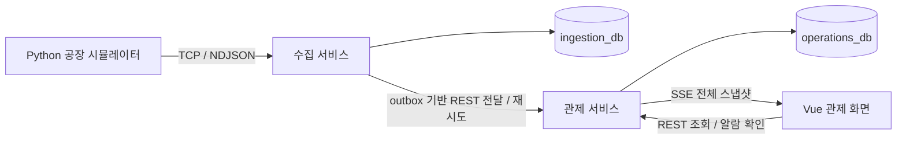

# 가상 제조공장 실시간 통합 관제 시스템 — 단계별 개발 계획

> 계획 버전: v1.19 · 작성일: 2026-10-04 · 갱신일: 2026-10-05 · 기준 시간대: Asia/Seoul  
> 진행 방식: 소규모 MSA · 작업 단위 구현/테스트 · 단계별 완료 기준  
> 현재 상태: S00~S09의 P0 구현·검증·문서·재현 산출물을 완료했다. 정상300초×3·스트레스120초×3×3을 측정하고 원본151,073건을 두 DB와 대조했다. 정상 실제 입력은25.63~25.72건/s, 작은 전경 화면의 반영 p95는98.20~98.50ms였다. 높은 입력 목표는 미생성이고 실제96.64~128.19건/s에서 관제 전달 대기와 최대 약54초 SSE 지연을 관측했다. 10만 로그 조회·기존 데이터 재시작·새5대 시연·캡처7장/21초 단계 영상, 작업37~40·ADR-002를 정리했다. 스택·흰색/네이비/파랑 UI·개발 DB/볼륨을 유지했다. 성능 목표의 달성/미검증과 수백 대 차량 등 후속 범위를 구분한다. [S09 실제 결과](<docs/development/S09 측정·완료 기록.md>).

## 1. 계획을 사용하는 방법

날짜별로 개발량을 배정하지 않는다. **작업 구현 → 테스트 → 관련 회귀 확인 → 결과 기록 → 단계 완료 확인** 순서로 진행한다. 하나의 단계가 여러 작업 세션에 걸쳐 이어져도 된다. 실제 소요 시간은 결과 기록에 남기되, 날짜가 지났다는 이유로 다음 단계로 넘어가지 않는다.

서비스는 실행·배포·데이터 소유의 경계다. 작업 단위는 그 서비스 안에서 독립적으로 구현·검증할 수 있는 기능이다. 한 작업 요청으로 서비스 전체를 완성하려 하지 않고, 아래 작업 ID 하나 또는 긴밀하게 연결된 소수 작업을 지정한다.

이 문서는 개발 순서·작업 범위·완료 기준의 기준 문서다. [기획서](<가상 제조공장 실시간 통합 관제 시스템 - 기획서.md>)는 요구사항과 설계를, [해설집](<가상 제조공장 실시간 통합 관제 시스템 - 해설집.md>)은 개념과 사례를 설명한다. 계약 변경은 관련 문서·예시·테스트에 함께 반영한다.

각 작업에는 `docs/work-notes/작업 N. 작업 이름.md` 설명 파일을 함께 작성한다. 웹개발을 처음 접하는 사람이 이해할 수 있도록 **이번 작업의 목적, 각 기술의 역할, 실제 동작 사례, 변경 내용, 필요한 최소 검증의 결과, 남은 작업**을 설명한다. 작업 번호와 계획의 작업 ID를 함께 기록하고, 이 계획과 README에서 연결한다.

### 1.1 사용자 당부 — 테스트는 최소한으로

> **테스트는 최소한으로 수행한다. 해당 변경의 정확성과 핵심 기능을 확인하는 데 꼭 필요한 테스트만 작성·실행한다.**

- 기존 테스트로 충분하면 새 테스트를 추가하지 않는다. 테스트 수나 커버리지 수치를 높이는 것을 목표로 삼지 않는다.
- 이번 변경과 직접 관련된 핵심 동작·경계·실패만 확인한다. 단계마다 모든 테스트 종류나 전체 테스트 묶음을 일괄 실행하지 않는다.
- 단순 문구·스타일·설정 변경이나 구현 구조를 그대로 따라 하는 테스트는 불필요하게 작성하지 않는다.
- 필요한 테스트가 통과하면 검증을 끝낸다. 추가 변경·실패·구체적인 미해결 문제가 없는 한 같은 검증을 반복하거나 범위를 넓히지 않는다.
- 슬롯 예약·차체 보존·중복 반영·저장 실패처럼 업무 정확성을 좌우하는 규칙은 필요한 최소 사례로 확인한다. 최소 검증 원칙이 핵심 오류를 확인하지 않아도 된다는 뜻은 아니다.

**이 원칙은 아래 모든 단계에 적용한다.** 단계별 테스트 목록은 검증 후보이며 매 작업에서 전부 수행할 체크리스트가 아니다. 변경 범위에 꼭 필요한 사례만 선택하고, 각 완료 기준을 입증할 수 있으면 종료한다.

## 2. 유지할 범위와 기술 스택

| 항목 | 기준 |
|---|---|
| 공장 | 독립 셀 ASM-01·ASM-02·QC-01, 고정된 비순환 경로 |
| 차체 | 실행별 bodyId/tagId 1:1, 차체는 한 순간에 한 물리 위치만 소유 |
| 차량 | 차체 AGV 2대, 부품 AMR 1대. 부품 운송은 차체 슬롯 계산에서 제외 |
| 버퍼 | 셀 작업 자리와 별도인 Parking Bay. 기본 3칸, 구성 범위 2~4칸 |
| 만석 | W(대기) + R(유효 예약) ≥ C(전체 슬롯)이면 신규 배출 차단 |
| 예약 | 픽업 전 배차·이동·인계까지 포함. 실제 픽업 전에는 차체가 앞 셀에 남음 |
| 전환 | 도착 R→W는 슬롯 반환이 아님. Bay→셀 진입으로 W가 줄어야 여유 발생 |
| 취소 | 출발 전만 지원. 통신 단절·서버 시간만으로 예약 자동 만료 금지 |
| 태그 | 가상 식별자와 GUI 조회. 실물 리더·무선 측위 제외 |
| Java | Java 21, Spring Boot, Maven Wrapper, Spring JDBC/JdbcClient, Flyway |
| DB | PostgreSQL 17, 서비스별 DB·계정·마이그레이션 분리 |
| 화면 | Vue 3·JavaScript·Vite, SVG·CSS·requestAnimationFrame, Apache ECharts |
| 시뮬레이터 | Python 3, 단일 상태 변경 루프, 결정적인 검증용 시나리오 |
| 통신·실행 | TCP/NDJSON, REST, SSE, Docker Compose |

S01-01에서 Java release 21(실제 Temurin 21.0.7+6), Spring Boot 4.1.1, Maven 3.10.0, Wrapper 3.3.4를 고정했다. [버전과 빌드 기준](<docs/development/실행 버전과 빌드 기준.md>)을 따른다. S01-02의 실제 PostgreSQL은 17.11이다. S01-03~04에서 Docker 29.8.2·Compose 5.6.0·Node 24.21.0·Vue 3.5.43·Vite 8.3.2를 확인했다. 이미지 digest와 npm 잠금 파일은 실행 버전 기준을 따른다. MSA를 이유로 별도 메시지 브로커·서비스 디스커버리·클러스터 플랫폼을 기본 범위에 추가하지 않는다. 수백 대 차량 시험은 P0 완료 후 P2 확장으로 둔다.

## 3. 서비스와 데이터 소유권

S00-01에서 확정한 상세 책임·표별 소유권·통신 경계는 [ADR-001](<docs/decisions/ADR-001-서비스 책임과 데이터 소유권.md>)에 기록했다. 쉬운 설명은 [작업 1 해설](<docs/work-notes/작업 1. 서비스 책임과 데이터 소유권.md>)에서 볼 수 있다.

| 실행 단위 | 책임 | 소유하는 상태·데이터 |
|---|---|---|
| `factory-simulator` · Python | 셀 작업·배차·차체/태그·예약/반환·운송·검사·장애 주입 | 권위 있는 공장 시뮬레이션 상태, 미확인 송신 대기 목록 |
| `ingestion-service` · Spring | TCP 프레임 조립, 입력 검증, 원본 중복 판정·저장, ACK, 관제 서비스로 재전달 | `ingestion_db`: 원본 이벤트, outbox(전달 대기), delivery_stream(다음 순번/중단), 전달 결과·delivery_action(재개 기록) |
| `operations-service` · Spring | 업무 검증, 현재 상태 투영, 검사/작업/운송 이력·집계·알람, REST/SSE | `operations_db`: 처리 이벤트 기록, 조회용 이벤트 투영, 현재 스냅샷, 메타데이터, 업무 이력, 알람 |
| `factory-console` · Vue | 지도·태그 상세·슬롯·품질·알람 표시와 조회 | 선택 대상·필터·연결 상태 등 UI 상태. 업무 판단용 DB 없음 |

각 Spring 서비스는 독립적으로 빌드·실행·재시작할 수 있도록 한다. 저장소는 하나로 유지해도 된다. 개발 환경의 PostgreSQL 인스턴스는 공유할 수 있지만 **DB·접속 계정·접근 권한은 분리**한다. 다른 서비스 DB를 직접 조회하거나 서비스 간 외래키·SQL JOIN을 만들지 않는다.

셀·차체·태그·버퍼를 각각 별도 서비스로 나누지 않는다. 공장의 물리적 변경은 Python이 결정하고, 관제 서비스는 같은 스냅샷 안에서 차체·셀·슬롯·차량의 정합성을 검증한다. 서버와 GUI는 별도로 같은 운송을 승인하지 않는다.



### 3.1 MSA에서 달라지는 저장·응답 계약

1. 수집 서비스가 원본 이벤트와 전달 대기 기록을 **수집 DB의 같은 트랜잭션**으로 커밋한다.
2. 커밋 후 `RECEIVED`를 응답한다. 동일 내용이 이미 저장됐다면 `DUPLICATE_RECEIVED`다. 이는 관제 화면 반영 완료를 뜻하지 않는다.
3. 수집 서비스의 전달 작업이 관제 서비스의 내부 REST API로 이벤트를 보낸다. 전송 실패·응답 유실 시 같은 이벤트를 재전달한다.
4. 관제 서비스는 처리 이벤트 기록과 해당 업무 이력·현재 상태 변경을 **관제 DB의 같은 트랜잭션**으로 커밋한다. `APPLIED` 또는 `DUPLICATE_APPLIED`로 결과를 알린다.
5. 관제 서비스에서 커밋됐지만 응답이 유실돼도 재전달로 이력·검사를 다시 반영하지 않는다.
6. 일시 오류는 제한된 backoff로 재시도하고, 업무적으로 잘못된 이벤트는 영속적인 거절/격리 기록으로 남긴다. 이미 수집한 이벤트를 소리 없이 삭제하거나 무한 재시도하지 않는다.

위 응답 이름·필드·호환성은 S00-03의 [v1 전달 계약](contracts/v1/delivery.md)에 확정했다. 기존 단일 서버 문서의 ‘원본+업무 반영을 모두 커밋한 뒤 TCP COMMITTED’ 의미를 그대로 가져오지 않는다. 서로 다른 서비스의 두 DB를 하나의 로컬 트랜잭션으로 처리한다고 가정하지 않는다.

동일 run/source는 전달 계약의 next_source_seq부터 한 건씩 보낸다. 누락·참조 미확인은 제한된 대기 후 보류하고, 영구 거절은 원본을 격리하며 해당 run의 다음 전달을 막는다. 오래된 sourceSeq는 현재 상태를 덮지 못하지만 미반영 검사 사실은 보관한다. DB 일련번호의 최댓값만 재개 커서로 사용해 늦게 커밋된 기록을 건너뛰는 방식을 피한다.

수집됐지만 아직 반영되지 않은 건수·가장 오래된 대기 시간·거절 건수를 관측한다. TCP 연결 정상만으로 LIVE를 표시하지 않는다. 공장 상태의 발생 시각과 관제 반영 지연을 함께 확인하며 뒤처진 상태는 `CATCHING_UP`/오래된 데이터로 구분한다. 대기 기록도 상한과 실패 정책을 갖는다.

### 3.2 목표 디렉토리

아래 구조는 구현 목표이며 현재 생성된 코드가 아니다.

```text
프로젝트 루트/
├── factory-gui/                   # 기존 독립 샘플 유지
├── services/
│   ├── ingestion-service/        # 별도 Spring 앱·pom·Flyway·테스트
│   └── operations-service/       # 별도 Spring 앱·pom·Flyway·테스트
├── simulator/                    # Python 모델·전송·시나리오·테스트
├── frontend/                     # Vue 앱·컴포넌트·상태 공급부·테스트
├── contracts/                    # 버전별 이벤트/API 계약·공통 예제
├── docs/                         # 설계 결정·검증 기록·작업 기록
├── scripts/                      # 실행·검증·재현 명령
├── artifacts/                    # 로그·캡처·측정 결과
└── compose.yaml
```

공통 계약 예제는 공유할 수 있지만 서비스의 DB 엔티티·업무 구현을 공통 라이브러리로 묶어 서로의 배포를 강제하지 않는다.

## 4. 단계 개요와 의존성

| 단계 | 목표 | 시작 조건 | 종료 증거 |
|---|---|---|---|
| S00 | 설계·통신 계약 확정 | 현재 기획/샘플 검토 | 데이터 소유·ACK·이벤트/API 계약·정상/오류 예제 |
| S01 | 독립 실행 기반 | S00 | 서비스별 빌드·DB 마이그레이션·기동·권한 검증 |
| S02 | Python 공장 모델 | S00, 실행 환경 준비 | 슬롯·태그·차체 보존·운송 모델 테스트 |
| S03 | TCP 수집·영속 저장 | S01, 이벤트 계약 | 조각/다중 프레임·중복·커밋 후 ACK·DB 실패 테스트 |
| S04 | 관제 업무 처리 | S01, 계약/모델 예제 | 업무 이력·현재 상태·중복/순서/거절 테스트 |
| S05 | 서비스 간 신뢰성 | S03 + S04 | 재전달·재시작·응답 유실·격리·지연 관측 테스트 |
| S06 | 첫 전체 데이터 연결 | S02 + S05 | 차체 1대의 TCP→두 서비스→DB→SSE→Vue 실제 변화 |
| S07 | 전체 관제 기능 | S06 | 3셀·AGV/AMR·태그/슬롯·품질·알람의 실제 데이터 연동 |
| S08 | 장애·복구 통합 검증 | S07 | 만석/반환·중복·연결/서비스/DB 장애·복구 재현 |
| S09 | 측정·문서·완료 검증 | S08 | 실제 성능 결과·재실행 절차·시연·P0 완료 목록 |

S02와 S03/S04는 계약 예제로 서로 의존성을 낮출 수 있다. 기본 진행은 한 작업 단위씩 순차적으로 한다. S06에서 최소 화면을 먼저 연결하고 S07에서 전체 GUI를 완성한다. 모든 기능을 작성한 뒤 마지막에 연결하지 않는다.

## 5. 단계별 작업과 완료 기준

### S00 — 설계·계약 확정

**목표:** 서비스와 테스트가 같은 데이터의 의미를 공유한다.

- [x] **S00-01:** 책임·DB 소유권·시뮬레이터의 상태 변경 권한을 설계 결정에 기록한다. [설계 결정](<docs/decisions/ADR-001-서비스 책임과 데이터 소유권.md>) · [작업 1 해설](<docs/work-notes/작업 1. 서비스 책임과 데이터 소유권.md>)
- [x] **S00-02:** run/body/tag/cell/slot/reservation/transport 식별자, 시각·순번, 이벤트 schemaVersion과 샘플을 정의한다. [v1 사건 계약](contracts/v1/events.md) · [작업 2 해설](<docs/work-notes/작업 2. 식별자와 사건 데이터 규격.md>)
- [x] **S00-03:** TCP ACK와 내부 REST 처리 결과를 분리하고 재시도/격리/전달 순서·상한·호환성 정책을 정한다. [v1 전달 계약](contracts/v1/delivery.md) · [작업 3 해설](<docs/work-notes/작업 3. 저장 확인과 서비스 간 전달.md>)
- [x] **S00-04:** 관제 REST/SSE의 현재 값·이력·freshness·반영 지연 계약, 검증 시나리오와 테스트 도구를 정한다. [v1 화면 계약](contracts/v1/monitoring.md) · [최소 검증 도구](<docs/validation/최소 검증 시나리오와 도구.md>) · [작업 4 해설](<docs/work-notes/작업 4. 화면 조회와 실시간 상태 전달.md>)

**테스트/검토:** 정상·누락 필드·ID 충돌·중복·오래된 상태·잘못된 슬롯 예제가 각각 어떤 결과를 내는지 계약만으로 판별한다. 생산/품질 표본과 부하용 데이터를 구분한다.

**완료 기준:** 각 데이터를 쓰는 서비스가 하나로 정해지고, 저장 완료와 업무 반영 완료를 혼동하지 않는다. 계약 파일과 예제에 미해결 핵심 항목이 없다. 계약 버전과 지금 실행하는 검증 도구 버전·명령을 기록한다. 앱/이미지의 정확한 패치 버전과 실제 빌드 명령은 S01에서 고정한다.

### S01 — 서비스별 실행 기반

**목표:** 두 Spring 앱과 저장소를 독립적으로 실행할 수 있다.

- [x] **S01-01:** 각 앱의 Maven Wrapper·설정·테스트 구조, 고정한 실행 버전을 준비한다. [서비스 실행 안내](services/README.md) · [버전 기준](<docs/development/실행 버전과 빌드 기준.md>) · [작업 5 해설](<docs/work-notes/작업 5. 두 Spring 앱의 실행 기반.md>)
- [x] **S01-02:** PostgreSQL의 두 DB와 제한된 서비스 계정, 서비스별 Flyway 마이그레이션을 준비한다. [DB 실행 안내](infrastructure/postgresql/README.md) · [작업 6 해설](<docs/work-notes/작업 6. 두 DB와 서비스별 저장 구조.md>)
- [x] **S01-03:** Compose 기동·종료·readiness·환경 변수·로그와 검증 명령을 구성한다. [전체 실행 안내](infrastructure/README.md) · [작업 7 해설](<docs/work-notes/작업 7. Compose와 실행 준비 상태.md>)
- [x] **S01-04:** Python 실행/테스트 환경과 Vue/Vite 기본 앱을 준비한다. [Python 안내](services/factory-simulator/README.md) · [Vue 안내](services/factory-console/README.md) · [작업 8 해설](<docs/work-notes/작업 8. Python과 Vue 기본 앱.md>)

**테스트:** 서비스별 빌드, DB 연결·마이그레이션, 상대 DB 접근 거절, 한 서비스 중단 시 다른 서비스 프로세스 유지, 필수 설정 누락 시 명확한 시작 실패.

**완료 기준:** 독립 빌드/기동 명령과 전체 기동 명령이 재현된다. 초기 기동으로 기존 DB 이력을 지우지 않는다. 코드 골격 기동을 업무 기능 완료로 기록하지 않는다.

### S02 — 공장 도메인 모델

**목표:** 네트워크 없이 Python에서 물리적 공장 규칙을 검증한다. 기존 JS 샘플은 참고 자료이며 Python 구현의 테스트를 대체하지 않는다.

- [x] **S02-01:** 실행 설정과 가상 차체·태그 등록, 단일 위치 소유 규칙을 구현한다. [Python 모델 실행 안내](services/factory-simulator/README.md) · [작업 10 해설](<docs/work-notes/작업 10. 공장 설정과 차체·태그 등록.md>)
- [x] **S02-02:** 셀 작업 시작/완료, 검사 결과와 차체 상태 전이를 구현한다. [작업 11 설명](<docs/work-notes/작업 11. 셀 작업과 최종 검사.md>)
- [x] **S02-03:** 슬롯 확인·AGV 확보·예약을 한 상태 변경 루프에서 처리하고 배출 차단 사유를 구현한다. [작업 12 설명](<docs/work-notes/작업 12. 슬롯 예약과 AGV 배차.md>)
- [x] **S02-04:** 픽업·이동·Bay 인계·셀 진입·슬롯 반환·재배차를 구현한다. [작업 13 설명](<docs/work-notes/작업 13. AGV 운송과 버퍼 슬롯 반환.md>)
- [x] **S02-05:** 출발 전 취소·반복 취소/도착 방지, 부품 AMR 분리, 결정적인 장애 시나리오를 구현한다. [작업 14 설명](<docs/work-notes/작업 14. 취소와 장애 복구 및 공장 모델 검증.md>)

**테스트:** C=3/W=2/R=1에서 신규 배출 거절, 도착 후 W=3/R=0/A=0, 셀 진입 후 A=1과 배차 1건 승인. 마지막 슬롯을 요구한 서로 다른 두 요청 중 하나만 승인한다. 예약 후 실제 픽업 전 차체는 앞 셀에 남는다. 출발 후 취소를 거절하고 통신 시간만으로 예약을 반환하지 않는다. 2~4칸 경계와 100대 순환에서 차체·태그·슬롯 보존, 검사 중복 없음, 부품 차량 제외를 검사한다.

**완료 기준:** GUI나 서버 없이 모델 테스트 명령만으로 결과를 재현한다. 모델의 사건과 같은 상태 전환을 나타내는 전체 스냅샷을 만들 수 있다.

### S03 — TCP 수집과 저장

**목표:** 수신한 원본과 전달할 책임을 수집 DB에 보존한다.

- [x] **S03-01:** UTF-8 NDJSON 조립, 크기 상한, 연결/입력 큐와 오류 처리를 구현한다. [S03-01 설명](<docs/work-notes/작업 15. S03-01 TCP 입력 조립과 수신 제한.md>)
- [x] **S03-02:** schema/식별자 검증, 동일 ID·내용 중복과 다른 내용 충돌을 구분한다. [S03-02 설명](<docs/work-notes/작업 16. S03-02 사건 검증과 중복 구분.md>)
- [x] **S03-03:** 원본+outbox 저장 트랜잭션과 커밋 후 ACK를 구현한다. [S03-03 설명](<docs/work-notes/작업 17. S03-03 원본과 전달 대기 저장 및 ACK.md>)
- [x] **S03-04:** Python 송신의 미확인 목록·ACK 처리·제한된 재전송을 구현한다. [S03-04 설명](<docs/work-notes/작업 18. S03-04 Python ACK 처리와 제한된 재전송.md>)

**테스트:** 한 메시지를 여러 TCP read로 나누기, 여러 메시지를 한 read로 합치기, UTF-8 문자 중간 분할, 잘못된 JSON·과대 프레임, 중복/충돌, DB rollback, 커밋 직후 ACK 유실, 입력 큐 상한. 실제 PostgreSQL에서 원본과 전달 대기가 함께 커밋/rollback되는지 확인한다.

**완료 기준:** 원본 저장이 확정된 뒤에만 성공 ACK를 보낸다. ACK 유실 재전송으로 원본·전달 대기가 중복 생성되지 않는다. 큐·대기 기록 상한에서 실패를 드러낸다.

### S04 — 관제 업무 처리와 조회 기반

**목표:** 수집한 사건에서 신뢰할 수 있는 관제 상태·이력을 만든다.

- [x] **S04-01:** 내부 이벤트 수신 API, 업무 검증과 영속적인 처리 이벤트 기록을 구현한다. [S04-01 설명](<docs/work-notes/작업 19. S04-01 내부 사건 수신과 업무 처리 기록.md>)
- [x] **S04-02:** 차체/태그 메타데이터, 작업·운송·검사 fact, 최신 전체 스냅샷 투영을 구현한다. [S04-02 설명](<docs/work-notes/작업 20. S04-02 차체·태그와 업무 이력 및 최신 상태.md>)
- [x] **S04-03:** 현재 차체/셀/Bay/차량 조회, 이력 페이지, 검사 집계의 SQL과 DTO를 구현한다. [S04-03 설명](<docs/work-notes/작업 21. S04-03 관제 조회 API와 검사 집계.md>)
- [x] **S04-04:** 데이터 신선도·지연 관측, 셀 고장 알람·확인·복구의 기본 규칙을 구현한다. [S04-04 설명](<docs/work-notes/작업 22. S04-04 데이터 신선도와 알람 확인·복구.md>)

**테스트:** 같은 eventId의 재반영, 다른 eventId에 같은 inspectionId, tagId 충돌, 잘못된 슬롯/소유자, 오래된 스냅샷, 지연 검사 fact, 이전 run 혼입, 트랜잭션 중간 실패. 최근 5분 검사 100/FAIL 20, 표본 0, 경계 시각을 고정된 데이터로 확인한다.

**완료 기준:** 처리 기록과 업무 반영이 관제 DB에서 함께 커밋/rollback된다. 처리 실패를 이미 반영된 것으로 표시하지 않는다. 현재 값은 뒤로 가지 않으면서 늦은 검사 사실은 보관한다. 실제 PostgreSQL 제약과 조회 결과를 검증한다.

### S05 — 서비스 간 전달·재시도

**목표:** 서비스가 잠시 멈추거나 응답이 끊겨도 저장한 이벤트를 추적할 수 있다.

- [x] **S05-01:** outbox의 영속적인 전달 상태와 REST 전달 작업, timeout/backoff/상한을 구현한다. [S05-01 설명](<docs/work-notes/작업 23. S05-01 영속 outbox와 자동 HTTP 전달.md>)
- [x] **S05-02:** 성공·중복·일시 실패·영구 거절 처리와 run/source의 순서 정책을 구현한다. [S05-02 설명](<docs/work-notes/작업 24. S05-02 전달 결과와 순서·격리.md>)
- [x] **S05-03:** 재시작 시 대기 기록 복구, 반영 지연·대기량·격리 기록 조회를 구현한다. [S05-03 설명](<docs/work-notes/작업 25. S05-03 재시작 복구와 전달 진단·재개.md>)

**테스트:** 관제 서비스 중단, 관제 DB 중단, 관제 커밋 후 응답 유실, 수집 서비스의 전달 완료 기록 전 종료, 서비스 재시작, 영구 오류. 장애 해제 후 동일 eventId를 재전달해 결과가 중복되지 않고 대기가 해소되는지 확인한다. 영구 거절 시 결과와 진행 정책이 기록되어야 한다.

**완료 기준:** 수집 ACK가 관제 반영 완료로 오인되지 않는다. 전달은 재시도될 수 있지만 업무 결과는 중복 반영되지 않는다. 소비가 멈추면 대기 상한과 실패 정책이 동작한다. 전체 시스템을 무조건 exactly-once라고 표현하지 않는다.

### S06 — 첫 전체 연결

**목표:** 차체 1대·셀 1개로 전체 데이터 흐름을 실제 연결한다.

- [x] **S06-01:** 최소 Python 시나리오를 TCP→수집 DB→내부 REST→관제 DB까지 전달한다. [S06-01 설명](<docs/work-notes/작업 26. S06-01 Python 최소 시나리오와 실제 전달.md>)
- [x] **S06-02:** 기준 시각·순번을 가진 REST 현재 값과 SSE 전체 스냅샷을 연결한다. [S06-02 설명](<docs/work-notes/작업 27. S06-02 REST와 SSE 전체 상태 연결.md>)
- [x] **S06-03:** Vue의 최소 셀 표시와 차체/태그 상세에 실제 수신 데이터를 연결한다. [S06-03 설명](<docs/work-notes/작업 28. S06-03 Vue 셀 관측과 차체·태그 상세.md>)

**테스트:** 같은 runId/bodyId/tagId가 모든 경계에서 일치하는지 확인한다. 시뮬레이터 상태 변경이 DB와 REST/SSE·화면까지 도달해야 한다. 소스가 중단되면 화면이 임의의 데모 상태를 생성하지 않아야 한다.

**완료 기준:** 정상 실행 명령, 이벤트 예제, 두 DB의 관련 결과와 화면 증거가 남는다. HTML 샘플의 JS 모델을 실제 데이터 공급부로 사용하지 않는다.

### S07 — 전체 관제 기능

**목표:** 기획서의 P0 공장과 GUI를 실제 데이터에 연결한다.

- [x] **S07-01:** 3셀·차체 AGV 2대·부품 AMR 1대와 셀별 Bay 지도를 연결한다.
- [x] **S07-02:** 태그 검색·차체 상세·관련 이력, 셀/Bay/차량 상세를 연결한다.
- [x] **S07-03:** 품질 지표·ECharts·알람 확인/복구·기록 조회를 연결한다.
- [x] **S07-04:** 선택/필터 유지, 오래된 REST 응답과 최신 SSE의 적용 순서, 모바일/키보드 접근을 구현한다.

**S07 완료 기록:** S07-01~04에서 실제 3셀·AGV 2대·AMR 1대·Bay SVG 지도, 태그 검색과 대상별 상세/이력, 동일 기간 품질 지표·ECharts, 알람 확인/복구 관측과 사건/알람 기록을 연결했다. 선택/필터 유지·지연 응답 배제·모바일/키보드도 확인했다. 실제 정상 등록 P0 실행의 원본 556건이 두 DB에 같은 바이트/해시로 저장됐고 프록시 SSE 1,070개 묶음을 확인했다. W2/R1/A0→W3/R0/A0→셀 진입 W2/R0/A1, 소스 중단 시 위치/예약 보존, 확인 후에도 설비 고장 유지와 실제 복구를 확인했다. 검사5/PASS4/FAIL1·비율20.0%와 태그 HOLD/FAIL이 실제 API/화면에서 일치했다. 필요한 검증은 Node5개·Python 신규2개와 기존 송신 회귀1개, Vue 빌드와 실제 연결 하나로 제한했다. Java/계약 v1/Flyway/DB/볼륨과 기존 스택을 유지하고 기획에 정한 ECharts6.1.0만 잠금 파일에 추가했다. 일반 기동은 자동 생산하지 않는다. S07 완료 당시 다음은 S08-01이었다. [S07-01 설명](<docs/work-notes/작업 29. S07-01 실제 공장 SVG 지도와 차량·슬롯.md>) · [S07-02 설명](<docs/work-notes/작업 30. S07-02 스마트태그 검색과 대상별 상세·이력.md>) · [S07-03 설명](<docs/work-notes/작업 31. S07-03 품질 차트와 알람 확인·기록 조회.md>) · [S07-04 설명](<docs/work-notes/작업 32. S07-04 선택·조회 순서와 모바일·키보드 접근.md>)

**테스트:** 만석 3단계의 W/R/A·차체 위치가 모델/DB/API/화면에서 일치한다. 픽업 전 예약과 이동 중 적재를 구분한다. 검사 결과와 동일 구간의 품질 집계가 일치한다. 연결 단절 시 위치 보간을 멈추며 태그 창도 같은 관측 상태를 따른다. 버퍼 만석은 셀 고장 알람과 구분한다.

**완료 기준:** 주 기능을 실제 데이터로 조작·설명할 수 있다. 결과가 비슷해 보이는 임의 숫자로 테스트를 대체하지 않는다. 데스크톱·모바일의 주요 화면 증거를 남긴다.

### S08 — 장애·복구와 P0 통합 검증

**목표:** 경계마다 실패를 주입해 유지해야 하는 상태와 재처리를 확인한다.

- [x] **S08-01:** 만석·도착·반환·셀 정지·정상화 시나리오를 전체 경로에서 재현한다.
- [x] **S08-02:** 시뮬레이터↔수집 TCP와 관제↔브라우저 SSE 단절을 별도로 검증한다.
- [x] **S08-03:** 각 서비스/DB 중단·재시작·재전달·지연/중복 사건을 검증한다.
- [x] **S08-04:** 100대 정상 순환·차체 단일 위치·검사/운송 중복·run 격리를 통합 검증한다.

**테스트:** 알람 확인 후에도 고장 상태 유지, 실제 복구 후 확인 이력 유지, 마지막 수신값/freshness, 현재 스냅샷 복원과 지연 사실 보관, 예약 자동 만료 없음. 두 서비스의 장애 지점을 구별하고 처리 대기가 복구되는지 확인한다.

**완료 기준:** 기획서 10장의 P0 사례와 MSA 전달 사례에 기대/실제 결과가 있다. 핵심 실패는 해결하거나 해당 단계를 미완료로 남긴다. Python 송신 대기 목록이 메모리 기반인 P0에서는 시뮬레이터 프로세스 자체의 비정상 종료까지 무손실을 보장하지 않는다.

**S08 완료 기록:** S08-01~04에서 별도 PostgreSQL과 두 서버로 예약 취소/반환·목적 셀 정지 중 도착·확인/복구, TCP ACK 유실/재전송·12초 보고 단절, 양 서비스와 개별 DB·PostgreSQL 재시작을 확인했다. 최종 5대 실행 원본216건과 100대 실행 원본3,533건은 두 DB에서 순번·바이트·해시가 일치했다. 100대의 2,764 tick에서 단일 위치/용량을 확인하고 중간 전체 스냅샷28개와 최종 상태를 관제 API와 비교했다. 작업300/검사100/운송400·PASS80/FAIL20, 검사/운송 원본 각각10회 재전송의 실적 증가0·run 격리가 통과했다. 실제 Chrome의 SSE 단절/복구·태그 선택/마지막 값 보존은 별도 실행 증거를 명시해 재사용했다. 기존 Java 관련2개만 선택 실행했고 전체 테스트·새 의존성·DDL·운영 코드 변경은 없다. 기존 스택과 흰색/네이비/파란색 UI·개발 DB/볼륨을 유지했다. 논리 공정의 정확성 검증이며 S08은 기능 정확성 기록이다. 이후 S09 실제 측정 결과를 별도로 기록했다. [S08-01 설명](<docs/work-notes/작업 33. S08-01 만석·예약 반환과 셀 정지·정상화.md>) · [S08-02 설명](<docs/work-notes/작업 34. S08-02 TCP와 브라우저 SSE 단절·복구.md>) · [S08-03 설명](<docs/work-notes/작업 35. S08-03 서비스·DB 재시작과 지연·중복 사건.md>) · [S08-04 설명](<docs/work-notes/작업 36. S08-04 100대 정상 순환과 차체·실행 격리.md>) · [S08 통합 결과/재실행](<docs/development/S08 장애·복구 통합 검증.md>)

### S09 — 측정·재현·산출물 정리

**목표:** 실제 동작과 측정 근거를 재실행 가능한 결과물로 남긴다.

- [x] **S09-01:** 기본 입력 부하, 프레임 크기, 수집/전달/반영/SSE 지연과 대기량을 측정한다.
- [x] **S09-02:** 주요 SQL과 화면 비용을 측정하고, 확인한 병목이 있다면 같은 조건에서 개선 전후를 비교한다.
- [x] **S09-03:** 초기 환경 및 기존 데이터가 남은 재실행, 마이그레이션·복구·시연 명령을 문서화한다.
- [x] **S09-04:** P0 상태표, 검증 결과, 설계 결정, 캡처·영상·한계를 정리한다.

**테스트:** 생성한 고유 이벤트, 수집 저장, 업무 반영, 중복/거절/대기 수를 대조한다. 초당 수신 시도 횟수를 검사 실적으로 취급하지 않는다. 환경·입력·실행 시간·p95 등 측정 조건을 기록한다. 목표 미달 결과도 남긴다.

**완료 기준:** 새 실행 세션에서 정상·만석·복구를 재현할 수 있다. 구현 범위와 측정 결과가 일치한다. 소수 차량 결과를 수백 대 검증 성과로 확대하지 않는다.

**S09 완료 기록:** S00~S09의 P0 구현·검증·문서·재현 산출물을 완료했다. 정상300초×3·스트레스120초×3×3을 측정하고 원본151,073건을 두 DB와 대조했다. 정상 실제 입력은25.63~25.72건/s, 작은 전경 화면의 반영 p95는98.20~98.50ms였다. 높은 입력 목표는 미생성이고 실제96.64~128.19건/s에서 관제 전달 대기와 최대 약54초 SSE 지연을 관측했다. 10만 로그 조회·기존 데이터 재시작·새5대 시연·캡처7장/21초 단계 영상, 작업37~40·ADR-002를 정리했다. 스택·흰색/네이비/파랑 UI·개발 DB/볼륨을 유지했다. 성능 목표의 달성/미검증과 수백 대 차량 등 후속 범위를 구분한다.

[S09-01 설명](<docs/work-notes/작업 37. S09-01 실제 입력 부하와 구간별 지연 측정.md>) · [S09-02 설명](<docs/work-notes/작업 38. S09-02 SQL과 실제 화면 비용 확인.md>) · [S09-03 설명](<docs/work-notes/작업 39. S09-03 초기 실행과 기존 데이터 재실행 안내.md>) · [S09-04 설명](<docs/work-notes/작업 40. S09-04 P0 완료표와 시연 산출물 정리.md>) · [통합 기록](<docs/development/S09 측정·완료 기록.md>) · [재실행 안내](<docs/development/초기 실행·재실행·복구·시연.md>) · [시연 단계 재생](docs/development/s09-demo/index.html)

## 6. 작업 단위의 개발·검증 절차

1. **작업 범위 확인:** 작업 ID, 선행 결과, 계약과 기대 동작을 읽는다. 변경할 서비스·파일과 영향을 정한다.
2. **검증 사례 확정:** 1.1의 최소 검증 원칙에 따라 이번 변경에 꼭 필요한 사례만 고른다. 기존 테스트를 우선 사용하고, 핵심 규칙의 확인에 필요한 경우에만 자동 테스트를 추가한다.
3. **구현:** 도메인 계산과 TCP/HTTP/DB/SSE 입출력 경계를 분리한다. 날짜별 목표량에 맞추려고 여러 기능을 섞지 않는다.
4. **테스트:** 선택한 최소 사례에 맞는 검증만 수행한다. 모델 규칙은 단위 테스트, DB 제약은 실제 PostgreSQL, 통신은 실제 소켓/HTTP, 화면은 브라우저 검증을 사용하되 모든 종류를 매번 수행하지 않는다.
5. **회귀 확인:** 변경 영향이 있는 기존 기능에 한해 필요한 테스트만 실행한다. 추가 변경·실패·구체적인 미해결 문제가 없으면 통과한 검증을 반복하거나 전체 테스트로 확대하지 않는다.
6. **결과 기록:** 변경 내용, 정확한 실행 명령, 기대/실제 결과와 제한을 남긴다. 테스트 환경이 없어 실행하지 못한 것은 통과로 쓰지 않는다.
7. **완료 판단:** 해당 작업과 단계의 필수 기준이 모두 충족되면 체크한다. 핵심 미해결 실패가 있으면 의존하는 다음 작업을 시작하지 않는다.

DB 정합성을 메모리 가짜 DB나 SQLite만으로 입증하지 않는다. getter·컴포넌트 구조만 따라 하는 테스트나 사소한 문구/색 변경의 테스트는 우선하지 않는다. 테스트 도구는 0~1단계에서 기존 스택의 개발 환경에 맞춰 정하고 재현 명령을 추가한다.

### 6.1 개발 요청 양식

아래는 완료한 S09-01의 요청 예시다. 새 작업에는 필요한 범위와 ID를 다시 정하며 측정을 자동 반복하지 않는다.

```text
작업 ID: S09-01
목표: 기본 입력 부하·프레임 크기·수집/전달/반영/SSE 지연과 대기량의 실제 측정
선행 결과: S08 장애·복구와 실제 100대 기능 정확성 검증
구현 범위: 재현 가능한 측정 조건·생성량/고유 저장/미확인/대기량과 지연 기록
핵심 테스트:
- 이미 통과한 S08 기능 시험은 변경/구체적인 문제 없으면 반복하지 않음
- 계측 경계에 필요한 최소 확인만 수행
완료 증거: 환경/조건·원본 결과·측정 구간과 실제 수치
보고 사항: 변경 파일, 쉬운 설명, 최소 검증 결과, 남은 S09 범위
```

### 6.2 작업 결과 기록 양식

```text
작업 ID / 상태: 미착수·진행·검증 실패·환경 대기·완료
목표와 구현한 동작:
변경한 서비스·파일·계약:
테스트 환경 / 정확한 실행 명령:
기대 결과 / 실제 결과:
확인한 데이터·로그·화면 증거:
발생한 문제 / 원인 / 해결 근거:
남은 실패·제한·실행하지 못한 검증:
실제 소요 시간 / 본인이 설명할 핵심 규칙:
다음 의존 작업:
관련 commit / 산출물 위치:
```

## 7. 진행 상태와 P0 종료 조건

체크박스는 실제 완료한 작업만 표시한다. S00-01~04의 책임·사건·전달·화면 계약은 완료했다. S00 완료는 설계 완료이며 실행 기반/실제 기능은 S01 이후다. 샘플 GUI의 검증을 Python·Spring·DB·Vue 본 구현 완료로 옮겨 적지 않는다.

| 단계 | 현재 상태 | 증거 |
|---|---|---|
| S00 | 완료 — S00-01~04 설계·계약 | [v1 화면 계약](contracts/v1/monitoring.md) · [작업 4 해설](<docs/work-notes/작업 4. 화면 조회와 실시간 상태 전달.md>) · [ADR-001](<docs/decisions/ADR-001-서비스 책임과 데이터 소유권.md>) · [v1 사건 계약](contracts/v1/events.md) · [v1 전달 계약](contracts/v1/delivery.md) · [작업 3 해설](<docs/work-notes/작업 3. 저장 확인과 서비스 간 전달.md>) |
| S01 | 완료 — S01-01~04 실행 기반, 당시 업무 기능은 미구현 | [전체 실행 안내](infrastructure/README.md) · [작업 7](<docs/work-notes/작업 7. Compose와 실행 준비 상태.md>) · [작업 8](<docs/work-notes/작업 8. Python과 Vue 기본 앱.md>) · [DB 실행 안내](infrastructure/postgresql/README.md) · [작업 6 해설](<docs/work-notes/작업 6. 두 DB와 서비스별 저장 구조.md>) · [두 앱 실행 기반](services/README.md) · [작업 5 해설](<docs/work-notes/작업 5. 두 Spring 앱의 실행 기반.md>) |
| S02 | 완료 — S02-01~05 모델/순환/사건·스냅샷 검증 | [작업 14 설명](<docs/work-notes/작업 14. 취소와 장애 복구 및 공장 모델 검증.md>) · [작업 13 설명](<docs/work-notes/작업 13. AGV 운송과 버퍼 슬롯 반환.md>) · [작업 12 설명](<docs/work-notes/작업 12. 슬롯 예약과 AGV 배차.md>) · [작업 11 설명](<docs/work-notes/작업 11. 셀 작업과 최종 검사.md>) · [작업 10](<docs/work-notes/작업 10. 공장 설정과 차체·태그 등록.md>) · [Python 모델 안내](services/factory-simulator/README.md) |
| S03 | 완료 — TCP/검증/원본·outbox·커밋 후 ACK/Python 재전송 | [S03-01 설명](<docs/work-notes/작업 15. S03-01 TCP 입력 조립과 수신 제한.md>) · [S03-02 설명](<docs/work-notes/작업 16. S03-02 사건 검증과 중복 구분.md>) · [S03-03 설명](<docs/work-notes/작업 17. S03-03 원본과 전달 대기 저장 및 ACK.md>) · [S03-04 설명](<docs/work-notes/작업 18. S03-04 Python ACK 처리와 제한된 재전송.md>) |
| S04 | 완료 — 내부 사건/업무·메타/이력/스냅샷·REST 조회/SQL·신선도/알람 | [S04-01 설명](<docs/work-notes/작업 19. S04-01 내부 사건 수신과 업무 처리 기록.md>) · [S04-02 설명](<docs/work-notes/작업 20. S04-02 차체·태그와 업무 이력 및 최신 상태.md>) · [S04-03 설명](<docs/work-notes/작업 21. S04-03 관제 조회 API와 검사 집계.md>) · [S04-04 설명](<docs/work-notes/작업 22. S04-04 데이터 신선도와 알람 확인·복구.md>) |
| S05 | 완료 — 자동 전달·결과/순서/격리·재시작 복구·진단/재개 | [S05-01 설명](<docs/work-notes/작업 23. S05-01 영속 outbox와 자동 HTTP 전달.md>) · [S05-02 설명](<docs/work-notes/작업 24. S05-02 전달 결과와 순서·격리.md>) · [S05-03 설명](<docs/work-notes/작업 25. S05-03 재시작 복구와 전달 진단·재개.md>) |
| S06 | 완료 — 최소 Python 실제 전달·REST/SSE 전체 묶음·Vue 셀/태그 | [S06-01 설명](<docs/work-notes/작업 26. S06-01 Python 최소 시나리오와 실제 전달.md>) · [S06-02 설명](<docs/work-notes/작업 27. S06-02 REST와 SSE 전체 상태 연결.md>) · [S06-03 설명](<docs/work-notes/작업 28. S06-03 Vue 셀 관측과 차체·태그 상세.md>) |
| S07 | 완료 — 실제 지도/태그·상세/이력·품질/알람·조회 순서/접근 | [S07-01 설명](<docs/work-notes/작업 29. S07-01 실제 공장 SVG 지도와 차량·슬롯.md>) · [S07-02 설명](<docs/work-notes/작업 30. S07-02 스마트태그 검색과 대상별 상세·이력.md>) · [S07-03 설명](<docs/work-notes/작업 31. S07-03 품질 차트와 알람 확인·기록 조회.md>) · [S07-04 설명](<docs/work-notes/작업 32. S07-04 선택·조회 순서와 모바일·키보드 접근.md>) |
| S08 | 완료 — 장애/복구·실제100대·run격리 | [S08-01 설명](<docs/work-notes/작업 33. S08-01 만석·예약 반환과 셀 정지·정상화.md>) · [S08-02 설명](<docs/work-notes/작업 34. S08-02 TCP와 브라우저 SSE 단절·복구.md>) · [S08-03 설명](<docs/work-notes/작업 35. S08-03 서비스·DB 재시작과 지연·중복 사건.md>) · [S08-04 설명](<docs/work-notes/작업 36. S08-04 100대 정상 순환과 차체·실행 격리.md>) |
| S09 | 완료 — 측정·SQL 판단·보존 재실행·실제 시연/산출물. 성능 한계 별도 | [S09-01 설명](<docs/work-notes/작업 37. S09-01 실제 입력 부하와 구간별 지연 측정.md>) · [S09-02 설명](<docs/work-notes/작업 38. S09-02 SQL과 실제 화면 비용 확인.md>) · [S09-03 설명](<docs/work-notes/작업 39. S09-03 초기 실행과 기존 데이터 재실행 안내.md>) · [S09-04 설명](<docs/work-notes/작업 40. S09-04 P0 완료표와 시연 산출물 정리.md>) · [S09 결과](<docs/development/S09 측정·완료 기록.md>) |

P0 종료에는 독립 서비스 실행, 서비스별 데이터 소유, 원본/전달 대기 영속화, 업무 멱등 처리, 실제 전체 데이터 연결, 태그·예약·만석/반환, 검사·알람·장애 복구와 검증 근거가 모두 필요하다. 부족하면 부가 차트·장식·추가 공정·차량·부품 재고·수백 대 시험을 미룬다. 핵심 규칙을 삭제하거나 실패한 검증을 완료로 표시하지 않는다.

**P0 단계 S00~S09를 완료했다.** S00~S09의 P0 구현·검증·문서·재현 산출물을 완료했다. 정상300초×3·스트레스120초×3×3을 측정하고 원본151,073건을 두 DB와 대조했다. 정상 실제 입력은25.63~25.72건/s, 작은 전경 화면의 반영 p95는98.20~98.50ms였다. 높은 입력 목표는 미생성이고 실제96.64~128.19건/s에서 관제 전달 대기와 최대 약54초 SSE 지연을 관측했다. 10만 로그 조회·기존 데이터 재시작·새5대 시연·캡처7장/21초 단계 영상, 작업37~40·ADR-002를 정리했다. 스택·흰색/네이비/파랑 UI·개발 DB/볼륨을 유지했다. 성능 목표의 달성/미검증과 수백 대 차량 등 후속 범위를 구분한다. [실제 수치와 한계](<docs/development/S09 측정·완료 기록.md>). 이후 개발은 높은 부하 전달 병목, 기준 해상도 검증 또는 합의한 P1/P2 범위를 별도로 선택한다.

## 8. 설계 참고

아래 자료는 서비스 데이터 소유와 전달 신뢰성의 일반 원칙을 확인하기 위한 자료다. 이 프로젝트의 구체적인 서비스 수·단계·REST 전달 방식은 프로젝트 요구에 맞춘 설계 제안이다.

- [Microsoft: 마이크로서비스의 데이터 관리](https://learn.microsoft.com/en-us/azure/architecture/microservices/design/data-considerations) — 서비스별 소유권과 분리된 데이터의 일관성.
- [AWS: Transactional outbox pattern](https://docs.aws.amazon.com/prescriptive-guidance/latest/cloud-design-patterns/transactional-outbox.html) — 저장과 전달 책임을 함께 남기는 패턴, 재전달 시 소비자의 중복 처리 방지.

## 9. 계획 변경 이력

| 날짜 | 버전 | 내용 |
|---|---|---|
| 2026-10-05 | v1.19 | S09-01~04 완료. 12회 실제 부하/원본 대조·10만 로그 SQL·기존 데이터 재시작·새 P0/단계 영상·작업37~40. 목표 미달/미검증 별도, 최소 검증 원칙 유지 |
