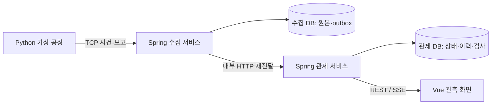
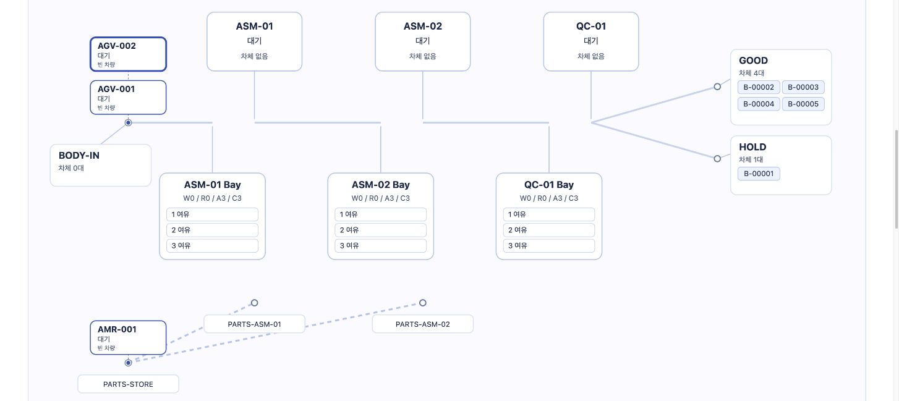
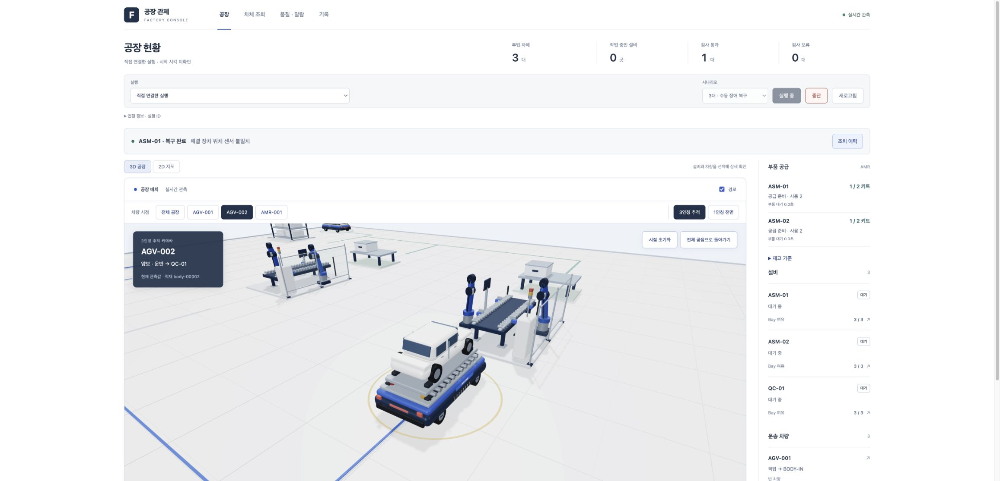
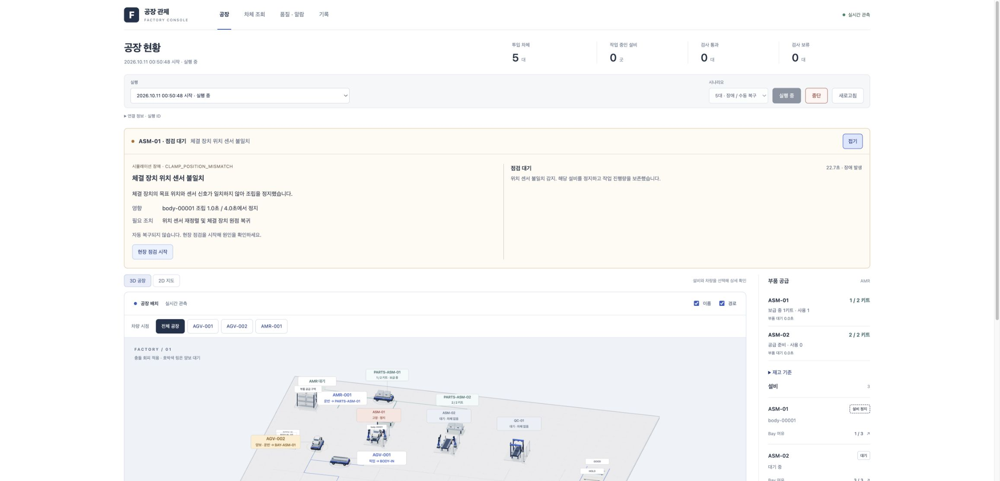

# 가상 제조공장 실시간 통합 관제 시스템 — 이력서·포트폴리오 활용 마스터

> 작성일: 2026-10-06 · 개정일: 2026-10-11 · 버전: v2.0
> 기준: S00~S09 P0 및 작업 59까지의 3D·교통·AMR·수동 복구·차량 시점
> 목적: 스마트팩토리·제조 자동화·생산기술·양산기술 분야의 SW 직무 지원에 프로젝트를 활용하기 위한 원본 문서

이 프로젝트는 **공정·물류 규칙을 모델링하고, 생산 데이터를 수집·저장·복구해 관측 화면으로 제공하는 제조 SW 프로젝트**로 소개한다. 특히 제조 IT, MES 관련 개발, 공장 관제, 설비 데이터 연계 업무와 연결할 설명이 많다. 생산기술·양산기술에서는 공정 운영과 품질 추적을 지원하는 SW 역량을 중심으로 활용한다.

이 문서는 그대로 제출하는 이력서가 아니라, 공고에 맞춰 필요한 내용을 꺼내 쓰는 원본이다. 구현 결과와 개인의 수행 범위는 구분한다. 기간·참여 인원·저장소 주소·본인이 직접 수행한 범위는 확인한 뒤 채운다.

| 지금 필요한 것 | 볼 부분 |
|---|---|
| 이력서에 바로 넣을 소개와 bullet | 4장 |
| 어떤 직무에 어떻게 연결할지 | 1~3장 |
| 개인 기여와 AI 활용을 어떻게 설명할지 | 5장 |
| 포트폴리오 구성과 대표 문제 해결 사례 | 6~7장 |
| 면접 소개와 예상 질문 | 8~9장 |
| 수치 근거와 제출 자료 | 10~12장 |

## 1. 지원할 때 어떤 프로젝트로 소개할 것인가

### 1.1 가장 먼저 전달할 역량

기술 이름을 모두 나열하기 전에 아래 세 가지를 전달한다.

1. **공정 규칙을 이해하고 코드로 표현했다.** 다음 셀의 대기 차체와 예약을 함께 세어 만석을 판단하고, 도착과 셀 진입을 다른 상태 전환으로 다뤘다.
2. **생산 정보의 정합성과 전달 실패를 다뤘다.** 원본 저장, 재전송, 업무 중복 반영 방지, 고유 검사 실적, 서버·DB 재시작을 구분했다.
3. **사용자가 상태와 원인을 읽을 수 있게 만들었다.** 태그로 차체를 찾고, 만석·차량 부족·고장·보고 단절을 서로 다른 상태로 설명했다.

이력서에서는 1~2개 핵심 문제와 그 검증 결과를 선택한다. 기술별 구현 목록 전체는 포트폴리오와 면접 자료에 둔다.

### 1.2 오토에버 외의 제조 SW 직무에도 연결할 수 있는 근거

현대오토에버의 공식 SDF 소개는 제조 데이터 통합, MES, 모니터링과 Factory BI의 데이터 수집·분석·시각화를 설명한다. 이 프로젝트의 상태 수집·이력·품질·관측 화면과 연결해 소개할 수 있다. [현대오토에버 SDF 소개](https://www.hyundai-autoever.com/kor/business-area/digital-transformation/sdf/contents.do?cntnSeq=455).

삼성SDS의 공식 MES 소개도 현장 데이터 수집, 재공 관리, 제품 추적, 검사·불량 이력과 설비 인터페이스를 다룬다. 이는 제조 SW에서 활용되는 문제 영역을 확인하는 참고 자료다. 이 프로젝트가 해당 상용 제품의 기능 전체를 구현했다는 뜻은 아니다. [삼성SDS MES 소개](https://www.samsungsds.com/kr/mes/nexplant-mes.html).

현대자동차의 생산기술 직무 인터뷰는 자동화 설비 구성·설치, 조립 공법, 가동률과 차체 품질 확보를 설명한다. 이 관점에서는 본 프로젝트를 현장 설비·공법 경험과 함께 연결할 **공정 상태 추적·운영 지원 SW 경험**으로 사용하는 것이 적절하다. [현대자동차 생산기술 직무 인터뷰](https://talent.hyundai.com/team/view.hc?category=JOB&seq=47).

위 자료는 2026-10-06에 확인한 공식 사업·직무 소개다. 아래 직무별 활용 방향은 이 자료와 프로젝트 구현을 연결한 판단이며, 현재 모집 중인 공고나 특정 기업의 채용 기준을 확정하는 표가 아니다.

## 2. 직무마다 강조하는 내용 바꾸기

| 지원 방향 | 프로젝트에서 먼저 보여 줄 내용 | 설명의 중심 | 함께 확인할 공고 요구사항 |
|---|---|---|---|
| 현대오토에버 제조 IT·OT 개발/운영 | 외부 보고 수집, 서비스·DB 장애 복구, 신선도·알람 | 생산 데이터가 끊기거나 업무 반영이 늦을 때 무엇을 보존하고 어떻게 진단하는가 | 요구 언어·현장 프로토콜·운영 범위 |
| 스마트팩토리·MES 관련 SW 개발 | 차체/태그 추적, 공정·검사 이력, 고유 실적, 서비스별 데이터 소유 | 공정 흐름을 상태·사건·조회 데이터로 연결하는 방법 | 생산지시·LOT·자원·상위 시스템 연계 범위 |
| 제조 자동화 연계·물류 SW | 슬롯 예약, 배차 조건, 적재/인계/귀환, 예외 처리 | 공간과 차량 자원을 함께 고려하고 상태 전환을 명확히 하는 방법 | 실제 장비 연계, 제어 주기, 장비별 인터페이스 |
| 생산기술의 디지털 제조·SW 직무 | 셀/Bay 모델, 대기 원인 구분, 지도·기록 조회 | 현장 담당자가 공정 흐름과 정체 원인을 읽을 수 있게 하는 방법 | 공정 설계·설비 구축과 SW 업무의 비중 |
| 양산기술의 데이터·운영 지원 SW | 검사 사실, PASS/FAIL 집계, 추적, 알람 확인/복구 | 반복·지연 보고가 실적을 왜곡하지 않게 관리하는 방법 | 업종별 공정 지식, 품질 분석, 실제 데이터 경험 |
| 일반 Java 백엔드·플랫폼 SW | TCP, 트랜잭션, outbox, 중복 처리, REST/SSE | 서비스 경계에서 저장과 업무 반영을 연결하는 방법 | 해당 공고의 프레임워크·배포·트래픽 요구 |

**MES·관제·연계 SW 개발을 명시한 공고라면 이 프로젝트를 대표 프로젝트로 배치하는 방향을 권한다.** 생산기술·양산기술이라는 이름만 있는 공고는 담당 업무를 먼저 읽는다. SW·데이터·공장 시스템 업무 비중이 높으면 앞에 두고, 공법·재료·장비 셋업이 중심이면 관련 현장·전공 경험 뒤에서 보완 자료로 사용한다.

PLC 프로그램, 모션 제어, 로봇 경로 계획, 펌웨어 또는 반도체 공정 조건 최적화가 주 업무인 공고는 별도의 역량 근거가 필요하다. 현재 구현은 가상 현장에서 발생한 데이터를 다루는 SW다. 자동차 차체 사례를 반도체 공정 경험이나 실제 PLC 운전 경험으로 바꾸어 표현하지 않는다.

### 공고 한 개에 맞춰 수정하는 순서

1. 공고의 업무 동사를 적는다. 예: 수집·연계·추적·집계·진단·운영·복구.
2. 각 동사에 대응하는 실제 구현과 검증 자료를 한 개씩 찾는다.
3. 가장 직접적인 세 가지를 이력서 bullet로 선택한다.
4. 공고의 업종·용어에 맞춰 배경 설명을 바꾸되, 구현 범위와 수치는 유지한다.
5. 요구 기술 중 사용하지 않은 것은 숙련 기술 목록에 넣지 않는다.

예를 들어 Java/SQL/외부 시스템 연계 공고는 수집·트랜잭션·outbox를 먼저 쓰고, 제조 품질 시스템 공고는 차체별 검사 추적·중복 실적 방지를 먼저 쓴다. PLC·OPC UA·Kafka·JPA 등의 단어는 공고에 나온다는 이유만으로 추가하지 않는다.

## 3. 모든 지원서에서 유지할 사실

| 항목 | 현재 확인한 내용 |
|---|---|
| 프로젝트 유형 | 실제 무선 장비 대신 Python 공장 모델을 사용하는 가상 제조공장 SW |
| 기본 규모 | 조립/검사 셀 3개, 차체 AGV 2대, 부품 AMR 1대 |
| 공정 흐름 | BODY-IN → ASM-01 → ASM-02 → QC-01 → GOOD/HOLD, 공정 사이의 AGV 운송과 Bay 대기 |
| 스마트태그 | 실행별 차체와 연결한 가상 식별자, 위치·공정·검사·운송·사건 상세 조회 |
| 버퍼 규칙 | W=현재 대기, R=픽업 전·이동 중 예약, A=C−W−R, W+R≥C이면 신규 배출/배차 차단 |
| 서비스 책임 | Python 물리 모델, Spring 수집 서비스, Spring 관제 서비스, Vue 관측 화면 |
| DB 구성 | 같은 PostgreSQL 인스턴스의 수집/관제 DB 분리, 서비스별 계정·소유권·Flyway |
| 전달 흐름 | TCP NDJSON → 원본/outbox 저장 → 내부 HTTP 전달 → 업무 반영 → REST/SSE 관측 |
| 서버 기술 | Java 21, Spring Boot 4.1.1, JDBC/JdbcTemplate, PostgreSQL 17, Flyway |
| 모델·화면 기술 | Python 3.12, Vue 3, JavaScript, Vite, Three.js 0.186.1, Apache ECharts, SVG |
| 실행 기반 | Docker Compose, Maven Wrapper, 잠금 파일·이미지 고정값, 실행·시연 문서 |
| 완료 범위 | S00~S09 기반 및 상세 3D·차량 추적·교통 정책 4·AMR 실제 재고/보급·5대 수동 복구 |



물리 배차·예약·고장 복구 상태는 Python이 결정한다. 로컬 Vite는 사용자 점검/조치 명령을 Python에 전달하고 결과를 확인한다. 일반 알람 확인은 설비 복구와 별개다. 위 두 DB는 소유권을 분리한 것이며, 별도 물리 DB 서버로 이중화한 구조가 아니다.

## 4. 이력서에 바로 사용할 문구

아래 문구는 **프로젝트 구현 내용의 초안**이다. 개인 역할을 적는 칸은 5장의 기준으로 먼저 채운다. 특히 ‘전부 직접 개발’, ‘기여도 100%’는 참여 인원과 AI 활용만으로 결정하지 않는다.

### 4.1 기본 정보와 가장 짧은 소개

```text
프로젝트: 가상 제조공장 실시간 통합 관제 시스템
기간: [실제 시작일] ~ [종료일 또는 진행 중]
유형 / 참여 인원: [개인·팀 프로젝트 여부] / [확인한 인원]
담당: [직접 수행한 요구 정의·설계·구현·검증·리뷰 범위]
기술: Java, Spring Boot, PostgreSQL, Python, Vue 3, JavaScript,
      Three.js, TCP/NDJSON, REST/SSE, Docker Compose
저장소 / 시연: [실제 공개 URL]
```

**한 줄 소개**

> 독립 작업 셀과 AGV/AMR의 공정·물류 흐름을 모델링하고, 차체 추적·슬롯 예약·품질·알람을 연결한 가상 제조공장 관제 SW 프로젝트.

### 4.2 공통 추천본 — 이력서에는 이 정도부터

> **가상 제조공장 실시간 통합 관제 시스템**  
> Java/Spring Boot·PostgreSQL·Python·Vue를 이용한 공정·물류 상태와 상세 3D 관제·수동 장애 복구를 연결한 프로젝트.

- 목적지 Bay의 대기+예약으로 가용량을 계산하고, `W+R≥C`에서 신규 배출을 차단하는 모델 및 차체·태그별 공정/검사 조회 구현.
- 수집/관제 서비스를 분리하고 원본과 outbox를 함께 저장해, 재전송·중복 입력과 서버/DB 장애 이후의 업무 전달을 검증.
- 100대 **차체**의 작업 300건·검사 100건·운송 400건을 대조하고, 검사·운송 원본을 각각 10회 반복 전송해 실적 증가가 없음을 확인.

이 추천본은 공정 규칙·서비스 정합성·검증이라는 세 축을 담는다. 분량이 부족하면 첫 bullet에서 GUI 상세 기능 목록을 줄이고, 지원 공고에 따라 아래 문구로 교체한다.

### 4.3 스마트팩토리·MES 개발 중심

- 차체/가상 스마트태그를 공정·운송·검사 사실과 연결하고, 실행별 상태·이력·PASS/FAIL 조회를 제공.
- 최신 전체 상태와 고유 검사 실적을 분리해, 오래된 상태 보고가 현재 위치를 되돌리거나 반복 검사가 생산 실적을 늘리지 않도록 처리.
- Python→TCP→두 Spring 서비스→PostgreSQL→Vue REST/SSE 경로를 연결하고, 100대 차체의 공정 결과와 실행 간 데이터 격리를 검증.

### 4.4 현대오토에버 등 제조 IT·OT 개발/운영 중심

- TCP 원본 수집과 관제 업무 반영의 책임을 분리하고, DB commit 후 ACK·영속 outbox·중복 반영 방지를 구현.
- 수집/관제 서비스·개별 DB·PostgreSQL 재시작, ACK 유실과 보고 단절을 재현해 저장·재전달·마지막 확인 상태 보존을 검증.
- 정상/스트레스 12회 측정 후 원본 151,073건의 순번·바이트·해시를 양 DB와 대조하고, 최종 미확인/outbox 0건을 확인.

마지막 수치는 **해당 측정과 대기 소진 후의 결과**다. 모든 입력량·모든 장애에서 무손실을 보장한다는 문장으로 확대하지 않는다.

### 4.5 제조 자동화·물류 연계 SW 중심

- 목적지 슬롯과 가용 AGV를 함께 확보하고, 픽업 전 예약·적재·운반·인계·귀환을 서로 다른 단계로 모델링.
- Bay 도착은 예약 R→대기 W로 전환하고, 현재 정책에서는 AGV가 Bay 차체를 픽업 완료할 때 슬롯을 반환하여 초과 진입을 방지.
- 목적 셀 정지 중 예약 차량 도착, 출발 전 취소 반복, 차량 부족과 버퍼 만석의 원인 구분을 검증.

### 4.6 생산기술·양산기술의 SW 업무 중심

- 작업 셀·운반 차량·대기 공간의 관계를 모델링하고, 공간 부족·차량 부족·설비 정지에 따른 공정 대기 원인을 관측 화면에 표시.
- 차체별 검사 사실과 제조 이력을 추적하고, 알람 발생·작업자 확인·실제 복구를 구분해 운영 상황을 조회하도록 구현.
- 100대 차체의 검사 100건과 PASS 80/FAIL 20을 대조하고, 반복 전송 이후에도 검사·운송 실적이 유지되는 것을 확인.

PASS/FAIL은 검증 시나리오의 정해진 패턴이다. 실제 공정의 수율 분석이나 불량 감소 성과로 표현하지 않는다.

### 4.6-A 3D 관제·가상 제조 시뮬레이터 중심

- Python 공정 모델의 관측을 Three.js 상세 공장과 연결하고 AGV·AMR 3인칭 추적 및 AGV 전면 시점을 제공.
- 설정 통로의 경로 계획·구간 예약·양보·적재 전진·최종 외곽 복귀를 구현하고 관측/화면 이동의 충돌 여유를 검증.
- ASM 키트 소비와 AMR 실배송 재고를 연결하고, 장애 중 진행량을 보존하는 사용자 점검·조치·재가동 시나리오를 구현.

‘가상 공정 모델 기반 디지털 트윈 형태의 관제 시뮬레이터’로 소개할 수 있다. 실공장 센서와 양방향 동기화한 디지털 트윈, 자율주행 인식·SLAM, 물리 엔진 기반 로봇 검증으로 표현하지 않는다. 3D 형상은 코드로 생성했으므로 Blender 모델링·GLB 제작을 수행 기술로 추가하지 않는다.

### 4.7 Java 백엔드 중심으로 줄일 때

- TCP 프레임 처리·사건 검증·원본/outbox 트랜잭션과 commit 후 ACK를 구현하고, 수집/관제 DB 소유권을 분리.
- 내부 HTTP 재전달과 관제 멱등 처리를 연결해 ACK 유실·서비스/DB 재시작 이후 저장 및 업무 실적의 중복을 검증.
- REST 조회·품질 집계·SSE 전체 상태 전달을 구현하고, 원본 151,073건의 양 DB 정합성을 측정 범위 안에서 확인.

## 5. 본인 기여와 AI 활용을 어떻게 적을 것인가

### 5.1 이 프로젝트에서 구분해야 하는 역할

현재 대화에서 본인이 제시한 판단은 분명히 있다. 3D 색감 승인, Bay 간격·직접 인계, 역주행과 불필요한 복귀의 수정 요구, AMR 선보급·수동 복구·차량별 추적 시점, 1/3/5대 시나리오 구성도 요구·검토했다. 독립 셀/AGV 환경으로 방향을 정했고, 가상 스마트태그의 범위, 예약 포함 만석 규칙, 기존 기술 스택 유지, 단계별 개발, 최소 테스트, 작업 해설, 색상 기준과 UI 문제를 요구·검토했다.

코드·검증 도구·문서 작성은 AI 개발 보조와 협업해 진행했다. 따라서 프로젝트에 기능이 있다는 사실과, 특정 코드·테스트를 본인이 직접 작성·실행했다는 사실을 같은 문장으로 취급하지 않는다.

| 구분 | 지원서에 적기 전 확인할 것 |
|---|---|
| 요구 정의·범위 결정 | 무엇을 요구했고 어떤 기준으로 선택했는지 자신의 말로 설명할 수 있는가 |
| 설계 판단 | 책임 분리·예약 규칙·중복 처리의 이유와 다른 선택의 비용을 이해하는가 |
| 직접 구현 | 실제 직접 작성·수정한 부분이 어디인지 파일·변경으로 가리킬 수 있는가 |
| AI 보조 구현 | 생성한 코드를 어떻게 검토하고 확인했는지, 아직 설명하기 어려운 부분은 무엇인지 |
| 검증 | 본인이 실행한 것, AI가 실행한 것, 문서로만 읽은 결과를 구분할 수 있는가 |
| UI 개선 | 겹침을 발견하고 요구한 사실과 실제 배치 코드 수정·검증의 수행자를 구분하는가 |

개발 기간은 기록에 2026-10-05 검증과 10-06 화면 수정이 있다고 해서 프로젝트 전체를 ‘2일 개발’로 확정하지 않는다. 팀원 수와 개발 경험 연수도 이 문서에서 추정하지 않는다. 프로젝트 저장소는 [kosyunderbar/smartfactorysimul](https://github.com/kosyunderbar/smartfactorysimul)이며 지원서에 이 주소를 사용할 수 있다.

### 5.2 활용할 수 있는 역할 설명 초안

> 제조공장 시나리오와 버퍼·태그 요구사항을 정의하고, AI 개발 보조를 활용해 단계별 구현과 검증을 진행한 프로젝트입니다. 개인 수행 범위는 요구·범위 결정과 [직접 수행한 추가 설계/수정/실행 범위]이며, 구현 근거와 장애·성능 결과를 정리했습니다.

대괄호에는 실제로 수행한 것만 넣는다. AI 사용 사실을 묻거나 해당 기업이 별도 작성 기준을 안내하면 그 기준에 따라 설명한다. 면접에서는 사용하는 부분의 코드 흐름과 검증 의미를 직접 설명할 수 있도록 준비한다.

### 5.3 제출 전에 직접 설명해 볼 다섯 가지

- 대기 2대·예약 1대·전체 3면에서 왜 새 배출을 막는가?
- ACK가 돌아온 뒤 관제 서버가 멈추면 누가 데이터를 보관하고 다시 보내는가?
- 같은 검사 보고가 다시 들어왔을 때 왜 검사 수가 늘지 않는가?
- 마지막 위치는 보이는데 LIVE라고 말할 수 없는 경우는 언제인가?
- 높은 입력 목표를 못 만든 결과에서 무엇을 확인했고 무엇은 확인하지 못했는가?

막히는 부분은 해당 작업 해설과 코드 한 경계를 읽고 직접 설명하는 연습부터 한다. 이력서 bullet을 더 늘리는 것보다 이 다섯 질문에 자신의 말로 답하는 것이 우선이다.

## 6. 포트폴리오를 구성하는 방법

### 6.1 한 페이지 소개에 넣을 여섯 요소

| 위치 | 넣을 내용 |
|---|---|
| 첫 문단 | 공정 대기·생산 정보 추적 문제와 한 줄 프로젝트 소개 |
| 기본 정보 | 실제 기간·역할·참여 인원·기술·저장소 |
| 그림 | Python→수집→관제→Vue 구조와 서비스별 DB |
| 핵심 규칙 | W2/R1/C3에서 A0, 예약 도착과 슬롯 반환의 차이 |
| 확인 결과 | 100대 차체 정확성, 중복 실적 증가 0, 원본 151,073건 대조 중 직무에 맞는 1~2개 |
| 링크 | 실제 화면, 시연 설명서, 장애·측정 근거 |

한 페이지에 전체 기능 목록과 부하 표를 모두 넣지 않는다. 숫자는 무엇을 세었는지 바로 옆에 쓴다. 화면 캡처에는 현재 LIVE인지, 종료한 실행인지, 과거 검증 장면인지 표시한다.

### 6.2 상세 포트폴리오는 5개 주제로

1. **문제와 범위:** 독립 셀 환경에서 차체 추적과 목적지 수용량 판단이 필요한 이유, 셀 3/AGV 2/AMR 1의 구현 범위.
2. **설계:** 서비스 책임과 두 저장 완료 단계, 물리 결정은 Python에 두는 이유.
3. **대표 사례:** 슬롯 예약과 배출 차단, 원본 재전달과 고유 검사 실적 중 공고에 맞는 두 가지.
4. **검증:** 장애·100대 차체·부하 측정의 조건과 결과, 달성하지 못한 입력 목표와 관측한 전달 대기.
5. **개선과 후속:** 지도 겹침 수정, 인덱스를 채택하지 않은 판단, 해당 직무에서 이어갈 작은 확장 한 가지.

아래 지도는 2026-10-06 당시의 2D 개선 증거다. 최신 3D 화면은 다음 자료를 사용한다. S09의 약 98ms 수치는 이 지도 수정 이전의 다른 화면 조건에서 측정했다. 최신 지도 성능 수치로 붙이지 않는다.







## 7. 문제 해결 경험으로 말할 사례

다음은 프로젝트 사실을 정리한 사례다. 자기소개서의 ‘제가 한 일’로 바꿀 때는 5장에서 확인한 개인 역할을 붙인다.

### 사례 A. 보이는 빈자리와 실제 가용 자리의 차이

**상황:** 현재 대기만 세면 이동 중인 차체 여러 대가 같은 빈자리를 기대할 수 있다. 앞 셀의 조립 완료가 곧 배출 가능을 의미하지 않는다.

**판단과 조치:** 배차 승인 시 목적지 슬롯을 예약하고 픽업 전·이동 중에도 R로 계산했다. `W+R≥C`에서는 새 배차를 막았다. 도착은 R→W, Bay에서 차체가 나가는 시점은 슬롯 반환으로 나눴다. 초기 모델은 셀 진입과 반환이 한 전환이고, 현재 물리 운송은 Bay 픽업 시 반환한 뒤 셀로 이동한다.

**근거와 결과:** W2/R1/A0 → W3/R0/A0 → 셀 진입 후 W 감소를 모델·관제에서 확인했다. 목적 셀 정지 중 이미 예약한 차량의 도착과 신규 배출 차단도 검증했다.

**직무 연결:** 물류 연계 SW, 공정 상태 모델링, 자원 제약과 예외 처리. 모든 경로·자원 순환의 교착 상태를 해결했다는 표현은 사용하지 않는다.

### 사례 B. 저장 확인과 업무 완료를 분리하기

**상황:** 수집 DB에는 저장됐지만 답장이 유실되면 송신기가 다시 보낸다. 관제 서버가 멈추면 저장 ACK 이후에도 업무 반영은 늦어질 수 있다.

**판단과 조치:** 원본과 outbox를 같은 트랜잭션으로 저장하고 commit 후 ACK했다. 수집은 미전달 원본을 재전달하고 관제는 중복 업무 반영을 막았다. 원본 순번을 건너뛰거나 내용을 바꾸어 보내지 않았다.

**근거와 결과:** ACK 유실·서비스/DB 재시작 사례와 양 DB 대조를 수행했다. S09 측정에서는 대기 소진 후 원본 151,073건의 순번·바이트·해시가 일치했다.

**직무 연결:** 데이터 수집·연계, 장애 복구, 트랜잭션 설계. ‘전송은 정확히 한 번’, ‘모든 장애에서 무손실’ 대신 반복 전달과 중복 반영 방지의 범위를 설명한다.

### 사례 C. 차체 위치와 생산 실적을 같은 방식으로 갱신하지 않기

**상황:** 오래된 전체 보고가 늦게 도착할 수 있고, 같은 검사 결과가 반복 전송될 수 있다.

**판단과 조치:** 최신 상태는 보고 순서와 관측 묶음으로 관리하고, 품질은 고유 검사 사실로 집계했다. 늦은 고유 사실과 같은 사실의 재전송을 구분했다. 검사 0건의 불량률은 ‘—’로 표시했다.

**근거와 결과:** 100대 차체에서 검사 100건·PASS 80/FAIL 20을 대조했다. 검사·운송 원본을 각각 10회 반복 전송해 실적 증가 0을 확인했다. 지연 사실과 오래된 상태의 경계도 별도 검증 기록에 있다.

**직무 연결:** 품질 시스템, 제품 추적, 제조 데이터 정합성. 실제 불량률 감소나 공정 수율 개선 성과를 대신하지 않는다.

### 사례 D. 높은 입력 목표를 못 맞춘 실험도 기록하기

**상황:** 정상/스트레스 입력을 목표로 측정했지만 입력기 자체가 한 원본의 ACK를 기다려 높은 목표량을 만들지 못했다. 관제 전달 대기도 증가했다.

**판단과 조치:** 목표 요청량과 실제 고유 저장량을 구분하고, 수집·HTTP·업무 반영·SSE 구간을 나누어 관측했다. SQL 실행 계획과 임시 인덱스의 공간·쓰기 비용을 확인했다.

**근거와 결과:** 정상 약 25.6~25.7건/s, 스트레스 실제 약 96.6~128.2건/s를 기록했다. 스트레스 SSE p95는 최대 약54초였다. 300/500건/s 수용 능력은 입증하지 못했다. SQL 병목이 확인되지 않아 운영 인덱스 추가를 채택하지 않았다.

**직무 연결:** 측정 설계, 병목 진단과 변경 비용 판단. 높은 부하의 문제를 이미 해결했다거나 API 전후 차이를 전부 인덱스 개선 효과라고 말하지 않는다.

### 사례 E. 데이터가 맞아도 읽을 수 없으면 운영 화면을 개선해야 함

**상황:** 같은 장소의 AGV가 포개지고 구역 이름과 겹쳤다. GOOD에 있는 여러 차체도 마지막 한 대처럼 보였다.

**판단과 조치:** 차량을 독립 카드로 표시하고 실제 위치 점에 연결했다. 구역별 차체 수와 개별 번호를 표시하며, 많은 차체는 전체 태그 목록으로 조회하도록 안내했다. 좁은 화면에서는 지도 내부만 스크롤하게 했다.

**근거와 결과:** 기존 종료 실행의 실제 Chrome 지도에서 글자 47개의 겹침 0과 차량·GOOD 차체 상세 연결을 확인했다. 실제 390px 화면에서도 겹침과 페이지 가로 넘침을 확인했다. 합성 배치 10가지에서도 카드 겹침·잘림·원본 변경이 없었다.

**직무 연결:** 관제 UI, 요구사항 리뷰, 사용자가 구분할 수 있는 상태 표현. 이 결과는 확인한 화면·배치 사례이며 모든 해상도와 모든 지도 구성의 검증은 아니다.

### 사례 F. 물류 동작과 3D 표현을 함께 바로잡기

**문제:** 인계 위치 불일치, 잦은 경로 변경, 적재 중 후진과 불필요한 귀환은 3D 화면에서 쉽게 드러난다.

**조치:** 빈 설비 직접 인계, 설정 통로의 경로·예약·양보, 적재 전진, 생산 완료 후 외곽 복귀로 규칙을 정리했다. 차량과 적재물을 자세히 보는 추적 카메라를 추가했다.

**근거:** 작업 48~51·58, [이동 검증](docs/development/3d-review/amr-normal-motion-verification.json). 실제 경로와 렌더링 보간의 충돌 여유 확인이며 실장비 안전 인증은 아니다.

### 사례 G. 부품 공급과 사람이 개입하는 복구를 연결하기

**문제:** 화면에 부품 운송만 그리면 실제 재고 부족·중복 소비를 확인할 수 없다. 장애가 자동으로 풀리면 사용자 점검 과정을 시연할 수 없다.

**조치:** 실제 키트 소비·AMR 배송·용량/남은 수요 계산과 수동 점검/조치 명령을 연결했다. 장애 중 작업 진행량과 이미 소비한 부품을 보존했다.

**근거:** 작업 56~59. 5대 오프라인 전체 완료·부품 대기 0ms 및 실제 웹 5대 투입/수동 대기 확인. 3대 수동 실제 연결 전체 완료 증거와 구분한다. 초기 재고·작업시간을 정한 시나리오 결과이며 공장 전체의 무병목 보장은 아니다.

## 8. 면접에서 소개하는 순서

### 30초 소개

> “독립 작업 셀 사이에서 AGV가 차체를 운반하는 가상공장을 모델링하고, 공정 상태를 수집해 관측하는 프로젝트를 진행했습니다. 목적지의 대기 차체와 이미 예약한 자리를 함께 세어 만석일 때 배출을 막고, 스마트태그로 위치·공정·검사를 추적합니다. 수집과 관제를 분리해 반복 전송·장애 복구를 검증했고, 제 역할은 [확인한 개인 수행 범위]입니다.”

### 2분 소개의 구성

- **문제:** 조립 완료와 배출 가능을 구분해야 하고, 데이터 단절·중복을 실제 공정 정상으로 해석하면 안 된다.
- **설계:** Python이 공장 상태를 결정하고, 수집은 원본 저장/전달, 관제는 업무 반영/조회, Vue는 관측을 담당한다.
- **사례:** W2/R1/C3에서 A0이다. 도착해도 W3/R0이라 만석이며, Bay에서 차체를 픽업 완료할 때 자리가 반환된다.
- **검증:** 100대 차체의 검사·운송 실적과 반복 입력을 확인했고, 부하 원본 151,073건을 두 DB와 대조했다.
- **한계와 기여:** 실제 장비·대규모 차량은 후속이며, 자신의 수행 범위와 AI 보조 범위를 밝힌다.

### 5분 면접 시연

| 순서 | 보여 줄 것 | 전달할 메시지 |
|---|---|---|
| 1 | 최신 3D·차량 추적과 태그 상세 | 공장 전체와 개별 차체의 상태를 연결한다 |
| 2 | 예약 만석·도착 캡처 또는 단계별 실제 시연 | 눈에 보이는 빈자리와 가용량은 다르다 |
| 3 | 장애 원인·현장 점검·조치 완료 | 사람이 읽었다는 기록과 물리 복구를 구분한다 |
| 4 | 최종 검사·태그 결과·사건 이력 | 검사 사실과 현재 상태를 근거로 추적한다 |
| 5 | 장애·측정 결과 한 장 | 확인한 결과와 미검증 범위를 설명한다 |

실제 시연은 [기능 설명 및 시연 시나리오](<가상 제조공장 실시간 통합 관제 시스템 - 기능 설명 및 시연 시나리오.md>)의 5대 수동 점검·조치 버튼 방식으로 준비한다. 과거 P0의 진행 파일은 별도 검증이다. 시간이 짧으면 원본 캡처를 사용한다. S09의 21초 영상은 캡처 7장을 각 3초씩 보여 주는 자료이며 연속 실시간 녹화로 소개하지 않는다.

## 9. 자주 받을 질문과 답변 방향

| 질문 | 답변에 포함할 내용 |
|---|---|
| 일반 웹 프로젝트와 무엇이 다른가요? | 차체 단일 위치, 예약/대기 전환, 고유 검사 실적처럼 제조 의미를 유지하는 규칙과 외부 보고의 중복·장애를 함께 다뤘다 |
| MES 전체를 만든 건가요? | 추적·상태·검사·알람·사건 조회 등 일부 제조 업무를 구현했다. 전체 생산지시·자재·공법·원가·상위 시스템 연계를 갖춘 상용 MES는 아니다 |
| 실제 설비를 연결했나요? | 현장은 Python 모델로 대신했고 TCP/HTTP/DB/브라우저 연결은 실제 구현했다. PLC·RFID·산업 프로토콜 장비는 연결하지 않았다 |
| 왜 MSA로 나눴나요? | 원본 저장과 업무 반영의 책임·실패를 분리해 이해하기 위해 두 Spring 서비스로 구성했다. 대신 전달 지연·중복·운영 복잡성이 생긴다 |
| 왜 차체·태그·슬롯을 각각 서버로 나누지 않았나요? | 함께 유지해야 할 물리 관계가 많아 Python 모델과 동일 스냅샷 경계 안에 두었다. 서비스 수 자체를 목표로 삼지 않았다 |
| 수집 ACK면 화면에도 표시된 건가요? | ACK는 수집 DB commit 확인이다. 관제 commit·SSE 수신·화면 반영은 별도다 |
| 도착하면 예약을 풀어도 되나요? | R을 W로 바꾸므로 가용량은 늘지 않는다. 현재 정책은 AGV의 Bay 픽업 완료 때 반환하며, 셀 인계는 이후 별도 단계다 |
| 부품 AMR도 차체 버퍼에 포함되나요? | 부품 운송과 차체 운송은 별도이며 부품 kit는 차체 Bay 대수를 늘리지 않는다 |
| 이중 처리 없이 정확히 한 번 전송하나요? | ACK 유실로 반복 전달될 수 있다. 원본 식별·중복 처리 기록·고유 업무 사실로 반복 반영을 막는 범위를 구현했다 |
| 재시작하면 다 복구되나요? | DB에 저장한 원본/outbox와 업무 상태의 재시작을 확인했다. Python의 비정상 종료 후 메모리 물리 상태 자동 복원은 구현하지 않았다 |
| 디지털 트윈·자율주행을 구현했나요? | 가상 모델과 관측 3D를 연결했다. 실센서 동기화·SLAM/인식·실장비 제어는 없으며 설정 통로 경로·예약/양보를 구현했다 |
| 100대는 차량 100대인가요? | 차체 100대다. 차량은 AGV 2/AMR 1이며 대규모 차량 성능을 뜻하지 않는다 |
| 불량률 20%는 좋지 않은 결과 아닌가요? | 검증용 고정 검사 패턴이다. 집계 정확성을 확인한 것이며 실제 공정 수율을 평가한 값이 아니다 |
| 약 98ms면 현재 지도도 그 속도로 동작하나요? | S09 이전 UI의 작은 전경 화면에서 수신→렌더 프레임을 관측한 값이다. 최신 지도·큰 화면·높은 부하를 보장하지 않는다 |
| 300/500건/s 실험은 성공했나요? | 그 입력량을 만들지 못했다. 실제 입력과 전달 대기·SSE 지연을 기록했고, 입력기와 전달 처리 경계를 후속 개선 대상으로 남겼다 |
| 왜 인덱스를 추가하지 않았나요? | 측정에서 SQL 병목을 확인하지 못했다. 최대 ordinal 조회 개선은 0.016ms였고 공간과 쓰기 비용이 추가되어 채택하지 않았다 |
| 사용자 입장에서 어떤 점이 좋아졌나요? | 위치·검사·대기 이유를 함께 조회하고 마지막 확인값을 구분할 수 있다. 실제 공장 생산성 향상 수치는 측정하지 않았다 |
| AI가 작성했다면 본인 역량은 무엇인가요? | 요구 결정·직접 수정/실행·검토한 범위를 구체적으로 설명하고, 맡은 부분의 코드 흐름과 한계에 답한다. 수행하지 않은 일을 직접 했다고 말하지 않는다 |

## 10. 숫자를 사용할 때 붙여야 할 조건

| 수치 | 의미와 조건 | 이력서에서의 사용 |
|---|---|---|
| 차체 100대 | S08 논리 공정·실제 TCP/HTTP/두 DB/REST 대조, AGV 2/AMR 1 | 차체 수임을 명시하면 핵심 검증 결과로 사용 가능 |
| 작업 300·검사 100·운송 400 | 위 100대 실행의 사실 건수 | 기능 정확성 근거. 시간당 생산량이나 현장 처리율로 변환하지 않음 |
| PASS 80/FAIL 20 | 검증용 검사 패턴 결과 | 집계 정합성 근거. 수율 향상 수치가 아님 |
| 검사·운송 원본 각 10회 반복, 실적 증가 0 | S08 반복 입력 후 재조회 | 중복 실적 방지의 구체 사례로 사용 가능 |
| 원본 151,073건 일치 | S09 정상3회·스트레스9회, 대기 소진 후 순번/UTF-8 바이트/SHA-256 양 DB 대조 | 검증 범위를 명시해 사용 가능. 일반적인 무손실 보장은 아님 |
| 정상 25.63~25.72건/s | 300초×3 활성 구간의 실제 고유 commit/s | 이벤트 처리량으로 사용. 생산량·차량 수와 구분 |
| 화면 p95 98.20~98.50ms | 2026-10-05, M3 Pro/36GiB의 네이티브 측정, 실제 731×685 전경, 수신→렌더 프레임 추정 | 상세 측정 자료에서 조건과 함께 사용. 현재 지도·실장비 종단 지연으로 쓰지 않음 |
| 스트레스 실제 96.64~128.19건/s | 100/300/500 목표 입력은 미생성, SSE p95 최대 약 54초 | 실패·병목 분석 사례. 해당 목표량 처리 성공으로 쓰지 않음 |
| 합성 로그 100,000건, 설비 첫페이지 API p95 12.770ms | S09 warm 조건, 5회 예열 후 50회 측정, 첫20건 | SQL 측정 조건으로 사용. 실시간 입력10만건/s와 구분 |
| 화면 글자 47개 겹침0 | 작업 41의 기존 종료 실행, 실제 390px 및 기본화면 확인 | UI 개선의 범위 있는 근거. 부하·모든 화면 검증은 아님 |

약 98ms 측정 당시 지도는 대부분 화면 아래에 있었다. rAF 호출률을 실제 GPU FPS로 표현하지 않는다. 임시 인덱스 이후 API p95가 줄어든 전후 결과에는 예열·실행 순서 영향도 있으므로 ‘인덱스로 조회 성능 N% 개선’이라는 성과를 만들지 않는다.

### 피해야 할 표현을 실제 근거로 바꾸기

| 확대된 표현 | 근거에 맞는 표현 |
|---|---|
| 현대차 공장/네오팩토리 시스템 구축 | 독립 셀·AGV 환경에서 착안한 가상 제조공장 SW 구현 |
| RFID 스마트태그 연동 | 가상 태그 식별자로 차체 위치·공정·검사 조회 |
| 수백 대 AMR/AGV 실시간 제어 | AGV 2/AMR 1 모델과 차체 100대 정확성 검증 |
| 양산 수율 향상·불량률 감소 | 고유 검사 사실과 PASS/FAIL 집계 정확성 확인 |
| 교착 상태 완전 해결 | 목적지 예약과 만석 시 신규 배출 차단 규칙 구현 |
| 무손실·exactly-once·무정지 보장 | 반복 전달·중복 반영 방지와 검증한 장애/원본 대조 범위 제시 |
| 500events/s 처리·120FPS 달성 | 목표 입력 미생성과 실제 commit/s·SSE 지연·rAF 표본을 구분 |
| OEE·Cpk·SPC·예지보전 구현 | 현재 구현한 상태·이력·최종 검사·알람 기능을 명시 |
| 대규모 MSA/고가용성 운영 | 두 Spring 서비스와 소유 DB를 분리한 소규모 MSA |

## 11. 질문이 들어오면 바로 열 근거

| 설명할 내용 | 확인 자료 |
|---|---|
| 서비스 책임·DB 소유권 | [ADR-001](<docs/decisions/ADR-001-서비스 책임과 데이터 소유권.md>) |
| 배차 승인·예약·슬롯 반환 | [예약/배차 작업](<docs/work-notes/작업 12. 슬롯 예약과 AGV 배차.md>), [운송/반환 작업](<docs/work-notes/작업 13. AGV 운송과 버퍼 슬롯 반환.md>), [물류 모델 코드](services/factory-simulator/factory_simulator/logistics.py) |
| 원본/outbox·ACK | [저장 작업](<docs/work-notes/작업 17. S03-03 원본과 전달 대기 저장 및 ACK.md>), [EventStore](services/ingestion-service/src/main/java/dev/factory/ingestion/receiver/EventStore.java) |
| 자동 전달·재시도 | [재시작 복구 작업](<docs/work-notes/작업 25. S05-03 재시작 복구와 전달 진단·재개.md>), [DeliveryWorker](services/ingestion-service/src/main/java/dev/factory/ingestion/delivery/DeliveryWorker.java) |
| 업무 반영·고유 사실·현재 상태 | [상태/이력 작업](<docs/work-notes/작업 20. S04-02 차체·태그와 업무 이력 및 최신 상태.md>), [EventApplication](services/operations-service/src/main/java/dev/factory/operations/domain/EventApplication.java) |
| 장애·반복 입력·100대 차체 | [S08 검증 기록](<docs/development/S08 장애·복구 통합 검증.md>) |
| 151,073건·실제 입력·지연·조건 | [S09 측정 기록](<docs/development/S09 측정·완료 기록.md>), [summary.json](docs/development/s09-results/summary.json), [pipeline.csv](docs/development/s09-results/pipeline.csv), [환경](docs/development/s09-results/environment.json) |
| 인덱스 미채택·측정 해석 | [ADR-002](<docs/decisions/ADR-002-측정 근거와 P0 완료 범위.md>), [최적화 판단](docs/development/s09-results/optimization-review.json) |
| 실제 지도·태그·품질·이력 | [Vue 안내](services/factory-console/README.md), [시연 설명서](<가상 제조공장 실시간 통합 관제 시스템 - 기능 설명 및 시연 시나리오.md>) |
| 최신 3D·AMR·수동 복구 증거 | [현재 기능과 검증 범위](<docs/development/현재 기능과 검증 범위.md>) |
| UI 겹침 수정 | [작업 41](<docs/work-notes/작업 41. 공장 지도 겹침과 좁은 화면 배치 수정.md>), [map-layout.js](services/factory-console/src/map-layout.js) |
| clone 이후 실행 | [다른 컴퓨터 실행·개발 안내](<가상 제조공장 실시간 통합 관제 시스템 - 다른 컴퓨터 실행·개발 안내.md>), [초기 실행/재실행 안내](<docs/development/초기 실행·재실행·복구·시연.md>) |

근거는 공개 가능한 `docs/` 결과와 코드부터 연결한다. `.build-cache/`는 Git에서 제외되므로 그 안의 로컬 원본·DB 경로만 제출 자료에 넣으면 다른 사람이 열 수 없다. 공유된 요약 JSON/CSV, 캡처·영상과 원본의 보존 경로 설명을 사용한다.

## 12. 제출 전에 정리할 자료와 후속 선택

### 최소 제출 묶음

- 공고에 맞춘 프로젝트 소개와 bullet 3개, 실제 개인 역할·기간·URL.
- 구조 그림 1개와 최신 지도·태그/검사·예약 만석 캡처 중 필요한 2~3개.
- 최신 3D·AMR·수동 장애 캡처와 현재 버튼 시연 안내. 기존 [S09 영상](docs/development/s09-demo/s09-stage-playback.mp4)은 과거 2D 캡처 재생임을 명시.
- 장애·측정 근거로 연결되는 포트폴리오 링크.

최신 지도 캡처와 과거 S09 캡처를 같은 시각의 화면으로 소개하지 않는다. GitHub 업로드 후 실제 링크로 대괄호를 바꾼다. 새 컴퓨터의 clone·최초 기동 전체 검증은 아직 별도 수행하지 않았다는 실행 안내의 범위를 유지한다. 자신의 컴퓨터에서 실행·코드 설명을 연습하되, 자료 제출만을 위해 전체 테스트·33분 부하 실험을 반복할 필요는 없다.

### 다음 기능을 붙이기 전에 고를 기준

현재 프로젝트만으로도 공정 규칙·데이터 정합성·장애·관측 경험을 설명할 자료가 있다. 기능 추가는 실제 지원 공고와 부족한 개인 설명 역량을 확인한 다음 선택한다.

| 공고에서 요구하는 내용 | 선택할 수 있는 작은 후속 범위 | 현재 상태 |
|---|---|---|
| 설비 프로토콜 연계 | 기존 수집 경계 앞에 공고의 프로토콜 어댑터 한 가지를 연결하고 중복/단절 사례 확인 | 미구현, 별도 요구 분석 필요 |
| 생산지시·제조 시스템 | 명시적인 작업 지시와 상태 전환 한 흐름을 기존 차체 추적에 연결 | 현재 데모의 직접 공장 진행과 구분되는 후속 기능 |
| 품질 데이터 분석 | 실제 활용 가능한 데이터·분모를 정한 검사 추적/분석 한 가지 | 현재는 최종 PASS/FAIL 집계, 공정 통계·원인 분석은 미구현 |
| 높은 이벤트 입력 | 실제 원본·순번 규칙을 지키는 입력기와 전달 처리 경계의 병목을 분리 측정 | S09에서 높은 목표 입력 미생성·지연을 확인, 개선 미완료 |

후속 개발도 기존 기술 스택과 서비스 책임을 유지하고, 바꾼 경계의 꼭 필요한 사례만 확인한다. 특정 기능을 넣는다고 현장 경험이나 합격 가능성이 자동으로 생긴다고 설명하지 않는다.

### 제출 전 확인

- [ ] 공고의 실제 업무와 맞는 프로젝트 bullet을 선택했다.
- [ ] 기간·인원·URL·직접 수행 범위를 확인했고 대괄호를 남기지 않았다.
- [ ] 가상 공장·가상 태그·차체 100대·실제 차량 3대의 차이를 설명할 수 있다.
- [ ] 숫자의 대상과 조건을 알고, 최신 지도에 과거 성능을 붙이지 않았다.
- [ ] 역할·AI 보조 범위를 사실대로 설명하고 핵심 다섯 질문에 답할 수 있다.
- [ ] 다른 사람이 열 수 있는 공개 결과·코드·시연 안내에 연결했다.
- [ ] 실제 생산성·수율·현장 제어 성과를 구현·검증 결과와 섞지 않았다.

이 문서는 기존 구현·검증 자료와 공식 제조 솔루션/직무 소개를 대조해 작성했다. 작성 중 프로그램·DB·서비스를 변경하거나 테스트·부하 실험을 새로 실행하지 않았다. 개인 메타데이터와 공고별 조건은 지원할 때 갱신한다.
