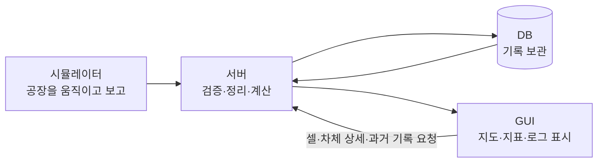

# 가상 제조공장 실시간 통합 관제 시스템 — 처음 읽는 사람을 위한 해설집

> 작성일: 2026-10-03 · 개정일: 2026-10-05  
> 문서 버전: v0.3.19 · 셀 기반 공장·소규모 MSA·단계별 개발/검증·사건/전달/화면 계약 v1 반영  
> 기준 문서: [프로젝트 기획서 v0.3.19](<가상 제조공장 실시간 통합 관제 시스템 - 기획서.md>)  
> 대상 독자: 제조업·프로그래밍·관제 시스템을 처음 접하거나, 이 프로젝트의 목적과 구조를 다른 사람에게 설명하고 싶은 사람  
> 현재 단계: S00~S09의 P0 구현·검증·문서·재현 산출물을 완료했다. 정상300초×3·스트레스120초×3×3을 측정하고 원본151,073건을 두 DB와 대조했다. 정상 실제 입력은25.63~25.72건/s, 작은 전경 화면의 반영 p95는98.20~98.50ms였다. 높은 입력 목표는 미생성이고 실제96.64~128.19건/s에서 관제 전달 대기와 최대 약54초 SSE 지연을 관측했다. 10만 로그 조회·기존 데이터 재시작·새5대 시연·캡처7장/21초 단계 영상, 작업37~40·ADR-002를 정리했다. 스택·흰색/네이비/파랑 UI·개발 DB/볼륨을 유지했다. 성능 목표의 달성/미검증과 수백 대 차량 등 후속 범위를 구분한다. 독립 factory-gui는 참고 샘플이다.

S01-01에서 실제 수집/관제 Java 프로그램의 시작점과 빌드 방법을 만들었습니다. 앱당 최소 기동 테스트를 통과했습니다. 이후 S01-02~04에서 DB와 실행 기반 화면을 준비했으며, S01 당시 보고서 처리와 공장 데이터 연결은 후속이었습니다. 현재는 S07의 전체 Vue 관제 기능과 S08의 서버/DB 장애·100대 정확성까지 확인했습니다. DB 없이 골격만 켜는 bootstrap 모드와 일반 실행을 구별합니다. Maven·JAR·설정이 어떤 역할인지와 실제 결과는 [작업 5 설명](<docs/work-notes/작업 5. 두 Spring 앱의 실행 기반.md>), 실행 명령은 [서비스 안내](services/README.md)에 있습니다.

S01-02에서는 두 저장 공간과 출입 계정을 만들었습니다. 일반 앱 계정은 자료만 변경하고, Flyway 계정은 자기 DB의 구조를 바꿉니다. 실제 DB에서 다른 공간 접속이 거절되고, 구조 준비를 다시 실행해도 기존 자료가 유지되는지 확인했습니다. [작업 6 설명](<docs/work-notes/작업 6. 두 DB와 서비스별 저장 구조.md>)에서 계정·표·마이그레이션의 차이를 사례로 볼 수 있습니다. S01-02의 검증 서버는 종료했습니다. 이후 Compose 실행은 S01-03에서 준비했으며 공장 데이터 연결은 후속 작업입니다.


S01-03은 여러 프로그램을 함께 켜고 준비 상태를 확인하는 방법을 만들었습니다. “서버가 살아 있음”과 “DB까지 준비됨”을 구분하며, 종료 후에도 DB 파일을 남깁니다. S01-04는 공장 상태를 결정할 Python 프로그램과 이를 보여 줄 Vue 관제 창의 틀을 만들었습니다. 현재 화면의 “실행 준비됨”은 실제 공장 데이터의 LIVE 상태가 아닙니다. [작업 7 설명](<docs/work-notes/작업 7. Compose와 실행 준비 상태.md>)과 [작업 8 설명](<docs/work-notes/작업 8. Python과 Vue 기본 앱.md>)에서 각 기술의 역할과 실제 최소 검증을 볼 수 있습니다. [전체 실행 안내](infrastructure/README.md)에 기동·종료·로컬 검증 VM의 저장 경로를 기록했습니다. 현재 S01 실행 기반, S02 공장 모델·취소/장애·사건/스냅샷, S03 TCP 수집과 저장/재전송을 완료했습니다. S04 관제 업무·조회·알람과 S05 자동 전달·복구·진단, S06 최소 실제 화면 연결까지 완료했고 이후 S07~S09도 완료했습니다.

S02-01에서는 공장 배치 설정과 차체의 가상 이름표 등록부를 만들었습니다. 한 차체의 현재 위치를 하나의 값으로 보관하고, 셀·버퍼 면·차체 AGV를 중복 점유하지 않도록 확인합니다. 같은 위치를 여러 목록에 따로 기록해 서로 다른 상태가 남지 않게 하는 기초입니다. S02-01 당시에는 조립·검사·운송을 진행하지 않았습니다. [작업 10 설명](<docs/work-notes/작업 10. 공장 설정과 차체·태그 등록.md>)에서 규칙과 서버 없는 실행 예제를 볼 수 있습니다.

S02-02에서는 셀 작업을 시작하고 설정된 작업 시간이 지나면 완료하는 Python 규칙을 추가했다. 조립 완료 차체는 셀 안에서 배출을 기다리며, QC 완료 시에만 검사 번호와 PASS/FAIL을 한 번 기록한다. 검사 전은 NOT_INSPECTED이고 최종 검사 후 COMPLETED는 반출 구역 도착을 뜻하지 않는다. 일시정지 중에는 작업 시간이 줄지 않는다. S02-02 당시 배차·슬롯 예약·실제 운송은 후속 범위였다. `--demo-work`는 공정 간 시험 배치로 작업 규칙을 보여 주는 서버 없는 로컬 확인이며 TCP 사건/완전한 스냅샷/GUI 연결은 아니다. [작업 11 설명](<docs/work-notes/작업 11. 셀 작업과 최종 검사.md>) · [Python 실행 안내](services/factory-simulator/README.md). S02-02 당시의 완료 기록이다.

S02-03에서는 Python의 단일 상태 변경 흐름에서 목적지 슬롯과 차체 AGV를 함께 확보하도록 구현했다. W=실제 Bay 대기, R=픽업 전부터 포함한 활성 예약, A=C-W-R이며 A=0 즉시 신규 배차를 거절한다. BUFFER_FULL/NO_VEHICLE을 구분하고, 승인된 차체는 출발지에 남고 해당 셀의 차단 이유는 WAITING_PICKUP이다. 중복 요청은 기존 운송을 반환하고 시간만으로 예약을 풀지 않는다. QC의 GOOD/HOLD 운송은 Bay 예약을 소비하지 않는다. `--demo-dispatch`로 만석 차단과 마지막 슬롯 경쟁을 확인할 수 있다. S02-03 당시 실제 픽업·이동·인계·반환은 후속 범위였다. S02-03 당시 GUI/네트워크 연결과 완전한 스냅샷은 후속 범위였다. [작업 12 설명](<docs/work-notes/작업 12. 슬롯 예약과 AGV 배차.md>) · [Python 실행 안내](services/factory-simulator/README.md).

S02-04에서는 승인된 운송의 빈 AGV 픽업 이동·적재·운반·Bay/결과 구역 인계·빈 차 귀환을 tick으로 연결했다. 자신의 예약이 있으면 A=0이어도 픽업/도착을 진행한다. Bay 인계 시 R→W 전환만 수행하고, 셀 진입 시 차체 위치/작업 시작과 슬롯 반환을 함께 처리한다. 반환 직후 재배차하므로 새 예약이 같은 슬롯을 즉시 사용할 수 있다. 귀환 중 차량은 신규 배차 대상이 아니다. `--demo-transport`로 일반 등록 차체의 GOOD 도착과 W=2/R=1→W=3/R=0→슬롯 반환/새 배차를 확인한다. 셀 진입은 명시적 모델 명령이며, S02-04 당시 일반 서비스 기동의 실시간 생산 루프나 GUI/통신 연결은 없었다. 이후 S06의 명시적 연결 시나리오에서 구현했다. [작업 13 설명](<docs/work-notes/작업 13. AGV 운송과 버퍼 슬롯 반환.md>) · [Python 실행 안내](services/factory-simulator/README.md).

S02-05에서는 출발 전 취소가 예약과 차량을 함께 반환하고, 반복 취소/도착이 기록이나 슬롯을 다시 바꾸지 않도록 구현했다. 부품 AMR은 별도 kit 식별자와 STORE→PARTS_DOCK 운송을 사용하며 차체/태그와 Bay 예약을 소비하지 않는다. DOWN은 기존 작업/차체/남은 시간을 보존하고 복구 후 이어서 진행한다. 지연·품질 배열도 명시적으로 주입한다. 모델 전환에서 v1 사건을 생성하며 snapshot()/publish_snapshot()으로 전체 상태를 만든다. C=2/3/4 각각 100대 흐름과 사건/최종 상태의 일치를 검증해 S02를 완료했다. 이는 단축 모델 설정의 정합성 시험이며 실제 성능 실적이 아니다. `--demo-scenarios`로 취소·고장/복구·부품 운송과 최종 HOLD 결과를 확인한다. S02-05 당시 사건은 메모리/로컬 출력이었고, 이후 S03에서 TCP/수집 DB 저장을 연결했다. S02-05 당시 관제 REST/SSE 연결은 후속 범위였으며, 현재 REST 조회는 S04, SSE/최소 Vue 연결은 S06에서 완료했다. [작업 14 설명](<docs/work-notes/작업 14. 취소와 장애 복구 및 공장 모델 검증.md>) · [Python 실행 안내](services/factory-simulator/README.md). 이후 S08 장애·복구와 S09 측정·문서까지 완료했다.


S03에서는 Python이 보내는 보고서를 Java 수집 서버가 받아 DB에 안전하게 맡는 부분을 완성했습니다. TCP에서 보고서가 잘려 들어와도 LF까지 모으고, 양식과 번호를 검사한 뒤 원본과 “관제에 전달해야 할 목록”을 함께 저장합니다. DB 저장이 확정된 뒤에만 ACK라는 답장을 보냅니다. 답장이 사라지면 Python이 같은 원본을 다시 보내고, 수집 서버는 기존 저장을 확인해 중복을 만들지 않습니다. 보고서 대기가 많으면 Python도 상태 변경을 되돌리고 잠시 정지합니다. 이 대기 목록은 차체의 Parking Bay와 다른 것입니다. S03 당시 실제 연결에서 보고서 39건을 확인했으며 관제 업무와 화면 LIVE는 후속이었습니다. 이후 S04~S06에서 연결했습니다. [S03-01 설명](<docs/work-notes/작업 15. S03-01 TCP 입력 조립과 수신 제한.md>) · [S03-02 설명](<docs/work-notes/작업 16. S03-02 사건 검증과 중복 구분.md>) · [S03-03 설명](<docs/work-notes/작업 17. S03-03 원본과 전달 대기 저장 및 ACK.md>) · [S03-04 설명](<docs/work-notes/작업 18. S03-04 Python ACK 처리와 제한된 재전송.md>).

S03-01~04에서는 TCP NDJSON 조립·입력 제한·v1 형태/식별자 검증·중복/충돌 판정·원본/outbox/실행 정보의 동시 저장·커밋 후 ACK·Python 미확인 원본/제한된 재전송을 구현했다. Java 7개(단위 3·실제 PostgreSQL/TCP 3·bootstrap 1), Python 총 20개가 통과했다. 실제 Python→Spring TCP→PostgreSQL 연결에서 차체 1대의 HOLD 흐름 원본/ACK 39건, DB 바이트/해시 일치, 재접속 중복 확인을 검증했다. 이는 모델 시간을 직접 진행한 연결 검증이며 실시간 성능 측정이 아니다. 검증 run만 정리했고 기존 DB/볼륨은 보존했다. S03 당시 outbox는 PENDING, 전달 커서는 1이었다. ACK는 수집 저장 확인이다. S03 당시 관제 업무 반영·HTTP 전달 worker·REST/SSE·GUI LIVE는 후속 범위였고, 현재 관제 업무와 REST 조회는 S04에서 완료했다. 일반 Python 기동은 자동 생산을 시작하지 않는다. Python 미확인 목록은 메모리이며 프로세스 종료 후 물리 상태 복원을 보장하지 않는다. 현재 S09까지 완료했다. [S03-01 설명](<docs/work-notes/작업 15. S03-01 TCP 입력 조립과 수신 제한.md>) · [S03-02 설명](<docs/work-notes/작업 16. S03-02 사건 검증과 중복 구분.md>) · [S03-03 설명](<docs/work-notes/작업 17. S03-03 원본과 전달 대기 저장 및 ACK.md>) · [S03-04 설명](<docs/work-notes/작업 18. S03-04 Python ACK 처리와 제한된 재전송.md>).

S04-01~04에서 관제 내부 사건 API·업무 검증/영속 중복 처리, 차체/태그 등록·작업/운송/검사 fact·최신 전체 스냅샷, REST 현재/이력/품질 조회와 신선도·알람 확인/복구를 완료했다. 기존 Java/Spring JDBC/PostgreSQL 기술 스택과 Flyway V1을 유지했다. 실제 PostgreSQL/HTTP 4개·판정 2개·bootstrap 회귀 1개가 통과했다. 최근 5분 검사 100/FAIL 20/비율 .2, 0건 null, 반열린 경계·늦은 고유 검사·cursor fence·중복/rollback·태그/슬롯 모순·run 분리를 확인했다. 기존 Compose의 관제 컨테이너만 반영하고 명시적 시험 호출로 모델 사건 60건의 DB 원본/해시·태그 HOLD·작업 3/운송 6/검사 1·알람 확인/복구를 검증했다. 검증 전용 UUID의 기존 행 0건을 확인한 뒤 자기 run만 정리했고 기존 DB/볼륨은 보존했다. S04 당시 자동 outbox 전달과 수집 진단 제공은 후속 S05 범위였고 진단 미확인은 UNAVAILABLE/UNKNOWN으로 표현했다. S05에서 전달/진단, S06에서 SSE와 최소 실제 Vue 연결을 완료했다. 전체 관제 GUI는 이후 S07에서 완료했다. 물리 runState=FINISHED만으로 관제 종료를 확정하지 않는다. 테스트는 S04의 핵심 경계만 공유 검증하고 Python/수집/GUI 전체 시험을 반복하지 않았다. S04 완료 직후의 다음 작업은 S05-01이었다. [S04-01 설명](<docs/work-notes/작업 19. S04-01 내부 사건 수신과 업무 처리 기록.md>) · [S04-02 설명](<docs/work-notes/작업 20. S04-02 차체·태그와 업무 이력 및 최신 상태.md>) · [S04-03 설명](<docs/work-notes/작업 21. S04-03 관제 조회 API와 검사 집계.md>) · [S04-04 설명](<docs/work-notes/작업 22. S04-04 데이터 신선도와 알람 확인·복구.md>)

S06-01~03에서 명시적 Python 최소 시나리오, REST와 같은 전체 묶음의 SSE, Vue 셀/버퍼 카드와 차체·태그 상세를 연결했다. 실제 새 실행의 원본 225건이 TCP→수집 DB→자동 HTTP→관제 DB에 동일 바이트/해시로 저장됐다. 프록시 SSE 313개 묶음과 Chrome에서 같은 run/body/tag, ASM-01 작업, 소스 중단 시 마지막 확인값 보존, 재개 후 GOOD/PASS와 FINISHED/ARCHIVED를 확인했다. 필요한 검증은 Java 3개와 Node 2개로 제한했다. 기존 스택/계약 v1/DB/볼륨과 수집 Flyway V1·V2/관제 V1을 유지하며 새 의존성·DDL은 추가하지 않았다. 일반 기동은 자동 생산하지 않는다. S06 완료 당시 다음은 S07-01이었다. 이후 S07에서 지도·검색/이력·품질/알람 화면을 연결했고 현재 S09까지 완료했다. [S06-01 설명](<docs/work-notes/작업 26. S06-01 Python 최소 시나리오와 실제 전달.md>) · [S06-02 설명](<docs/work-notes/작업 27. S06-02 REST와 SSE 전체 상태 연결.md>) · [S06-03 설명](<docs/work-notes/작업 28. S06-03 Vue 셀 관측과 차체·태그 상세.md>)

이제 이름표를 누르면 Python이 보고한 차체 위치와 검사 결과를 실제 서버에서 받은 값으로 볼 수 있습니다. 셀 카드와 태그 창은 같은 보고 묶음을 사용합니다. 공장 보고가 멈췄을 때 마지막 위치를 그대로 보여 주는 이유는 새 위치를 확인할 근거가 없기 때문입니다. SSE 연결 자체가 살아 있다는 것과 공장에서 새 보고가 온다는 것은 서로 다릅니다.

### S07 실제 관제 화면 완료

S07-01~04에서 실제 3셀·AGV 2대·AMR 1대·Bay SVG 지도, 태그 검색과 대상별 상세/이력, 동일 기간 품질 지표·ECharts, 알람 확인/복구 관측과 사건/알람 기록을 연결했다. 선택/필터 유지·지연 응답 배제·모바일/키보드도 확인했다. 실제 정상 등록 P0 실행의 원본 556건이 두 DB에 같은 바이트/해시로 저장됐고 프록시 SSE 1,070개 묶음을 확인했다. W2/R1/A0→W3/R0/A0→셀 진입 W2/R0/A1, 소스 중단 시 위치/예약 보존, 확인 후에도 설비 고장 유지와 실제 복구를 확인했다. 검사5/PASS4/FAIL1·비율20.0%와 태그 HOLD/FAIL이 실제 API/화면에서 일치했다. 필요한 검증은 Node5개·Python 신규2개와 기존 송신 회귀1개, Vue 빌드와 실제 연결 하나로 제한했다. Java/계약 v1/Flyway/DB/볼륨과 기존 스택을 유지하고 기획에 정한 ECharts6.1.0만 잠금 파일에 추가했다. 일반 기동은 자동 생산하지 않는다. S07 완료 당시 다음은 S08-01이었다. [S07-01 설명](<docs/work-notes/작업 29. S07-01 실제 공장 SVG 지도와 차량·슬롯.md>) · [S07-02 설명](<docs/work-notes/작업 30. S07-02 스마트태그 검색과 대상별 상세·이력.md>) · [S07-03 설명](<docs/work-notes/작업 31. S07-03 품질 차트와 알람 확인·기록 조회.md>) · [S07-04 설명](<docs/work-notes/작업 32. S07-04 선택·조회 순서와 모바일·키보드 접근.md>)

지도와 상세는 같은 전체 보고를 읽고, 과거 이력은 별도 조회 시점을 표시한다. 품질 지표와 차트는 같은 기간의 검사 사실을 함께 읽는다. 알람 확인은 읽었다는 기록이며 실제 복구나 슬롯 반환은 공장의 새 보고로만 바뀐다. [실제 Vue 실행 안내](services/factory-console/README.md)에서 재현 명령과 캡처를 볼 수 있다.

### S08 장애·복구와 100대 통합 완료

S08-01~04에서 별도 PostgreSQL과 두 서버로 예약 취소/반환·목적 셀 정지 중 도착·확인/복구, TCP ACK 유실/재전송·12초 보고 단절, 양 서비스와 개별 DB·PostgreSQL 재시작을 확인했다. 최종 5대 실행 원본216건과 100대 실행 원본3,533건은 두 DB에서 순번·바이트·해시가 일치했다. 100대의 2,764 tick에서 단일 위치/용량을 확인하고 중간 전체 스냅샷28개와 최종 상태를 관제 API와 비교했다. 작업300/검사100/운송400·PASS80/FAIL20, 검사/운송 원본 각각10회 재전송의 실적 증가0·run 격리가 통과했다. 실제 Chrome의 SSE 단절/복구·태그 선택/마지막 값 보존은 별도 실행 증거를 명시해 재사용했다. 기존 Java 관련2개만 선택 실행했고 전체 테스트·새 의존성·DDL·운영 코드 변경은 없다. 기존 스택과 흰색/네이비/파란색 UI·개발 DB/볼륨을 유지했다. 논리 공정의 정확성 검증이며 이후 S09에서 실제 성능 수치와 한계를 기록했다.

[S08-01 설명](<docs/work-notes/작업 33. S08-01 만석·예약 반환과 셀 정지·정상화.md>) · [S08-02 설명](<docs/work-notes/작업 34. S08-02 TCP와 브라우저 SSE 단절·복구.md>) · [S08-03 설명](<docs/work-notes/작업 35. S08-03 서비스·DB 재시작과 지연·중복 사건.md>) · [S08-04 설명](<docs/work-notes/작업 36. S08-04 100대 정상 순환과 차체·실행 격리.md>) · [S08 통합 결과/재실행](<docs/development/S08 장애·복구 통합 검증.md>)

## 이 책을 읽는 방법

기획서는 개발할 항목과 규칙을 정리한 문서다. v0.2에서는 기존 기술 스택을 유지하면서 공장 배경을 독립 작업 셀과 차체·부품 운송으로 구체화했다. 스마트태그는 차체를 찾는 가상 식별자이며, 실제 태그 장치를 만드는 과제가 아니다. v0.3에서는 수집/관제 서비스를 분리하는 소규모 MSA와 단계별 검증 계획을 추가했다. 개발 순서·작업 ID·완료 기준은 [단계별 개발 계획](<가상 제조공장 실시간 통합 관제 시스템 - 단계별 개발 계획.md>)을 따른다. 이 해설집은 각 항목이 어떤 장면을 뜻하고, 왜 필요하며, 서로 어떻게 연결되는지를 설명한다.

처음부터 기술 이름을 외울 필요는 없다. 먼저 공장 안에서 자재가 이동하는 장면을 이해하고, 그 장면을 컴퓨터가 어떻게 알고 화면으로 보여주는지 따라가면 된다.

- **빠르게 전체 그림을 보고 싶다면:** 1장, 2장, 5장, 8장, 17장을 읽는다.
- **이번 변경의 핵심만 보려면:** 2장의 셀·버퍼 예약, 7장의 가상 태그와 차체 추적, 8장의 차체 창, 15장의 경계 시험을 읽는다.
- **기획서를 이해하고 싶다면:** 1~14장을 순서대로 읽고, 18장의 기획서 대응표를 사용한다.
- **직접 개발하고 설명하고 싶다면:** 9~16장의 오류 사례·설계 이유·검증 방법까지 읽는다.
- 낯선 용어는 문장 속에서 먼저 설명하고, 마지막 용어 사전에서 다시 찾을 수 있게 했다.

각 장 끝의 ‘직접 설명해 보기’는 이해를 확인하는 질문이다. 답을 외우기보다, 왜 그런지 자기 말로 설명하는 데 사용한다.

S05-01~03에서 영속 outbox의 자동 HTTP 전달·결과 분류·실행별 순서/격리·재시작 복구·전달 진단/명시적 재개를 완료했다. 기존 기술 스택과 적용된 Flyway V1을 유지하고 수집 V2만 추가했다. 필요한 Java 검증 8개가 통과했다. 관제 커밋 후 응답 유실, 수집 전달 완료 저장의 실제 제약 rollback, 관제 DB 접속 중단/복구, 순번/의존성 보류, 영구 거절, 20회 상한과 재개를 확인했다. 기존 Compose에서도 Python TCP ACK 60건→자동 HTTP→관제 저장 60건, 원본/해시 일치, 관제 중단 중 수집 재시작 복구, pending=0/nextSourceSeq=61, REST LIVE→FINISHED/ARCHIVED와 태그 HOLD/FAIL을 확인했다. 새 UUID의 기존 행0건을 먼저 확인하고 성공한 자기 실행만 정리했으며 기존 DB/볼륨을 보존했다. sourceConnected는 현재 TCP 연결 표본이며 진단 실패는 계속 UNKNOWN이다. S05 완료 당시 다음은 S06-01이었고 SSE/실제 Vue 연결은 후속이었다. 현재 최소 연결은 S06에서 완료했으며 상시 생산·성능 측정은 후속이다. [S05-01 설명](<docs/work-notes/작업 23. S05-01 영속 outbox와 자동 HTTP 전달.md>) · [S05-02 설명](<docs/work-notes/작업 24. S05-02 전달 결과와 순서·격리.md>) · [S05-03 설명](<docs/work-notes/작업 25. S05-03 재시작 복구와 전달 진단·재개.md>)

## 목차

1. 우리가 만들려는 것은 어떤 프로그램인가
2. 화면 속 공장은 어떻게 움직이는가
3. 설비가 멈췄다는 말에도 여러 뜻이 있다
4. 시뮬레이터는 무엇을 실제로 만들어 주는가
5. 전체 시스템을 네 가지 역할로 이해하기
6. 로그·이벤트·스냅샷은 어떻게 다른가
7. 스마트태그가 연결된 차체 한 대의 데이터 흐름
8. 사용자는 화면에서 무엇을 보고 판단하는가
9. 생산량과 불량률을 정확하게 계산한다는 것
10. 중복·지연·통신 단절을 왜 다뤄야 하는가
11. 실시간 화면이 부드럽게 움직이는 원리
12. 데이터가 쏟아질 때 무엇이 어려워지는가
13. 기술 스택을 역할과 선택 이유로 이해하기
14. DB·API·시간·식별자 설계를 쉽게 읽기
15. 잘 만들었다는 것을 어떻게 확인하는가
16. 단계별로 무엇을 구현하고 검증하는가
17. 다른 사람에게 설명하는 방법과 예상 질문
18. 기획서 대응표·용어 사전·이해 점검

---

## 1. 우리가 만들려는 것은 어떤 프로그램인가

### 1.1 독립된 작업 셀과 이동 로봇이 있는 공장

지도 위에 조립 셀과 검사 셀이 따로 있다. 셀은 차체 한 대를 받아 정해진 작업을 수행하는 작은 작업 공간이다. 셀 사이에는 차체를 운반하는 AGV가 다니고, 부품 창고에서는 AMR이 조립 셀로 부품 키트를 가져온다.

어떤 셀은 작업 중이고 어떤 셀은 차체를 기다린다. 또 어떤 셀은 작업을 다 끝냈지만 다음 셀 앞에 자리가 없어 차체를 내보내지 못한다. 화면은 이 상황을 셀 상태, 차체 위치, 차량 이동, 버퍼 대기와 예약으로 함께 보여 준다.

### 1.2 ‘통합 관제’의 의미

관제는 운영자가 여러 대상의 상태를 모아 살펴보는 일이다. 통합은 셀·차체·운송·품질이 같은 사건을 기준으로 연결된다는 뜻이다.

예를 들어 조립 1의 완료 차체가 움직이지 않는 이유를 알아보려면 다음 정보가 필요하다.

- 다음 조립 셀 앞 Bay의 전체 용량은 3면이다.
- 실제 대기 차체는 2대지만, AGV가 차체 1대를 싣고 그곳으로 이동 중이다.
- 세 번째 자리는 이미 예약되어 남은 슬롯이 0이다.
- 따라서 조립 1의 새 차체는 셀 안에서 배출을 기다린다.

화면의 빈 자리만 보고 배출을 허용하면 도착한 차체가 기다릴 장소를 잃는다. 대기와 도착 예정 예약을 함께 보여 주는 것이 이번 모델의 핵심이다.

### 1.3 스마트태그는 차체를 찾는 이름표

차체마다 `bodyId`와 가상 `tagId`를 연결한다. 지도에서 차체를 누르거나 태그 ID를 조회하면 차체 상세 창 하나가 열린다. 그 창에서 현재 위치, 운반 AGV, 완료·다음 공정, 검사 결과, 관련 이력을 본다.

태그 자체가 조립 상태나 불량을 모두 측정한다고 가정하지 않는다. 차체 식별은 태그로 연결하고 위치·작업·검사 데이터는 시뮬레이터와 서버의 기록에서 가져온다. 실제 UWB/BLE 통신·태그 하드웨어·펌웨어는 이번 범위 밖이다.

### 1.4 공장 배경과 실제 구현 규모

수백 대의 로봇이 운행하는 제조 환경을 배경으로 삼지만, 처음에는 **조립 2셀·검사 1셀, 차체 AGV 2대·부품 AMR 1대**로 완성한다. 작은 규모에서도 차체 추적과 예약 만석을 충분히 시험할 수 있다. 차량 수백 대는 이후 규모 실험으로 나눈다.

현대자동차그룹의 HMGICS 셀 생산·로보틱스 소개와 현대오토에버의 통합 관제·스마트태그 소개에서 방향을 참고한다. NNNEO Factory라는 솔루션 소개 명칭과 HMGICS라는 현장을 구분하고, 내부 구현을 복제한 프로젝트로 설명하지 않는다. [HMGICS 셀 생산 방식](https://www.hyundaimotorgroup.com/ko/story/CONT0000000000122356), [스마트태그 소개](https://www.hyundai-autoever.com/kor/business-area/digital-transformation/sdf/contents.do?cntnSeq=455)

### 1.5 실제로 개발할 경험

현대오토에버 OT시스템 개발·운영 직무와 연결할 경험은 Java 서버의 외부 데이터 수집, PostgreSQL 이력·집계, Vue 관제 화면, 데이터 중복·연결 장애 검증이다. 기존 Java·Spring·PostgreSQL·Vue·Python·TCP·SSE 기술 스택을 그대로 사용한다.

현재 디렉토리의 factory-gui v0.2는 새 셀 모델·태그 창·예약 규칙을 구현한 브라우저 샘플이다. 정상 운영에서는 차체가 셀·Bay·AGV 사이를 이동하고, 버퍼 만석에서는 대기 2 + 예약 1 → 도착 후 대기 3 → 셀 진입 후 슬롯 반환·배차 재개의 순서를 단계별로 확인한다. 이는 로컬 모델의 구현 증거이며 서버의 동시 배차 처리·DB 트랜잭션·실제 TCP/SSE 복구·수백 대 성능의 증거는 아니다. [실행 및 검증 안내](factory-gui/README.md)를 참고한다.

**직접 설명해 보기:** “차체가 지금 어디 있고 왜 기다리는지를 한 화면에서 어떻게 알 수 있나요?”

---

## 2. 화면 속 공장은 어떻게 움직이는가

### 2.1 차체 42번이 거치는 순서

차체 42번은 다음 순서로 움직인다. 조립 작업의 내용은 학습용 단계이며 실제 자동차 전체 공법이 아니다.

```text
차체 투입·가상 태그 연결
  → AGV로 조립 1 Bay 이동 → 조립 셀 1 진입·작업
  → 다음 Bay 예약 → AGV로 조립 2 Bay 이동 → 조립 셀 2 작업
  → 검사 Bay 예약 → AGV로 검사 Bay 이동 → 검사 셀 진입
  → 최종 PASS/FAIL → AGV로 GOOD/HOLD 결과 구역 이동
```

각 구간은 차체의 출발지 제거와 목적지 등록이 이어지는 운송이다. 화면의 차체가 순간적으로 두 곳에 생기지 않아야 한다. 부품 AMR은 창고에서 조립 셀의 별도 부품 도착 지점으로 키트를 공급한다.

### 2.2 ‘작업 셀’과 ‘셀 진입 Bay’는 별개다

작업 셀은 조립이나 검사를 하는 공간이다. P0의 각 셀은 차체 1대를 처리한다. Bay는 그 셀에 들어가기 전에 차체가 기다리는 진입로 또는 임시 Parking Bay다. 기본 3면이고 2~4면으로 설정할 수 있다.

Bay는 차체를 받아 보관하는 가상 받침 공간으로 단순화한다. AGV가 차체를 인계하면 차량은 비워지고, Bay에서 셀 안으로 들어가는 인계에는 별도 AGV를 요구하지 않는다. 실제 인계 장비의 동작까지 계산하는 모델은 아니다.

셀 안에서 작업 중인 차체 1대는 Bay 대기 수에 포함하지 않는다. 예를 들어 셀 안에 1대가 있고 Bay에 2대가 있다면, Bay의 실제 대기 W는 2다. 모든 공간을 하나의 ‘수량’으로 섞으면 배출 허용을 잘못 계산하게 된다.

### 2.3 실제 대기와 예약을 함께 세는 이유

Bay가 3면이고 실제 대기 차체가 2대라면 눈으로는 1면이 비어 있다. 하지만 차체 1대를 싣고 그 셀로 오는 AGV가 있다면 그 자리는 이미 예약된 자리다.

```text
C = 전체 슬롯 수 = 3
W = 실제 대기 차체 수 = 2
R = 도착할 차체 운송의 예약 수 = 1
남은 슬롯 A = C − W − R = 0

W + R >= C → 새 차체의 배출 금지
```

사용자가 말한 `(현재 대기 대수 + 해당 셀로 이동 중인 AGV 수) >= 해당 셀 가용 슬롯`에서 오른쪽은 **총 용량**이다. 남은 슬롯과 혼동하지 않도록 문서에서는 C라고 부른다. 이동 중 AGV는 차체를 싣고 해당 Bay의 예약을 가진 차량만 센다. 부품 AMR이나 빈 차 귀환은 제외한다.

출발 직전에도 슬롯을 예약해야 하므로 실제 구현의 R은 ‘출발 직전 + 이동 중 + 도착 인계 중’의 활성 예약 수다. 차체 AGV 1대가 차체 1대를 운반한다는 가정으로 계산을 단순하게 유지한다.

### 2.4 마지막 빈자리를 확보한 요청은 진행한다

남은 1면에 두 차체가 운송을 요청했다고 하자. 시뮬레이터는 요청을 정한 순서로 처리한다. 첫 요청이 빈 AGV와 슬롯을 함께 확보하면 R이 1 늘고 남은 슬롯은 0이 된다. 두 번째 요청은 출발하지 못한다.

할당된 AGV가 출발 셀로 픽업하러 오는 동안 차체는 셀에 남고 WAITING_PICKUP이다. 이 출발 전 단계도 예약에 포함한다. 운송 작업은 ASSIGNED이고, 실제 차체를 AGV로 인계하면 IN_TRANSIT이 된다.

첫 요청까지 ‘이제 만석이니 금지’라고 막아서는 안 된다. **마지막 자리를 예약한 요청은 진행하고, 그 이후의 신규 요청을 차단**한다. 같은 순간 두 요청이 같은 슬롯을 예약하지 못하게 확인과 등록을 한 전환으로 처리한다.

### 2.5 도착은 빈자리 반환이 아니다

다음 순서가 중요하다.

| 장면 | 대기 W | 예약 R | 총 C | 남은 A |
|---|---:|---:|---:|---:|
| 2대 대기 + 1대 이동 중 | 2 | 1 | 3 | 0 |
| 예약 AGV가 차체를 Bay에 인계 | 3 | 0 | 3 | 0 |
| Bay 차체 1대가 셀 안으로 진입 | 2 | 0 | 3 | 1 |
| 앞 셀의 다음 운송이 1면 예약 | 2 | 1 | 3 | 0 |

이 표는 각 모델 전환 직후의 예시다. 도착과 셀 진입이 같은 tick에 이어지면 500ms 화면 갱신이 중간 단계를 모두 표시하지 않을 수 있다. 도착 후 만석을 보여주는 시연은 목적 셀을 정지·점유 상태로 두고, 이후 셀을 비워 반환과 재개를 보여준다.

차량이 도착하면 예약이 실제 점유로 바뀐다. R을 하나 빼고 W를 하나 더하는 일을 함께 처리하므로 전체 사용량은 같다. **Bay에서 셀 안으로 들어가야** 대기 자리가 비고 신규 배출이 가능해진다.

### 2.6 출발 셀의 Unload lock

조립 1이 작업을 끝냈더라도 조립 2 Bay가 만석이면 차체를 AGV에 실어 보내지 않는다. 완료 차체는 조립 1 안에 남고 셀은 BLOCKED가 된다. 작업 완료와 배출 완료는 다른 사건이다.

여기서 Unload는 출발 셀이 완료 차체를 밖으로 배출하는 동작이다. 운송 상태의 UNLOADING은 목적지에서 AGV가 Bay로 인계하는 동작이다. 출발과 도착에서 방향이 다르므로 구분해 읽는다.

목적지 슬롯이 있어도 빈 AGV가 없으면 NO_VEHICLE로 기다린다. 실제 배출에는 목적지 자리와 차량 둘 다 필요하다. 이미 예약했다면 차량 지연을 이유로 슬롯을 몰래 다른 운송에 넘기지 않는다.

### 2.7 취소·통신 장애와 예약

P0에서 출발 전 취소는 차체가 원래 셀에 있음을 확인한 뒤 예약과 차량 할당을 해제한다. 같은 취소를 두 번 처리해도 슬롯이 두 번 비지 않아야 한다.

이동 중에 통신이 끊겨도 차체가 사라지는 것은 아니다. 관제 서버가 새 상태를 모른다고 슬롯을 자동 만료시키면 뒤 차체가 같은 자리를 예약할 수 있다. 따라서 이동 중 예약은 유지하고 최신 스냅샷으로 다시 맞춘다. 이동 중 취소·우회·고장 차량 회수는 후속 설계다.

### 2.8 셀 정지와 교착 방지의 범위

조립 2를 정지시키면 그 Bay가 대기를 소비하지 못한다. 이미 예약한 AGV는 Bay에 도착할 수 있지만, W+R이 총 용량에 도달하면 조립 1은 차체를 배출하지 못한다. 후속 검사 셀은 이미 확보한 차체를 처리한 뒤 다음 차체를 기다릴 수 있다.

공간을 먼저 예약하는 규칙은 목적지에 자리가 없는 차체를 통로에 내보내는 상황을 예방한다. 모든 로봇의 교착이나 충돌을 해결하는 알고리즘은 아니다. P0는 비순환 공정, 고정 경로, 차체와 부품 대기 공간 분리로 범위를 제한한다. 셀 고장이 지속되어 흐름이 멈추는 것과 순환 자원 대기로 생기는 교착도 구분한다.

**직접 설명해 보기:** “3면에 대기 2대와 도착 예정 1대가 있으면 왜 막아야 하나요? 그 차량이 도착하면 남은 슬롯은 늘어나나요?”

---

## 3. 설비가 멈췄다는 말에도 여러 뜻이 있다

### 3.1 작업 대기·배출 대기·고장을 구분한다

| 셀 상태 | 쉬운 뜻 | 장면 |
|---|---|---|
| IDLE | 셀이 비어 다음 차체를 기다림 | 진입할 차체 없음 |
| RUNNING | 차체를 작업·검사 중 | 정해진 작업 시간이 진행됨 |
| BLOCKED | 완료 차체를 셀 안에 보유하며 배출 대기 | 다음 Bay 만석 또는 빈 AGV 없음 |
| DOWN | 셀 자체 이상으로 작업 불가 | 장애 주입, 차체와 남은 작업 유지 |

BLOCKED의 원인은 상세 창의 BUFFER_FULL(목적지 만석) / NO_VEHICLE(빈 AGV 없음) / WAITING_PICKUP(예약·차량 할당 후 픽업 대기)로 설명한다. 작업 완료 뒤 픽업을 기다리는 짧은 단계도 완료 차체를 셀에 보유한다. 배출이 실제로 끝나기 전에 IDLE로 바꿔 다음 차체를 겹쳐 넣지 않는다.

### 3.2 만석이 곧 고장은 아니다

대기와 예약이 총 슬롯에 도달하는 일은 정상 운송 중에도 발생할 수 있다. 화면에 만석과 차단 이유는 바로 표시하되 매번 고장 알람을 만들지는 않는다. 장시간 배출 대기 경고는 P1에서 지속 시간·복구 조건을 별도로 정한다.

### 3.3 셀 상태와 수신 상태는 다른 축이다

셀의 마지막 보고가 RUNNING이어도 한동안 새 스냅샷이 없으면 현재 가동 여부는 모른다. FRESH는 최신 보고가 확인됨, STALE은 오래됨, DISCONNECTED는 단절 또는 장시간 부재다. 초기 기준은 최신 보고 3초 경과와 10초 경과다.

차체와 슬롯도 같은 원칙을 적용한다. 통신이 끊기면 `마지막 확인: 대기 2 + 예약 1, 남은 0`을 남기고 현재 가용량이라고 단정하지 않는다. GUI가 오래된 값으로 실제 배출을 제어하지 않는다.

### 3.4 의도적인 일시정지

PAUSED는 시뮬레이션의 공정·이동 계산을 멈춘 상태다. 먼저 PAUSED를 알리고 기존 예약·알람을 유지한다. 새 위치가 없다고 통신 고장으로 오해하지 않게 한다. 전송만 끊는 실험에서는 공정이 계속 움직이므로 PAUSED와 다르다.

**직접 설명해 보기:** “완료 차체를 보유한 BLOCKED 셀과, 통신이 끊겨 현재를 모르는 셀은 어떻게 다른가요?”

---

## 4. 시뮬레이터는 무엇을 실제로 만들어 주는가

### 4.1 화면 뒤에서 공장 상태를 기억한다

Python 시뮬레이터는 차체 42번과 태그 42번의 연결, 현재 조립 셀, 남은 작업 시간, AGV 적재, Bay의 대기와 예약을 기억한다. 시간 흐름에 따라 상태를 바꾸고 사건과 전체 스냅샷을 보낸다. 생산량·좌표·버퍼 수를 독립적인 난수로 만들지 않는다.

### 4.2 tick은 계산을 진행하는 한 박자다

100ms는 0.1초다. 한 tick에서는 도착·인계·셀 진입·작업 완료·새 운송 요청을 정한 순서로 처리한다. 각 전환 뒤 차체 위치와 슬롯 조건을 확인한다. 새 예약이 마지막 공간을 사용하면 다음 요청은 같은 tick에서도 막는다.

예약 확인은 500ms 보고 주기를 기다리지 않는다. 현장 모델은 매 상태 전환에서 즉시 판단하고 서버·GUI는 다음 보고 때 그 결과를 받는다. ‘만석 즉시 차단’과 ‘화면이 이를 표시하는 지연’은 다른 시간이다.

### 4.3 예약·배차의 결정 주체는 한 곳이다

시뮬레이터가 슬롯 확인, AGV 할당, 출발지 차체 인계, 도착과 반환을 결정한다. Spring 서버는 받은 상태가 올바른지 검증하고 DB와 GUI로 전달한다. Vue는 표현과 조회를 맡는다.

세 곳에서 각각 예약 수를 더하면 서로 다른 답이 나올 수 있다. P0는 Python의 단일 상태 변경 루프를 기준으로 두고, 서버는 슬롯 이력을 받아 별도로 배출을 승인하지 않는다.

### 4.4 검사 확률과 시험용 결과

기본 FAIL 확률 1%는 100대마다 반드시 1대 불합격이라는 뜻이 아니다. 품질 저하의 20%도 유한 표본의 관측값을 보장하지 않는다. 자동 시험에는 PASS 18대·FAIL 2대처럼 고정 배열을 사용해 검사 20대·불량 2대·10%를 확인한다.

### 4.5 seed와 초기 상태

seed는 난수 생성의 시작값이다. 재현에는 seed뿐 아니라 셀·차량·Bay 설정, 초기 차체 위치, 예약, 요청 처리 순서가 필요하다. 만석 시험은 `W=2, R=1, C=3`을 만들어 놓고 각 차체와 차량의 위치도 일치시키는 fixture를 쓴다.

차량을 수백 대로 늘리는 실험은 별도 run에서 하고 실제 생산 실적과 섞지 않는다. P0는 최대 추적 차체 수를 초기 100대로 제한하고, 상한에 도달하면 신규 투입을 멈춘 뒤 남은 공정을 끝낸다. 무기한 차체 목록이 늘어 전체 스냅샷이 커지는 일을 초기 범위에서 제한하는 설정이다.

### 4.6 서버와 별도로 실행하는 이유

시뮬레이터와 Spring 서버는 별도 프로세스다. 같은 PC에서도 한쪽의 전송만 끊거나 서버만 재시작할 수 있다. 시뮬레이터는 공정과 예약을 계속 계산하고, 관제 서버는 마지막 상태를 표시하며 나중에 재동기화한다.

**직접 설명해 보기:** “공장의 배출 판단은 어느 프로그램이 하나요? 통신이 끊겼을 때 예약을 유지하는 이유는 무엇인가요?”

---

## 5. 전체 시스템을 네 가지 역할로 이해하기

### 5.1 만드는 곳, 판단하는 곳, 기록하는 곳, 보여주는 곳

| 구성요소 | 하는 일 | 이해를 돕는 표현 |
|---|---|---|
| 시뮬레이터 | 셀·차체·태그·예약·배차·부품 운송을 진행하고 보고 | 가상 공장 현장 역할 |
| Java·Spring 서버 | 데이터를 검증·정리하고 지표와 알람을 구성 | 정보를 받는 운영 사무실 |
| PostgreSQL DB | 사건과 검사 결과를 보관하고 조회 | 검색 가능한 기록 보관소 |
| Vue GUI | 지도·숫자·차트·로그를 화면에 표시 | 운영자가 보는 관제판 |

이 비유에서 서버가 사람처럼 모든 원인을 추론하는 것은 아니다. 우리가 정한 규칙과 계산을 수행하는 프로그램이다.

### 5.2 큰 흐름



사용자가 셀·차체·AGV를 클릭하거나 태그를 조회하면 화면은 서버에 관련 정보를 요청한다. 서버는 DB에서 필요한 기록을 찾아 응답한다. 동시에 서버는 새로운 공장 상태를 화면으로 계속 보낸다.

### 5.3 서버와 DB는 같은 것이 아니다

서버는 “이 데이터가 올바른가?”, “같은 검사를 이미 받았는가?”, “최근 5분 불량률이 얼마인가?” 같은 처리를 한다.

DB는 결과와 기록을 보관하고 검색하는 역할을 한다. 서버가 종료됐다 다시 시작해도 저장한 이력을 읽을 수 있게 하는 데 필요하다.

실제 구현에서는 DB도 별도의 프로그램으로 실행되지만, 기능을 이해할 때는 처리 담당과 기록 담당으로 나눠 생각하면 된다.

### 5.4 프론트엔드와 백엔드

브라우저에서 사용자가 보고 누르는 부분을 프론트엔드라고 부른다. 이 프로젝트에서는 Vue로 만든 화면이다.

그 요청을 받아 데이터를 처리하고 DB와 연결하는 서버 쪽을 백엔드라고 부른다. 이 프로젝트에서는 Java·Spring이 맡는다.

Vue가 검사 결과나 슬롯 예약을 임의로 결정하지 않고, 서버가 차량을 따로 배차하거나 화면의 픽셀을 하나씩 그리지도 않는다. 각자 맡는 일이 다르다.

**직접 설명해 보기:** “브라우저를 껐다 다시 켜도 검사 이력을 볼 수 있는 이유는 무엇인가요?”

---

## 6. 로그·이벤트·스냅샷은 어떻게 다른가

### 6.1 이벤트는 일어난 사건이다

차체 42번의 조립이 완료됨, AGV-001이 목적지 슬롯 S3을 예약함, 검사 결과가 FAIL임, ASM-02가 DOWN으로 바뀜은 사건이다. 사건을 종류·ID·시각·내용으로 구조화한 것이 이벤트 메시지다.

작업 완료는 차체를 배출했다는 뜻이 아니다. 슬롯 예약도 차체가 Bay에 도착했다는 뜻이 아니다. 이벤트 이름을 통해 각 단계의 의미를 구분한다.

### 6.2 로그는 받은 보고를 남긴 기록이다

원본 이벤트와 측정값은 수집 DB의 raw_event에 보관하고, 화면 조회용 기록은 관제 DB의 event_projection으로 투영한다. 정상 검사·예약·도착도 로그다. 오류만 기록하는 것이 아니다. 이력에는 ‘언제 어떤 차체·차량·슬롯에서 무슨 일이 있었는가’가 남는다.

### 6.3 스냅샷은 어느 시점의 현재 상태다

```text
시각: 10:00:05
ASM-01: BLOCKED, 차체 44번 보유, 목적지 BAY-ASM-02 만석
ASM-02: DOWN
BAY-ASM-02: 대기 2 + 예약 1 / 총 3, 남은 0
AGV-001: 차체 42번 운반, BAY-ASM-02-S3 예약
차체 42번: tag-00042, 위치 AGV-001, 조립 1 완료
AMR-001: 부품 키트 운반, 조립 1의 전용 부품 도착 지점으로 이동
```

이 정보는 하나의 상태 묶음이다. 대기 차체가 2대라면 실제 각 차체의 위치도 Bay여야 하고, 예약 차체 42번은 AGV에 있어야 한다. 예약에 이름이 있다고 차체를 Bay에도 복제하지 않는다.

### 6.4 두 단계의 스냅샷

| 이름 | 작성 주체 | 내용 |
|---|---|---|
| 공장 FACTORY_SNAPSHOT | Python 시뮬레이터 | 셀·차체·Bay/slot·활성 운송·AMR/AGV 상태 |
| 화면 factory-snapshot | Spring 서버 | 저장된 공장 상태 + DB 검사 집계·알람·최근 이벤트 |

서버는 최신 sourceSeq의 상태를 채택한다. 이력의 SLOT_RESERVED 메시지를 받았다고 스냅샷의 R에 다시 1을 더하지 않는다. 이력은 설명 근거이고 최신 상태는 현재 값의 근거다.

### 6.5 과거 사건과 현재 상태의 질문

‘지금 차체 42번은 어디 있나?’는 최신 스냅샷에서 찾는다. ‘조립 1을 언제 마쳤고 어떤 AGV로 이동했나?’는 차체 ID로 작업·운송 이력을 조회한다. 검사 수·불량률은 고유 검사 fact에서 계산한다.

이 구분 덕분에 과거 예약 이벤트가 늦게 도착해도 현재 슬롯을 과거 상태로 되돌리지 않고, 유효한 늦은 검사 결과는 보존할 수 있다.

**직접 설명해 보기:** “슬롯 예약 이벤트가 재전송됐다고 현재 예약 수를 다시 늘리면 왜 틀리나요?”

---

## 7. 스마트태그가 연결된 차체 한 대의 데이터 흐름

### 7.1 차체와 태그를 연결한다

차체 투입 때 `body-00042`와 `tag-00042`를 연결하고 BODY_REGISTERED를 보낸다. 같은 run에서 이 연결은 1:1이며 이동 중에도 바뀌지 않는다. 태그는 차체의 검색용 이름표다. 실제 무선 신호 수신이나 태그 교환은 구현하지 않는다.

기존 공통 이벤트의 `unitId`에는 `body-00042`를 그대로 넣는다. bodyId와 unitId를 다른 번호로 만들어 변환표를 늘리지 않는다. 부품 AMR의 키트는 `partsKitId`를 써서 차체와 구분한다.

### 7.2 조립 완료와 배출을 따로 본다

ASM-01에서 차체 42번 작업이 끝나면 OPERATION_COMPLETED를 보낸다. 다음 Bay가 만석이면 차체는 셀 안에 남아 WAITING_UNLOAD다. 목적지에 자리가 있고 빈 AGV가 있으면 슬롯과 차량을 할당한다. 픽업 차량이 도착할 때까지 차체는 셀에 남고, 실제 인계 때 셀에서 AGV로 위치를 바꾼다.

차체 상세 창의 위치는 CELL → VEHICLE → BUFFER → CELL 순서로 바뀐다. tagId는 계속 같다. 예약 목록에 차체가 있다고 실제 위치를 BUFFER로 미리 바꾸면 안 된다.

### 7.3 최종 검사 보고 예시

실제로 주고받을 필드와 ID 형식은 [v1 사건 계약](contracts/v1/events.md)에 정리했다. 번호·시각·JSON을 처음 접한다면 [작업 2 설명](<docs/work-notes/작업 2. 식별자와 사건 데이터 규격.md>)에서 차체 사례와 함께 읽을 수 있다.

```json
{
  "eventId": "c9e9a07a-0b1a-4c47-a172-bc3cc91b4780",
  "runId": "run-20261003-001",
  "eventType": "INSPECTION_COMPLETED",
  "occurredAt": "2026-10-03T01:02:03.000Z",
  "payload": {
    "inspectionId": "inspection-00042",
    "unitId": "body-00042",
    "equipmentId": "QC-01",
    "result": "FAIL"
  }
}
```

읽기 위한 축약 예시다. 실제 전송에는 v1 계약의 schemaVersion·sourceId·sourceSeq와 합성 불량의 defectCode 등도 필요하다. 생략 없는 예제는 [사건 예제 파일](contracts/v1/examples/event-catalog.json)에 있다. P0는 셀당 대표 설비 1대이므로 equipmentId에 cellId와 같은 QC-01을 쓴다.

| 항목 | 쉬운 뜻 |
|---|---|
| eventId | 이 사건 보고서의 번호 |
| runId | 어떤 실행 회차인가 |
| inspectionId | 어느 최종 검사 행위인가 |
| unitId=bodyId | 어떤 차체인가 |
| equipmentId=cellId | 어느 셀에서 검사했나 |
| result / occurredAt | 검사 결과 / 실제 발생 시각 |

### 7.4 서버와 DB의 처리

수집 서비스는 필수 형식과 사건 ID·내용 충돌을 확인하고 원본과 전달 대기를 수집 DB에 함께 저장한 뒤 RECEIVED 또는 DUPLICATE_RECEIVED를 응답한다. 관제 서비스는 내부 REST로 전달된 사건의 차체·셀·실행과 검사 중복을 검증하고, 처리 기록과 검사 fact를 관제 DB에 함께 저장한다. 차체 메타데이터는 body, 검사 결과는 inspection_result에 남는다. 수집 저장 완료는 관제 반영 완료와 다르다.

태그로 bodyId를 찾으면 같은 차체의 작업·운송·검사를 연결해 조회할 수 있다. 태그 ID를 모든 이벤트에 중복해 붙일 필요는 없고, run 안의 태그 연결이 유일하면 된다.

### 7.5 상세 창과 공장 지표가 함께 바뀐다

차체 42번의 FAIL이 저장되면 상세 창에는 검사 결과와 시각이 나타난다. 같은 시간 범위의 검사 19대 중 FAIL이 1대였고 이 결과가 추가됐다면 다음 값이 된다.

```text
검사 완료 20대 = PASS 18대 + FAIL 2대
불량률 = 2 ÷ 20 × 100 = 10%
```

검사 전은 NOT_INSPECTED다. 검사 완료는 COMPLETED 상태이고 PASS/FAIL은 별도 결과다. 검사 뒤 AGV로 HOLD까지 이동하는 동안에도 차체는 추적된다. 따라서 COMPLETED와 실제 위치 VEHICLE이 함께 표시될 수 있다. ‘검사 완료’와 ‘최종 출구 도착’을 혼동하지 않는다.

### 7.6 통합 관제에서 같은 차체를 계속 찾는다

운영자는 태그를 통해 같은 차체를 찾고 현재 위치를 본 뒤, 조립 완료·예약·운송·검사 이력을 시간순으로 살펴본다. 지도·상세·실적은 같은 실행과 기준 상태를 바라봐야 한다. 통신 지연 중이라면 마지막 확인값과 CATCHING_UP을 표시한다.

**직접 설명해 보기:** “태그 ID는 유지되는데 차체의 위치와 작업 상태는 어떻게 바뀌나요? 완료와 출구 도착은 왜 별개인가요?”

---

## 8. 사용자는 화면에서 무엇을 보고 판단하는가

### 8.1 전체 화면에서 상세로 이동한다

처음에는 run, 연결 상태, 마지막 상태 시각을 확인한다. 지도에서 셀·Bay·차량·차체를 보고, 지표에서 검사·품질·가동·배출 대기를 읽는다. 관심 대상을 선택해 상세와 전후 이력으로 이어간다.

### 8.2 차체 상세 창 하나로 시작한다

지도 차체를 누르거나 `tag-00042`를 검색하면 같은 창이 열린다. 셀과 AGV 상세의 차체 ID도 이 창으로 연결한다.

```text
차체 body-00042 / 가상 태그 tag-00042 / DEMO-EV-A
위치: AGV-001에 적재 · 조립 2 Bay로 이동
공정: 조립 1 완료 / 다음 조립 2
운송: transport-00042 / 예약: BAY-ASM-02-S3
검사: 아직 검사 전
마지막 상태 시각: 10:00:05 / 수신 정상
관련 작업·운송·검사·이벤트 보기
```

현재 값은 SSE로 갱신하고 긴 이력은 REST로 페이지 조회한다. 매번 전체 과거 기록을 전송하지 않는다. 미등록 태그는 ‘등록된 차체 없음’, 아직 검사하지 않은 차체는 ‘검사 전’으로 표시한다. 오류·빈 결과를 PASS나 0으로 대신하지 않는다.

### 8.3 배출 차단의 이유를 보여 준다

ASM-01이 BLOCKED라면 완료 차체, 목적지 BAY-ASM-02, BUFFER_FULL 또는 NO_VEHICLE을 표시한다. 목적지 Bay 상세는 다음처럼 읽힌다.

```text
전체 3면 / 실제 대기 2대 / 예약 1대 / 남은 0면
S1: 점유 body-00040
S2: 점유 body-00041
S3: 예약 body-00042 · AGV-001
신규 배출 차단 / 기존 예약 차량 도착 허용
```

화면·카드·지도 바탕은 흰색, 글씨는 네이비 계열로 통일하고 강조·상태·차트는 네이비~파란색으로 표현한다. 같은 계열의 색을 사용하므로 상태 이름·아이콘·선 모양을 함께 보여 준다. 예약은 점선·아이콘, 점유는 채워진 도형처럼 색상 외에도 구분한다. 자세한 기준은 [UI 색상 기준](<docs/development/UI 색상 기준.md>)에 있다. 사용자는 이동 중인 차체를 눌러 예약한 운송까지 연결해 볼 수 있다. 슬롯 반환 이후 상태 변경은 시뮬레이터가 판단한 결과를 표시한다.

### 8.4 선택과 시간 기준을 유지한다

실시간 갱신 때도 선택 차체·셀·필터를 유지한다. 늦게 도착한 상세 REST 응답의 sourceSeq/capturedAt이 더 오래됐다면 최신 SSE의 현재 값을 덮지 않는다. 이력과 현재 상태는 조회 목적에 맞게 분리한다.

불량률에는 최근 5분·표본 수를 붙이고, 사용 슬롯에는 예약 포함 여부를 붙인다. 숫자 자체뿐 아니라 해석할 기준이 화면 기능이다.

### 8.5 알람 확인은 슬롯 반환이나 셀 복구가 아니다

10:00 셀 정지, 10:01 운영자 확인, 10:05 실제 정상화가 발생했다면 각각 다른 시각으로 남긴다. 확인 버튼으로 셀을 정상화하거나 예약을 해제하거나 차체를 강제 배출하지 않는다. 만석은 정상 흐름 상태일 수 있으므로 즉시 표시하되 기본 고장 알람과 구분한다.

### 8.6 모르는 현재 상태도 표시한다

통신 단절 때 AGV를 계속 움직이거나 예약을 0으로 바꾸면 확인되지 않은 상태를 만들어내게 된다. 마지막 좌표·차체·슬롯과 그 시각을 유지하고 ‘현재 미확인’을 붙인다. 새 전체 스냅샷을 받으면 함께 교체한다.

### 8.7 브라우저 샘플과 본 시스템 검증 화면

참고 샘플과 실제 데이터 연결의 캡처를 나누어 연결합니다. 실제 연결 화면은 S07/S08 당시의 증거와 S09의 새 같은 실행을 구분합니다. 종료한 실행의 캡처는 현재 LIVE 생산이 아닙니다.

| 대상 | 참고 샘플 | 실제 연결 근거 |
|---|---|---|
| 셀·AGV/AMR 지도 | [샘플](factory-gui/preview-desktop.png) | [S07 지도](services/factory-console/preview-s07-map.jpg) |
| 태그 차체 상세 | [샘플](factory-gui/preview-tag.png) | [새 HOLD 태그](docs/development/s09-demo/UI-TAG_HOLD.jpg) |
| 대기2+예약1 만석 | [샘플](factory-gui/preview-buffer.png) | [새 실제 Bay](docs/development/s09-demo/UI-FULL_RESERVED.jpg) |
| 도착 후 만석·셀 진입 후 반환 | [도착 샘플](factory-gui/preview-buffer-arrival.png) | [새 도착](docs/development/s09-demo/UI-FULL_ARRIVED.jpg) · [새 반환](docs/development/s09-demo/UI-SLOT_RELEASED.jpg) |
| 검사·품질 지표 | 샘플 개념 | [새 검사5/P4/F1](docs/development/s09-demo/UI-FINISHED.jpg) |
| 통신 단절·예약 유지·복구 | 샘플 개념 | [실제 S08 장애/복구](<docs/development/S08 장애·복구 통합 검증.md>) |
| 알람 확인·실제 복구·이력 | 샘플 개념 | [S07 구현 설명](<docs/work-notes/작업 31. S07-03 품질 차트와 알람 확인·기록 조회.md>) · [S08 근거](<docs/development/S08 장애·복구 통합 검증.md>) |

**직접 설명해 보기:** “차체·셀·Bay 창을 차례로 봤을 때 배출 대기 이유를 어떻게 확인하나요?”

---

## 9. 생산량과 불량률을 정확하게 계산한다는 것

### 9.1 숫자에 이름을 붙이기 전에 기준을 정한다

화면에 `생산량 100`이라고만 쓰면 사람마다 다르게 이해할 수 있습니다. 조립 셀 작업을 한 번 마친 차체가 100대인지, 검사가 끝난 차체가 100대인지, 합격한 차체가 100대인지 알 수 없습니다.

이 프로젝트에서는 **최종 검사가 끝난 수량을 생산 완료 수량으로 정의**합니다. 그중 합격한 수량과 불합격한 수량을 따로 보여 줍니다. 화면에서도 가능하면 `검사 완료`, `양품`, `불량`처럼 의미가 분명한 이름을 사용합니다.

예를 들어 최종 검사 결과가 PASS 90대, FAIL 10대라면 다음과 같습니다.

| 항목 | 값 | 의미 |
|---|---:|---|
| 검사 완료 | 100대 | PASS와 FAIL을 합한 고유 차체의 최종 검사 수 |
| 양품 | 90대 | 최종 검사에서 합격한 수 |
| 불량 | 10대 | 최종 검사에서 불합격한 수 |
| 불량률 | 10% | 검사 완료 수 중 불량이 차지하는 비율 |

조립 1을 마친 차체, 조립 2를 마친 차체, 검사를 마친 차체를 모두 합치면 같은 차체를 여러 번 세게 됩니다. 각 공정의 처리 실적은 공정별로 볼 수 있지만, 그것을 그대로 공장 전체 생산 완료 수량으로 합산하지 않습니다.

### 9.2 불량률에는 시간 범위가 붙어야 한다

기본 화면의 불량률은 **최근 5분 동안 검사된 차체**을 기준으로 계산합니다.

```text
최근 5분 불량률 = 최근 5분 FAIL 수 / 최근 5분 검사 완료 수 × 100
```

오후 2시 화면에서는 오후 1시 55분부터 2시까지의 결과를 봅니다. 시간이 지나면 오래된 검사 결과는 이 범위에서 빠집니다. 이를 ‘이동 시간창’이라고 부릅니다. 고정된 상자를 시간축 위에서 계속 오른쪽으로 미는 모습으로 생각하면 됩니다.

전체 실행 동안의 누적 수량과 최근 5분 불량률을 함께 표시할 수는 있습니다. 다만 제목에 범위를 써서 서로 다른 기간의 숫자를 같은 기준처럼 읽지 않게 해야 합니다.

### 9.3 검사 1대 중 불량 1대와 검사 100대 중 불량 100대

두 경우 모두 불량률은 100%입니다. 하지만 운영자가 받아들여야 할 상황은 다릅니다. 그래서 비율 옆에 `검사 1대 / 불량 1대`처럼 표본 수를 함께 보여 줍니다.

검사가 한 번도 없었다면 불량률은 0%가 아닙니다. 나눗셈의 분모가 0이므로 비율을 정의할 수 없습니다. 화면에는 `—` 또는 `검사 데이터 없음`을 표시합니다. 0%는 ‘검사했지만 불량이 없었다’는 뜻으로 남겨 둡니다.

선택 기능인 품질 경고는 최근 5분 검사 20대 이상, 불량률 10% 이상 같은 조건을 사용할 수 있습니다. 이 숫자는 시연을 위한 설정값입니다. 실제 공장의 품질 기준을 조사하거나 검증한 결과가 아닙니다.

### 9.4 분당 처리량도 같은 길이의 시간으로 비교한다

14시 03분 10초에 ‘현재 분’의 생산량을 보면 아직 10초밖에 지나지 않았습니다. 이를 직전 1분의 생산량과 비교하면 갑자기 성능이 떨어진 것처럼 보일 수 있습니다.

따라서 기본 지표는 **마지막으로 완전히 끝난 1분 구간**을 기준으로 보여 줍니다. 예를 들어 14시 03분 10초에는 14시 02분 00초부터 14시 03분 00초 직전까지를 봅니다. 기간의 시작은 포함하고 끝은 제외하는 식으로 경계를 통일하면 같은 검사를 두 구간에 중복으로 넣지 않습니다.

### 9.5 늦게 도착한 검사 결과는 언제 검사한 것으로 세는가

13시 59분 50초에 검사한 결과가 통신 문제로 14시 00분 20초에 서버에 도착할 수 있습니다. 이 검사는 발생 시각인 13시 59분 50초를 기준으로 집계합니다.

따라서 지연된 결과가 도착하면 이미 표시한 구간의 값이 보정될 수 있습니다. 현재의 최근 5분 범위에 들어오면 현재 비율에도 반영하고, 그 범위를 벗어났다면 과거 조회에 반영합니다. 늦게 왔다는 이유만으로 전부 ‘지금 생산된 제품’으로 세면 실제 생산 흐름을 왜곡합니다.

**직접 설명해 보기:** “검사 데이터가 없을 때 0% 대신 빈 값을 보여 주는 이유는 무엇인가요?”

---

## 10. 중복·지연·통신 단절을 왜 다뤄야 하는가

### 10.1 가장 중요한 질문은 ‘이 숫자를 믿어도 되는가’이다

설비 그림이 움직이고 그래프가 올라가는 것만으로는 관제 화면을 신뢰하기 어렵습니다. 같은 검사 결과가 두 번 오면 생산량이 두 배가 되는지, 연결이 끊겨도 정상 상태 표시가 계속 보이는지 확인해야 합니다.

이 프로젝트의 기술적인 설명거리는 이런 상황에서도 **차체·슬롯의 현재 상태와 과거 이력을 구분하고, 저장한 사실을 기준으로 화면을 구성하는 과정**에 있습니다.

### 10.2 같은 결과를 다시 보내야 하는 상황

다음 상황을 생각해 봅니다.

1. 시뮬레이터가 검사 결과 E42를 보냅니다.
2. 서버가 E42를 DB에 저장합니다.
3. 서버가 ‘저장 완료’ 답장을 보내려는 순간 연결이 끊깁니다.
4. 시뮬레이터는 저장 여부를 모르므로 다시 연결한 뒤 E42를 재전송합니다.

시뮬레이터가 다시 보내지 않으면 실제로 저장되지 않았던 경우에 기록을 잃습니다. 반대로 서버가 매번 새 검사로 세면 중복 집계됩니다. 그래서 **보내는 쪽은 확인받지 못한 기록을 다시 보내고, 받는 쪽은 같은 기록을 한 번만 반영**하도록 설계합니다.

이것이 여기서 말하는 멱등성입니다. 어려운 단어지만 핵심은 ‘같은 요청을 반복해도 업무 결과가 한 번 처리한 것과 같게 만든다’입니다.

### 10.3 eventId와 inspectionId를 둘 다 두는 이유

`eventId`는 전송된 사건의 고유 번호입니다. 같은 사건을 재전송할 때는 번호를 바꾸지 않습니다.

`inspectionId`는 검사 행위 자체의 고유 번호입니다. 만약 잘못된 송신 로직이 같은 검사에 새 eventId를 붙여 보냈더라도, 검사 번호까지 같으면 중복 검사로 집계하지 않을 수 있습니다. 이 프로젝트의 초기 범위에서는 차체 한 대에 최종 검사는 한 번만 허용합니다. 재검사 공정을 지원하려면 별도의 업무 규칙이 필요합니다.

비유하면 eventId는 접수 봉투 번호, inspectionId는 봉투 안에 든 검사 성적서 번호입니다. 번호가 같은데 내용이 다르다면 단순 재전송으로 받아들이지 않고 충돌로 기록해야 합니다.

### 10.4 저장 완료 답장은 언제 보내는가

MSA에서는 ‘받음’, ‘수집 DB에 저장함’, ‘관제 DB의 업무에 반영함’이 다른 시점입니다. 수집 서비스는 원본과 전달 대기 기록을 함께 커밋한 뒤 시뮬레이터에 답장합니다. 전달 대기 기록인 **outbox**가 있어 관제 서비스가 잠시 멈춰도 나중에 재전달할 책임을 추적합니다.

관제 서비스는 처리 이벤트 기록과 검사/작업/현재 상태를 자체 DB의 트랜잭션으로 반영합니다. 트랜잭션은 함께 성공하거나 함께 취소할 저장 묶음이고, 커밋은 결과를 확정하는 동작입니다. 서로 다른 두 서비스 DB를 하나의 로컬 저장 묶음으로 취급하지 않습니다.

| 수집 ACK | 쉬운 뜻 | 시뮬레이터가 할 일 |
|---|---|---|
| RECEIVED | 원본과 전달 대기가 수집 DB에 저장됨 | 미확인 송신 목록에서 제거. 관제 반영 완료로 해석하지 않음 |
| DUPLICATE_RECEIVED | 같은 내용이 이미 수집 저장됨 | 미확인 송신 목록에서 제거 |
| REJECTED | 입력 형식·ID/내용 충돌로 수집할 수 없음 | 오류 기록, 같은 내용을 무한 재전송하지 않음 |
| RETRY_LATER | 지금 수집 저장할 수 없음 | 대기 후 같은 ID로 재시도 |

관제의 내부 성공 응답은 APPLIED 또는 DUPLICATE_APPLIED입니다. 관제 커밋 후 응답이 끊겨 수집 서비스가 다시 보내도 업무 결과는 한 번만 반영해야 합니다. 일시 오류는 원본을 유지하며 제한된 횟수만 재시도합니다. 영구적인 업무 오류는 원본과 거절 근거를 보존하고 해당 run의 뒤 전달을 막습니다.

응답과 순서·거절·재처리의 규칙은 S00-03의 [v1 전달 계약](contracts/v1/delivery.md)에 확정했습니다. 처음 읽는 사람에게는 [작업 3 설명](<docs/work-notes/작업 3. 저장 확인과 서비스 간 전달.md>)이 도움이 됩니다. 수집 ACK 이후의 전달 책임은 DB에 남지만, 아직 수집 ACK를 받지 못한 Python 송신 목록은 P0에서 메모리 기반입니다. 송신 프로세스 자체의 비정상 종료까지 무손실이라고 주장하지 않습니다.

한 보고서의 번호·해시·원본 바이트를 유지하며 다시 보냅니다. 수집은 delivery_stream에 다음 전달 순번을 남겨 재시작 후에도 앞 순번을 건너뛰지 않습니다. 늦은 검사 사실은 보관하되 오래된 스냅샷이 현재 위치를 되돌리지 않게 합니다. 보고서 대기 상한과 차체 Bay의 만석은 서로 다른 규칙이며, 통신 대기를 이유로 차체 예약을 풀지 않습니다.


### 10.5 예전 상태가 늦게 와서 현재 상태를 덮으면 안 된다

셀이 순서대로 RUNNING → DOWN으로 변했다고 합시다. 서버가 최신 DOWN 상태를 반영한 뒤 과거 RUNNING 스냅샷을 다시 처리하면 화면이 잘못 정상으로 돌아갈 수 있습니다.

각 메시지에는 같은 실행 안에서 증가하는 `sourceSeq`를 붙입니다. 현재 상태용 스냅샷은 더 새로운 순서 번호일 때만 교체합니다. 이 설계는 한 실행에 하나의 시뮬레이터가 여러 가상 설비의 메시지를 생성한다는 전제입니다. 가상 차량 수가 수백 대여도 송신 프로세스는 하나입니다. 실제 독립된 수백 개 태그·로봇 송신 장치의 전역 순서 문제까지 해결한 것은 아닙니다.

오래된 **상태 스냅샷**을 현재 상태로 반영하지 않는 것과, 늦게 도착한 **검사 사실**을 버리는 것은 다른 결정입니다. 검사 사실은 중복이 아니라면 이력에 보관하고 원래 발생 시각에 맞춰 집계합니다.

TCP는 하나의 살아 있는 연결 안에서 바이트 순서를 보장합니다. 여기서 다루는 과거 메시지 문제는 재접속 후 재전송, 애플리케이션의 처리 순서 등에서 생길 수 있는 문제입니다. ‘TCP가 연결 안에서 데이터 순서를 마음대로 바꾼다’고 설명하면 안 됩니다.

### 10.6 설비 고장과 관측 불가능은 다르다

설비가 DOWN이라는 메시지를 받았다면 설비 정지를 관측한 것입니다. 반면 한동안 아무 메시지도 받지 못했다면 현재 설비 상태를 알 수 없는 것입니다.

예를 들어 마지막으로 RUNNING을 받은 뒤 3초 동안 새 정보가 없으면 STALE, 10초 이상 없으면 DISCONNECTED로 표시하도록 시연 기준을 정할 수 있습니다. 연결 종료를 직접 감지했다면 더 빨리 끊김을 표시할 수도 있습니다.

```text
마지막 관측 상태: RUNNING
마지막 수신: 12초 전
현재 데이터 상태: DISCONNECTED
화면 의미: 마지막에는 가동 중이었지만 지금도 그런지는 확인할 수 없음
```

통신 단절 실험에서는 가상 공장이 계속 움직이도록 합니다. 연결이 끊겼다는 이유로 가상 설비도 정지시켜 버리면, 실제 설비와 관제 연결이 분리되어 있다는 상황을 시험할 수 없습니다.

### 10.7 재연결하면 과거 기록과 현재 화면은 어떻게 복구되는가

시뮬레이터는 확인받지 못한 이벤트를 제한된 대기 목록에 보관했다가 다시 보냅니다. 서버는 중복을 걸러 이력을 채웁니다. 브라우저에는 누락된 애니메이션을 전부 빠르게 재생시키기보다 최신 전체 상태를 다시 제공해 현재 화면을 맞춥니다.

따라서 두 복구 목표를 나누어 생각해야 합니다.

| 대상 | 복구 목표 |
|---|---|
| 검사·운영 이력 | 빠진 사실을 채우고 중복을 방지 |
| 현재 관제 화면 | 가장 최근에 확인된 상태로 다시 맞춤 |

재전송을 처리하는 중에는 CATCHING_UP, 서버가 저장된 상태를 복원하는 동안에는 RESTORING처럼 데이터 준비 상태를 보여 줄 수 있습니다. 저장된 마지막 상태를 읽었다고 해서 그것이 곧 방금 확인한 상태가 되는 것은 아닙니다.

슬롯·차체·운송의 현재 상태는 최신 스냅샷으로 함께 교체합니다. 과거 ASSIGNED나 STARTED 이력이 늦게 와도 완료된 운송 상태를 되돌리지 않도록 운송 fact의 갱신 순번도 확인합니다. 재전송된 슬롯 이력을 현재 값에 다시 더하지 않으며, 통신 단절만으로 예약을 자동 해제하지 않습니다.

기본 구현의 송신 대기 목록은 메모리에 있습니다. **네트워크가 끊겼다가 복구되는 상황은 다루지만, 시뮬레이터 프로세스 자체가 사라져 메모리가 유실되는 상황까지 보장하지는 않습니다.** 디스크에 대기 기록을 보관하는 기능은 후순위입니다. 이 경계를 명확히 말하는 것이 기술 설명의 일부입니다.

**직접 설명해 보기:** “DB에는 저장됐지만 저장 완료 답장을 받지 못한 경우, 왜 재전송과 중복 방지가 함께 필요한가요?”

---

## 11. 실시간 화면이 부드럽게 움직이는 원리

### 11.1 실시간은 ‘지연이 전혀 없다’는 뜻이 아니다

이 프로젝트에서 실시간은 짧은 주기로 최신 상태를 전달해 사용자가 변화에 빠르게 대응할 수 있다는 뜻입니다. 센서 변화부터 화면까지 시간이 0초라는 뜻은 아닙니다.

가상 공장의 내부 계산은 100ms 간격, 전체 상태 전송은 500ms 간격, 브라우저로의 상태 전달은 초당 약 2회를 기본값으로 계획합니다. 이 값들은 서로 다른 역할을 갖습니다.

| 주기 | 무엇을 하는가 | 비유 |
|---|---|---|
| 시뮬레이션 계산 | 셀 작업 시간과 이동 진행도를 갱신 | 공장 안에서 시간이 흐름 |
| 상태 전송 | 계산된 상태를 서버에 알림 | 현장 보고서를 보냄 |
| 화면 전달 | 저장된 상태와 집계를 브라우저에 알림 | 관제실 게시판을 갱신 |
| 브라우저 렌더링 | 받은 상태를 픽셀로 그림 | 게시판의 내용을 눈에 보이게 그림 |

### 11.2 SSE는 서버가 화면에 소식을 보내는 통로다

일반적인 REST 요청은 브라우저가 ‘이 설비의 이력을 주세요’라고 물으면 서버가 답하는 방식입니다. 이를 계속 반복해서 새 상태가 있는지 물어보는 방식이 폴링입니다.

SSE는 연결을 열어 두고 서버가 새 상태를 브라우저에 계속 보내는 방식입니다. 이 프로젝트는 서버에서 브라우저로 상태를 전달하는 일이 중심이므로 SSE를 사용합니다. 사용자가 알람 확인 버튼을 누르는 행동은 별도의 REST 요청으로 보냅니다.

WebSocket은 양방향 통신에 적합한 또 다른 선택지입니다. 현재 범위에서는 화면으로 상태를 보내는 흐름과 간헐적인 사용자 요청을 나누어 처리할 수 있으므로 SSE와 REST의 조합을 선택한 것입니다. WebSocket을 사용할 수 없거나 항상 더 나쁘기 때문은 아닙니다.

### 11.3 매번 전체 상태를 보내는 이유

‘설비 2만 DOWN으로 변경’ 같은 변화분만 보내면 메시지는 작아집니다. 대신 중간 메시지를 놓쳤을 때 무엇이 빠졌는지 추적해야 합니다.

P0 규모는 조립 2셀·검사 1셀과 차체 AGV 2대·부품 AMR 1대입니다. 이 범위에서는 현재 셀·차체·Bay 예약·차량·지표·알람을 묶은 전체 화면 상태를 보내는 방식을 선택합니다. 재접속했을 때도 최신 묶음 하나로 화면을 다시 구성할 수 있어 복구 설명이 단순해집니다. 실제 메시지 크기와 처리 비용은 구현 뒤 확인합니다. 차량 100/200/300대의 후속 실험에서도 전체 스냅샷 전송 비용을 먼저 측정하며, 무조건 같은 지연을 낼 수 있다고 가정하지 않습니다.

화면에는 `serverEpoch`와 `revision`을 함께 전달합니다. 서버가 다시 시작됐는지, 같은 서버 실행에서 어떤 화면 묶음이 더 최신인지를 구분하는 번호입니다. 공장 실행을 구분하는 runId와도 목적이 다릅니다.

S00-04에서 [v1 화면 계약](contracts/v1/monitoring.md)을 확정했습니다. 쉬운 사례와 결과는 [작업 4 설명](<docs/work-notes/작업 4. 화면 조회와 실시간 상태 전달.md>)에 있습니다. 3초 이상 공장 보고가 없으면 STALE, 10초 이상 또는 생산자 단절이면 DISCONNECTED, 보고서 반영이 1초 이상 밀리면 CATCHING_UP으로 표시합니다. 수집 진단을 읽을 수 없으면 UNKNOWN이며 통로가 열렸다는 이유만으로 LIVE로 바꾸지 않습니다.

서버 재시작 직후 저장된 값은 RESTORING입니다. 아직 관측하지 않은 차체 수는 0이 아니라 ‘모름’입니다. 지도와 태그 창은 같은 묶음을 사용하고, 늦은 조회 응답은 최신 묶음을 덮지 못합니다. 검사 0건의 불량률은 ‘—’이며 알람 확인은 고장 복구나 슬롯 반환과 별개입니다. S04~S06에서 서버 판정과 최소 Vue 셀·태그 화면을 연결했습니다. S07에서 실제 지도·태그 검색/이력·품질/알람 화면까지 연결했습니다.

### 11.4 0.5초마다 위치를 받아도 차량은 부드럽게 보일 수 있다

차량의 위치를 좌표 10에서 20으로 갱신할 때 즉시 점프시키면 끊겨 보입니다. 브라우저는 받은 두 위치 사이를 짧은 시간에 나누어 그릴 수 있습니다. 이를 **보간**이라고 합니다.

```text
수신된 위치: 10 → 20
화면 표현 예: 10 → 12 → 14 → 16 → 18 → 20
```

중간 좌표들은 브라우저가 만든 표현입니다. 현장 측정이 더 자주 들어온 것은 아닙니다. 실제 측정 주기와 화면을 그리는 빈도를 구분해야 합니다.

새 위치가 오지 않는데 계속 앞으로 움직이면 현재 위치를 알고 있는 것처럼 속이게 됩니다. 데이터가 오래되면 마지막으로 확인된 위치에서 멈추고 통신 상태를 표시합니다. 보간 때문에 추가되는 표시 지연도 측정할 화면 지연에 포함해 판단해야 합니다.

### 11.5 화면의 여러 숫자가 같은 기준을 바라보게 한다

서버가 생산량을 읽은 직후 새 검사가 저장되고, 그 다음 불량 수를 읽으면 두 값의 기준 시점이 달라질 수 있습니다. 예를 들어 분모는 갱신 전, 분자는 갱신 후 값이 될 수 있습니다.

그래서 한 번의 화면 묶음을 만들 때 DB를 일관된 읽기 시점으로 조회하도록 계획합니다. DB의 REPEATABLE READ라는 읽기 방식을 활용하는 이유입니다. 여러 페이지를 읽는 동안 내용이 바뀌지 않는 복사본을 잠깐 펼쳐 보는 것으로 이해하면 됩니다.

이것은 **서버에 저장된 데이터의 일관성**에 관한 장치입니다. 서로 다른 설비가 완전히 같은 물리적 순간에 측정됐다는 뜻은 아닙니다. 화면에 데이터 수집 시각과 준비 상태도 함께 표시해야 하는 이유가 여기에 있습니다.

**직접 설명해 보기:** “화면이 초당 30번 그려진다면 현장 데이터도 초당 30번 측정됐다는 뜻인가요?”

---

## 12. 데이터가 쏟아질 때 무엇이 어려워지는가

### 12.1 입구가 넓어도 뒤쪽이 느리면 줄이 생긴다

서버가 초당 300건을 받는데 DB에 초당 200건만 저장할 수 있다면, 처리하지 못한 기록이 매초 100건씩 쌓입니다. 10초면 1,000건입니다. 큐는 이 대기 줄을 담는 공간입니다.

큐를 무한히 늘리면 메모리가 부족해질 수 있습니다. S00-03의 [전달 기본값](contracts/v1/delivery-policy.json)은 수집 입력 대기 128프레임/8MiB, Python 사건 대기 최대 1,000건/64MiB, DB의 미전달 outbox 5,000건/128MiB입니다. 메모리 대기와 DB의 전달 대기는 서로 다른 공간입니다. 이 숫자만으로 처리 성능이 보장되지는 않습니다.

입력 속도가 처리 속도보다 계속 크면 언젠가 가득 찹니다. 큐는 짧은 밀림을 흡수하는 장치이지 지속적인 처리 능력 부족을 없애는 장치가 아닙니다.

### 12.2 꽉 찼을 때의 행동도 설계해야 한다

기록을 받는 쪽이 처리하지 못하는 상황을 보내는 쪽에 전달하고, 전송을 늦추거나 나중에 다시 보내게 하는 것을 **역압 또는 backpressure**라고 합니다.

이 프로젝트에서는 큐 길이와 재전송 대기 수를 관측하고, 재시도 간격을 늘리는 방식 등을 적용합니다. 대기 공간이 모두 차는 지속 과부하에서는 실험을 실패로 기록하거나 명시적으로 중단해야 합니다. 오래된 검사 결과를 몰래 지워 놓고 ‘유실 없음’이라고 보고해서는 안 됩니다.

### 12.3 기록은 보존하지만 오래된 화면은 건너뛸 수 있다

검사 결과 100건은 모두 별개의 업무 사실입니다. 반면 같은 브라우저에 보내려고 대기 중인 ‘1초 전 전체 화면’과 ‘현재 전체 화면’이 있다면 현재 화면을 우선할 수 있습니다.

느린 브라우저마다 전달 대기 화면을 하나만 두고 최신 상태로 교체하는 방식을 계획합니다. 이것은 DB에 쌓는 검사 이력을 삭제하는 것과 다릅니다.

| 데이터 | 밀렸을 때의 원칙 |
|---|---|
| 검사·상태 변경 등 보존 대상 원본 이벤트 | 확인 없이 유실시키지 않음. 한계에 도달하면 실패를 드러냄 |
| 브라우저 전달용 전체 상태 묶음 | 대기 중인 오래된 묶음을 최신 묶음으로 대체 가능 |
| 화면의 최근 로그 목록 | 최근 100개만 표시하고 과거는 별도 조회 |

### 12.4 정상 시뮬레이션과 부하 시험의 숫자를 섞지 않는다

기획서의 P0 소수 셀·차량 기준 정상 입력 추정치는 초당 20~50건이고, 부하 시험 단계는 초당 100·300·500건입니다. 모두 아직 측정한 성과가 아닙니다.

부하 시험에서는 제조 의미를 유지한 기본 시나리오와 입력량을 높이는 시험을 구분합니다. 결과에는 시험 시간, 데이터 크기, 사용 장비, DB에 실제로 저장된 고유 이벤트 수를 함께 적어야 합니다.

같은 이벤트를 열 번 재전송해서 수신 횟수가 열 번 늘어난 것을 서로 다른 검사 열 건을 처리한 것처럼 말하지 않습니다. 생성한 고유 사건 수, 수신 시도 수, 저장된 고유 사건 수, 중복 수, 거절 수, 대기 수를 구분해야 설명이 가능합니다.

차량 수와 이벤트 빈도는 서로 다른 축입니다. 차량 200대는 초당 200건과 같은 뜻이 아닙니다. P2 차량 규모 실험은 셀/차체/차량 수, 스냅샷 크기, 고유 저장량, p95, 화면 비용을 따로 기록합니다. TCP의 기존 프레임 상한 64KiB를 넘으면 일부 상태를 누락하지 않고 명시적으로 거부하거나 실패로 남깁니다. 상한 조정은 별도 규격 결정이며 기술 스택 교체가 아닙니다.

### 12.5 처음부터 큰 기술을 많이 붙이지 않는 이유

현재 두 Spring 서비스와 분리된 PostgreSQL DB를 구성했고, S03 수집 저장과 S04 내부 REST 업무 반영을 검증했습니다. 자동 전달과 진단은 S05에서 연결했으며 실제 병목과 성능 측정은 후속 단계에서 확인합니다. 병목은 전체 처리 속도를 제한하는 가장 느린 구간입니다.

DB 저장이 느린지, 집계 SQL이 느린지, 화면이 너무 많은 요소를 다시 그리는지에 따라 해결책이 달라집니다. 처음부터 별도의 분산 메시지 시스템을 추가한다고 모든 병목이 사라지는 것은 아닙니다. 우선 수신·저장·전송·화면 표시의 시간을 나누어 측정합니다.

**직접 설명해 보기:** “오래된 화면 전송을 생략하는 것과 검사 기록을 버리는 것은 왜 다른가요?”

---

## 13. 기술 스택을 역할과 선택 이유로 이해하기

기술 스택은 이 프로그램을 만드는 데 사용하는 언어·도구·저장소의 조합입니다. **v0.3의 MSA 개발에서도 기존 스택을 유지합니다.** 셀·가상 태그·슬롯 예약은 기존 데이터 모델과 화면을 확장하는 작업이며 새 플랫폼을 도입할 이유로 삼지 않습니다. 이름을 많이 외우기보다 **어떤 책임을 어느 기술이 맡는가**를 설명하는 것이 우선입니다.

### 13.1 Java와 Spring Boot — 데이터를 해석하고 업무 규칙을 적용한다

Java는 서버 프로그램을 작성하는 언어입니다. Spring Boot는 Java 서버를 구성하고 실행하는 데 사용하는 기반 도구입니다. 요청을 받을 주소를 만들고, DB 연결과 여러 기능의 구성을 관리하는 일을 돕습니다.

이 프로젝트에서 서버가 담당하는 중요한 판단은 다음과 같습니다.

- 이 이벤트는 형식이 올바른가?
- 처음 받은 사건인가, 이미 저장한 사건인가?
- 현재 상태를 갱신할 만큼 새로운 스냅샷인가?
- 검사 완료 수와 불량률은 얼마인가?
- 어떤 알람을 발생·복구 처리할 것인가?
- 브라우저에 어떤 상태 묶음을 보낼 것인가?

S01에서 Java 21·Spring Boot 4.1.1·Maven 3.10.0을 고정하고 실제 빌드/기동을 확인했습니다. S04에서는 같은 스택으로 관제 업무·SQL 조회·알람을 구현했습니다. 최소 실제 Vue 데이터 연결은 S06에서 완료했습니다. 전체 관제 GUI는 S07에서 연결했고 성능 목표는 후속 검증 범위입니다.

### 13.2 PostgreSQL과 SQL — 기록을 보관하고 근거 있는 숫자를 만든다

PostgreSQL은 데이터를 보관하는 관계형 DB입니다. 관계형이라는 말은 설비 표, 검사 결과 표, 알람 표처럼 구조화한 데이터끼리 식별자를 통해 연결할 수 있다는 뜻입니다.

SQL은 DB에 질문하거나 데이터를 저장할 때 사용하는 언어입니다. 예를 들어 다음 질문을 SQL로 표현합니다.

> “현재 실행에서 최근 5분 동안 끝난 검사를 찾아, 전체 수와 FAIL 수를 알려 줘.”

서버 메모리에 숫자만 올려 두면 서버가 다시 시작될 때 근거를 잃을 수 있습니다. 검사 사실을 DB에 저장하면 저장된 결과를 다시 세어 화면 수치를 확인할 수 있습니다.

Java 코드에서 SQL을 실행하는 연결 도구로 JDBC/JdbcClient를 사용합니다. 초기에는 직접 작성한 SQL로 저장·조회·집계 과정을 명확히 드러내는 방향입니다. PostgreSQL 17은 기획서의 기준 버전이며, 실제 실행 환경은 구현 시 기록합니다.

### 13.3 Vue 3와 JavaScript — 상태를 사용자가 읽을 수 있는 화면으로 만든다

Vue는 브라우저 화면을 구성하는 도구입니다. 셀·차체 상세 창, 알람 목록, 지표 카드처럼 화면을 여러 부분으로 나누어 만들고, 데이터가 바뀌었을 때 관련 표시를 갱신하는 데 사용합니다.

JavaScript는 브라우저에서 실행되는 프로그램을 작성하는 언어입니다. Java와 이름이 비슷하지만 다른 언어입니다. 이 프로젝트에서 Java는 서버, JavaScript는 주로 브라우저 화면을 담당합니다.

Vite는 프런트엔드 개발 서버를 실행하고 배포용 파일을 묶는 도구입니다. 사용자가 보는 생산 지표를 계산하는 업무 규칙 자체는 Vite의 역할이 아닙니다.

### 13.4 SVG와 ECharts — 배치도와 시간 그래프를 구분해서 그린다

SVG는 선·도형·글자 등을 좌표로 배치해 그리는 방식입니다. 독립 셀, Bay의 점유/예약 슬롯, 고정 운송 경로, 차체와 차량 아이콘을 만드는 데 사용합니다. 설비를 클릭했을 때 상세 화면으로 연결하기에도 적합한 형태로 구성할 수 있습니다.

ECharts는 불량률 추이와 처리량 같은 그래프를 그리는 도구입니다. 배치도가 ‘어디에서 무슨 일이 일어나는가’를 보여 준다면, 그래프는 ‘시간에 따라 어떻게 변했는가’를 보여 줍니다.

3D 공장을 만드는 것은 이번 목표에 포함하지 않습니다. 2D 배치도에서도 상태, 위치, 병목 후보, 데이터 신선도를 충분히 전달할 수 있도록 설계합니다.

### 13.5 Python — 재현 가능한 가상 현장을 만든다

Python 시뮬레이터는 차체·태그 연결·셀·차량·슬롯 예약의 상태와 시간을 관리하고, 그 결과를 서버에 보냅니다. 가짜 숫자를 매번 무작위로 찍는 것에 그치지 않고, 앞선 상태가 다음 상태에 영향을 주도록 만듭니다.

예를 들어 조립 2셀을 정지시키면 그 Bay의 대기와 예약이 용량에 도달하고, 조립 1셀은 완료 차체를 배출하지 못합니다. 예약 차량 도착은 대기로 전환되고, 셀이 대기를 받아 슬롯을 반환해야 다음 배출이 가능합니다. 이 인과관계가 있어야 화면을 보고 상황을 설명할 수 있습니다.

시뮬레이터를 서버와 별도 프로세스로 실행하면 연결 끊김과 재접속을 실제 소프트웨어 통신으로 시험할 수 있습니다. 같은 PC에서 실행하더라도 서로 별개의 프로그램입니다.

### 13.6 TCP와 NDJSON — 가상 현장의 메시지를 서버로 전달한다

TCP는 두 프로그램 사이에 연결을 만들어 바이트를 주고받는 통신 방식입니다. 소켓은 프로그램이 이 연결을 사용하기 위한 접점이라고 이해하면 됩니다.

TCP가 보내는 것은 이어진 바이트 흐름입니다. ‘JSON 하나’라는 경계는 자동으로 제공하지 않습니다. 시뮬레이터가 두 번 보낸 데이터가 서버에서는 한 번에 읽힐 수 있고, 한 번 보낸 데이터가 여러 번에 나뉘어 읽힐 수도 있습니다.

NDJSON은 JSON 하나를 한 줄에 쓰고 줄바꿈으로 메시지 경계를 구분하는 형식입니다.

```text
첫 번째 JSON 메시지 + 줄바꿈
두 번째 JSON 메시지 + 줄바꿈
```

수신 프로그램은 줄바꿈까지 모인 데이터를 한 메시지로 해석합니다. UTF-8 인코딩과 최대 프레임 크기 64KiB를 정하고, 불완전하게 들어온 줄과 너무 긴 메시지를 처리하는 규칙도 만듭니다. 한글 한 글자를 나타내는 바이트가 나뉘어 도착하는 경우도 고려해야 합니다.

이 선택으로 실제 산업용 통신 규격을 구현했다고 주장할 수는 없습니다. 이번 프로젝트가 보여 주는 것은 자체 메시지 규칙에 따른 수집, 경계 처리, 저장 확인, 재전송 설계입니다.

### 13.7 Flyway·Maven Wrapper·Docker Compose — 다른 환경에서도 다시 실행하게 한다

| 도구 | 해결하려는 문제 | 이 프로젝트에서의 역할 |
|---|---|---|
| Flyway | DB 표 구조를 누가 어떻게 바꿨는지 알기 어려움 | DB 생성·변경 SQL을 순서대로 적용 |
| Maven Wrapper | 개발자마다 빌드 도구 버전이 달라짐 | 정한 Maven 버전으로 Java 빌드 실행 |
| Docker Compose | DB 등 실행 요소를 수동으로 준비하기 번거로움 | 정한 실행 구성을 재현하기 쉽게 관리 |

이 도구들은 관제 업무 기능을 대신 만들어 주지 않습니다. 결과물을 다른 사람이 실행하고 검증할 수 있게 돕습니다. 포트폴리오에서는 ‘내 PC에서 한 번 실행됐다’보다 재현 절차가 있는 결과물이 설명하기 좋습니다.

### 13.8 서비스 경계와 작업 단위는 어떻게 다른가

수집 서비스와 관제 서비스는 각각 실행·빌드·재시작할 수 있는 Spring 앱입니다. 서비스별 DB와 계정을 가지며, 다른 서비스의 테이블을 직접 읽지 않습니다. 이처럼 작은 독립 실행 단위로 나누는 것이 이번 MSA 방향입니다.

한 서비스 안에서는 다시 프레임 조립·원본 저장·전달 작업, 또는 업무 처리·조회·알람·SSE 같은 모듈로 나눕니다. 개발 요청은 더 작게 ‘슬롯 예약 규칙’, ‘TCP 부분 프레임 처리’, ‘검사 중복 방지’ 등의 작업 ID로 지정하고 테스트합니다. 서비스 하나가 작업 한 번의 분량은 아닙니다.

셀·차체·태그·버퍼를 각각 서버로 나누지는 않습니다. 같은 차체와 슬롯의 정합성을 한 모델에서 확인하고, 공장의 물리적 결정은 Python에 유지합니다. 서버 수를 늘리는 것보다 각 경계의 책임과 실패 시 동작을 설명할 수 있어야 합니다.


**직접 설명해 보기:** “Java·Vue·PostgreSQL·Python은 각각 무엇을 맡나요?”

---

## 14. DB·API·시간·식별자 설계를 쉽게 읽기

### 14.1 DB 표들은 같은 내용을 중복해서 적는 것인가

원본 이벤트, 검사 결과, 현재 상태는 일부 정보를 공유하지만 목적이 다릅니다.

| 데이터 | 쉬운 비유 | 필요한 이유 |
|---|---|---|
| simulation_run | 실험 회차 표지 | 이번 실행과 이전 실행을 분리 |
| equipment·factory_buffer·vehicle | 셀·Bay·차량 주소록 | 독립 셀·슬롯 총 용량·차량 종류·좌표 관리 |
| body | 차체와 가상 태그 연결표 | run 안의 1:1 식별·차종·사양 관리 |
| raw_event · 수집 DB | 받은 보고서 원본철 | 어떤 메시지를 실제로 받았는지 확인 |
| event_outbox · 수집 DB | 아직 전달 책임이 남은 목록 | 전달 실패·재시작 후 재전달 |
| delivery_stream · 수집 DB | 다음으로 전달할 번호와 중단 이유 | 앞 순번 누락/거절을 건너뛰지 않고 재개 |
| delivery_action · 수집 DB | 누가 왜 현재 보류 보고서를 재개했는가 | 횟수 묶음 재설정의 근거를 남기고 원본/누적값 보존 |
| processed_event · 관제 DB | 업무 반영·거절 확인 목록 | 반복 전달의 중복 업무 반영 방지 |
| event_projection · 관제 DB | 화면 조회용 사건 목록 | 수집 DB 직접 조회 없이 관련 이력 검색 |
| inspection_result | 검사 성적 대장 | 검사 건수·불량률을 명확한 항목으로 계산 |
| operation_history | 셀 작업 완료 대장 | 같은 차체의 셀 작업 완료와 소요 시간 조회 |
| transport_history | 차체/부품 운송 대장 | 차량·차체/키트·목적지·예약·완료/출발 전 취소 조회 |
| factory_snapshot | 가장 최근 현장 보고 | 현재 배치와 상태 복원 |
| alarm | 이상 상황 관리 대장 | 발생·확인·복구를 구분해 관리 |
| alarm_note | 조치 메모 | 선택 기능으로 사람의 대응 기록 보관 |

셀 이벤트도 관련 bodyId를 원본 표의 검색용 열에 연결해 차체 이력으로 찾을 수 있게 합니다. 작업·검사에서는 unitId가 같은 bodyId이며, 부품 이벤트에는 차체 ID를 붙이지 않습니다.

원본을 보관하면 변환 과정에 문제가 생겼을 때 근거를 확인할 수 있습니다. 별도 검사 표는 매번 모든 원본 JSON을 해석하지 않고 필요한 사실을 조회하도록 돕습니다. 현재 상태 표는 과거 이벤트 전체를 처음부터 읽지 않고 셀·차체·Bay/slot·차량을 함께 복원하는 데 사용합니다. 예약을 결정하는 프로그램은 Python 시뮬레이터이며, DB의 UNIQUE 제약이 실제 공간의 배출 판단을 대신하지 않습니다.

### 14.2 UNIQUE와 인덱스는 무엇인가

UNIQUE는 같은 값이 중복 저장되지 않도록 DB가 지키는 규칙입니다. 예를 들어 같은 실행의 같은 eventId가 두 번 들어오면 DB 수준에서도 중복을 막습니다. 서버 코드에서 먼저 확인하는 것만으로 끝내지 않고 저장소에서도 제약을 둡니다.

인덱스는 책의 찾아보기와 비슷합니다. 특정 설비의 최근 이력을 찾을 때 모든 행을 처음부터 훑지 않도록 조회를 돕습니다. 다만 인덱스도 저장 공간과 갱신 비용이 있으므로 모든 칸에 무조건 만드는 것이 아니라 실제 조회 조건을 기준으로 정합니다.

JSONB는 JSON 형태의 데이터를 PostgreSQL에 저장하는 형식입니다. 이벤트 종류마다 달라질 수 있는 부가 측정값 등을 담는 데 사용하고, 자주 찾는 실행 ID·설비 ID·발생 시각 같은 항목은 명시적인 열로 관리하는 방향입니다.

### 14.3 API는 프로그램 사이의 요청 약속이다

API는 다른 프로그램이 어떤 방식으로 요청하면 어떤 결과를 받을 수 있는지 정한 약속입니다. 이 프로젝트의 브라우저는 서버 내부 DB를 직접 만지는 대신 정해진 API를 이용합니다.

| 사용자의 행동 또는 상황 | 통신 방식 | 요청·전달 내용 |
|---|---|---|
| 화면 처음 열기 | REST 및 SSE 연결 | 실행 정보와 초기 상태 확인, 상태 스트림 연결 |
| 셀·Bay·차량 선택 | REST | 선택 대상 상세·이력 조회 |
| 차체 클릭·태그 ID 조회 | REST + SSE 현재 값 갱신 | 같은 차체의 위치·운반 차량·공정·검사·이력 조회 |
| 알람 확인 버튼 | REST | 해당 알람을 사람이 확인했음을 기록 |
| 과거 로그 더 보기 | REST | 다음 구간의 이력 조회 |
| 새 상태 발생 | SSE | 서버가 최신 전체 화면 상태 전달 |

이 표는 요청의 의미를 설명합니다. 구현할 정확한 URL과 필드 정의는 기획서의 인터페이스 항목을 기준으로 맞춥니다.

API 입력값을 검사하는 것도 서버 책임입니다. 존재하지 않는 설비 ID나 지나치게 큰 조회 개수를 그대로 신뢰하지 않습니다.

### 14.4 로그가 계속 추가되는데 ‘다음 페이지’는 어떻게 찾는가

최근 로그를 조회하는 동안에도 새 로그가 계속 쌓입니다. 단순히 ‘앞에서 50개를 건너뛰라’고 하면 앞부분에 새 데이터가 들어와 페이지 경계가 달라질 수 있습니다.

커서 방식은 마지막으로 본 행의 기준을 책갈피처럼 전달합니다. 이 프로젝트에서는 발생 시각과 고유 ID를 함께 사용해 정렬 순서를 분명히 하고, 그 다음 범위를 찾도록 계획합니다. 기본 50개, 최대 200개처럼 한 번에 가져오는 양도 제한합니다.

같은 시각의 로그가 여러 개 있을 수 있으므로 시각만으로는 충분하지 않습니다. 또 늦게 도착한 이벤트가 이미 읽은 과거 구간에 추가되면 새로 조회해야 보일 수 있습니다. 커서는 전체 이력을 영원히 고정하는 장치가 아니라, 정한 정렬 기준으로 이어 읽기 위한 장치입니다.

### 14.5 시각은 하나가 아니다

| 시각 | 의미 | 알고 싶은 질문 |
|---|---|---|
| occurredAt | 가상 현장에서 사건이 발생한 때 | 실제로 언제 검사·정지했는가? |
| receivedAt | 서버가 메시지를 받은 때 | 얼마나 늦게 도착했는가? |
| DB 저장 완료 시각 | 서버가 저장을 확정한 때 | 저장에 얼마나 걸렸는가? |
| publishedAt | 서버가 화면 상태를 내보낸 때 | 화면 전달 준비에 얼마나 걸렸는가? |
| 브라우저 반영 시각 | 받은 상태가 화면에 적용된 때 | 사용자가 언제 볼 수 있었는가? |

S00-02에서 사건 시각을 UTC·밀리초 3자리로 고정했습니다. 수집의 receivedAt/committedAt과 관제의 appliedAt, 화면 발행의 publishedAt을 구분합니다. S00-03에서 committedAt은 이번 응답의 커밋 확인 시각, appliedAt은 업무 결과 행의 기록 시각으로 정했습니다. 실제 COMMIT 반환 시점의 지연은 별도 측정합니다. 화면용 봉투·신선도·반영 지연은 [v1 화면 계약](contracts/v1/monitoring.md)에 확정했습니다. 중요한 것은 위 시점을 하나로 뭉개지 않는 것입니다.

전달·저장은 UTC 기준 시각을 사용하고, 사람이 읽는 화면은 한국 시간으로 표시합니다. PostgreSQL의 timestamptz는 시점을 다루는 데 사용합니다. 원래 입력한 지역 이름을 그대로 보관하는 용도로 이해하지 않습니다.

같은 PC에서 실행하는 초기 시험은 시계 차이가 작다는 가정을 둡니다. 서로 다른 장비로 넓히면 시계 동기화 문제를 따로 다뤄야 합니다. 한 프로세스 안에서 경과 시간을 측정할 때는 시스템 날짜 변경의 영향을 덜 받는 단조 시계를 사용할 수 있습니다.

### 14.6 번호가 여러 개인 이유

| 이름 | 무엇을 구분하는가 | 혼동하면 생기는 문제 |
|---|---|---|
| runId | 가상 공장 실행 회차 | 어제 실행과 오늘 실행의 생산량이 섞임 |
| sourceId | 메시지를 보낸 주체 | 어떤 송신원의 보고인지 알 수 없음 |
| sourceSeq | 같은 실행·송신 흐름의 메시지 순서 | 과거 상태가 최신 상태를 덮음 |
| eventId | 전달하는 사건 하나 | 재전송을 새 사건으로 셈 |
| bodyId / unitId | 차체 한 대. 작업·검사의 unitId는 bodyId와 같은 값 | 같은 차체의 공정·검사를 연결할 수 없음 |
| tagId | 차체에 연결한 가상 태그 | 같은 run에서 여러 차체와 잘못 연결 |
| cellId / equipmentId | 독립 셀과 대표 설비. P0 값 동일 | 셀 작업과 배치 위치를 혼동 |
| bufferId / slotId | 셀 Bay와 개별 대기 면 | 총 용량과 어느 자리가 예약됐는지 구분 불가 |
| transportId / reservationId | 운송 작업과 목적지 예약 | 취소·도착을 반복 반영하거나 예약 소유자를 잃음 |
| partsKitId | 부품 AMR의 합성 키트 | 차체 Bay 슬롯과 부품을 함께 셈 |
| inspectionId | 검사 행위 하나 | 같은 검사를 여러 건으로 셈 |
| serverEpoch | 서버 실행 세대 | 서버 재시작 후 화면 번호를 잘못 비교 |
| revision | 같은 서버 세대의 화면 묶음 순서 | 늦게 받은 화면이 최신 화면을 덮음 |

모든 번호를 하나로 합치면 간단해 보이지만, 실행 회차·전송 사건·검사 사실·화면 갱신은 서로 다른 대상입니다. 각각의 구분 기준을 두는 것이 데이터 흐름을 추적하는 데 도움이 됩니다.

**직접 설명해 보기:** “원본 이벤트와 검사 결과 표를 따로 두는 이유를 설명해 보세요.”

---

## 15. 잘 만들었다는 것을 어떻게 확인하는가

### 15.1 정상 화면만으로는 부족하다

검증은 예상한 상황을 만들고 실제 결과를 비교하는 일입니다. ‘보기 좋다’와 ‘정확하다’를 각각 확인합니다. 다음은 기획서의 검증 의도를 이해하기 위한 예시입니다.

| 시험 | 어떻게 상황을 만드는가 | 기대 결과 |
|---|---|---|
| 기본 흐름 | 차체를 투입해 최종 검사까지 진행 | 경로·공정 순서가 맞고 차체가 복제·소실되지 않음 |
| 셀 정지 | ASM-02 정지 | Bay 대기/예약 누적과 앞 셀 배출 차단이 시간에 따라 나타남 |
| 이동 중 포함 만석 | 3면에 대기 2 + 예약 1 | 새 배출 금지, 완료 차체는 출발 셀 보유 |
| 예약 차량 도착 | 같은 fixture에서 도착 처리 | W=3/R=0, 남은 0 유지, 기존 운송 도착 허용 |
| 슬롯 반환 | Bay 차체가 셀 진입 | W가 1 줄고 다음 운송 한 건 허용 |
| 동시 요청 | 마지막 1면에 두 요청 | 한 건만 예약, 다른 차체는 출발지 보유 |
| 취소·도착 중복 | 같은 transportId 전환 반복 | 예약 해제·R→W는 한 번만 적용 |
| 태그 차체 조회 | 같은 태그로 이동 단계별 조회 | 위치·AGV·공정·검사가 같은 bodyId로 연결 |
| 부품 AMR 이동 | 키트 공급·빈 차 귀환 | 차체 Bay W/R에 포함되지 않음 |
| 잘못된 슬롯 상태 | 같은 slot 두 소유자·용량 초과 | 최신 상태 투영 거부·오류 기록 |
| 중복 이벤트 | 같은 검사 결과를 10번 전송 | 검사 집계는 한 번만 증가 |
| 검사 중복 | 같은 검사에 다른 eventId를 붙여 전송 | 같은 검사 사실을 두 번 집계하지 않음 |
| 고정 검사 결과 | PASS 18개·FAIL 2개 전송 | 검사 20개·불량 2개·불량률 10% |
| 검사 없음 | 빈 시간 범위 조회 | 불량률은 ‘—’, 검사 수는 0 |
| 과거 상태 | 최신 스냅샷 뒤에 이전 순서 스냅샷 전달 | 현재 상태가 과거로 되돌아가지 않음 |
| 통신 단절 | 연결을 12초간 끊고 복구 | 오래된 상태 표시, 재전송 후 중복 없는 복구 |
| DB 장애 | DB를 사용할 수 없게 함 | 저장 성공을 거짓 통보하지 않음 |
| 분할·결합 수신 | 메시지를 조각내거나 여러 개 붙여 전송 | 메시지 경계를 정확히 해석 |
| 서버 재시작 | 저장 후 서버 재실행 | 저장된 상태 복원, 새 수신 전 신선도 구분 |
| 느린 브라우저 | 화면 소비 속도를 낮춤 | 화면 전송 대기가 무한히 늘지 않음 |

### 15.2 차체와 슬롯의 보존 규칙

차체 10대를 생성했다면 BODY-IN·셀·Bay·AGV·결과 구역의 차체를 합해 10대여야 합니다. 차체 하나는 정확히 한 위치에 있고 태그 하나에 연결됩니다.

```text
생성 차체 수 = 투입 대기 + 셀 보유 + Bay 대기 + AGV 적재 + 결과 구역
Bay 사용 슬롯 = 실제 대기 W + 활성 예약 R <= 전체 슬롯 C
남은 슬롯 A = C − W − R >= 0
```

예약은 실제 차체 위치가 아니므로 첫 보존식에 추가하지 않습니다. 예약된 차체가 AGV에 있다면 AGV 적재로 이미 한 번 셉니다. 여기에 예약 수를 더하면 같은 차체를 두 번 세게 됩니다.

도착은 R 1 감소와 W 1 증가, 셀 진입은 W 1 감소와 셀 보유 1 증가를 함께 처리합니다. 같은 slot에는 한 소유자만 있으며 운송과 목적지 예약이 맞아야 합니다. 완료 차체를 BLOCKED 셀이 계속 보유해도 같은 작업 완료를 매 tick 새로 발생시키지 않습니다.

서버의 DB UNIQUE는 같은 사건·검사를 다시 세지 않게 합니다. 시뮬레이터의 모델 검증은 차체 복제·예약 초과를 막습니다. 화면이 보기 좋아도 둘 중 하나가 틀리면 모델의 의미가 무너집니다.

### 15.3 p95는 무엇을 말하는가

지연 시간을 100번 측정해 작은 값부터 정렬했다고 생각해 봅니다. p95는 대략 95%의 측정값이 그 이하에 들어가는 경계입니다. 정확한 계산 방식에 따라 보간 방법이 달라질 수 있으므로 측정 도구의 기준도 함께 기록합니다.

평균이 작아도 일부 요청이 매우 느릴 수 있습니다. 그래서 평균과 함께 p95를 보고, 시험 시간과 표본 수를 적습니다. p95 1초라는 목표는 모든 요청이 반드시 1초 안에 끝난다는 뜻이 아닙니다.

기획서의 `서버 수신 → 브라우저 화면 반영 p95 1초 이내`, `10만 행 조건 조회 p95 500ms 이내`, `화면 30fps 이상`은 **검증하려는 목표**입니다. 구현 전 성과로 적으면 안 됩니다. 실제로 목표를 달성하지 못했다면 결과와 원인을 그대로 남깁니다.

### 15.4 무엇부터 무엇까지 측정했는지 적는다

서버 수신부터 화면 반영까지 재면, 시뮬레이터가 메시지를 보내기 전에 기다린 시간은 포함되지 않습니다. API 응답 시간과 사용자가 화면에서 결과를 보는 시간도 같지 않을 수 있습니다.

각 구간의 p95를 따로 구한 뒤 더한 값을 전체 p95라고 부르지 않습니다. 전체 지연을 말하려면 같은 사건이 전체 경로를 통과한 시간을 측정해야 합니다. 이벤트 또는 화면 revision을 연결해 추적하는 이유입니다.

브라우저가 배경 탭이면 렌더링 동작이 달라질 수 있으므로 전경 탭 조건 등도 기록합니다. FPS는 초당 그린 화면 수이며 데이터 정확성이나 수신 빈도와는 다른 지표입니다.

### 15.5 결과 기록 양식

다음 칸은 구현 후 실제로 측정해서 채웁니다.

| 항목 | 실제 기록 |
|---|---|
| 시험 날짜·코드 버전 | |
| CPU·메모리·OS·브라우저 | |
| 서버·DB·시뮬레이터 실행 구성 | |
| 실행 시간·입력 이벤트 크기 | |
| 생성한 고유 이벤트 수 / 수신 시도 수 | |
| 저장된 고유 이벤트 수 / 중복·거절·대기 수 | |
| 입력 속도 / 실제 저장 처리량 | |
| 셀·차체·AGV·AMR 수 / Bay C·W·R·A | |
| 태그 조회·동시 예약·취소/도착 중복 시험 | |
| 스냅샷 최대 바이트 / frame 상한 | |
| 수신부터 화면 반영까지 표본 수·평균·p95·최댓값 | |
| 조회 데이터 행 수·쿼리·표본 수·p95 | |
| 큐 길이 변화·메모리 변화 | |
| 발견한 문제와 수정 내용 | |
| 개선 전후를 비교한 동일 조건 | |
| 재현 명령·로그·화면 캡처 위치 | |

측정 조건이 다른 두 결과를 단순 비교하지 않습니다. 개선 전후를 설명하려면 같은 입력과 환경에서 무엇을 바꿨는지 드러나야 합니다.

**직접 설명해 보기:** “초당 500건을 보냈다는 기록만으로 초당 500건을 정상 처리했다고 말할 수 있나요?”

---

## 16. 단계별로 무엇을 구현하고 검증하는가

### 16.1 날짜보다 완료 기준으로 진행한다

이번 계획은 ‘몇 일째’가 아니라 ‘어떤 동작과 테스트가 끝났는가’를 기준으로 합니다. 하나의 작업이 여러 세션에 걸쳐 이어져도 되며, 날짜가 지나도 핵심 실패가 있으면 의존하는 다음 작업으로 넘어가지 않습니다.

전체 작업 ID와 체크박스는 [단계별 개발 계획](<가상 제조공장 실시간 통합 관제 시스템 - 단계별 개발 계획.md>)에 있습니다. 단계를 다시 작은 작업으로 나누고 목표·입력/출력·실패 사례·테스트 명령·결과를 함께 관리합니다.

### 16.2 단계별로 설명할 수 있어야 하는 것

| 단계 | 중심 작업 | 끝에 설명할 수 있어야 하는 것 |
|---|---|---|
| S00 | 서비스·이벤트/API·ACK 계약 | 누가 데이터를 소유하고 수집/업무 반영 완료가 어떻게 다른가 |
| S01 | 독립 실행·서비스별 DB | 한 서비스가 멈췄을 때 다른 서비스와 기록은 어떻게 되는가 |
| S02 | Python 모델·태그·슬롯·운송 | 만석·도착·슬롯 반환이 왜 다른가 |
| S03 | TCP 수집·원본/outbox 저장 | 잘린 메시지·중복·DB 실패에서 ACK는 언제 보내는가 |
| S04 | 관제 업무 처리·상태·이력/집계 | 과거 상태와 늦게 온 검사 사실을 왜 다르게 다루는가 |
| S05 | 서비스 간 전달·재시도 | 커밋 후 응답이 유실돼도 업무가 중복되지 않는가 |
| S06 | 최소 전체 연결 | 같은 차체/태그가 두 서비스와 DB를 거쳐 화면에 도달하는가 |
| S07 | 전체 P0 관제 기능 | 셀·AGV/AMR·태그·슬롯·품질·알람이 같은 데이터를 보는가 |
| S08 | 장애·복구 통합 검증 | 차체/예약을 유지하면서 연결·서비스 장애를 복구하는가 |
| S09 | 측정·재현·산출물 | 다른 실행 세션에서도 결과와 측정 근거를 재현하는가 |

S06에서 차체 1대의 전체 흐름을 먼저 연결했고 S07에서 전체 P0 화면을 실제 데이터에 연결했습니다. 모든 GUI를 만든 뒤 마지막에 데이터를 붙이지 않습니다. 현재 브라우저 샘플은 디자인·규칙 참고 자료이며 실제 Python·Spring·DB·Vue 연동을 증명하지 않습니다.

```text
Python 사건 → TCP → 수집 DB 원본/전달 대기
  → 내부 REST → 관제 DB 상태/이력 → SSE → Vue 실제 변화
```

개발을 맡길 때는 ‘S02 전체를 만들어 줘’보다 ‘S02-03의 마지막 슬롯 예약과 배출 차단을 구현하고 경계 테스트를 실행해 줘’처럼 요청합니다. 결과에는 변경 파일·정확한 명령·기대/실제 결과·남은 한계를 적습니다. 자세한 요청/결과 양식은 단계별 계획을 사용합니다.

### 16.3 P0와 P1을 읽는 법

P0는 이 프로젝트의 핵심을 설명하기 위해 우선 완성해야 하는 기능입니다. P1은 기본 흐름이 안정된 뒤 추가하는 기능입니다. ‘P0는 쉽고 P1은 어렵다’는 난이도 분류가 아닙니다.

우선 확보할 것은 실제 수집·저장·셀/차체 상태·가상 태그 차체 상세·슬롯 예약/반환·배출 제한·검사 집계·알람·중복·통신 복구와 검증입니다. 품질 경고의 세부 정책, 조치 메모, 더 풍부한 그래프 등은 후순위로 둘 수 있습니다.

일정이 부족하면 확장을 미루고 **조립 2셀·검사 1셀·차체 AGV 2대·부품 AMR 1대**로 고정합니다. 차체 창과 예약 규칙을 없애는 대신 시각 장식·추가 셀·차량·부품 재고·수백 대 시험을 미룹니다. 시각 효과와 부가 화면을 줄여도 핵심 흐름을 실제로 실행하고 설명할 수 있어야 합니다.

범위를 줄였을 때는 기획서의 목표와 실제 구현 범위를 구분해 기록합니다. 구현하지 않은 기능을 완료 목록에 남기지 않습니다.

### 16.4 이번에 하지 않는 작업의 의미

실제 스마트태그·UWB/BLE 위치 측정·MCU 펌웨어·드라이버·SECS/GEM/OPC UA·이미지 불량 탐지·최적 배차·교차로 충돌 회피·모든 교착 해결은 이번 핵심 범위에서 제외합니다. 부품 재고·공정 부족 연동은 P1, 수백 대 규모 검증은 P2입니다.

이들은 모두 별도의 설계·학습·검증이 필요한 주제입니다. 현재 목표는 OT 관련 데이터가 관제 화면에 도달하는 과정을 완성하고 신뢰성을 설명하는 것입니다. 이후 확장한다면 새 기능이 어떤 문제를 해결하는지 먼저 정의하고 붙입니다.

**직접 설명해 보기:** “시간이 부족할 때 줄여도 되는 것과 반드시 남겨야 하는 것은 무엇인가요?”

---

## 17. 다른 사람에게 설명하는 방법과 예상 질문

### 17.1 배경지식이 없는 사람에게 30초 설명

> 독립된 조립 셀 사이를 차체 AGV와 부품 AMR이 오가는 가상 공장을 관제할 계획입니다. 가상 스마트태그로 차체의 위치·작업·검사를 한 창에서 조회하고, 다음 셀의 대기와 이동 중 예약을 합쳐 만석이면 완료 차체를 배출하지 않게 합니다. 이 흐름을 실제 서버·DB·GUI로 연결하고 중복·통신 장애에서도 상태와 숫자가 정확한지 검증하려 합니다.

구현 전에는 위처럼 계획형으로 말합니다. 구현 후에는 실제 완료한 범위만 과거형으로 바꿉니다.

### 17.2 3분 설명의 순서

**첫째, 사용자의 문제부터 설명합니다.**

> 공장에서는 설비 상태, 검사 결과, 자재 이동이 서로 연결되어 있습니다. 설비가 하나 멈추면 앞쪽에는 자재가 쌓이고 뒤쪽에는 일감이 줄어들 수 있습니다. 정보를 따로 보면 이 관계를 확인하기 번거롭습니다. 이 프로젝트는 그 흐름을 한 화면에서 살펴보도록 설계했습니다.

**둘째, 한 장면을 보여 줍니다.**

> 조립 2 Bay가 3면이고 대기 2대와 예약 1대가 있으면 남은 자리는 0입니다. 조립 1이 작업을 끝내도 새 차체를 배출하지 않습니다. 예약 차량은 도착해 대기로 바뀌고, Bay 차체가 셀에 들어가야 다음 운송이 가능합니다. 태그로 차체를 선택해 위치·AGV·공정·검사를 한 창에서 확인합니다.

**셋째, 내부 흐름을 설명합니다.**

> Python 시뮬레이터가 가상 현장을 움직이며 사건과 상태를 보냅니다. Java 서버가 이를 받아 PostgreSQL에 저장하고 검사 수와 알람을 계산합니다. Vue 화면은 서버가 전달한 상태를 받아 공장 배치도와 지표를 갱신합니다. 실제 설비 대신 시뮬레이터를 사용하지만, 프로그램 간 통신과 저장·복구 과정은 직접 구현하는 범위입니다.

**넷째, 정확성을 설명합니다.**

> 같은 검사 결과가 열 번 와도 검사 수는 한 번만 증가하도록 사건 번호와 검사 번호로 중복을 막습니다. 연결이 끊기면 마지막 상태의 시각을 표시해 현재 상태를 모른다는 점을 드러냅니다. 다시 연결되면 미확인 기록을 재전송하고 화면은 최신 상태로 맞춥니다.

**다섯째, 확인한 범위를 말합니다.**

> 구현 후에는 정해진 검사 데이터, 중복 전송, 연결 단절과 복구, 부하 조건으로 동작을 확인하고 수치를 남길 계획입니다. 물리 설비 연동과 산업용 프로토콜 검증은 이번 범위에 포함하지 않습니다.

마지막 부분은 실제 결과가 생기면 시험 조건과 측정값으로 교체합니다. 확인한 항목과 아직 확인하지 못한 항목을 구분합니다.

### 17.3 시연은 기능 목록보다 사건의 흐름으로 보여 준다

다음은 약 4~5분 시연을 구성하는 예시입니다. 정확한 길이는 구현 후 조정합니다.

| 순서 | 보여 줄 장면 | 설명할 내용 |
|---|---|---|
| 1 | 정상 셀·차체 AGV·부품 AMR 지도 | 작업 공간·진입 Bay·운송 역할 |
| 2 | 가상 태그로 차체 상세 조회 | 위치·차량·공정·검사 연결 |
| 3 | 대기 2 + 예약 1 / 3, 도착·셀 진입 | 만석 차단, 도착은 반환 아님, 반환 후 배출 재개 |
| 4 | 고정된 검사 결과 입력 | 검사 수·불량 수·불량률의 계산 기준 |
| 5 | 같은 검사 재전송 | 화면 숫자가 증가하지 않는 이유 |
| 6 | 연결 단절과 복구 | 오래된 정보 표시와 최신 상태 복원 |
| 7 | 검증 결과 표 | 실제 측정한 조건·성과·한계 |

여러 시험 데이터를 섞어 수량을 설명하기 어려워지면 runId를 나누어 별도 시나리오로 실행합니다. 시연 도중 초기화했다면 그 사실과 새 실행 회차를 화면에 드러냅니다.

### 17.4 면접에서 나올 수 있는 질문

**Q. 스마트태그는 직접 구현했나요?**

A. 가상 tagId와 bodyId의 1:1 연결, 태그 조회, 차체 상세 창을 구현 대상으로 합니다. 실제 무선 장치·정밀 위치 측정·펌웨어는 제외합니다. 위치는 시뮬레이터, 작업·검사는 해당 사건과 DB 기록이 근거입니다.

**Q. 버퍼에 빈자리가 보이는데 왜 배출을 막나요?**

A. 그 자리에 들어올 차체가 이미 이동 중일 수 있습니다. 실제 대기 W와 목적지 예약 R의 합이 총 용량 C에 도달하면 신규 배출을 막습니다. 마지막 자리를 예약한 차량은 도착할 수 있으며 예약→점유 전환으로 총 사용량은 유지됩니다. 차체가 셀로 들어갈 때 슬롯이 반환됩니다.

**Q. 예약을 언제 해제하나요?**

A. 출발 전 취소는 차체가 원래 위치에 있는지 확인하고 해제합니다. 정상 운송은 도착 인계 때 예약이 점유로 바뀌고 셀 진입 때 슬롯이 비게 됩니다. 지연이나 통신 단절만으로 만료시키지 않습니다. 이동 중 취소·차량 회수는 후속 범위입니다.

**Q. 모든 교착 상태를 방지하나요?**

A. 목적지 수용 공간을 확보한 뒤 배출해 진입로 과밀을 예방하는 범위입니다. 초기 모델은 비순환 공정과 분리된 부품 공급 지점을 사용합니다. 모든 경로 충돌·교차로·순환 공정 교착을 해결했다고 주장하지 않습니다.

**Q. 수백 대를 운영하나요?**

A. 배경은 대규모 이동 로봇 환경이지만 P0는 소수 셀·차량으로 완성합니다. 100/200/300대는 후속 규모 실험이며 실제 측정한 수·전송 크기·지연을 제시해야 합니다. 가상 차량 수와 실제 독립 송신 장치 수는 다릅니다.

**Q. 그냥 대시보드와 어떤 차이가 있나요?**

A. 설명의 중심을 데이터 흐름에 둡니다. 공정·버퍼·운반이 연결된 시뮬레이터에서 데이터를 만들고, 수집·저장·집계·화면 전달을 구현합니다. 중복 전송과 통신 단절 때도 숫자와 상태를 어떻게 관리하는지 검증한다는 점을 구체적인 사례로 설명합니다. 차이가 있다고 주장하는 것만으로는 부족하고 실제 시험 결과가 있어야 합니다.

**Q. 실제 설비도 없는데 OT 역량을 보여 준다고 할 수 있나요?**

A. 실제 설비 연동 경험을 대신한다고 말하지 않습니다. 설비 상태와 생산 흐름을 모델링하고, 외부 프로세스의 데이터를 수집해 운영 화면으로 제공하는 소프트웨어 경험을 보여 줍니다. 실제 현장에 적용하려면 프로토콜·장비 특성·운영 요구를 추가로 검증해야 합니다.

**Q. 불량은 어떻게 탐지하나요?**

A. 시뮬레이터가 정한 규칙이나 시험용 결과 목록으로 PASS·FAIL을 생성합니다. 이 프로젝트는 그 검사 결과를 수집·집계·표시합니다. 실제 제품의 불량을 판정하는 AI나 검사 장치를 만든 것은 아닙니다.

**Q. 설비 정지의 원인을 자동으로 분석하나요?**

A. 기본 범위는 상태·적재·검사·이력을 함께 보여 주어 사람이 확인할 근거를 제공하는 것입니다. 시간적으로 함께 나타났다는 이유만으로 원인을 확정하지 않습니다. 화면에 나타난 병목 후보와 원인 진단을 구분합니다.

**Q. 왜 WebSocket 대신 SSE를 선택했나요?**

A. 주된 실시간 흐름이 서버에서 브라우저로 상태를 보내는 방향이기 때문입니다. 사용자 요청은 REST로 처리할 수 있어 SSE와 조합했습니다. 양방향 실시간 제어가 핵심이 되면 선택을 다시 검토할 수 있습니다.

**Q. TCP를 쓰는데 왜 ACK와 재전송을 직접 설계하나요?**

A. TCP 전달, 수집 DB 저장, 관제 업무 반영은 다른 단계입니다. 수집 ACK로 원본/outbox 저장을 확인하고 내부 REST 결과로 업무 반영을 확인합니다. 커밋 직후 답장이 끊길 수 있으므로 두 경계 모두 재전달과 중복 방지가 필요합니다.

**Q. exactly-once 처리를 보장하나요?**

A. 전체 시스템에 대해 무조건 한 번만 처리한다고 단정하지 않습니다. 같은 이벤트의 반복 전송을 허용하고 DB의 고유 제약과 트랜잭션으로 중복 업무 반영을 막는 범위를 설명합니다. 기본 송신 대기 목록은 메모리이므로 송신 프로세스 유실까지 복구한다고 주장하지 않습니다.

**Q. 디지털 트윈인가요?**

A. 실제 공장과 실시간으로 대응하며 물리적 정확도를 검증한 디지털 트윈으로 소개하지 않습니다. 고정된 규칙으로 움직이는 가상 제조공장 시뮬레이터와 통합 관제 시스템이라고 설명합니다.

**Q. 서버가 재시작되면 무엇이 남나요?**

A. 커밋된 이벤트와 검사·알람·최신 상태는 DB에 남도록 설계합니다. 재시작 직후에는 저장된 상태를 복원하되 새로 받은 정보인지 구분합니다. 송신 측에서 아직 확인받지 못한 기록은 같은 ID로 재전송해 중복을 방지합니다. 실제 복구 결과는 재시작 시험으로 확인해야 합니다.

**Q. 왜 큰 규모의 메시지 처리 플랫폼을 사용하지 않았나요?**

A. 두 Spring 서비스와 PostgreSQL·REST로 기존 스택을 유지한 소규모 MSA를 만들 계획입니다. 원본과 전달 대기를 함께 저장하고 관제 멱등 처리로 복구를 검증합니다. 별도 플랫폼 도입은 기본 범위가 아니며, 부하 시험에서 확인한 병목과 필요를 근거로 검토합니다.

**Q. 어떤 성과를 냈나요?**

A. 지금은 기획 단계이므로 측정 성과를 제시하지 않습니다. 구현 후에는 ‘어떤 환경에서 어떤 입력을 몇 분 동안 처리했고, 지연·중복·유실을 어떻게 확인했는지’를 말합니다. 실제 사용자나 공장에 도입하지 않았다면 생산성 향상이나 불량 감소를 달성했다고 쓰지 않습니다.

### 17.5 자기소개서로 옮길 때의 구조

아래는 완성된 자기소개서 문장이 아니라, 구현 후 증거를 넣기 위한 작성 틀입니다.

```text
문제: [여러 운영 정보를 함께 보고, 데이터 신뢰도를 확인해야 하는 이유]
역할: [본인이 설계·구현한 범위]
판단: [차체/태그 연결, 대기+예약, 도착/반환, 중복·신선도의 중요한 결정]
검증: [실제 시험 조건과 결과]
학습: [실패·수정 과정에서 얻은 구체적인 이해]
직무 연결: [외부 시스템 연계, SQL 집계, 운영 GUI 등과 연결되는 경험]
```

지원 직무와 연결할 수 있는 부분은 Java 기반 서버 개발, SQL을 통한 데이터 처리, 외부 시스템 통신, 실시간 운영 GUI, 장애 상황을 고려한 데이터 관리입니다. 이 프로젝트 하나로 현장 운영 경험이나 채용 경쟁력을 확정할 수는 없지만, 각 설계 선택을 실제 코드와 시험으로 설명할 자료를 만들 수 있습니다.

**직접 설명해 보기:** “기술 이름을 하나도 쓰지 않고 이 프로젝트의 목적을 30초 안에 설명해 보세요.”

---

## 18. 기획서 대응표·용어 사전·이해 점검

### 18.1 기획서와 함께 읽는 방법

기획서의 세부 요구사항을 읽다 막히면 아래 설명으로 돌아옵니다. 이 해설집은 요구사항을 추가하는 문서가 아니라 기존 설계의 목적과 동작을 풀어 쓴 문서입니다. 구현 범위를 바꿀 때는 기획서와 실제 구현 목록을 함께 갱신합니다.

| 기획서에서 읽는 내용 | 이 해설집에서 먼저 읽을 장 |
|---|---|
| 1. 프로젝트 의도와 문제 정의 | 1장, 5장, 17장 |
| 2. 사용자와 시나리오 | 2장, 8장, 17장 |
| 3. 셀·차체·스마트태그·슬롯 모델 | 2~4장, 7장, 15장 |
| 4. 개발 범위와 우선순위 | 16장 |
| 5. 기능 요구사항 | 2~3장, 7~12장 |
| 6. GUI 설계 | 8장, 11장 |
| 7. 시스템 구조와 기술 선택 | 5장, 11장, 13장 |
| 8. 데이터와 인터페이스 | 6~7장, 9장, 14장 |
| 9. 정합성·신뢰성과 복구 | 10~12장 |
| 10. 시험과 평가 | 15장 |
| 11. 단계별 개발 | 16장 및 단계별 개발 계획 |
| 12. 산출물과 직무 연결 | 17장 |

위 표의 항목명은 찾아보기 쉽도록 내용을 요약한 표현입니다. 원문의 정확한 제목과 세부 결정은 [기획서](<가상 제조공장 실시간 통합 관제 시스템 - 기획서.md>)를 확인합니다.

### 18.2 제조·운영 용어

| 용어 | 이 프로젝트에서의 의미 |
|---|---|
| OT | 설비·공정의 운전과 상태를 다루는 운영 기술 영역 |
| 통합 관제 | 서로 연결된 상태·품질·이동 정보를 한곳에서 확인하는 것 |
| 설비 | 셀에서 조립·검사 등의 작업을 수행하는 장치. 여기서는 소프트웨어로 모사 |
| 공정 | 제품이 완성되기 위해 거치는 작업 단계 |
| 셀 | 차체 한 대의 작업을 수행하는 독립 공간. 진입 Bay와 별개 |
| 공정 흐름 | P0는 조립 1→조립 2→검사 순서를 고정, 셀 사이는 AGV 운송 |
| 차체·bodyId | 태그를 연결하고 조립·검사·운송을 추적하는 대상 |
| 가상 스마트태그·tagId | 차체와 run 안에서 1:1 연결한 식별 매체 |
| unitId | 차체 작업·검사에서는 bodyId와 같은 값. 부품 키트는 partsKitId로 구분 |
| 물리적 버퍼·Parking Bay | 셀 진입 전에 차체가 대기하는 2~4면 공간 |
| W / R / C / A | 실제 대기 / 활성 예약 / 전체 슬롯 / 남은 슬롯 |
| In-transit 예약 | 출발 직전·이동·인계 중 목적지 공간을 확보한 운송 |
| Unload lock | 목적지 만석이면 완료 차체를 출발 셀에 보유하는 배출 제한 |
| WIP·재공 | 공장 안에서 작업·이동·대기 중인 차체. 검사 뒤 결과 구역 이동도 포함 |
| 차체 AGV | P0에서 한 대당 차체 한 대를 운반하는 가상 차량 |
| 부품 AMR | 창고→셀 전용 부품 도착 지점으로 키트를 공급하는 가상 차량 |
| 병목 | 전체 흐름의 처리량을 제한하는 구간 |
| RUNNING | 설비가 작업 중인 상태 |
| IDLE | 정상적으로 작업할 수 있지만 현재 처리 중인 작업이 없는 상태 |
| BLOCKED | 완료 차체를 셀에 보유하며 목적지 슬롯·차량·픽업을 기다리는 상태 |
| DOWN | 고장 등으로 작업할 수 없는 설비 상태 |
| PASS·FAIL | 검사 합격·불합격 결과 |
| 불량률 | 정한 기간의 검사 완료 수 중 불량 수의 비율 |
| 처리량 | 일정 시간 동안 완료한 작업이나 처리한 데이터의 양 |
| 알람 확인 | 사람이 이상 발생을 인지했다고 기록하는 행동 |
| 알람 복구 | 이상 발생 조건이 해소된 상태 |
| 시뮬레이션 | 정한 규칙과 시간 흐름으로 가상 상황을 계산하는 것 |
| 시드 | 난수 생성의 시작 조건. 같은 실험을 재현하는 데 사용 |

### 18.3 소프트웨어·데이터 용어

| 용어 | 쉬운 설명 |
|---|---|
| 프런트엔드 | 사용자가 보는 화면과 그 동작을 담당하는 부분 |
| 백엔드 | 데이터 수집·저장·업무 판단·조회 등을 담당하는 서버 부분 |
| 프로세스 | 실행 중인 프로그램의 단위 |
| 이벤트 | 검사 완료·설비 정지처럼 발생한 사건을 표현한 데이터 |
| 로그 | 사건이나 프로그램 동작을 남긴 기록 |
| 스냅샷 | 어느 시점의 상태를 묶어 표현한 데이터 |
| 텔레메트리 | 상태·위치·측정값처럼 대상에서 수집하는 관측 데이터 |
| 스키마 | 데이터에 어떤 항목이 있고 어떤 형식인지 정한 구조 |
| JSON | 이름과 값을 구조화해 표현하는 데이터 형식 |
| NDJSON | JSON 메시지 하나를 한 줄에 담는 형식 |
| payload | 메시지에서 실제 사건 내용이 들어 있는 부분 |
| TCP | 연결 안에서 순서 있는 바이트 전달을 제공하는 통신 방식 |
| 소켓 | 프로그램이 네트워크 통신을 수행하는 접점 |
| 프레임 | 애플리케이션이 하나의 메시지로 해석하는 데이터 단위 |
| REST API | 정한 주소와 요청 방식으로 조회·변경 등을 요청하는 인터페이스 |
| SSE | 서버가 브라우저에 지속적으로 이벤트를 전달하는 방식 |
| ACK | 받은 데이터의 처리 결과를 알리는 응답 |
| DB | 데이터를 보관하고 조회하는 저장 시스템 |
| SQL | 관계형 DB에 저장·조회·변경을 요청하는 언어 |
| 트랜잭션 | 함께 성공하거나 함께 취소되어야 하는 저장 작업의 묶음 |
| 커밋 | 트랜잭션의 결과를 확정하는 것 |
| UNIQUE | 같은 키의 중복 저장을 막는 DB 제약 |
| 인덱스 | 특정 조건의 데이터를 찾도록 돕는 DB의 검색 구조 |
| 멱등성 | 같은 요청을 반복해도 업무 결과가 반복 증가하지 않는 성질 |
| 정합성 | 데이터가 서로 모순되지 않고 정한 규칙을 만족하는 성질 |
| 신선도 | 현재 표시한 정보가 얼마나 최근에 관측된 것인지 |
| STALE | 정보가 오래되어 현재 상태로 그대로 신뢰하기 어려운 상태 |
| DISCONNECTED | 연결이 끊겼거나 정한 시간 동안 수신이 없는 상태 |
| RESTORING | 저장된 상태를 복원하며 새 관측을 준비하는 상태 |
| CATCHING_UP | 밀린 기록을 반영하며 최신 상태를 따라잡는 상태 |
| 큐 | 처리할 데이터를 순서대로 기다리게 하는 공간 |
| 역압 | 처리 능력을 넘는 입력에 대해 전송 속도 조절 등을 유도하는 것 |
| 보간 | 확인된 두 위치·값 사이의 중간 표현을 계산하는 것 |
| 렌더링 | 데이터를 사용자가 볼 수 있는 화면으로 그리는 과정 |
| DOM | 브라우저가 HTML 화면 요소를 관리하는 구조 |
| FPS | 초당 화면을 그리는 횟수 |
| 지연 시간 | 기준 사건부터 결과가 나타날 때까지 걸린 시간 |
| p95 | 관측값의 약 95%가 그 이하에 놓이는 경계값 |
| 커서 페이지 조회 | 마지막 조회 위치를 책갈피처럼 사용해 다음 데이터를 읽는 방식 |
| 마이그레이션 | DB 구조 등의 변경을 정한 순서에 따라 적용하는 작업 |
| P0·P1 | 먼저 완성할 핵심 범위와 후순위 범위를 나누는 우선순위 |

### 18.4 이해 점검과 답의 핵심

정확한 문장을 암기할 필요는 없습니다. 아래 질문에 자기 말로 답할 수 있으면 기획서의 주요 의도를 설명할 준비가 된 것입니다.

| 질문 | 답에 포함되어야 할 핵심 |
|---|---|
| 이 프로그램은 누구의 어떤 판단을 돕는가? | 운영자가 설비·적재·품질·이동의 현재 상황과 관련 이력을 함께 확인 |
| ASM-02가 멈추면 모든 셀이 즉시 멈추는가? | 기존 대기·예약·작업 차체 때문에 영향이 시간차로 전파 |
| 총 3면에 대기 2 + 예약 1이면 남은 슬롯은? | 0. 예약 포함 100%라 신규 배출 금지 |
| 예약 차량이 도착하면 여유가 늘어나는가? | R이 W로 전환, 사용량 불변. 셀 진입 때 반환 |
| 마지막 1면에 두 요청이 들어오면? | 단일 루프에서 한 건만 예약, 다른 차체는 출발지 유지 |
| 예약도 실제 차체 보존식에 더하는가? | 아니오. 차체는 AGV 또는 출발지에서 이미 한 번 셈 |
| 태그가 모든 차체 상태를 측정하는가? | 가상 ID로 연결, 위치·작업·검사는 모델/기록 근거 |
| 부품 AMR도 차체 Bay를 예약하는가? | 아니오. 별도 부품 도착 지점과 키트 ID |
| 통신 단절이면 예약을 풀어도 되는가? | 아니오. 실제 위치 확인 없이 해제하면 중복 예약 위험 |
| 수백 대 환경이 곧 현재 구현 규모인가? | 배경·P0·P2 실험을 구분하고 실제 결과만 제시 |
| 설비 DOWN과 통신 단절은 같은가? | 관측한 정지와 현재 상태를 관측할 수 없음의 차이 |
| 시뮬레이터의 불량 확률 20%는 실제 결과가 항상 20%라는 뜻인가? | 확률 설정과 유한한 표본에서 나온 비율은 다름 |
| 로그와 스냅샷은 무엇이 다른가? | 사건의 기록과 특정 시점 상태의 묶음 |
| 검사 20개 중 불량 2개면 불량률은? | 10%, 같은 시간 범위와 검사 기준 사용 |
| 검사 0개면 왜 불량률 0%가 아닌가? | 비율을 계산할 분모가 없으며, 무불량과 구분해야 함 |
| 같은 검사 결과를 10번 받으면 어떻게 되어야 하는가? | 수신 시도는 10번, 검사 사실은 1건 반영 |
| DB 저장 전 성공 답장을 보내면 어떤 문제가 생기는가? | 송신 측이 기록을 지운 뒤 저장 실패하면 복구 근거 상실 |
| 오래된 스냅샷과 늦게 온 검사 결과를 똑같이 버려도 되는가? | 과거 상태의 현재 덮어쓰기는 막되 미반영 검사 사실은 보관 |
| 화면이 부드러우면 현장 데이터도 자주 받는 것인가? | 보간·렌더링 빈도와 실제 데이터 수신 빈도는 다름 |
| 브라우저로 모든 중간 화면을 보내야 하는가? | 최신 전체 상태로 맞출 수 있으며 이력 보존과 화면 전달은 구분 |
| 송신 프로세스가 종료돼도 재전송 기록이 보존되는가? | 기본 메모리 대기 목록으로는 보장하지 않음 |
| 초당 500건 입력 시험이 곧 500건 처리 성과인가? | 저장된 고유 수량·대기·오류·시험 시간과 지연을 확인해야 함 |
| 왜 차체 보존 규칙을 확인하는가? | 그림이 움직여도 차체가 복제·소실되면 모델 의미가 무너짐 |
| 단계 완료가 지연돼 범위를 줄인다면 무엇을 남기는가? | P0 최소 셀·차량에서 차체 조회·예약/배출·실제 연계·복구·검증 |
| 이 프로젝트가 실제 불량률을 낮췄다고 말할 수 있는가? | 실제 도입과 효과 측정이 없으므로 그런 성과를 주장하지 않음 |

### 18.5 구현 후 이 문서에 추가할 자료

| 자료 | 들어갈 위치 | 작성·삽입란 |
|---|---|---|
| 실제 정상 셀 관제 화면·차체 태그 창 | 8장 | |
| 만석·도착·슬롯 반환·배출 재개 캡처 | 2장·8장·15장 | |
| 실제 장애·통신 단절 화면 | 8장·10장 | |
| 핵심 코드와 설명 링크 | 10~14장의 해당 설계 옆 | |
| 실행 및 재현 절차 | README 링크 | |
| 시험 결과와 개선 기록 | 15장 | |
| 실제 시연 영상 | 17장 | |
| 목표와 달라진 최종 구현 범위 | 16장 | |
| 본인이 직접 겪은 문제와 판단 | 17장 자기소개서 작성 틀 | |

해설집을 읽은 뒤에는 **‘어떤 상황이 생기는가 → 어떤 데이터가 만들어지는가 → 서버가 무엇을 판단하는가 → 화면은 무엇을 보여 주는가 → 그 결과를 어떻게 확인하는가’**의 순서로 설명해 봅니다. 기술 이름이 기억나지 않더라도 이 흐름을 연결할 수 있다면 프로젝트의 목적과 설계 이유를 이해한 것입니다.

## S09를 마치며: “작동한다”와 “얼마나 빠른가”

기능 검증은 차체가 한 장소에만 있고, 예약을 포함해 만석이면 앞 셀에서 배출을 막고, 검사 한 건이 두 번 실적으로 늘지 않는지를 확인하는 일입니다. 성능 측정은 그 올바른 처리가 실제 시간 안에 얼마나 빨리 끝나는지를 따로 재는 일입니다.

S09-01에서는 기본 공장을 실제5분씩3번 운전했습니다. 보고와 공정 사건이 초당 약25.6~25.7건 저장됐고, 실제 작은 전경 화면에서는 수신부터 다음 렌더 프레임까지95%가 약98ms 안에 끝났습니다. p95는 전체 관측의95%가 그 값 이하라는 뜻입니다. 평균이나 가장 느린 한 건과는 다릅니다.

초당100·300·500건을 목표로 한 실험에서는 입력기가 원본 한 건의 저장 ACK를 기다려 실제 약96.6~128.2건/s까지만 만들었습니다. 관제 전달 대기도 늘고 SSE p95는 최대 약54초였습니다. 끝까지 기다린 뒤 원본151,073건을 두 DB와 비교했고 누락 없이 일치했지만, 이 결과를 높은 목표 입력량의 처리 능력이나 빠른 실시간 화면의 보장이라고 설명할 수는 없습니다.

S09-02는 DB의 색인과 화면 갱신 비용을 살펴봤습니다. 10만 건 합성 로그의 설비별 첫 페이지 API p95는 약12.77ms였습니다. 시험 색인을 넣어도 DB 최대 기록 번호 조회에서 줄어든 시간은0.016ms뿐이고 약7.41MiB를 더 차지했습니다. 그래서 운영 색인을 추가하지 않았습니다. API의 앞/뒤 시간 차이에는 예열과 순차 실행 영향도 있어 모두 색인의 효과라고 보지 않았습니다. 품질은 실제100대 원본의 검사100건·PASS80/FAIL20으로 별도 집계했습니다.

S09-03은 처음 켤 때와 이미 자료가 있는 DB를 다시 켤 때를 구분했습니다. 기존 DB에 초기화 명령을 실행하면 거부하며, 서버/DB를 같은 저장 폴더로 재시작해도 선택한8개 표의 행 수와 내용 지문이 유지됐습니다. Python 자체의 물리 상태는 메모리에 있어 Python 프로세스의 비정상 종료 후 자동 물리 복원을 구현했다는 뜻은 아닙니다.

S09-04의 새 시연은 태그·만석·고장·반환·품질을 같은 실행으로 보여 줍니다. 대기2+예약1에서 도착하면 대기3+예약0이 되어 계속 만석입니다. 차체가 Bay에서 셀 안으로 들어가야 슬롯이 반환됩니다. 그때 남은 배출 대기가 빈 AGV 부족 때문이라면 화면도 그 사유를 따로 보여 줍니다. 마지막 검사5/PASS4/FAIL1·불량률20%와 tag-00001의 HOLD/FAIL을 실제 화면에서 확인했습니다.

캡처7장을 각3초씩 재생하는21초 MP4/AVI·HTML 자료를 만들었습니다. 연속 실시간 녹화는 아니며 촬영 시각과 설명을 함께 남겼습니다. MP4는 QuickTime에서 끝까지 재생했습니다. 기본 화면731×685와 기준1440×900은 달랐고, rAF 호출 간격을 GPU FPS로 바꿔 말하지 않습니다. 브라우저의 시계 원점 차이를 발견해 보정했으며 보정 전 수치도 보존했습니다.

작업별 설명은 [작업37](<docs/work-notes/작업 37. S09-01 실제 입력 부하와 구간별 지연 측정.md>), [작업38](<docs/work-notes/작업 38. S09-02 SQL과 실제 화면 비용 확인.md>), [작업39](<docs/work-notes/작업 39. S09-03 초기 실행과 기존 데이터 재실행 안내.md>), [작업40](<docs/work-notes/작업 40. S09-04 P0 완료표와 시연 산출물 정리.md>)에서 볼 수 있습니다. [실제 수치/조건/완료표](<docs/development/S09 측정·완료 기록.md>) · [처음 실행/재실행/복구/시연](<docs/development/초기 실행·재실행·복구·시연.md>) · [단계 재생](docs/development/s09-demo/index.html).

P0 기능·문서·측정 산출물은 완료했습니다. 실제 무선 태그, 수백 대 차량, 교통 충돌과 복잡한 자원 순환의 교착 상태 전체 증명, 고가용성/운영 인증은 후속 범위입니다. 변경 없는 기능 시험을 모두 반복하지 않고 필요한 기존 Java2개·Node2개와 실제 측정/재시작/시연만 확인했습니다. 기존 스택과 흰색/네이비/파랑 UI는 유지했습니다.
